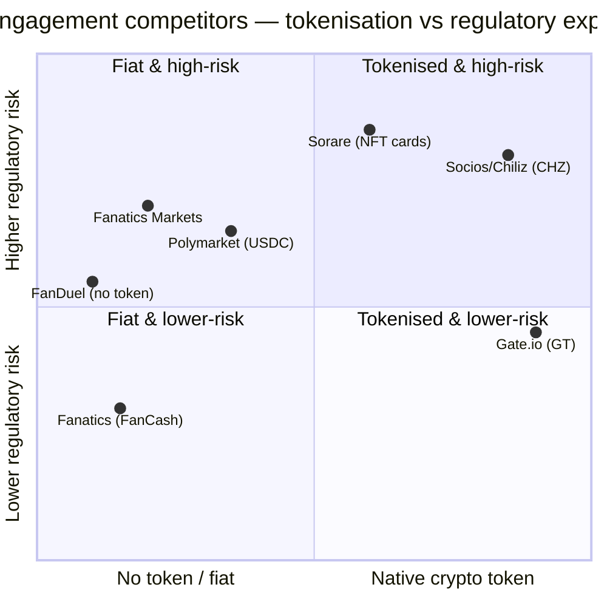

# 00 — Fan-Engagement Competitor Teardown

> Consolidated synthesis of the C13 web3/fan-engagement research library at
> `research/competitors/{sorare,socios-chiliz,polymarket,fanduel,fanatics,gate-io}/`.
> Six reference players spanning **tokenised collectibles, fan tokens, prediction markets,
> sports betting, fandom super-platforms and crypto exchanges** — mapped to **business model,
> monetisation, mechanics and South African (SA) relevance**. Public information only; tags
> inherited from the underlying files; secondary/estimated figures flagged.

---

## 1. Origin & Founding Timeline

| Player | Founded | HQ | Founder(s) | Category | Native token? |
|---|---|---|---|---|---|
| **Sorare** | 2018 (game 2019) | Paris | Nicolas Julia, Adrien Montfort | Licensed **fantasy + NFT player cards** | **No** (NFT cards only) |
| **Socios.com / Chiliz** | 2018 (Socios.com 18 Jun 2018) | Malta/Switzerland (group) | Alexandre Dreyfus | **Fan Tokens** + Chiliz Chain | **Yes — CHZ** + club Fan Tokens |
| **Polymarket** | 2020 | New York | Shayne Coplan | **Prediction markets** (USDC on Polygon) | **No** (USDC; token weighed) |
| **FanDuel** | 2009 | Edinburgh → US | Eccles ×2, Griffiths, Jones, Stafford | **US sportsbook + iGaming + DFS** | **No** |
| **Fanatics** | 1995 (GSI Commerce) | US (Jacksonville/NYC) | Michael Rubin | **Commerce + collectibles + betting + ads** | **No** (FanCash rewards) |
| **Gate.io / Gate** | Apr 2013 (as Bter.com) | George Town, Cayman Islands | Dr. Lin Han | **Crypto exchange** (multi-asset) | **Yes — GT** |

[OBS] (all cells sourced in §10).

---

## 2. Growth Journey (comparative)

- [OBS] **Sorare** peaked in the 2021 NFT boom at a **$4.3B valuation (SoftBank-led Series B)**, then
  retrenched — revenue fell **€59M (2023) → €43M (2024)**; a **Nov 2025 ~35% staff cut** and a
  **+$10M bridge (Sep 2026)** frame a return-to-profitability rebuild (H1 2026 net revenue **+85% YoY**)
  ([fr.wikipedia](https://fr.wikipedia.org/wiki/Sorare); [BlockchainGamer](https://www.blockchaingamer.biz/news/42931/sorare-raises-10-million-rebuilds-profitability/)).
- [OBS] **Socios/Chiliz** built the **largest club-partnership book (70–80+ orgs)** and claims
  **>$700M generated for sport since 2018**, but its club Fan Tokens collapsed in price (e.g. **$BAR
  down ~99%** from ATH) ([Socios](https://www.socios.com/socios-securitize-partner-tokenized-sports-equity-offerings/); [Bitbase](https://www.bitbase.com/blog/what-fan-tokens-actually-vote-on)).
- [OBS] **Polymarket** scaled from ~$73M volume (2023) to **~$9B (2024)** and **~$21.5B (2025)**,
  reaching **~$1B annualised revenue (Jun 2026)** and valuations of **~$15B → ~$21B**, anchored by
  **ICE (NYSE parent)** ([Sacra](https://sacra.com/c/polymarket/)).
- [OBS] **FanDuel** became the **#1 US sportsbook** (~39–44% GGR share) and **#1 iGaming** (~27–28%),
  with ~**70% of US market EBITDA**, after the 2018 PASPA repeal and its merger into Paddy Power
  Betfair US (now Flutter) ([Flutter Q2 2026](https://flutter.com/media/k2lju3sf/q2-factsheet-2026.pdf); [Flutter FY25](https://flutter.com/media/hdshhrmb/q4-2025-earnings-release.pdf)).
- [OBS] **Fanatics** rolled up licensed retail into a **$8.1B (2024) → ~$13B (2025 est.)** platform,
  valued **$31B (Dec 2022)** and marked **~$33.5B (Nov 2025)** ([Sacra](https://sacra.com/c/fanatics/)).
- [OBS] **Gate.io** grew to **>58M users (Q2 2026)** as a **bootstrapped, fee-funded** exchange with
  **top-3 global spot volume** ([Gate Q2 2026](https://www.gate.ac/pt-br/blog/gate-releases-q2-2026-report-user-base-surpasses-58-million-as-spot-trading-volume-ranks-top-3-globally)).

---

## 3. Business Model & Monetisation

| Player | Core model | Monetisation | Tag |
|---|---|---|---|
| **Sorare** | Licensed digital collectibles + fantasy game | **Primary card issuance** + **5% secondary commission** + freemium/Arcade packs | [OBS] |
| **Socios/Chiliz** | Two-sided IP marketplace (clubs ↔ fans) | **% of Fan Token Offering (FTO) proceeds** + **transaction commissions**; revenue shared with clubs; **10% of revenue → CHZ buybacks** | [OBS] |
| **Polymarket** | **Non-custodial** event-contract marketplace | Pivoted in 2026 to **taker fees** (crypto 0.07, sports 0.03, etc.; makers $0 + rebates) + **data monetisation via ICE** | [OBS]/[EST] |
| **FanDuel** | Regulated sportsbook + iGaming + DFS | House **edge (vig)** + **5–15% DFS commission** + iGaming; cross-sell flywheel | [OBS] |
| **Fanatics** | Vertically integrated fan super-platform | Commerce (~54%), **Collectibles (highest margin >20% EBITDA)**, betting/gaming, **advertising**; **FanCash loyalty** | [OBS] |
| **Gate.io** | Global multi-asset exchange | **Trading fees** (spot 0.1%; futures 0.02/0.05%) + withdrawals + TradFi/token burns | [OBS] |

- [OBS] **Sorare** pays the licence cost (e.g., a reported **~$140M four-year Premier League deal**)
  as its dominant variable cost — a marketplace take-rate model (issuance + 5%) with **no inventory risk**
  ([grokipedia](https://grokipedia.com/page/Sorare)).
- [OBS] **Polymarket** revenue is **flow-based (taker fees)** and **capital-light** (no house positions)
  — a fundamentally different economics from FanDuel's vig ([Sacra](https://sacra.com/c/polymarket/)).
- [OBS] **Fanatics'** economics hinge on **exclusive long-term league licensing (15–20 yrs)** with
  **equity-for-alignment** (leagues/players own ~**10%**) and **v-commerce** margins (40%+ gross vs
  15–20% traditional) ([Sacra](https://sacra.com/c/fanatics/)).

---

## 4. Products & Engagement Mechanics

- [OBS] **Sorare mechanics:** two-layer design (wallet-held NFT + fantasy game layer); **scarcity
  tiers** (Unique = 1, Super Rare ≤100, Rare ≤1000, Limited ≤5000, Common free); **daily auctions**
  (2–4 day windows, demand spiking at close); bought-with-credit cards **locked 14 days** before
  resale ([Sorare help](https://sorare.com/pt/help/a/4406429217053/understanding-sorare-cards-pro-set-and-scarcity-levels); [Ludo9](https://www.ludo9.com/sorare/cartes-sorare/vendre-cartes-sorare/prix-de-vente-cartes-sorare/)).
- [OBS] **Socios mechanics:** buy **CHZ → swap for club Fan Token → vote in polls + VIP rewards**;
  Fan Tokens are ERC-20-style with club/platform **multisig mint control**
  ([IronWallet](https://ironwallet.io/coins/chiliz/); [Fujitac](https://www.fujitac.com/flash/4b3987c8144cd992.html)).
  - [OBS] **Reality check:** fans mostly vote on **low-stakes decisions** (kit, songs) — the token's
    attraction is **speculation + VIP access**, not governance ([Bitbase](https://www.bitbase.com/blog/what-fan-tokens-actually-vote-on)).
- [OBS] **Polymarket mechanics:** binary outcome tokens ($0–$1); **60-second wallet-less signup**
  (MoonPay/Stripe + social-login hot wallets); **meta-transactions remove gas**; **maker incentives**;
  user-to-user matching (**never against the house**) ([Sacra](https://sacra.com/c/polymarket/)).
- [OBS] **FanDuel mechanics:** **odds/pricing superiority** + **single-account cross-sell**
  (sportsbook → casino → DFS → prediction markets via FanDuel Predicts/CME), loyalty over bonus-chasing
  ([Flutter factsheet](https://flutter.com/media/k2lju3sf/q2-factsheet-2026.pdf)).
- [OBS] **Fanatics mechanics:** **Fanatics ONE loyalty** — **5% FanCash** back in-app, **up to 10%** on
  sportsbook bets, redeemable for apparel/collectibles/tickets/experiences; **branded credit card**
  (announced Jan 2026); live "card breaks" and marketplaces ([Sacra](https://sacra.com/c/fanatics/); [Tech-Insider](https://tech-insider.org/sports-betting/platforms/fanatics-sportsbook-review/)).
- [OBS] **Gate mechanics:** spot/futures (up to **100x** leverage), **zero-fee US stocks/ETFs (gStocks)**,
  copy trading, **Proof of Reserves via zk-SNARK + Merkle trees** (reserve ratio **127%, $8.215B, Aug 2026**)
  ([Gate July 2026](https://www.gate.com/announcements/article/101129); [Gate PoR](https://www.gateioservicefront.com/blog/gate-releases-latest-proof-of-reserves-report-total-reserve-ratio-reaches-127-total-reserves-exceed-8.215-billion)).

---

## 5. Tokenomics & Rewards Currency

| Player | Token model | Key mechanics |
|---|---|---|
| **Sorare** | **No fungible token** | Fixed per-season NFT supply; demand/speculation-driven value |
| **Chiliz** | **CHZ** — initial supply **8,888,888,888** (2018); now **inflationary** (~10.5B circulating, Oct 2026) | **10% of revenue → buybacks/burns**; inflation split 65% validators / 25% ecosystem / 10% Community Vault |
| **Fan Tokens ($BAR etc.)** | Club tokens, €2 initial (40M BAR) | **~99% price decay** from ATH; stabilised via Central Bank/collateral fund |
| **Polymarket** | **No native token** (USDC denom.) | Deliberately avoided token to preserve CFTC clearance; weighing one + IPO |
| **FanDuel** | **No token** | Promotional credits / bonus bets / loyalty only |
| **Fanatics** | **No token** | **FanCash** — closed-loop, non-transferable rewards currency |
| **Gate** | **GT** — original supply **300M**, **~60.88% burned** (182.6M by Oct 2025) | **Quarterly burns funded from revenue** (~191.9M burned by Q3 2026, >$1.5B value) |

[OBS] (all cells sourced in §10; Chiliz fixed-cap claim is **contradicted** by the whitepaper's
inflationary model → treat as [UNVERIFIED]).

- [INF] **Two viable "reward currency" archetypes:** a **closed-loop, non-tradeable** currency
  (Fanatics FanCash) or a **revenue-funded, deflationary** token (Chiliz buyback, Gate GT burns) —
  both safer/more defensible than emission-funded speculative tokens.

---

## 6. Regulation & SA Relevance

- [OBS] **Sorare:** UK Gambling Commission charged it with **three counts of unlicensed gambling**
  (Sept 2024; not-guilty pleas; trial listed 2027); the **NCA froze ~£10.02M (~$13.5M)** of a
  **Premier League** sponsorship instalment (Aug/Sep 2026) — the regulator's **first action against a
  blockchain platform** ([Fortune](https://fortune.com/2026/09/01/crypto-fantasy-platform-premier-league-13-million-uk-criminal-probe/)).
- [OBS] **Socios/Chiliz:** UK **ASA ruled Arsenal's Socios ads "misleading/irresponsible"** (upheld
  on review, Aug 2022); **SEC scrutiny** of CHZ as a potential unregistered security; **MiCA** —
  Socios Europe Services became the **first sports-focused MiCA-authorised platform**
  ([ASA](https://www.asa.org.uk/rulings/arsenal-football-club-plc-a21-1121873-arsenal-football-club-plc-1.html); [Socios MiCA](https://www.socios.com/the-chiliz-group-celebrates-dual-mica-milestone-european-licence-for-socios-europe-services-and-mica-compliant-chz-white-paper/)).
- [OBS] **Polymarket:** CFTC **$1.4M settlement + US block (2022)**; FBI raid (Nov 2024); probe
  **closed without charges (Jul 2025)**; returned via **QCX** with CFTC designations; **~20 US states**
  moved to shut it down as unlicensed gambling in 2026 ([Britannica](https://www.britannica.com/money/Polymarket); [Crypto.news](https://crypto.news/polymarket-hit-1-billion-in-revenue-and-now-20-states-want-to-shut-it-down/)).
- [OBS] **FanDuel:** state-by-state licences; **Nevada warned** operators that prediction-market
  offerings could **jeopardise gambling licences** ([Sacra](https://sacra.com/c/polymarket/)).
- [OBS] **Fanatics:** sportsbook in **24 states** (licensed), casino in MI/NJ/PA/WV, **Fanatics
  Markets** via Crypto.com Derivatives NA / Paragon Global Markets (CFTC-registered)
  ([Sacra](https://sacra.com/c/fanatics/)).
- [OBS] **Gate.io:** multi-jurisdiction licences (**9** per one source) incl. **Malta (MiCA), Dubai
  (VARA), Japan (FSA)**; **Gate US** holds **36 state MTLs** ([Gate licences](https://www.gate.com/learn/articles/gatecom-licenses-global-regulatory-guide)).

**South Africa applicability [INF]:**
- **NGA 2004 (s.11)** prohibits unlicensed gambling; **online casino-style games are illegal**; only
  **provincially licensed online sports/horse betting** is legal — so **cash-entry-with-prize fantasy**
  and casino-style products are off-limits without a provincial licence
  ([BestBitcoinCasino](https://www.bestbitcoincasino.com/crypto-casinos-south-africa/)).
- **Prediction markets sit in a legal gap in SA** — ENSafrica places them between crypto,
  exchange-control and gambling law; **not clearly legal or illegal** ([NextPredict](https://nextpredict.io/legal/africa/)).
- **Crypto/fan tokens:** SA treats crypto assets as **financial products** (FSCA/FAIS since Oct 2022)
  and **exchanges must register as CASPs** with FSCA + comply with **FICA** (since 19 Dec 2022)
  ([CMS](https://cms.law/en/int/expert-guides/cms-expert-guide-to-crypto-regulation/south-africa);
  [BitcoinChaser](https://bitcoinchaser.com/country/south-africa/)).
- **Net read-across:** a SA NeoBank should **avoid cash-entry-for-prize** structures, **not market
  crypto-linked collectibles as investments**, and use **access/rewards (not speculability)** as the
  safe engagement mechanic. [INF]

---

## 7. Technology & Marketing

- [OBS] **Sorare** migrated **Ethereum L1 → StarkNet (StarkEx L2, gas-free)** to cut fees, abstracting
  wallets for users ([Bitbase](https://www.bitbase.com/blog/sorare-vs-fifa-collect); [CoinMarketCap Academy](https://coinmarketcap.com/academy/article/what-is-starkware-the-ultimate-guide-to-the-starkware-starknet-and-starkex-ecosystem)).
- [OBS] **Chiliz** runs a **purpose-built EVM-compatible sports chain (Chiliz Chain / Dragon 8)** with
  validators incl. OKX, Animoca, Ankr, SBI Holdings ([Chiliz whitepaper](https://www.chiliz.com/CHZ_whitepaper_v1.1.pdf)).
- [OBS] **Polymarket** = **Polygon + USDC + UMA oracle + meta-transactions + wallet-less onboarding**
  ([Sacra](https://sacra.com/c/polymarket/)).
- [OBS] **Gate** runs **GateChain + Gate Layer (L2)** and **zk-SNARK proof of reserves**
  ([Gate Jan 2026](https://bi.live/announcements/article/49713)).
- [OBS] **Marketing:** Sorare = **IP-licensing-as-marketing** (Premier League, FIFPRO, Mbappé); Polymarket
  = **embedded data distribution** (X, Google Finance, Yahoo, ICE) + **MLB/ATP deals** (MLB worth up to
  **$300M**); FanDuel = **pricing superiority + loyalty + media**; Fanatics = **IP-anchored events**
  (Fanatics Fest, 200k attendees) + up to **$1B betting ads**; Gate = **transparency-as-marketing**
  (proof-of-reserves, user metrics) ([Fortune](https://fortune.com/2026/09/01/crypto-fantasy-platform-premier-league-13-million-uk-criminal-probe/); [Sacra](https://sacra.com/c/polymarket/); [Bookmakers Review](https://www.bookmakersreview.com/industry/fanatics-to-drop-1-billion-on-betting-ads/)).

---

## 8. Lessons & Transferable Mechanics for a SA NeoBank

1. **Prefer closed-loop rewards over speculative tokens.** **Fanatics FanCash** (non-transferable,
   redeemable for real goods) and **FanDuel's no-token loyalty** are the **regulator-safe** templates;
   **Sorare's and Chiliz's** regulatory collisions are the cautionary evidence. [INF]
2. **If a token is used, tie value to real revenue.** **Chiliz (10% of revenue → buybacks)** and
   **Gate (revenue-funded GT burns)** are the most defensible tokenomics; emission-funded tokens
   collapsed. [INF]
3. **Invisible crypto is table-stakes.** Polymarket's **wallet-less signup + gasless meta-transactions**
   is the single most transferable UX lesson — mainstream users will not manage seed phrases. [INF]
4. **Scarcity tiers + auctions are proven engagement loops.** Sorare's **bronze→unique** tiers and
   last-minute auctions map cleanly to **loyalty tiers + timed drops** for a NeoBank. [INF]
5. **Membership/access beats investability.** Fan Tokens' **~99% decay** shows tokens sold as
   investments fail; **VIP access/rewards** is the durable hook. [INF]
6. **Distribution > advertising.** Polymarket's **embedded data** (X/Google/Yahoo) and league deals
   show a NeoBank can grow by **embedding in partner apps** rather than buying ads. [INF]
7. **Commerce + collectibles + credit = the full fan stack.** Fanatics' **branded credit card integrated
   with FanCash** is the single most transferable element for a NeoBank loyalty/payments programme. [INF]
8. **SA-legal design constraints are binding.** No cash-entry-for-prize, no online casino, no unlicensed
   prediction markets; crypto touching consumers requires **FSCA CASP + FICA** compliance. [INF]

---

## 9. Positioning Map (Mermaid)

---

## 10. Sources

**Sorare**
- [Sorare — Wikipedia (FR)](https://fr.wikipedia.org/wiki/Sorare) · [Bitbase — Sorare vs FIFA Collect](https://www.bitbase.com/blog/sorare-vs-fifa-collect) · [Fortune — UK criminal probe](https://fortune.com/2026/09/01/crypto-fantasy-platform-premier-league-13-million-uk-criminal-probe/) · [BlockchainGamer — rebuild to profitability](https://www.blockchaingamer.biz/news/42931/sorare-raises-10-million-rebuilds-profitability/) · [Grokipedia — Sorare](https://grokipedia.com/page/Sorare) · [DealMatrix — $680M Series B](https://dealmatrix.com/deals/fantasy-football-platform-sorare-raises-680-million/) · [Sorare help — scarcity levels](https://sorare.com/pt/help/a/4406429217053/understanding-sorare-cards-pro-set-and-scarcity-levels) · [Ludo9 — 5% fee](https://www.ludo9.com/sorare/cartes-sorare/vendre-cartes-sorare/prix-de-vente-cartes-sorare/) · [CoinMarketCap Academy — StarkWare](https://coinmarketcap.com/academy/article/what-is-starkware-the-ultimate-guide-to-the-starkware-starknet-and-starkex-ecosystem)

**Socios.com / Chiliz**
- [Chiliz White Paper v1.1](https://www.chiliz.com/CHZ_whitepaper_v1.1.pdf) · [Chiliz/Binance proposal](https://www.chiliz.com/docs/CHZ_binance_proposal.pdf) · [Blockworks — token transparency](https://blockworks.com/token-transparency/filing/chiliz) · [Socios — Securitize / 70+ orgs](https://www.socios.com/socios-securitize-partner-tokenized-sports-equity-offerings/) · [Socios — MiCA milestone](https://www.socios.com/the-chiliz-group-celebrates-dual-mica-milestone-european-licence-for-socios-europe-services-and-mica-compliant-chz-white-paper/) · [FC Barcelona — Chiliz alliance](https://www.fcbarcelona.com/en/news/1608032/barca-and-blockchain-platform-chiliz-join-forces-for-new-global-alliance-to-increase-interaction-with-fans) · [Bitbase — what Fan Tokens vote on](https://www.bitbase.com/blog/what-fan-tokens-actually-vote-on) · [CoinMarketCap — FC Barcelona Fan Token](https://coinmarketcap.com/currencies/fc-barcelona-fan-token/) · [ASA — Arsenal ruling](https://www.asa.org.uk/rulings/arsenal-football-club-plc-a21-1121873-arsenal-football-club-plc-1.html) · [Springer — gambling-like features](https://link.springer.com/content/pdf/10.1007/s10899-023-10215-0.pdf)

**Polymarket**
- [Sacra — Polymarket](https://sacra.com/c/polymarket/) · [Britannica Money — Polymarket](https://www.britannica.com/money/Polymarket) · [MarketsWiki — Polymarket US](https://www.marketswiki.com/wiki/Polymarket_US) · [RevenueMemo — who owns Polymarket](https://www.revenuememo.com/p/who-owns-polymarket) · [Crypto.news — $1B revenue / states](https://crypto.news/polymarket-hit-1-billion-in-revenue-and-now-20-states-want-to-shut-it-down/) · [AInvest — $8B valuation](https://www.ainvest.com/news/polymarket-8-billion-valuation-number-2610/) · [Entrepreneurs Insights — valuation 2026](https://entrepreneursinsights.net/polymarket-valuation-2026/) · [PANews — Polymarket six years](https://www.panewslab.com/zh-hant/articles/019ed88f-da6b-736e-bf06-dfbda97f5965)

**FanDuel**
- [Flutter — FY2025 results](https://flutter.com/media/hdshhrmb/q4-2025-earnings-release.pdf) · [Flutter — Q1 2026 results](https://flutter.com/media/ek1iky22/flutter-q1-2026-earnings-release.pdf) · [Flutter — Q2 2026 factsheet](https://flutter.com/media/k2lju3sf/q2-factsheet-2026.pdf) · [Grokipedia — FanDuel Sportsbook](https://grokipedia.com/page/FanDuel_Sportsbook) · [RevenueMemo — who owns FanDuel](https://www.revenuememo.com/p/who-owns-fanduel) · [SportBotAI — market share](https://www.sportbotai.com/stats/sportsbook-market-share) · [SCCG — prediction markets vs sportsbooks](https://sccgmanagement.com/sccg-articles/2026/02/13/three-structural-scenarios-for-the-future-of-u-s-prediction-markets-and-sportsbooks/) · [Flutter — $50B playbook](https://flutter.com/news-media/blogs/huddle-up-recap-inside-fanduel-s-50-billion-playbook/) · [Flutter — FanDuel leadership transition](https://flutter.com/news-media/press-releases/flutter-announces-leadership-transition-at-fanduel/)

**Fanatics**
- [Sacra — Fanatics](https://sacra.com/c/fanatics/) · [Fanatics — Michael Rubin](https://www.fanaticsinc.com/michael-rubin/) · [Fanatics — Our History](https://www.fanaticsinc.com/our-history) · [CardCapsule — Topps acquisition](https://cardcapsule.com/blogs/blog/fanatics-acquisition-of-topps) · [Tech-Insider — Fanatics Sportsbook](https://tech-insider.org/sports-betting/platforms/fanatics-sportsbook-review/) · [Bookmakers Review — $1B betting ads](https://www.bookmakersreview.com/industry/fanatics-to-drop-1-billion-on-betting-ads/) · [TraderHQ — Fanatics rounds](https://traderhq.com/how-to-buy-fanatics-stock/) · [MEXC — Fanatics IPO 2026](https://blog.mexc.com/finance/fanatics-ipo-2026-valuation-draftkings-how-to-invest/)

**Gate.io / Gate**
- [CoinMarketCap — Gate exchange](https://coinmarketcap.com/exchanges/gate/) · [Wikipedia (PT) — Gate.io](https://pt.m.wikipedia.org/wiki/Gate.io) · [Gate — Licenses & global regulatory guide](https://www.gate.com/learn/articles/gatecom-licenses-global-regulatory-guide) · [Gate — Q2 2026 report](https://www.gate.ac/pt-br/blog/gate-releases-q2-2026-report-user-base-surpasses-58-million-as-spot-trading-volume-ranks-top-3-globally) · [Gate — GT Q3 2026 burn](https://www.gate.com/blog/gatetoken-gt-burns-nearly-2-million-tokens-in-q3-2026-further-strengthening-its-long-term-value-foundation) · [Gate — fees explained](https://www.gate.com/learn/articles/gatecom-fees-explained) · [Gate — July 2026 report](https://www.gate.com/announcements/article/101129) · [Gate — proof of reserves](https://www.gateioservicefront.com/blog/gate-releases-latest-proof-of-reserves-report-total-reserve-ratio-reaches-127-total-reserves-exceed-8.215-billion)

**SA regulation**
- [NextPredict — prediction markets in Africa](https://nextpredict.io/legal/africa/) · [Best Bitcoin Casino — SA gambling law](https://www.bestbitcoincasino.com/crypto-casinos-south-africa/) · [CMS — crypto regulation South Africa](https://cms.law/en/int/expert-guides/cms-expert-guide-to-crypto-regulation/south-africa) · [BitcoinChaser — South Africa crypto/CASP](https://bitcoinchaser.com/country/south-africa/)
