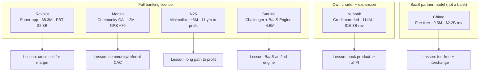

# 00 — Global Neobank Models (Revolut · Monzo · Nubank · Chime · N26 · Starling)

> Consolidated synthesis of `research/banks/00-GLOBAL-DIGITAL-BANK-PEERS.md` (Council C10).
> Six leading digital banks / neobanks, distilled into **model, customers, funding and lessons**
> for the South African NeoBank launch programme. Public information only. Figures are cited and
> tagged; mixed fiscal years are noted. Sources inherited from the underlying reference file.

---

## 1. Origin & Founding Timeline

| Neobank | Founded | HQ | Founder(s) | Licence route | Listed / status |
|---|---|---|---|---|---|
| **Revolut** | 2015 | London | Nikolay Storonsky & Vlad Yatsenko | UK banking licence (**PRA, 11 Mar 2026**); EU licence for IBANs | Private (secondary-market valuation) |
| **Monzo** | Feb 2015 (as "Mondo") | London | Tom Blomfield, Jonas Huckestein, Jason Bates, Paul Rippon, Gary Dolman | **Full UK banking licence** | Private |
| **Nubank (Nu Holdings)** | 2013 | São Paulo | David Vélez, Cristina Junqueira, Edward Wible | Regulated FI in Brazil (2016); **MX bank licence (Apr 2025)**; **US national charter applied (Sep 2025)** | **NYSE: NU** (IPO Dec 2021, ~$45B) |
| **Chime** | 2012 | San Francisco | Chris Britt & Ryan King (widely reported [UNK]) | **Not a bank** — BaaS via **The Bancorp** & **Stride Bank** | **Nasdaq: CHYM** (IPO 12 Jun 2025, ~$11.6B) |
| **N26** | 2013 | Berlin | Valentin Stalf & Maximilian Tayenthal | **Full German banking licence** since Jul 2016 (BaFin) | Private |
| **Starling Bank** | 2014 | London | Anne Boden | **Full UK banking licence** since Jul 2016 | Private |

[OBS] (all cells sourced in §10).

---

## 2. Growth Journey (comparative)

- [OBS] **Nubank** is the clear **scale leader** among pure neobanks: revenue grew to **$16.3B
  (FY2025, +45%)** from $11.5B (FY2024), with **114M+ customers** and net income **$1.9B (+91.8%)**
  in FY2024 ([Business of Apps](https://www.businessofapps.com/data/nubank-statistics/); [Nu 4Q25](https://international.nubank.com.br/pt-br/companhia/nu-holdings-ltd-divulga-resultados-financeiros-do-quarto-trimestre-e-do-ano-de-2025/)).
- [OBS] **Revolut** is the **growth/profitability standout**: FY2024 revenue **$4.0B (£3.1B, +72%)**;
  FY2025 revenue **$6.0B (£4.5B, +46%)**, **profit before tax $2.3B (£1.7B, PBT margin 38%)**, net
  profit £1.3B, **68.3M customers** ([Revolut 2025 results](https://www.revolut.com/news/revolut_reports_record_profit_of_2_3bn_for_2025_as_revenue_surges_to_6bn/)).
- [OBS] **Monzo** reached profitability at scale: FY2025 revenue **£1.2B (+48%)**, **adjusted PBT
  £113.9m (8×)**, **12M+ customers**, **£16.6bn deposits**, **NPS +70**
  ([Monzo Annual Report 2025](https://monzo.com/annual-report/2025)).
- [OBS] **Chime** IPO'd at **$27.00/share, raising $864M, ~$11.6B valuation**, then reported FY2025
  revenue **$2.2B (+31%)**, **9.5M active members**, **$127M adjusted EBITDA**
  ([Sacra](https://sacra.com/c/chime/); [Chime FY2025](https://chime.gcs-web.com/news-releases/news-release-details/chime-reports-fourth-quarter-and-full-year-2025-financial)).
- [OBS] **N26** completed an 11-year path to its **first full-year net profit (€1.6M)** on 2025
  revenue **>$500M**, after **€1.025B cumulative losses (2015–2024)**
  ([TabInsights](https://riskandregulation.tabinsights.com/article/-n26-s-first-full-year-profit-ends-its-11-year-start-up-phase)).
- [OBS] **Starling** is the **disciplined, profitable challenger**: FY2025 (to Mar 2025) revenue
  **£714M (+4.7%)**, underlying **PBT £280.6M (−7%)**, **4.6M accounts**, **£12.1bn deposits**
  ([Starling AR 2025](https://www.starlingbank.com/docs/annual-reports/Starling-Bank-Annual-Report-2025.pdf)).

---

## 3. Product / Model Evolution

- [OBS] **Revolut** → **super-app**: multi-currency accounts (30+ currencies), card, FX, crypto,
  stocks, insurance; full EU banking licence with IBAN ([freenance](https://freenance.io/rankings/best-neobanks-2026/)).
- [OBS] **Monzo** → personal current accounts, savings pots, overdrafts, loans, business banking;
  FSCS-protected ([Money To The Masses](https://moneytothemasses.com/banking/revolut-vs-monzo-which-is-best)).
- [OBS] **Nubank** → no-fee **credit card** (initial hook), then accounts, lending, investing,
  insurance; data/ML-driven, branchless ([Nu About](https://international.nubank.com.br/about)).
- [OBS] **Chime** → fee-free checking, **spot-me overdraft**, credit builder, high-yield savings;
  revenue = **interchange + platform (OIT)** ([Chime disclosures](https://www.chime.com/disclosures/)).
- [OBS] **N26** → minimalist mobile account, cards, savings across **24 European markets**; premium
  tiering (Standard €0 plan) ([N26](https://www.number26.eu/en-fr); [freenance](https://freenance.io/fintech/neobanks-europe-comparison-2026/)).
- [OBS] **Starling** → personal/business current accounts, lending, **plus "Engine by Starling"
  BaaS SaaS** licensed to **Salt Bank (Romania), AMP Bank (Australia), Cora Bank (Canada)**
  ([Starling news](https://www.starlingbank.com/news/starling-reports-strong-revenue-and-invests-for-growth/)).

**Archetypes:** *super-app* (Revolut) · *community current-account* (Monzo) · *credit-card-led
financial inclusion* (Nubank) · *fee-free BaaS front-end* (Chime) · *minimalist mobile bank* (N26)
· *profitable challenger + B2B BaaS* (Starling). [INF]

---

## 4. Business Model & Economics

| Bank | Latest revenue | Profitability | Primary revenue engines | Licence model |
|---|---|---|---|---|
| Revolut | $6.0B (FY25) | PBT $2.3B (38% margin) | FX, subscriptions, crypto/stocks, interchange | UK/EU banking licence (2026) |
| Monzo | £1.2B (FY25) | adj. PBT £113.9m | interchange, lending, subscriptions | Full UK licence |
| Nubank | $16.3B (FY25) | net income $1.9B (FY24) | credit/lending (card), interchange, fees | Bank (BR); licences MX/US |
| Chime | $2.2B (FY25) | $127M adj. EBITDA | interchange + platform (OIT) | Not a bank (BaaS) |
| N26 | ~$567M (FY25) | first net profit €1.6M | interchange, subscriptions, lending | German licence |
| Starling | £714M (FY25) | PBT £280.6M | lending (incl. govt-backed), BaaS (Engine) | Full UK licence |

[OBS] (all cells sourced in §10; "Latest revenue" mixes fiscal years).

**Key economics reads:**
- [OBS] **Revolut's** 38% PBT margin and 68.3M customers show **super-app cross-sell** can be
  extraordinarily profitable at scale ([Revolut 2025 results](https://www.revolut.com/news/revolut_reports_record_profit_of_2_3bn_for_2025_as_revenue_surges_to_6bn/)).
- [OBS] **N26's** €1.025B cumulative losses to first profit is the **long-path-to-profitability
  warning** for licence-led models ([TabInsights](https://riskandregulation.tabinsights.com/article/-n26-s-first-full-year-profit-ends-its-11-year-start-up-phase)).
- [OBS] **Starling's** **Engine BaaS** is a **second revenue engine** — licensing the core stack to
  other banks ([Starling news](https://www.starlingbank.com/news/starling-reports-strong-revenue-and-invests-for-growth/)).
- [OBS] **Chime/Nubank** show **two US/LatAm structures: BaaS partner model vs. own charter** —
  and Nubank is now pursuing a **US national bank charter**.

---

## 5. Customers & Scale

| Bank | Customers / members | Deposits / AUM proxy | FY |
|---|---|---|---|
| Nubank | **114M+** | — | FY25 |
| Revolut | **68.3M** | — | FY25 |
| Monzo | **12M+** | **£16.6bn deposits** | FY25 |
| Chime | **9.5M active** | — | FY25 |
| N26 | **~8M+** | — | 2025 |
| Starling | **4.6M accounts** | **£12.1bn deposits** | FY25 |

[OBS] (all cells sourced in §10). [OBS] **Monzo NPS +70** is a notable satisfaction benchmark
([Monzo AR 2025](https://monzo.com/annual-report/2025)).

---

## 6. Technology / Blockchain

- [OBS] **Cloud-native, mobile-first cores** are universal; **Starling's Engine** is the clearest
  **BaaS/SaaS** productisation of a neobank core (licensed to Salt, AMP, Cora)
  ([Starling news](https://www.starlingbank.com/news/starling-reports-strong-revenue-and-invests-for-growth/)).
- [OBS] **Revolut** runs a **cloud-native super-app** hosting multiple product lines (multi-currency,
  crypto, equities) ([freenance](https://freenance.io/rankings/best-neobanks-2026/)).
- [OBS] **Nubank** is **data/ML-driven and branchless** ([Nu About](https://international.nubank.com.br/about)).
- [OBS] **Chime** is mobile-first with a revenue model rooted in **interchange + platform (OIT)**
  ([Chime disclosures](https://www.chime.com/disclosures/)).
- [INF] None of the six is primarily a **blockchain** company; where crypto appears (Revolut,
  Nubank, N26) it is a **product line**, not the core ledger — a key contrast with the pure-web3
  fan-engagement competitors.
- [UNK] Specific core-banking vendors are largely undisclosed.

---

## 7. Marketing & Partnerships

- [OBS] **Referral/community-led growth:** Revolut grew via **customer referrals**, no branches;
  Monzo **crowdfunded £1M in 96 seconds (2016)** and grew community-first
  ([freenance](https://freenance.io/rankings/best-neobanks-2026/); [Money To The Masses](https://moneytothemasses.com/banking/revolut-vs-monzo-which-is-best)).
- [OBS] **Brand-led, viral acquisition:** Nubank scaled on brand, with **Berkshire Hathaway
  investing ~$1B** ([Nu About](https://international.nubank.com.br/about)).
- [OBS] **Mass-market "fee-free" positioning:** Chime's core message
  ([Chime disclosures](https://www.chime.com/disclosures/)).
- [OBS] **Premium/everyday-banking positioning:** N26 with a free Standard tier and paid upgrades
  ([freenance](https://freenance.io/fintech/neobanks-europe-comparison-2026/)).
- [OBS] **Disciplined/profitable challenger positioning:** Starling, monetising trust and BaaS
  ([Starling news](https://www.starlingbank.com/news/starling-reports-strong-revenue-and-invests-for-growth/)).
- [UNK] Independent CAC figures are not disclosed by most.

---

## 8. Lessons & Transferable Mechanics for a SA NeoBank

1. **Licence choice is the defining strategic decision.** Starling/Monzo/N26 (full licence) vs **Chime
   (BaaS partner)** vs **Nubank (own charter + expansion)** — the SA NeoBank must choose between a
   **full SARB banking licence** and a **sponsor-bank/BaaS** launch, with clear trade-offs on speed
   vs economics. [INF]
2. **Fee-free + interchange is the day-one engine.** Chime/Nubank show **interchange + fee-free
   positioning** can build tens of millions of users; a SA NeoBank should lead with **honest,
   no-junk-fee pricing**. [INF]
3. **Super-app cross-sell drives margin, not just scale.** Revolut's **38% PBT margin** comes from
   stacking FX, subscriptions, crypto/equities; a NeoBank should pre-plan **adjacent revenue rails**
   rather than rely on a single product. [INF]
4. **Community/referral beats paid acquisition.** Monzo's 96-second crowdfund and Revolut's referral
   growth show **low-CAC community loops**; a SA NeoBank should design **referral + community**
   from launch. [INF]
5. **Profitability can take a decade on the licence path.** N26's **€1.025B cumulative losses** are a
   caution to sequence capital and product realistically. [INF]
6. **BaaS/Infra is a second business.** Starling's **Engine** licenses the core to other banks —
   a NeoBank could similarly productise its platform for partner banks/other African markets. [INF]
7. **Brand trust is the balance-sheet.** Nubank's Berkshire endorsement and Monzo's NPS +70 show
   **third-party validation and satisfaction** are marketing assets a NeoBank should engineer. [INF]

---

## 9. Model Map (Mermaid)

---

## 10. Sources

- [Revolut 2025 results](https://www.revolut.com/news/revolut_reports_record_profit_of_2_3bn_for_2025_as_revenue_surges_to_6bn/)
- [Revolut FY2024 Annual Report (PDF)](https://assets.revolut.com/pdf/annualreport2024.pdf)
- [European Business Magazine — Revolut UK banking licence](https://europeanbusinessmagazine.com/finance-revolut-uk-banking-licence-ipo-valuation-2026/)
- [binaryx — Revolut equity metrics](https://app.binaryx.com/equity/revolut)
- [freenance — best neobanks 2026](https://freenance.io/rankings/best-neobanks-2026/)
- [Monzo Annual Report 2025](https://monzo.com/annual-report/2025)
- [Grokipedia — Monzo](https://grokipedia.com/page/Monzo)
- [Money To The Masses — Revolut vs Monzo](https://moneytothemasses.com/banking/revolut-vs-monzo-which-is-best)
- [Litmus — Monzo business model](https://litmus.lapaas.com/learn/monzo-business-model)
- [Nubank — About Nu](https://international.nubank.com.br/about)
- [Nu Holdings 4Q/2025 results](https://international.nubank.com.br/pt-br/companhia/nu-holdings-ltd-divulga-resultados-financeiros-do-quarto-trimestre-e-do-ano-de-2025/)
- [Business of Apps — Nubank statistics](https://www.businessofapps.com/data/nubank-statistics/)
- [Nu Mexico receives authorization to operate as a bank](https://international.nubank.com.br/company/nu-mexico-receives-authorization-to-begin-operations-as-a-bank/)
- [PYMNTS — Nubank US/BR licensing](https://www.pymnts.com/dashboard-post/bank-regulation/2025/nubank-seeks-banking-license-brazil-comply-with-new-rule-branding/)
- [Chime 4Q/FY2025 results](https://chime.gcs-web.com/news-releases/news-release-details/chime-reports-fourth-quarter-and-full-year-2025-financial)
- [Chime IPO prospectus (SEC)](http://pdf.secdatabase.com/234/0001628280-25-030855.pdf)
- [Chime disclosures](https://www.chime.com/disclosures/)
- [Sacra — Chime](https://sacra.com/c/chime/)
- [TabInsights — N26 first full-year profit](https://riskandregulation.tabinsights.com/article/-n26-s-first-full-year-profit-ends-its-11-year-start-up-phase)
- [Sacra — N26](https://sacra.com/c/n26/)
- [N26 — full German banking licence](https://www.number26.eu/en-fr)
- [freenance — neobanks Europe comparison 2026](https://freenance.io/fintech/neobanks-europe-comparison-2026/)
- [Litmus — N26 business model](https://litmus.lapaas.com/learn/n26-business-model)
- [Starling Annual Report 2025 (PDF)](https://www.starlingbank.com/docs/annual-reports/Starling-Bank-Annual-Report-2025.pdf)
- [Starling — strong revenue & growth (Engine BaaS)](https://www.starlingbank.com/news/starling-reports-strong-revenue-and-invests-for-growth/)
- [Barcoder — Starling](https://barcoder.luminiverse.hr/docs/wallets/starling)
