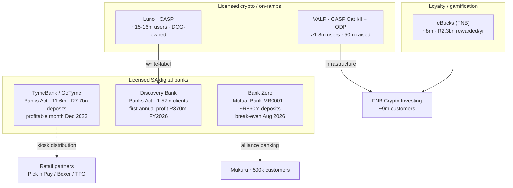

# SA NeoBank & Crypto/Loyalty Cohort — Consolidated Comparison

> Cross-entity synthesis of the six journey deliverables in this folder, plus the two landscape files
> (`research/neobanks-sa/00-SA-NEOBANK-LANDSCAPE.md`, `research/crypto-trading/00-ZA-CRYPTO-LANDSCAPE.md`).
> Public information only. Tags: `[OBS]` observed, `[INF]` inference, `[EST]` estimate, `[UNK]` unknown, `[UNVERIFIED]`.

## 1. Master comparison table

| Entity | Licence / regulatory status | Launch year | Customers | Deposits | Profitability | Funding / valuation | Tech model | Distribution |
|---|---|---|---|---|---|---|---|---|
| **TymeBank / GoTyme** | Commercial bank · Banks Act 94/1990 · CODI-eligible | **Feb 2019** (soft Nov 2018) | 11.6m SA (FY2025); ~21–22m group | **R7.7bn** (FY2025, +22%) | First profitable *month* **Dec 2023**; FY2025 loss before tax R226m (narrowing) | ~**US$500m+** raised; **US$1.5bn** valuation (Dec 2024); US$15bn IPO ambition [UNVERIFIED] | AWS cloud-native; **Mambu** core; BPC SmartVista issuing; Vietnam eng hub | ~1,000→1,450 retail **kiosks** (Pick n Pay/Boxer/TFG) → 2026 mall "Customer Hubs" |
| **Discovery Bank** | Commercial bank · Banks Act 94/1990 | **Mar 2019** | 1.57m clients / 3.77m accounts (FY2026) | [UNK] | First annual profit **R370m** (FY2026); monthly break-even FY2025 H1 | ~**R15bn** cumulative group investment [EST] | App + online; AI-driven; deep Vitality ecosystem integration; vendor stack [UNK] | Ecosystem cross-sell; digital-first, in-app advisors; no branches |
| **Bank Zero** | **Mutual bank** · Mutual Banks Act 124/1993 · **MB0001** | **2021** (reg. 2018) | not disclosed (built to profit at ~100k) | **~R860m** (2026) | First break-even *month* **Aug 2026** (4 yrs 10 mths) | Acquired for **R1.1bn** by Lesaka (Jun 2025, pending); no external equity prior | **IBM Z / LinuxONE** + Secure Service Container; Paymentology processing | App-only direct + **alliance banking** (Mukuru ~500k customers) |
| **Luno** | FSCA **CASP** (Apr 2024; first SA licensee) · FICA accountable institution | **2013** (as BitX) | ~**15–16m** global (2025) | n/a (exchange) | Not disclosed (private DCG subsidiary) — [UNK] | DCG-owned (2020); earlier Naspers/Prosus US$3m (2015) | ~95% multi-sig cold storage; BitGo+Fireblocks; ISO 27001; monthly **Merkle PoR**; Stitch rails | App (retail on-ramp) + **bank-embedded** via Discovery Bank (Dec 2025) |
| **VALR** | FSCA **CASP Cat I & II** (Apr 2024) + **ODP + FSP** (Oct 2025) · FICA | **2018** | >**1.8m**; >1,000 institutional | n/a (exchange) | Not disclosed (private) — [UNK] | ~**US$54.9m** raised; ~US$190m pre / ~US$240m post [OBS] | Institutional API + sub-accounts; **Sumsub** compliance; **Hacken** PoR (1:1) | Direct pro/retail + **bank-embedded** via FNB "Crypto Investing" (~9m customers, Oct 2026) |
| **eBucks** | Not a licensed product — loyalty programme T&Cs (under FNB/FirstRand) | **2000** | ~**8m** (87% active) | n/a (loyalty currency) | Cost centre / marketing programme (not separately reported) | n/a (FNB/FirstRand internal) | App-embedded; Smart Spend behavioural scoring; partner marketplace; Virtual Card gating | **FNB App** + partner stores (31 PnP kiosks, 200 pop-ups) |
| *Bettr (context)* | **No banking licence** (Access Bank sponsor) | never fully launched | pre-launch only | [UNK] | **Out of business** | private founders | Visa + Access Bank partner stack | sponsor-bank channel |

## 2. Structural contrasts

- **Two viable paths to a profitable bank:** (a) mass-market, low-cost, retail-distribution (TymeBank) and (b) premium, behaviour-linked, ecosystem-integrated (Discovery Bank). Bank Zero is a third: narrow, fee-free, member-owned. [INF]
- **Capital intensity spans ~two orders of magnitude:** TymeBank reached profitability relatively cheaply via kiosks (CAC ~US$3–4); Discovery required ~R15bn; Bank Zero reached break-even on a ~R860m deposit base. [OBS]/[EST]
- **Profitability order (fastest first):** TymeBank (Dec 2023 monthly) → Discovery Bank (FY2026 first annual) → Bank Zero (Aug 2026 break-even month). All took 3–7 years. [OBS]
- **Licence = capability:** TymeBank/Discovery hold Banks Act licences (R250m minimum capital, full deposit-taking + NPS access); Bank Zero uses the mutual-bank licence (R10m floor); Bettr's licence gap is cited as central to its failure. [OBS]
- **Crypto is being absorbed into banks, not replacing them:** both Discovery Bank (via Luno) and FNB (via VALR) now embed crypto through licensed exchanges rather than building it — a NeoBank's fastest route is a **CASP partnership/white-label**. [DER]
- **Trust signalling is table stakes for crypto:** monthly proof-of-reserves (Luno's Moore/Merkle; VALR's Hacken) plus named custodians/auditors — though PoR is an attestation, not a statutory audit. [DER]
- **Loyalty is a distribution weapon:** eBucks shows a co-funded partner marketplace inside the app is the engagement engine for a bank. [DER]

## 3. Corrigenda carried from research

- **[UNCORROBORATED]** The brief's "**VALR/Vitality**" pairing is not supported: the **Vitality Money** crypto-rewards integration is with **Luno/Discovery Bank**, and the **FNB** crypto integration is with **VALR**. Treat the two partnerships as distinct.
- Luno **licence numbers** conflict across secondary sources (FSP 51334 vs 53314) — verify against the FSCA register. [UNK]
- Fee values and limits change frequently; all values in the journey files are dated **2026-10-16**.

## 4. Comparison chart (Mermaid)

## 5. Consolidated Sources

- neobanks.guide — best neobank South Africa: https://neobanks.guide/best-neobank-south-africa/
- SA Neobank Landscape (internal): `research/neobanks-sa/00-SA-NEOBANK-LANDSCAPE.md`
- ZA Crypto Landscape (internal): `research/crypto-trading/00-ZA-CRYPTO-LANDSCAPE.md`
- Tyme Bank Limited AFS 2025 (PDF): https://www.tymebank.co.za/wp-content/uploads/2025/10/TymeBank-Limited-AFS-2025-Signed.pdf
- Discovery FY2026 annual results (PDF): https://www.discovery.co.za/assets/discoverycoza/corporate/investor-relations/2026/annual-results.pdf
- Wikipedia — Bank Zero: https://en.wikipedia.org/wiki/Bank_Zero
- Luno global press kit (PDF): https://d32exi8v9av3ux.cloudfront.net/static/docs/press_kit_global_v4.pdf
- VALR — US$50m Series B: https://blog.valr.com/blog/valr-com-raises-50-million-in-africas-largest-ever-crypto-raise
- MyBroadband — FNB eBucks update: https://mybroadband.co.za/news/banking/640996-fnb-ebucks-update.html
- Zitadelle — SA CASP licence guide: https://www.zitadelleag.com/services/vasp-licensing/south-africa-vasp
- SARB — Banking licences / CODI member banks: https://www.resbank.co.za/en/home/what-we-do/Deposit-insurance/member-banks0
