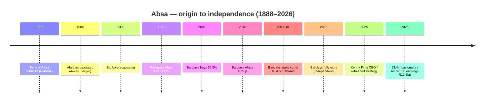

# Absa Group — Consolidated Journey (UnConsolidated)

> Self-contained synthesis of the Absa research set (`/workspace/research/banks/absa/`). Every figure is
> traceable to a source already cited in that research set. Tags: `[OBS]` observed/filing-stated,
> `[INF]` inference, `[DER]` derived, `[EST]` estimate, `[UNK]` unknown, `[UNVERIFIED]` single/low-authority.

## 1. Origin & founding story

Absa's lineage is a **federation of older banks** rather than a single founder. Its earliest traced ancestor
is the **Bank of Africa**, founded in Pretoria in **1888**, and the modern group was assembled in **1986**
through a four-way merger. `[OBS]`

| Year | Milestone | Tag |
|---|---|---|
| 1888 | Earliest lineage traced to the founding of the **Bank of Africa** in Pretoria | [OBS] |
| 1986 | **Amalgamated Banks of South Africa (Absa) Limited** incorporated via merger of UBS Holdings (United), Allied Bank, Volkskas Group and certain Sage Group interests | [OBS] |
| 1992 | Absa acquires 100% of the **Bankorp Group** (incl. TrustBank, Senbank, Bankfin) | [OBS] |
| 1997 | Holding company renamed **Absa Group Ltd** | [OBS] |
| 2005 | **Barclays PLC** acquires a **55.5%** stake in Absa | [OBS] |
| 2013 | Barclays' African businesses combined with Absa → **Barclays Africa Group Ltd** | [OBS] |
| 2017–2018 | Barclays reduces stake to ~16.4%; business rebrands as **Absa Group Ltd** (Africa rebrand completed 2020) | [OBS] |
| Aug 2022 | Barclays sells its remaining **7.4%** for ~US$620m — Absa becomes **fully independent** | [OBS] |
| Jun 2025 | **Kenny Fihla** appointed permanent Group CEO (effective 17 June 2025) | [OBS] |

> **Listing-year nuance:** sources conflict — some cite a JSE listing in **1986** (as Absa), others **1992**
> (FinanceCharts). Treated as `[UNVERIFIED]`; the 1986 incorporation is well corroborated. `[UNVERIFIED]`

## 2. The journey — how it grew

- **Phase 1 — Federation (1986–2004):** merger-led consolidation of domestic banking brands (Bankorp,
  TrustBank, Senbank, Bankfin) into a universal bank with corporate, retail and asset-finance arms. `[OBS]`
- **Phase 2 — Barclays era (2005–2017):** global-owner integration; African operations bundled into
  Barclays Africa Group (2013). `[OBS]`
- **Phase 3 — Independence & rebrand (2017–2022):** the "managed separation" sequence (stake reduced
  2017–2018, full exit Aug 2022) turned Absa into a **standalone pan-African group** with no controlling
  shareholder. `[OBS]`
- **Phase 4 — Re-strategising (2023–2026):** leadership churn (Rautenbach → interim Russon → **Fihla**),
  a refreshed 2025 strategy ("winning with customers, execution efficiency, digital-first relevance") and a
  pan-African growth push. `[OBS]`

## 3. Product evolution

| Era | Product build-out | Tag |
|---|---|---|
| 1986–2005 | Full-service universal banking: current accounts, home loans, vehicle & asset finance (Bankfin), business banking | [OBS] |
| 2003–2013 | Transactional accounts and card range; later the **Premium Banking** tier; **Absa Rewards** loyalty | [OBS] |
| 2019–2022 | **Absa Banking App** matures; **Abby** AI virtual assistant launched ~2022 (2m+ Absa-ID enrolments in year one) | [OBS] |
| 2023–2026 | Cashback-led proposition (up to R810/month), Islamic Vehicle Finance (Shari'ah Ijaarah), PayShap + Request-to-Pay on the app | [OBS] |

Current headline products: **Transact Account (R6.50/m)**; **Premium Banking Package (R240/m)**; everyday
bundle service fee **R105**; Gold/Premium credit cards at **zero extra fee** on Ultimate tiers; **Absa
Rewards** up to **30% cashback** (Woolworths, Pick n Pay, Checkers, Sasol, Shell); home loans up to 100%
finance; Islamic Vehicle Finance. `[OBS]`

## 4. Business model & economics

Absa's model is a classic **pan-African universal bank**: NII-dominant, supplemented by strong non-interest
income (fees, trading, insurance) and a large merchant-acquiring franchise (claimed
**largest merchant acquirer in Africa, 2024 Nilson Report**). `[OBS]`

| Metric | FY2025 (Dec) | FY2024 | Change | Tag |
|---|---|---|---|---|
| Total income | R115,697m | R109,949m | +5.2% | [OBS] |
| — Net interest income (NII) | R73,941m | R71,100m | +4% | [OBS] |
| — Non-interest income | R41,760m | R38,840m | +7% | [OBS] |
| Headline earnings | R24,800m | ~R22,059m | +12% | [OBS] |
| HEPS | 2,987c | — | +12% | [OBS] |
| ROE | 15.0% | 14.8% | +0.2pp | [OBS] |
| Cost-to-income ratio | 53.8% | 53.2% | worsened 0.6pp | [OBS] |
| DPS | 1,635c | — | +12% | [OBS] |
| Net interest margin | 4.53% | 4.63% | −10bps | [OBS] |
| CET1 ratio | 12.7% | 12.6% | +0.1pp | [OBS] |
| Total assets | R2,239bn | — | +8% | [OBS] |

- **1H2026:** headline earnings **R12.8bn (+8%)** — a record first half; revenue **R58.8bn (+4%)**; SA
  operations earnings **+17%**, Africa Regions **−10%**. `[OBS]`
- **Segmental FY25:** Personal & Private Banking **R7,535m (+7%)**; Business Banking **R3,865m (−8%)**;
  Africa Regions PPB & BB **+51%**. `[OBS]`
- `[DER]` Absa is the **cheapest of the Big Five on P/E (7.89)** vs Nedbank (15.53) and Capitec (30.91),
  despite similar/higher ROE than Nedbank — a "SA-bank / Africa-Regions execution" discount. `[DER]`

## 5. Customers & distribution

- **Active customers: 13.1m (FY2025)** → **13.4m (1H2026)**; **5.4m digitally active** (2024: 4.6m). `[OBS]`
- **Employees: 37,033** (SA 26,565; Africa Regions 10,258); staff costs R36,373m (**58% of opex**). `[OBS]`
- **Footprint:** 16 countries (17 incl. UAE rep. presence in 1H2026); banks in 10 African markets.
  Network: **1,035 outlets / 6,240 ATMs** (group; BusinessTech's narrower definition: 566 branches /
  5,016 ATMs). `[OBS]`
- **Channels:** Banking App (~11m downloads, self-rated 4.8/5; third-party store average ~4.1/5), Online
  Banking, USSD, IVR, **Absa Abby** (AI assistant on app/WhatsApp). `[OBS]`
- **Complaints:** Absa-specific complaints **fell 8%** in the tracked period (best-trending of the Big Five
  bar Standard Bank's −5.3%); sector-wide the NFO returned **R60m+** to clients in 2025, with
  mobile/internet fraud = **39%** of cases. `[OBS]`

## 6. Technology & partnerships

- **Cloud:** AWS strategic partnership formalised **8 Sep 2025** (relationship since 2015); credit-risk
  reporting rebuilt on **SAS Viya on AWS**, cutting reporting cycles **80–90%**. IT spend **R8.8bn in
  1H2026 (+7%)**; **3,904 tech employees**. `[OBS]`
- **Multi-cloud:** AWS primary for data/AI; **Azure** also claimed (`[UNVERIFIED]`). Core banking vendor
  `[UNK]`. `[UNVERIFIED]`
- **Partnerships:** AWS, SAS; sponsorship partnerships (Cape Epic, SuperSport Shootout); merchant-acquiring
  and BaaS-type ecosystem plays are **not publicly documented**. `[OBS]`/`[UNK]`
- **Rails:** first-wave **PayShap** participant (launched 13 Mar 2023); Request-to-Pay; card issuer + largest
  African acquirer. `[OBS]`

## 7. Marketing & sponsorships

Absa has **deliberately pivoted from mass football/rugby to premium endurance-sport and culture**. `[INF]`

| Property | Category | Note | Tag |
|---|---|---|---|
| **Absa Cape Epic** (+ #SheUntamed) | MTB | Title sponsor, **extended to 2032**; ~20-year relationship; UCI hors catégorie | [OBS] |
| **Absa Run Your City** | Road running | Owned/title series | [OBS] |
| **Absa SuperSport Shootout** | Golf | Co-title with SuperSport | [OBS] |
| **Absa Champagne in Africa Festival** | Lifestyle | Premium brand event | [OBS] |
| **Johannesburg Film Festival** | Arts/culture | — | [OBS] |
| L'Atelier / Qhubekha | Lifestyle/community | — | [OBS] |

- **Historical:** Bafana Bafana / SAFA (resigned **Oct 2013**); **Absa Premiership (PSL)** — 16 yrs, 13 as
  title sponsor from 2007, ended after 2019/20; **Absa Currie Cup** (later Carling Currie Cup). `[OBS]`
- **App marketing:** "Data is on us!" free in-app data + free Digital Fraud Warranty. `[OBS]`
- `[OBS]` The **Absa Cape Epic** has contributed ~**R11bn** to the Western Cape economy over two decades.

> **Brief correction:** the NeoBank brief linked "Cape Epic" to Nedbank — evidence shows **Cape Epic is an
> ABSA property**; Nedbank's flagship golf event is the **Nedbank Golf Challenge**. `[OBS]`

## 8. Strengths, weaknesses, threats & NeoBank lessons

**Strengths**
- Scale (R115.7bn income; R2,239bn assets; 13.1m customers) and the **largest merchant-acquiring franchise
  in Africa**. `[OBS]`
- Full product stack + pan-African footprint (10 African bank licences). `[OBS]`

**Weaknesses**
- **CIR worsened to 53.8%**; NIM compressing; **Africa Regions earnings −10%** (1H2026). `[OBS]`
- Cheapest P/E in the peer set — a market-value discount. `[DER]`

**Threats**
- Digital-first challengers attacking the fee line (Capitec at R7.50/m; TymeBank; FNB Easy Zero R0). `[OBS]`
- Sector-wide mobile/internet fraud driving complaints and remediation cost. `[OBS]`

**NeoBank learn / exploit**
- **Exploit the premium fee tiers:** Absa's R240 Premium and R105 everyday bundle leave a wide low-cost
  flank for a simple, transparent NeoBank proposition (mirror Capitec's R7.50 anchor).
- **Copy the sponsorship playbook ethically:** Absa proves endurance/lifestyle properties drive measurable
  regional economic impact — a NeoBank can sponsor *community* properties at a fraction of Cape Epic's cost.
- **Beat it on fraud service:** incumbents' fraud-driven complaints are the single biggest service gap;
  a NeoBank with a strong reimbursement/SLA promise wins trust. `[INF]`

## 9. Journey chart (Mermaid)

## 10. Sources

- [Barclays archive — ABSA Group founding](https://home.barclays/archive-barclays/founding-banks/absa-group/)
- [Absa Group FY25 SENS short-form results](https://www.absa.africa/wp-content/uploads/2026/03/Full-year-results-Group-short-form-SENS-announcement.pdf)
- [Absa Group Integrated Report 2025](https://www.absa.africa/wp-content/uploads/2026/04/Absa-Group-Limited-Integrated-Report.pdf)
- [Absa Group FY25 Results booklet](https://www.absa.africa/wp-content/uploads/2026/03/Results-booklet-for-the-period-ended-31-December-2025-double-page.pdf)
- [Absa 1H2026 media statement](https://www.absa.africa/media-statements/2026/absa-group-delivered-an-8-increase-in-headline-earnings-to-r12-8-billion-supported-by-revenue-growth-of-4-to-r58-8-billion/)
- [Absa — 2025 Benefits & Pricing (everyday banking)](https://www.absa.co.za/content/dam/south-africa/absa/pdf/2025/2025-benefits-and-pricing-everyday-banking-products-on-sale.pdf)
- [Absa Sponsorships hub](https://www.absa.africa/absa-sponsorships/)
- [TREAD Media — Absa extends Cape Epic to 2032](https://www.treadmtb.co.za/absa-extends-cape-epic-sponsorship-to-2032/)
- [Absa Group collaborates with AWS](https://www.absa.africa/media-statements/2025/absa-group-collaborates-with-amazon-web-services/)
- [SAS — Absa Bank modernises credit risk](https://www.sas.com/en_us/news/press-releases/2026/august/absa-bank-modern-credit-risk.html)
- [BusinessTech — Battle of the banks 2026](https://businesstech.co.za/news/banking/876479/battle-of-the-banks-2026-capitec-vs-fnb-vs-standard-bank-vs-absa-vs-nedbank/)
- [FinanceCharts — Absa Group profile](https://www.financecharts.com/stocks/AGRPY/profile)
- [Moonstone — Fraud floods complaints](https://www.moonstone.co.za/fraud-floods-complaints-as-banking-ombud-speeds-up-resolutions/)
