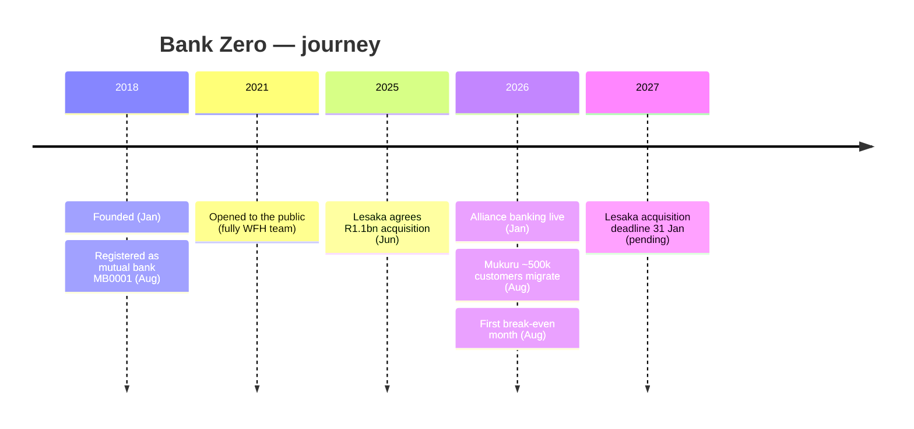
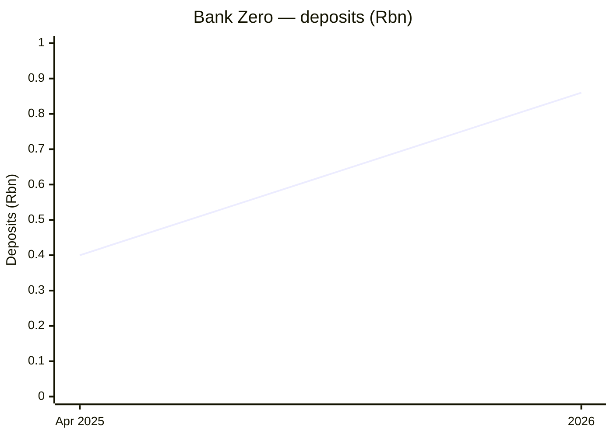

# Bank Zero — Consolidated Journey

> Self-contained synthesis of the deep per-department research under
> `research/neobanks-sa/bank-zero/` plus the SA neobank landscape file.
> Public information only. Tags: `[OBS]` observed, `[INF]` inference, `[EST]` estimate, `[UNK]` unknown.

## 1. Origin & founding timeline

| Date | Milestone | Tag |
|---|---|---|
| **16 Jan 2018** | Founded by **7 co-founders**, incl. **Michael Jordaan** (chairman; ex-FNB CEO) and **Yatin Narsai** (CEO) | [OBS] |
| **17 Aug 2018** | Registered as a **mutual bank** by SARB — licence **MB0001** (SA's first app-driven mutual bank) | [OBS] |
| **2021** | Opened to the public (waitlist first, then "fully open"; public opening Aug 2021) — billed as the first bank in the world launched by a **fully WFH team** | [OBS] |
| **June 2025** | **Lesaka Technologies** agrees to acquire 100% for **R1.1bn** (small cash component up to R91m) | [OBS] |
| **Jan 2026** | **Alliance banking** goes live (developed over >18 months) | [OBS] |
| **Aug 2026** | **First break-even month** — beating its own Dec-2026 projection | [OBS] |
| **2027 (pending)** | SARB Prudential Authority review extended; acquisition deadline moved to **31 Jan 2027** | [OBS] |

## 2. Growth journey & pivots

Bank Zero is the **narrow, fee-free, member-owned** third path in the SA cohort:

1. **Founder-led build (2018–2021).** Founded by 7 co-founders anchored by ex-FNB CEO Michael Jordaan; built entirely remote/WFH and licensed as a **mutual bank** (a distinct licensing class from commercial banks, with a lower R10m capital floor). [OBS]
2. **Zero-fee operating model (2021–2025).** Engineered to reach profitability with only **~100,000 customers** by charging **R0 monthly and R0 transaction fees**. Public access was initially **waitlist-constrained** while support processes were stress-tested. [OBS]
3. **Alliance-banking pivot (2026).** The growth engine shifted from direct retail acquisition to **B2B2C "alliance banking"** — issuing cards and providing banking rails for third-party platforms. The signature move: **~500,000 Mukuru customers migrated onto Bank Zero in Aug 2026**, moving the Mukuru Card base away from **Standard Bank**, because sponsor banks had raised fintech prices sharply (100%+ in some cases). [OBS]
4. **Break-even & sale (2026).** First break-even month Aug 2026 (~4 years 10 months after opening); being acquired by Lesaka, with capital earmarked for a lending push. [OBS]

## 3. Product evolution

- **Zero-fee transactional banking** for individuals and businesses: **R0 monthly fees** and **R0 transaction fees** (debit orders, EFTs, card online/in-store, phone tap, internal payments) — first SA bank to charge zero for both EFTs and debit orders. [OBS]
- **Savings/Notice accounts:** free to open; savings rate **5.00%** (<R1k) rising to **6.25%** (≥R1k) and higher tiers (≥R25k, ≥R50k, ≥R100k, ≥R500k, ≥R1m) effective 25 Sep 2026; headline range ~5%–6.5%. [OBS]
- **Patented debit card security architecture:** card data changes during transactions to limit fraud; Mastercard debit card (physical + digital). [OBS]
- **Business banking:** multi-user authorisations and automated invoicing built in-app, at R0. [OBS]
- **Lending (planned):** applied to SARB/PA to offer loans, funded by deposits + Lesaka capital (pending). [OBS]
- **Limitations:** no branches/cash-deposit tellers; limited international wires. [OBS]

## 4. Business model & unit economics

**Model:** Mutual bank — **profits returned to members**, not external shareholders; app-only, no branches, zero fees. Positions on value + control + security rather than cash-back rewards. [OBS]

**Unit economics (publicly visible):**
- **Break-even:** **Aug 2026** — revenue covered operating costs for the month, **58 months (~4 yrs 10 mths)** after public opening, beating a Dec-2026 projection. Break-even ≠ sustained profit: earnings expected to stay **uneven**, with stronger revenue growth and healthy profit forecast for **2027**. [OBS]
- **Deposits:** **>R400m** (end Apr 2025) → **~R860m** (2026) — a small balance sheet, deliberately capital-light. [OBS]
- **Customer economics:** designed to profit at **~100,000 customers** (mutual model with no external equity leakage). Growth now comes from alliance banking (Mukuru's ~500k customers). [OBS]
- **Exit value:** agreed sale to Lesaka at **R1.1bn** (June 2025). [OBS]
- **CAC:** not disclosed — **[UNK]**; the alliance-banking model effectively outsources acquisition to partners. [INF]

## 5. Customers & distribution

- **Customers:** not directly disclosed; the bank was engineered to profit at ~100k direct customers, with ~500k Mukuru customers migrating in Aug 2026. [OBS]
- **Distribution:** app-only direct channel (no branches/call centres); the strategic channel is **alliance banking** (third-party card issuance/rails). [OBS]
- **Sentiment:** on-site reviews **4.6**; aggregator **4.2**; positive on low fees/support, negative on a dated UI. oXC everyday-app usability scored Bank Zero **49** (2025). Per-bank NFO case counts **[UNK]**. [OBS]
- **Transformation:** **45% black-owned, 20% women-owned** — credentials reportedly scrutinised by the Prudential Authority in the Lesaka approval. [OBS]

## 6. Technology

- **Core infrastructure:** runs on **IBM Z mainframe + LinuxONE** using **IBM Secure Service Container** for breach protection — a notable mainframe-first choice, distinct from cloud-native peers. [OBS]
- **Card security:** **patented debit-card security architecture** (rotating card data). [OBS]
- **Processing:** partnership with **Paymentology (Apr 2026)** to prepare the card/processing model for the Mukuru migration and alliance banking. [OBS]
- **App:** app-only; account opening in-app; multi-user business authorisations and invoicing built in. [OBS]
- **Gaps:** cloud/hybrid architecture beyond IBM Z/LinuxONE and core-banking vendor are **[UNK]**. [UNK]

## 7. Marketing & partnerships

- **Positioning:** "powerful banking at zero fees"; differentiation on value, control and security (patented card) rather than rewards. [OBS]
- **PR narrative:** the "first bank in the world launched by a fully WFH team" story and an "unconstrained" full-open launch; the **Michael Jordaan halo** (ex-FNB CEO) as high-profile chairman. [OBS]
- **Pricing-guide marketing:** publishes an annual **Zero pricing guide** as a transparency device. [OBS]
- **Partnerships:** **Mukuru** (alliance banking / card issuing, ~500k customers), **Paymentology** (processing), **IBM** (infrastructure), **Lesaka** (acquirer/capital partner after deal close). No team/jersey sponsorship identified — **[UNK]**. [OBS]
- **People:** Chairman/co-founder **Michael Jordaan**; CEO/co-founder **Yatin Narsai** (remains CEO); Jordaan to join the Lesaka board as part of the deal. Headcount not disclosed — **[UNK]**. [OBS]

## 8. Key lessons for a SA NeoBank

1. **There is a low-capital path.** A mutual-bank licence (**R10m** minimum capital vs R250m for a commercial bank) plus an app-only model let Bank Zero reach break-even on a **~R860m** deposit base — without the R15bn ecosystem build of Discovery or the US$500m+ raised by Tyme. [OBS]
2. **Zero fees only work with an ultra-low cost base.** No branches, no call centres, mainframe-secured automation. [OBS]
3. **Alliance banking is a powerful, capital-light growth channel** — but it outsources your customer relationship to a partner (Mukuru) and concentrates dependency. [OBS]
4. **Break-even is not profitability.** The bank explicitly flags uneven earnings after its first break-even month; a month-level milestone can precede a durable profit by years. [OBS]
5. **Ownership structure constrains and enables.** The mutual model removes external equity dilution but caps the capital available for lending — hence the pending Lesaka sale. [INF]

## 9. Timeline / growth chart (Mermaid)

## 10. Consolidated Sources

- Wikipedia — Bank Zero: https://en.wikipedia.org/wiki/Bank_Zero
- Grokipedia — Bank Zero: https://grokipedia.com/page/Bank_Zero
- Bank Zero press release — opens fully, 2022 pricing guide (PDF): https://www.bankzero.co.za/wp-content/uploads/2021/10/PR007-Bank-Zero-opens-fully-and-publishes-2022-Zero-pricing-guide-2.pdf
- Bank Zero — rates & pricing: https://www.bankzero.co.za/rates-and-pricing/
- Bank Zero — pricing guide 2026 (PDF): https://www.bankzero.co.za/wp-content/uploads/2025/11/Bank-Zero-pricing-guide-2026.pdf
- TechCabal — Bank Zero break-even & alliance banking: https://techcabal.com/2026/09/22/bank-zero-break-even-alliance-partnerships/
- itnewsafrica — Bank Zero profit: https://www.itnewsafrica.com/industries/fintech_news/bank-zero-profit/
- Lesaka — Bank Zero acquisition: https://lesakatech.com/newsroom-all/bank-zero-snapped-up-for-r1-1-billion
- Bloomberg — Bank Zero turns profitable, plans lending push: https://www.bloomberg.com/news/articles/2026-09-22/south-africa-s-bank-zero-turns-profitable-plans-lending-push
- TechMoonshot — Lesaka deadline extension: https://techmoonshot.com/2026/06/19/lesaka-pushes-bank-zero-acquisition-deadline-to-2027-as-regulators-stall/
- VaultCue — Bank Zero review: https://vaultcue.com/accounts/bank-zero/review/
- CreditDeals — Bank Zero debit cards: https://creditdeals.io/za/debit-cards/bankzero
