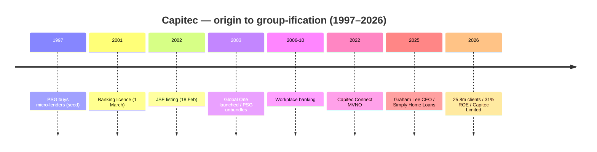

# Capitec — Consolidated Journey (UnConsolidated)

> Self-contained synthesis of the Capitec research set (`/workspace/research/banks/capitec/`). Every figure is
> traceable to a source already cited in that research set. Tags: `[OBS]` observed/filing-stated,
> `[INF]` inference, `[DER]` derived, `[EST]` estimate, `[UNK]` unknown, `[UNVERIFIED]` single/low-authority.
> **Entity note:** the bank is **Capitec Bank Limited**; the holding company **Capitec Bank Holdings
> Limited** was renamed **Capitec Limited** effective **1 August 2026**. FY ends **28/29 February**.

## 1. Origin & founding story

Capitec is the **youngest of the six** — a 2001 start-up born out of the PSG Group's micro-lending
businesses — and became South Africa's **largest retail bank by client numbers** within two decades. `[OBS]`

| Year | Milestone | Tag |
|---|---|---|
| 1997 | PSG acquires micro-lending businesses (incl. Smartfin, Finai) that seeded Capitec | [OBS] |
| 1 Mar 2001 | **Capitec registered as a bank / received its licence** (founded by Jannie Mouton, Michiel le Roux, Riaan Stassen) | [OBS] |
| 18 Feb 2002 | **Listed on the JSE** (share code CPI) — nine days before the Saambou collapse | [OBS] |
| Nov 2003 | PSG **unbundled its entire Capitec stake** — a decision Jannie Mouton later called a costly error (cost PSG ~R1.4bn) | [OBS] |
| 2003 | **Global One** launched — SA's first account with 4 free personalised savings pockets | [OBS] |
| 2004 | Biometric authentication introduced | [OBS] |
| Sep 2022 | **Capitec Connect** MVNO launched (on Cell C) | [OBS] |
| 19 Jul 2025 | **Graham Lee** appointed CEO, succeeding Gerrie Fourie (CEO 2014–2025) | [OBS] |
| 1 Aug 2026 | Holding company renamed **Capitec Limited** (gazetted by the Prudential Authority 2 Oct 2026) | [OBS] |

- Initial shareholding: **PSG 58% / management 22% / independent investors 20%**. `[UNVERIFIED]`
- **Legal/licence:** Capitec Bank Limited — Reg No **1980/003695/06**; FAIS **FSP 46669**; registered credit
  provider **NCRCP13**; SARB-supervised bank under the Banks Act 1990. `[OBS]`

## 2. The journey — how it grew

- **Phase 1 — Micro-lending start-up (1997–2003):** PSG consolidated micro-lenders into Capitec, which
  obtained a banking licence during the 1999–2002 "small banks crisis" and listed in 2002. `[OBS]`
- **Phase 2 — Single-product scale (2003–2014):** a deliberately **simple, low-fee Global One account** grew
  a massive mass-market client base; PSG's early exit left a dispersed public float. `[OBS]`
- **Phase 3 — Diversification (2015–2022):** credit cards, savings tools, insurance and the launch of
  **Capitec Connect** (MVNO, 2022) broadened revenue beyond transactional banking. `[OBS]`
- **Phase 4 — Group-ification & MVNO/insurance/lending (2023–2026):** over five years the group diversified
  into **Business banking, VAS, Capitec Connect, insurance (own life licence) and online consumer lending
  (AvaFin)**; rebranded the holding as **Capitec Limited** (2026). `[OBS]`

## 3. Product evolution

| Era | Product build-out | Tag |
|---|---|---|
| 2001–2003 | Single savings/transaction account; micro-lending heritage | [OBS] |
| 2003–2014 | **Global One** (R7.50/m, 8 savings pockets); biometrics; workplace banking (2006–2010) | [OBS] |
| 2015–2022 | Credit cards; **Live Better** rewards; **Capitec Connect** MVNO (Sep 2022); Capitec Pay (open-banking A2A) | [OBS] |
| 2023–2026 | **Entrepreneur Account** (Dec 2025, zero monthly fee); **Simply Home Loans** (with SA Home Loans, Nov 2025); **Repay-As-You-Earn** loans (Jul 2025); own life-insurance licence | [OBS] |

Current headline products: **Global One (R7.50/m)** with payments between Capitec accounts **R1**, EFT to
other banks **R2**, debit orders **R3**, immediate payments **R6**, purchases **free**, **0% forex margin**,
up to **8 savings pockets**; credit cards (1% cash back); **Multi-income loans** (R2.6bn FY2026);
**Accessible Credit Card** (from R600); **Simply Home Loans**; **Business Banking**; **Capitec Connect**;
**Live Better** rewards (Cashbuild 1%, Dis-Chem 15%, Tiger Wheel & Tyre, Shell). `[OBS]`

## 4. Business model & economics

Capitec pairs a **low-cost, high-volume transactional core** with a fast-growing, diversified
**non-interest-income engine** (transaction & commission, VAS, MVNO, insurance). `[OBS]`

| Metric (group) | FY2026 (Feb) | FY2025 | Change | Tag |
|---|---|---|---|---|
| Interest income | R33,309m | R30,228m | +10% | [OBS] |
| Interest expense | (R9,230m) | (R10,043m) | −8% | [OBS] |
| Net interest income (NII) | R24,079m | R20,185m | +19% | [OBS] |
| Credit impairments | (R9,976m) | (R8,258m) | +21% | [OBS] |
| NII after credit impairments | R14,103m | R11,927m | +18% | [OBS] |
| — Net transaction & commission income | R15,433m | R14,117m | +9% | [OBS] |
| — VAS | R5,650m | R4,225m | +34% | [OBS] |
| — Capitec Connect | R442m | R193m | >100% | [OBS] |
| — Net insurance result | R5,224m | R3,777m | +38% | [OBS] |
| **Net non-interest income** | **R28,341m** | R23,882m | +19% | [OBS] |
| Income from operations after credit impairments | R42,444m | R35,809m | +19% | [OBS] |
| Operating expenses | (R20,238m) | (R18,099m) | +12% | [OBS] |
| Operating profit before tax | R22,179m | R17,740m | +25% | [OBS] |
| **Headline earnings** | **R16,848m** | R13,739m | **+23%** | [OBS] |
| HEPS | 14,606c | 11,912c | +23% | [OBS] |
| DPS | 7,980c | 6,510c | +23% | [OBS] |
| **ROE** | **31%** | 29% | +2pp | [OBS] |
| **Cost-to-income ratio** | **39%** | 41% | improved 2pp | [OBS] |
| Total assets | R263,284m | R238,464m | +10% | [OBS] |
| Gross loans & advances | R131,774m | R115,525m | +14% | [OBS] |
| Deposits & wholesale funding | R190,575m | R175,541m | +9% | [OBS] |
| Total equity | R59,513m | R50,914m | +17% | [OBS] |
| CAR | 33% | 38% | −5pp | [OBS] |
| Credit loss ratio (CLR) | 8.1% | 7.5% | +0.6pp | [OBS] |

- **Segments (FY2026):** Personal Banking gross loans R98,012m (CLR 8.2%); Business Banking gross loans
  R30,389m (CLR 2.4%); **AvaFin** (online consumer lending, consolidated 1 May 2024) gross loans R3,373m
  (**CLR 53.2%** — high-yield, non-bank lending). `[OBS]`
- **H1 FY2027 (to 31 Aug 2026):** headline earnings **+19% to R9.5bn**. `[OBS]`
- **Market cap FY2026: R550.7bn**; share price 474,354c (+54% YoY). `[OBS]`
- `[DER]` Capitec has by far the **highest ROE (31%)** and the **lowest CIR (39%)** of the six — the clearest
  evidence that a low-cost, high-volume digital model can out-earn far larger balance sheets. `[DER]`
- `[UNVERIFIED]` Cross-source conflict: BusinessTech's "Battle of the banks 2026" table lists Capitec
  **HE R16.8bn / HEPS 14,606c / ROE 31.0% / market cap R521.7bn / P/E 30.91** — consistent with the audited
  figures apart from the market cap (R521.7bn vs R550.7bn) timing difference. `[UNVERIFIED]`

## 5. Customers & distribution

- **Active clients (incl. card-machine merchants): 25.802m (+7%)**; **25.2m excluding merchants** —
  South Africa's **largest retail bank by client numbers**; **>26m** on a marketing basis. `[OBS]`/`[DER]`
- **Active banking-app clients: 15.3m (+19%)** — the **highest app-adoption count of the six**;
  **fully banked clients 9.9m (+12%)**. `[OBS]`
- **Employees: 17,672 (+4%)** — the **leanest headcount per client** of the six. `[OBS]`
- **Footprint:** **885 branches**; **8,771 cash devices** (ATMs/note & coin recyclers); **619m cash
  transactions**. `[OBS]`
- **Volumes:** total transaction volumes **12,312m (+11%)**; digital (incl. VAS) **3,180m (+26%)**;
  card payment volumes **3,743m (+23%)**. `[OBS]`
- **Channels:** Capitec app (`capitec.acuity.mobile.prod`), USSD, branches, **Capitec Pay** (open-banking
  A2A), **Scan to Pay** QR, **Virtual Card**, **Capitec Connect** MVNO, Samsung/Google Pay. `[OBS]`
- **Complaints:** Capitec's **share** of formal banking complaints fell **21% → 16% YoY (2025)** though its
  absolute case count (**2,641**) was the **3rd highest** (industry registered 14,685 cases); app ratings
  **Google Play 4.34**, **Apple App Store 3.6**. `[OBS]`
- `[INF]` High raw volume reflects the largest client base; the **declining share** is consistent with an
  improving fraud/resolution strategy. `[INF]`

## 6. Technology & partnerships

- **Cloud:** a **cloud-forward, AWS-centric** engineering organisation — the banking app was **rewritten and
  migrated on-prem → AWS with zero downtime**; contact centre migrated to **Amazon Connect** (replaced 198
  on-prem servers; 600 agents migrated in 5 days); **conversational AI** on **Amazon Connect Contact Lens +
  Amazon Bedrock** (conversation analysis 1% → 100%); **Zscaler** cloud security via AWS Marketplace. `[OBS]`
- **Payments engineering:** **Capitec Pay** (open-banking A2A) built with **Electrum** on AWS using
  **Amazon EKS, RDS, CloudFormation**; payments department handles **RTC, PayShap and EFT** via AWS Lambda
  (.NET Core) with SQL Server, DynamoDB, SQS and CloudWatch. `[OBS]`
- **AI stance:** heavy investment in fraud prevention, data and AI, used to **augment rather than cut**
  headcount (added 711 staff while expanding AI). `[OBS]`
- **Partnerships:** **Samsung Pay** & **Google Pay** wallets; **Electrum** (Capitec Pay);
  **Cell C** (Capitec Connect host network); Samsung device sales via the app; **SA Home Loans** (Simply Home
  Loans); **Department of Home Affairs** (Smart ID self-service terminals in 86+ branches; 71,000
  applications since March 2026). `[OBS]`
- **Rails:** **PayShap** participant; RTC; EFT; Capitec Pay; Scan to Pay; Virtual Card; **Visa** issuing. `[OBS]`
- `[UNK]` Core banking vendor is **not publicly confirmed**. `[UNK]`

## 7. Marketing & sponsorships

Capitec's marketing is **fee-and-simplicity led**, with sponsorships skewed to **inclusive, mass-market and
community/culture** properties rather than elite sport. `[OBS]`/`[INF]`

| Property | Category | Note | Tag |
|---|---|---|---|
| **Comic Con Africa / Comic Con Cape Town** | Pop culture | Three-year **headline sponsor** | [OBS] |
| **Kota Festival Tour** | Food/culture | Official **banking sponsor** (2026) | [OBS] |
| **My Design Rules** | Interior design (TV) | Sponsor (with BUCO as hardware supplier) | [OBS] |
| **GRAD / GRADnext** | Education | Sponsor (with StudyTrust, Van Schaik) | [OBS] |

- **Owned campaigns:** **Live Better** rewards ecosystem (cash back + partner discounts) and **Live Better
  Day**; **Capitec Connect** data-price-reduction messaging (R108m in rewards/data and R330m saved via data
  price reductions FY2026). `[OBS]`
- **Value-return narrative (FY2026):** **R1bn returned to clients** (R228m fee savings, R107m credit-card
  cash back, R61m forex savings, R213m merchant savings). `[OBS]`
- `[UNK]` Total marketing/advertising spend and CAC by channel are not disclosed. `[UNK]`

> **Brief correction:** the brief hypothesised a "no-sponsorship strategy" for Capitec. Evidence **contradicts
> a blanket no-sponsorship position** — Capitec does not run Big-Four-style elite sport/stadium sponsorships,
> but it **does** headline-sponsor cultural/community/education properties (Comic Con Africa, Kota Festival
> Tour, My Design Rules, GRAD). `[OBS]`

## 8. Strengths, weaknesses, threats & NeoBank lessons

**Strengths**
- **Highest ROE (31%) and lowest CIR (39%)** of the six; **largest client base (25.8m)** and **best app
  adoption (15.3m app clients)** from the **leanest headcount (17,672)**. `[OBS]`
- Genuinely **cloud-native, AWS-centric** engineering and a **diversified non-interest-income engine**
  (VAS, MVNO, insurance). `[OBS]`

**Weaknesses**
- **Very high credit loss ratio (8.1% group; AvaFin 53.2%)** — unsecured-lending risk is structural. `[OBS]`
- **CAR fell to 33%** (from 38%); app-store rating on iOS is comparatively low (3.6). `[OBS]`

**Threats**
- Rising SA consumer-credit stress and unemployment hitting its unsecured book. `[INF]`
- Competitive response from FNB/Standard Bank on low-fee accounts and ecosystem bundling. `[INF]`

**NeoBank learn / exploit**
- **The benchmark to beat:** Capitec already *is* the low-fee, digital-first incumbent (R7.50/m, 0% forex),
  so a NeoBank must differentiate on **something beyond price** — e.g. radical transparency, instant
  onboarding, or a superior savings/lending value proposition. `[INF]`
- **Attack its credit weakness:** its 8.1% CLR and 53.2% AvaFin CLR show where it is exposed — a NeoBank with
  better underwriting/affordability tooling can serve declined or over-indebted customers responsibly. `[INF]`
- **Copy and extend "Live Better":** Capitec proves cash-back-in-savings (that doesn't expire) drives
  engagement; a NeoBank can offer an even simpler, unbundled rewards model. `[INF]`

## 9. Journey chart (Mermaid)

## 10. Sources

- [Capitec FY2026 summary consolidated financial statements (PDF)](https://www.capitecbank.co.za/globalassets/pages/investor-relations/financial-results/2026/audited-results/cpify26_summary.pdf)
- [Capitec — 25 years of banking on better (Our journey)](https://www.capitecbank.co.za/about-us/our-journey/)
- [Capitec — headline earnings up 23% (annual results blog)](https://www.capitecbank.co.za/blog/news/2026/annual-results/)
- [Capitec Bank Holdings Integrated annual report FY2026 (PDF)](https://www.capitecbank.co.za/globalassets/pages/investor-relations/financial-results/2026/annual-report/integrated_annual_report_2026.pdf)
- [Capitec 2026 personal banking fees (PDF)](https://www.capitecbank.co.za/globalassets/pages/documents-library/transact/personal-banking-fees-2026.pdf)
- [Capitec Bank Limited B-BBEE certificate 2025 (PDF)](https://www.capitecbank.co.za/globalassets/pages/investor-relations/shareholder-centre/b-bbee-certificate---capitec-bank-limited-2025.pdf)
- [Electrum / AWS — Capitec Pay case study (PDF)](https://cdn.prod.website-files.com/60e2dc7cef09ba877f290236/6662cff38f0736bead3f76c7_AWS_Capitec_Case%20Study_June%202024_compressed.pdf)
- [NTT DATA — Capitec contact centre with Amazon Connect](https://www.nttdata.com/en-ca/insights/case-studies/capitec-contact-center-boosts-customer-experience-with-amazon-connect)
- [Zscaler — Capitec accelerates digital transformation](https://www.zscaler.com/jp/customers/capitec-bank-limited)
- [AI Use Case Hub — Capitec Amazon Connect + Bedrock](https://www.aiusecasehub.com/case/capitec-used-amazon-connect-and-amazon-bedrock-with-contact-lens-to)
- [Bizcommunity — Comic Con Africa names Capitec headline sponsor](https://www.bizcommunity.com/article/comic-con-africa-names-capitec-as-new-headline-sponsor-285617a)
- [Capitec — Kasi culture / Kota Festival Tour](https://www.capitecbank.co.za/blog/events/2026/kasi-culture-is-coming-to-you/)
- [Samsung Newsroom — Capitec joins Samsung Pay](https://news.samsung.com/za/samsung-welcomes-capitec-bank-to-the-samsung-pay-family)
- [Daily Investor — Good news for Capitec banking clients](https://dailyinvestor.com/banking/137683/good-news-for-capitec-banking-clients/)
- [Moonstone — NFO recovers R442.99m for consumers](https://www.moonstone.co.za/nfo-recovers-r442-99m-for-consumers-as-complaints-climb/)
- [SARB — PayShap launch press release (PDF)](https://www.resbank.co.za/content/dam/sarb/publications/media-releases/2023/payshap-/Press%20release%20on%20the%20launch%20of%20Payshap%20-%20a%20digital%20payment%20service.pdf)
- [Newsday — Capitec name change gazetted](https://newsday.co.za/business/28443/south-africas-largest-bank-changes-its-official-name/)
- [BusinessTech — Battle of the banks 2026](https://businesstech.co.za/news/banking/876479/battle-of-the-banks-2026-capitec-vs-fnb-vs-standard-bank-vs-absa-vs-nedbank/)
