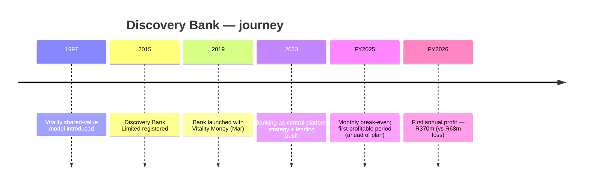

# Discovery Bank — Consolidated Journey

> Self-contained synthesis of the deep per-department research under
> `research/neobanks-sa/discovery-bank/` plus the SA neobank landscape file.
> Public information only. Tags: `[OBS]` observed, `[INF]` inference, `[EST]` estimate, `[UNK]` unknown.

## 1. Origin & founding timeline

| Date | Milestone | Tag |
|---|---|---|
| **1997** | Discovery's **Vitality** shared-value insurance model introduced (the DNA later applied to banking) | [OBS] |
| **2015** | Discovery Bank Limited registered (Reg no. 2015/408745/06) | [OBS] |
| **Mar 2019** | **Discovery Bank launched** with core product **Vitality Money** — positioned as the world's first "shared-value" bank | [OBS] |
| **2023** | CEO **Hylton Kallner** proposes integrating Discovery's app suite with banking as the central platform; adds lending products | [OBS] |
| **FY2025** (to 30 Jun 2025) | Monthly break-even at end of H1; first profitable *period* in H2, ahead of plan; overall loss R386m better than prior year | [OBS] |
| **FY2026** (to 30 Jun 2026) | **First annual profit of R370m** (vs R68m loss FY25); bank "no longer requires investment from the group" | [OBS] |

## 2. Growth journey & pivots

Discovery Bank took the **premium, behaviour-linked, vertically integrated** path rather than a low-cost land-grab:

1. **Ecosystem leverage (2019–2023).** It launched on top of Discovery's existing health/insurance/investment bases, applying the Vitality behavioural model to money management — rewarding good financial behaviour with better rates and rewards. [OBS]
2. **Platform consolidation (2023).** Strategy shifted toward making the **banking app the central platform** for all Discovery products (medical aid claims, insurance, investments visible in-app), with a push into **lending** (home loans, vehicle finance, personal loans) to improve profitability. [OBS]
3. **Profitability (FY2025–FY2026).** Monthly break-even in H1 FY2025, first profitable period in H2, then the **first annual profit (R370m)** in FY2026 — roughly **7 years** after launch. [OBS]

The pivot that mattered was **product-mix**: adding credit (lending) alongside the rewards engine was the stated route to profitability. [OBS]

## 3. Product evolution

- **Vitality Money (behavioural engine):** clients earn dynamic discounts/rewards based on **Vitality Money status** (Blue → Bronze → Silver → Gold → Diamond) and money-management behaviour. [OBS]
- **Four banking suites:** **Gold, Platinum, Black, Purple**, each combining a transaction account + credit card; standalone credit cards also offered. Example: **Gold Suite card from R74/month** with a free Gold Transaction Account. Purple Suite rewards 5–6% dynamic discounts at higher spend bands. [OBS]
- **Savings & investment:** free, unlimited savings accounts. [OBS]
- **Lending:** home loans, vehicle finance, personal loans (added 2023 onward). [OBS]
- **Rewards currency:** **Discovery Mileage**, tied to the Vitality/shared-value ecosystem. [OBS]
- **Digital features:** Discovery Pay, Live Assist, Smart Vault; app-based transaction authorisation rather than OTP. [OBS]
- Full current fee schedule: **[UNK]** from sources reviewed. [UNK]

## 4. Business model & unit economics

**Model:** Premium, tiered-fee, behaviour-linked bank embedded in the Discovery Limited ecosystem — a deliberate contrast to the R0 models of TymeBank/Bank Zero. [OBS]

**Financial trajectory:**
- **FY2025:** operating loss before new-business acquisition costs improved **R420m**; overall loss **R386m better** YoY; client base **+30% to June 2025**; ~**1,400 daily sales** in June 2025. [OBS]
- **H1 FY2026:** swung to profit, posting **R210–230m** vs a R145m loss a year earlier; averaging ~**1,500 new customers daily**; low credit-loss ratios; both non-interest revenue and NII up. [OBS]
- **FY2026:** **first annual profit R370m** (normalised profit from operations), a ~**600% jump** vs the R68m FY25 loss; **1.57m clients (+26%)** and **3.77m accounts (+26%)**. [OBS]
- **Group (FY2026):** Discovery Limited normalised headline earnings **R11,795m (+21%)**; normalised operating profit **R17,750m (+29%)**. [OBS]

**Capital intensity:** estimated cumulative group investment to build the bank **≈R15bn** — tagged **[EST]** — the sharpest capital-intensity contrast in the SA cohort. The bank is now self-funding ("no longer requires investment from the group"). [EST]/[OBS]

**CAC:** not publicly disclosed — **[UNK]**. The lever Discovery uses instead is **ecosystem cross-sell**, not cheap acquisition. [INF]

## 5. Customers & distribution

- **Customers:** 1.57m clients, 3.77m accounts (FY2026); growth ~1,500/day. [OBS]
- **Distribution:** digital-first, no branches; **in-app advisors and specialists** rather than retail/kiosk agent networks. The "channel" is the existing Discovery/Vitality customer base. [OBS]
- **Sentiment:** highest **Net Sentiment of 61%** in SA (2025, +14 pts YoY, 15 pts ahead of second place) and named SA's "most loved bank"; app store rating **4.8**. However, **Hellopeter TrustIndex 3.3/10** (917 trailing-12-month reviews) with themes of blocked accounts, app-only authorisation friction, refund delays and home-loan declines — a jarring app-vs-service gap. Per-bank NFO case counts are **[UNK]**. [OBS]

## 6. Technology

- **Fully digital** app + online banking sharing one design language; features include **Discovery Pay, Live Assist, Smart Vault**. [OBS]
- **Ecosystem integration:** banking app as the central platform for group products; in-app calling to specialists; cross-product visibility. [OBS]
- **AI & data:** FY2026 results cite improving efficiency/client experience "increasingly through the deployment of AI"; behavioural/risk analytics underpin the shared-value model. [OBS]
- **Security:** app-based transaction authorisation (some clients report OTP friction). [OBS]
- **Gaps:** specific cloud provider, core-banking vendor and architecture are **not publicly disclosed — [UNK]**. [UNK]

## 7. Marketing & partnerships

- **Positioning:** "The world's first shared-value bank"; "The Future of Banking. Now." Core message: improving financial behaviour earns greater value. [OBS]
- **Marketing engine:** the **Vitality flywheel** — leveraging Discovery Vitality (health, insurance, investments; programmes in 40+ markets) to acquire and retain bank clients; increasing AI-driven personalisation. [OBS]
- **Partnerships:** the primary "partnership" is **intra-group** (Vitality, Discovery Health, Insure, Invest). No external retail/kiosk or sponsor-bank arrangements identified — **[UNK]** for third-party deals. [OBS]/[UNK]
- **Sponsorship:** no major Springboks/SA Rugby jersey deal (FNB is the principal partner from 2025); the flagship asset is Discovery's own **Vitality** brand. Bank-specific sponsorships **[UNK]**. [OBS]
- **People:** Founder/Group CEO **Adrian Gore**; **Hylton Kallner** as Discovery Bank CEO (~27 years at Discovery as of 2023). Bank-specific headcount **[UNK]**. [OBS]

## 8. Key lessons for a SA NeoBank

1. **Ecosystem cross-sell can substitute for cheap acquisition** — but it is capital-heavy: ~R15bn and ~7 years to first annual profit. Only viable with a large existing, data-rich customer base. [EST]/[OBS]
2. **Behavioural/behaviour-linked pricing works commercially** (premium suites + dynamic rewards) and produced SA's highest net sentiment — but app-only authorisation and service resolution are the weak spots to design around. [OBS]
3. **Product-mix shift is the profitability lever.** Adding lending (home/vehicle/personal) was the stated route from loss to profit — deposits alone rarely get a premium bank there. [OBS]
4. **Rewards complexity is a double-edged sword** (see eBucks): shared-value gamification drives engagement, but service friction (blocked accounts, OTP) can drag trust indices even when app ratings are stellar. [OBS]
5. **The ~R15bn build vs TymeBank's capital-light kiosk model is the defining contrast** in the SA cohort: there is more than one road to a profitable digital bank. [INF]

## 9. Timeline / growth chart (Mermaid)



```mermaid
xychart-beta
    title "Discovery Bank — clients (m)"
    x-axis ["FY2025", "FY2026"]
    y-axis "Clients (m)" 0 --> 2
    line [1.25, 1.57]
```

> FY2026 clients (1.57m) are `[OBS]`; the FY2025 point (≈1.25m) is **derived** from the stated +26% YoY growth — `[EST]`.

## 10. Consolidated Sources

- JEF Journal — Discovery shared-value bank: https://jefjournal.org.za/index.php/jef/article/view/602/1163
- Brand Finance — Discovery: https://brandfinance.com/insights/discovery
- Discovery FY2026 annual results (PDF): https://www.discovery.co.za/assets/discoverycoza/corporate/investor-relations/2026/annual-results.pdf
- Discovery FY2025 results booklet (PDF): https://mso.discoveryholdings.com/wcm/discoverycoza/assets/investor-relations/2025/results-booklet-fy-2025.pdf
- Daily Investor — Discovery Bank new era, 600% profit jump: https://dailyinvestor.com/banking/152648/discovery-bank-enters-a-new-era-with-600-profit-jump/
- The Banking Brief — Discovery adding 1,500 customers daily: https://the-banking-brief.beehiiv.com/p/discovery-adding-1500-customers-daily
- HBS case — Discovery Bank: https://www.hbs.edu/faculty/Pages/item.aspx?num=66477
- The Citizen — bank at the centre of Discovery: https://www.citizen.co.za/business/the-bank-is-now-firmly-at-the-centre-of-everything-discovery-does/
- HelloPeter — Discovery Bank: https://www.hellopeter.com/discovery-bank
- Discovery — digital banking: https://www.discovery.co.za/bank/digital-banking
- Discovery — products: https://www.discovery.co.za/bank/info-and-tips-discovery-bank-products
- Discovery — leadership (PDF): https://www.discovery.co.za/assets/discoverycoza/corporate/investor-relations/discovery-leadership.pdf
