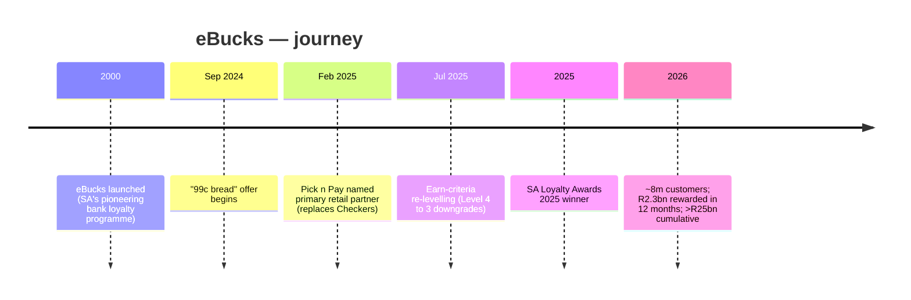
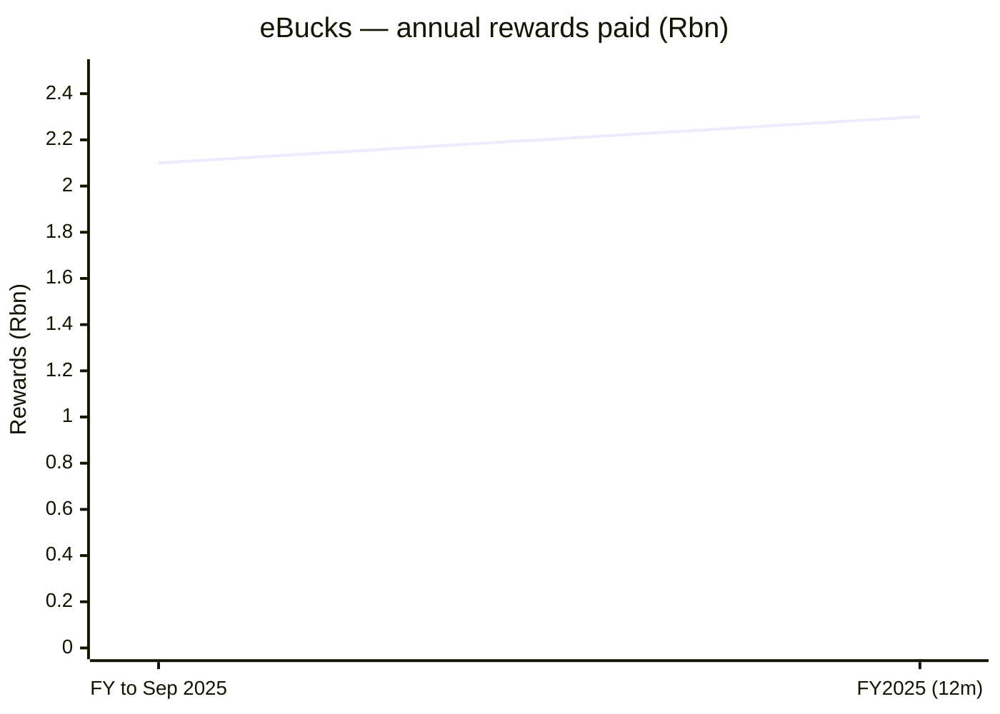

# eBucks — Consolidated Journey

> Self-contained synthesis of the deep per-department research under
> `research/crypto-trading/ebucks/` plus the ZA crypto/loyalty landscape file.
> Public information only. Tags: `[OBS]` observed, `[INF]` inference, `[EST]` estimate, `[UNK]` unknown.
>
> **Note:** eBucks is **not** a crypto/trading platform. It is **FNB's (FirstRand's) bank loyalty programme**,
> included as the "loyalty/gamification" reference for the SA NeoBank programme.

## 1. Origin & founding timeline

| Date | Milestone | Tag |
|---|---|---|
| **2000** | **eBucks launched** as SA's pioneering bank-linked loyalty programme (FNB/FirstRand) | [OBS] |
| **Sep 2024** | "99c bread" offer begins — 3.4m vouchers later reported | [OBS] |
| **Feb 2025** | **Pick n Pay named eBucks' primary retail partner** (replacing Checkers); live 1 Apr 2025 | [OBS] |
| **Jul 2025** | Reward-levelling criteria change — free-and-easy points threshold cut 10,000 → 8,500; most customers dropped Level 4 → Level 3 | [OBS] |
| **2025** | **South African Loyalty Awards 2025** — top recognition for industry innovation | [OBS] |
| **2026** | ~8m customers (87% active); **R2.3bn** rewarded in past 12 months (+9%); >R25bn cumulative since 2000 | [OBS] |

## 2. Growth journey & pivots

1. **Pioneer & scale (2000–2024).** eBucks built a points currency (**R1 spend = eB10**, points never expire) rewarding FNB banking behaviour, growing to millions of users inside the FNB App. [OBS]
2. **Partner-marketplace pivot (2025).** The single most material shift was retail: **Pick n Pay replaced Checkers** as the primary partner (from 1 Apr 2025), with aggressive earn rates (up to 30% on asap!/Clothing, 20% in-store) and co-located physical distribution (**31 banking kiosks in PnP stores; 200 pop-up locations**). [OBS]
3. **Cost-control re-levelling (2025–2026).** To contain the reward cost, FNB tightened earn criteria (Jul 2025 levelling change) — a classic loyalty trade-off that triggered customer backlash while engagement stayed high. [OBS]

## 3. Product evolution

**Mechanics:**
1. **Qualify** — hold qualifying FNB/RMB accounts and meet monthly criteria.
2. **Earn** — collect points monthly from banking behaviour (**Smart Spend**) and partner spend.
3. **Reward level** — monthly points determine a **reward level 1–5** (higher level = higher earn/redeem rates). [OBS]

| Mechanism | Detail | Tag |
|---|---|---|
| Smart Spend | Points on qualifying card spend | [OBS] |
| Partner spend | Additional stackable eBucks from retailers | [OBS] |
| Product holdings | FNB Insurance, FNB Connect etc. drive level | [OBS] |
| Virtual card | Many max-reward tiers require virtual-card use (70+ exempt) | [OBS] |
| Fuel | Up to **R8/litre** back at Engen (private wealth tier) | [OBS] |

**Illustrative max earn rates (2025/26):** Pick n Pay asap! up to **30%**; PnP in-store up to **20%**; PnP Clothing up to 30%; Clicks up to 15% (virtual card); ARC stores up to 30%; Woolworths up to 25% ([UNVERIFIED]); Checkers/SPAR up to 15% (private wealth). Max rates apply at the highest reward level and often require virtual-card payment. [OBS]

**Redemption:** in-partner discounts, travel (**eBucks Travel**), and partner vouchers (Makro, Checkers/Shoprite, Mr Price, Ster Kinekor, Nu Metro, KFC, Dis-Chem). [OBS]

## 4. Business model & unit economics

**Model:** eBucks is a **cost centre / marketing programme inside FNB**, not separately reported. It is a **two-sided partner marketplace**: retailers co-fund earn rates for footfall/customer acquisition; FNB supplies the customer base and data. [INF]

| Metric | Value | Period | Tag |
|---|---|---|---|
| Customers | ~**8m**, 87% active | 2026 | [OBS] |
| eBucks client base | ~6.4m | Mar 2026 | [OBS] |
| Value rewarded | **R2.3bn** (+9% YoY) | FY2025 / TTM | [OBS] |
| Value rewarded | R2.2bn | TTM to Jun 2025 | [OBS] |
| Value paid out | R2.1bn | past FY to Sep 2025 | [OBS] |
| Travel sales | R1.4bn (+16% YoY) | past FY | [OBS] |
| Engen (fuel) eBucks paid | R295m | TTM | [OBS] |
| Clicks eBucks paid | R98m | TTM | [OBS] |
| Pick n Pay rewards | **R600m** in first 12 months (Apr 2025–) | TTM | [OBS] |
| Cumulative paid | **>R25bn** | since 2000 | [OBS] |

**Growth:** rewards grew 9% YoY in 2025, outpacing inflation; forecast ~4% by FirstRand FY-end (30 Jun 2026). [OBS]

**CAC / true cost split:** the FNB-vs-partner cost split is **[UNK]**; partner co-funding materially reduces FNB's net cost. [INF]

## 5. Customers & distribution

- **Customers:** ~8m, 87% active; ~6.4m eBucks clients (Mar 2026). [OBS]
- **Distribution:** inside the **FNB App** (earn/redeem, eBucks Travel, Partner Shop) **and** inside **partner stores** — 31 banking kiosks in Pick n Pay plus weekly pop-ups across 200 locations. "Rails" are points credited to the eBucks wallet; no external settlement rail. [OBS]
- **Sentiment:** FNB eBucks growth is positioned as healthy (R2.3bn rewarded, 87% active), yet complaint themes are significant: **rule complexity**, **devaluation/tier downgrades** (Jul 2025 Level 4 → 3), and net-cost pressure pushing customers to buy insurance/minimum covers; some threatened to switch banks. [OBS]

## 6. Technology

| Layer | Detail | Tag |
|---|---|---|
| Primary channel | **FNB App** (earn/redeem, eBucks Travel, Partner Shop) | [OBS] |
| Partner integrations | Partner Shop (Hirsch's, iStore, FNB Connect); **The ENTERTAINER** 2-for-1 offers | [OBS] |
| Redemption tech | In-app vouchers, travel booking, streaming discounts | [OBS] |
| Card tech | **Virtual Card** gating for max earn tiers | [OBS] |
| Data engine | Behavioural "Smart Spend" scoring → monthly reward levels | [OBS] |

**Gaps:** the personalisation/recommendation engine, cloud stack and data-science architecture are **[UNK]**. The moat is **data + partner network**, not novel infrastructure. [INF]

## 7. Marketing & partnerships

- **Positioning:** "Not transactional — transformational"; helping customers "do life confidently while saving". Awards: **SA Loyalty Awards 2025**. [OBS]
- **Campaigns & co-marketing:** **Pick n Pay partnership** (primary retail partner, Feb 2025); "99c bread" (3.4m vouchers); up to **40% back on devices** via eBucks Partner Shop (Hirsch's, iStore, FNB Connect); up to **40% back on streaming** (Netflix/Spotify) via Virtual Card. Marketing is embedded in partner retail experiences (PnP kiosks/pop-ups) rather than standalone ad campaigns. Ad spend **[UNK]**. [OBS]/[INF]
- **Partners:** Pick n Pay (primary), Clicks, SPAR, Engen, Dis-Chem, Woolworths [UNVERIFIED], Checkers/Shoprite (legacy), Makro, ARC/Superbalist/Edgars/Jet/CNA, The ENTERTAINER, plus voucher partners. [OBS]
- **People:** eBucks CEO **Pieter Woodhatch**; programme headcount **[UNK]** (operated within FNB/FirstRand). [OBS]

## 8. Key lessons for a SA NeoBank

1. **Loyalty is a distribution weapon.** A co-funded partner marketplace inside the app is the engagement engine for a bank; eBucks converts banking behaviour into scored reward levels and merchandises partner offers. [OBS]
2. **Make earn rules simple and avoid retrospective devaluation.** The Jul 2025 level downgrade triggered churn threats — the classic loyalty failure mode. Design rules for clarity and never cut value after the fact. [INF]
3. **Partner co-funding lowers net cost.** Retailers fund earn rates for footfall, so a R2.3bn/yr rewards programme need not be a R2.3bn bank cost — but verify the split. [INF]
4. **Put loyalty in both the app and the store.** 31 Pick n Pay kiosks + 200 pop-up locations drive both engagement and partner footfall — a blended digital/physical distribution model a NeoBank can copy. [INF]
5. **Regulatory design note:** eBucks points are **not money** (T&Cs, not a licensed financial product). If a NeoBank issues transferable/redeemable points with monetary value, **e-money/FIC scrutiny** may apply. [INF]

## 9. Timeline / growth chart (Mermaid)

## 10. Consolidated Sources

- Grokipedia — FNB eBucks history: https://grokipedia.com/page/FNB_eBucks
- MyBroadband — FNB eBucks update (2026 metrics): https://mybroadband.co.za/news/banking/640996-fnb-ebucks-update.html
- eBucks earn rules 2025 — Private Clients: https://www.ebucks.com/web/eBucks/earn/fnb-private-clients-2025.jsp
- FNB — Pick n Pay primary retail partner (Feb 2025): https://www.ebucks.biz/web/eBucks/aboutus/pressreleases/2025/202502-pnp-partnership.jsp
- FNB — enhanced solutions & rewards (R2.2bn; Engen R295m; Clicks R98m): https://www.ebucks.com/web/eBucks/aboutus/pressreleases/2025/202506-enhanced-solutions.jsp
- eBucks — SA Loyalty Awards 2025 (R2.1bn; travel R1.4bn): https://www.ezebucks.com/web/eBucks/aboutus/pressreleases/2025/202509-loyalty-awards.jsp
- The Banking Brief — FNB's R600 million in rewards: https://the-banking-brief.beehiiv.com/p/fnb-s-r600-million-in-rewards
- Tuzo — FNB eBucks breakdown (tier changes): https://tuzo.africa/breakdowns/fnb-ebucks.html
- eBucks — Clicks partner page: https://www.ebucks.com/web/eBucks/partners/clicks.jsp
- eBucks — terms & conditions: https://www.ebucks.com/web/eBucks/aboutus/legal/termsandconditions/
