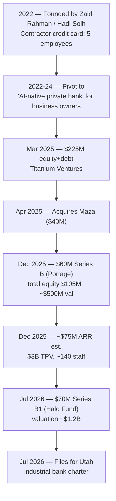

# Flex (Flex.one) — Journey / Teardown

> Consolidated synthesis of the C10 research library at `research/banks/flex-one/`.
> A "journey" profile of a fast-scaling **US business-banking neobank** that reached unicorn
> valuation in ~4 years — the closest structural analogue to what a SA NeoBank is building.
> Public information only. Flex is private and publishes no audited financials; reported/estimated
> figures are tagged **[EST]/[UNK]** and inherit their source tags.

> **Entity note (read first).** There are **two different "Flex" companies.** This file documents
> **Flex.one = Flexbase Technologies, Inc.** (US **business-banking** platform, founded 2022).
> The **rent-payment "Flex"** (getflex.com, Flexible Finance, Inc.) is a **separate entity**
> ([Private Law Wiki](https://wiki.private.law/en/flex.md); [getflex.com](https://getflex.com/)).
> The task's "rent-and-credit model" description maps to getflex.com — flagged **[INF]** for the
> orchestrator.

---

## 1. Origin & Founding Timeline

| Year | Milestone | Tag | Source |
|---|---|---|---|
| **2022** | **Flex founded** by **Zaid Rahman** (Thiel Fellow, Columbia dropout; previously founded **Volley**) with co-founder **Hadi Solh** | [OBS] | [Private Law Wiki](https://wiki.private.law/en/flex.md); [YesPress](https://yespress.io/zaid-rahman) |
| **2022** | First product: working-capital/**credit card for construction contractors**; first card swipe and first 5 employees | [OBS] | [flex.one About](https://www.flex.one/pt/company); [AllScale](https://www.allscale.io/posts/how-flex-turned-a-contractor-card-into-a-unicorn-neobank) |
| **Mar 2025** | **$225M equity + debt** raise ($25M equity led by **Titanium Ventures**) | [OBS] | [BusinessWire](https://www.businesswire.com/news/home/20250306625979/en/) |
| **Apr 2025** | Acquires **Maza** ($40M, a16z-backed) | [OBS] | [YesPress](https://yespress.io/zaid-rahman) *(secondary)* |
| **Dec 2025** | **$60M Series B** led by **Portage Ventures**; total equity **$105M** | [OBS] | [Fintech Magazine](https://fintechmagazine.com/globenewswire/3199876) |
| **Jul 14, 2026** | **$70M Series B1** led by **Halo Fund** → **valuation ~$1.2B** (unicorn) | [OBS] | [flex.one newsroom](https://www.flex.one/it/resource-hub/halo-fund-leads-70m-investment-to-accelerate-the-launch-of-flex-global); [Woofun](https://www.woofun.ai/en/news/detail/101902) |
| **Jul 2026** | Files application for a **Utah industrial bank charter** | [OBS] (attribution caution) | [getflex.com resource](https://getflex.com/resources/flex-bank-charter-application) *(source hosted on getflex domain — treat entity attribution as partial)* |

---

## 2. Growth Journey

- [OBS] Flex started in **2022** as a **contractor-focused working-capital card**, then pivoted to
  an **"AI-native private bank"** for **high-net-worth middle-market business owners** — a
  category-creation play rather than a generic SMB neobank ([Fintech Magazine](https://fintechmagazine.com/globenewswire/3199876)).
- [OBS] Reported traction: **$3B annualized total payment volume (TPV)**; revenue **~4× YoY**;
  **$1B+ in transactions** reached in 2025; **~140 team members**
  ([YesPress](https://yespress.io/zaid-rahman); [flex.one About](https://www.flex.one/pt/company)).
- [OBS] Sacra estimates **~$75M annualized revenue** (Dec 2025, +295% YoY) — third-party **[EST]**
  ([Sacra](https://sacra.com/c/flex/)).
- [OBS] Valuation journey: **~$500M (Dec 2025 Series B)** → **~$1.2B (Jul 2026 Series B1)** — a
  **~2.4× step-up in ~7 months**, tied to an **AI + stablecoin** brand narrative
  ([Founders Mag](https://www.thefoundersmagazine.com/markets/flex-raises-60-million-series-b-reaches-500m-valuation/); [Woofun](https://www.woofun.ai/en/news/detail/101902)).

---

## 3. Product / Model Evolution

- [OBS] Headline proposition: **$0/month**, interest-bearing business checking, **1% cashback**,
  **up to 2.47% APY** ("42× the national average"), **Net-60** on purchases, **up to $3M FDIC**
  ([flex.one Business Banking](https://www.flex.one/business-banking); [banklist.co](https://banklist.co/flex)).
- [OBS] **Pricing schedule** (as published): free monthly account, unlimited physical/virtual cards,
  built-in expense management, automated accounting integrations, same-day ACH and domestic wires
  — all **free**; **international wires 1% currency fee**; 24/7 concierge support included
  ([flex.one Pricing](https://www.flex.one/pricing)).
- [OBS] **Cash management:** up to **20 subaccounts** (taxes, payroll, client projects); global
  payments in **180+ countries** ([banklist.co](https://banklist.co/flex)).
- [OBS] **Credit card:** Flex Business Credit Card with **0% interest for 60 days (Net-60)** and
  employee expense management ([BusinessWire](https://www.businesswire.com/news/home/20250306625979/en/)).
- [OBS] **Flex Global (evolution to a super-app):** institutional business accounts, **multi-currency
  (32 currencies)**, **stablecoins (USDC/USDT)**, high-yield treasury/investment products, personal
  banking, and **trust & family-office accounts**; **Flex Invest** investment products
  ([flex.one Global Banking](https://www.flex.one/global-banking)).
- [INF] The product arc is **card → full business banking → global/multi-currency + stablecoins +
  wealth/trust** — i.e., **acquire via card, expand into a platform**, mirroring what a NeoBank
  would do.

---

## 4. Business Model & Economics

- [OBS] Revenue is **primarily interchange-driven** — merchant fees on Flex card spend flow back to
  Flex via issuing partner **Lead Bank**; additional revenue from a **4% fee on card bill payments**
  and a **1% FX** fee ([Sacra](https://sacra.com/c/flex/)) — third-party **[EST]/[INF]**.
- [INF] Interchange-led economics plus **float/yield on deposits** (2.47% APY marketing) implies
  **NIM-like earnings on idle cash**.
- [OBS] Funding stack: **$225M (Mar 2025)**, **$60M Series B (Dec 2025)** → total equity **$105M**;
  a separate source reports total raised **~$490M** (equity + debt)
  ([Fintech Magazine](https://fintechmagazine.com/globenewswire/3199876); [YesPress](https://yespress.io/zaid-rahman)).
- [UNK] **CAC, gross margin and credit losses are not disclosed.**

**Economics read for a NeoBank:** Flex proves a **card-first, interchange-funded, deposit-yield-
enhanced** model can reach unicorn scale fast — but its economics depend on **BD partner-bank
economics** (interchange share) and **credit discipline on the Net-60 book**, neither of which is
public. [INF]

---

## 5. Customers & Scale

- [OBS] Target segment: **high-net-worth middle-market business owners** (not micro-SMB)
  ([Fintech Magazine](https://fintechmagazine.com/globenewswire/3199876)).
- [OBS] Scale signals: **$3B annualized TPV**, **$1B+ transactions (2025)**, **~140 team members**,
  funding events at **~$1.2B valuation** ([YesPress](https://yespress.io/zaid-rahman); [Woofun](https://www.woofun.ai/en/news/detail/101902)).
- [OBS] Community scale: **10,000+ attendees at Flex-hosted events in 2024**
  ([flex.one About](https://www.flex.one/pt/company)).
- [UNK] Active customer count not disclosed.

---

## 6. Technology

- [OBS] Marketed as **AI-native**, with AI-powered tools (e.g., an **"AI Inbox"** to turn vendor
  documents/spend into actions) ([Fintech Magazine](https://fintechmagazine.com/globenewswire/3199876);
  [AllScale](https://www.allscale.io/posts/how-flex-turned-a-contractor-card-into-a-unicorn-neobank)).
- [OBS] Payments/rails span **ACH/wires, partner-bank card issuance, multi-currency (32 currencies)
  and stablecoin rails (USDC/USDT)** ([flex.one Global Banking](https://www.flex.one/global-banking)).
- [OBS] Banking/cards/lending are delivered through **partner banks — Lead Bank, Column N.A. and
  Thread Bank**; FDIC insurance **up to $3M via Thread Bank** through networked deposits
  ([neobankbeat](https://www.neobankbeat.com/n/flex/who-owns/); [flex.one home](https://www.flex.one/)).
- [INF] Flex maintains **orchestration/programme-management layers** over partner-bank APIs plus its
  own AI/UX front-end.
- [UNK] Named cloud provider, core ledger vendor, app framework.

---

## 7. Marketing & Partnerships

- [OBS] Brand positioning: **"AI-native private bank"** for business owners — category creation, not
  a generic SMB neobank ([Fintech Magazine](https://fintechmagazine.com/globenewswire/3199876)).
- [OBS] Taglines: **"Free for Every Business Owner"**, **"One Card to Rule Them All"**
  ([flex.one Pricing](https://www.flex.one/pricing)).
- [OBS] **Contrast-led value messaging** vs incumbent business banking: $0/month, 1% cashback,
  2.47% APY "42× the national average", Net-60, up to $3M FDIC
  ([banklist.co](https://banklist.co/flex); [flex.one home](https://www.flex.one/)).
- [OBS] Founder **Zaid Rahman** is the primary public face (Thiel Fellow / Columbia dropout
  narrative) ([AllScale](https://www.allscale.io/posts/how-flex-turned-a-contractor-card-into-a-unicorn-neobank)).
- [OBS] **PR/fundraising as marketing beats** ($225M Mar 2025; $60M Dec 2025; $70M / $1.2B Jul 2026)
  and **owned events** (10,000+ attendees in 2024) ([Fintech Magazine](https://fintechmagazine.com/globenewswire/3199876); [flex.one About](https://www.flex.one/pt/company)).
- [OBS] **Partner-bank relationships** (Lead Bank, Column N.A., Thread Bank) are both infrastructure
  and implicit trust signals ([neobankbeat](https://www.neobankbeat.com/n/flex/who-owns/)).
- [UNK] Paid-media spend and CAC.

---

## 8. Lessons & Transferable Mechanics for a SA NeoBank

1. **Card-first acquisition, platform expansion.** Flex acquired on a **free business card** and
   expanded into full banking, global FX and wealth/trust — a NeoBank can use a **single hook
   product** (card/account) then widen via cross-sell. [INF]
2. **Interchange + deposit yield = the early revenue engine.** With no lending scale at launch,
   Flex leaned on **interchange and float**; a SA NeoBank should model **interchange and deposit
   spread** as its day-one economics (subject to local interchange regulation). [INF]
3. **Partner-bank (BaaS) is a fast, capital-light launch path.** Flex reached scale **without its
   own charter** (until its Jul 2026 charter application); a SA NeoBank can start on a **sponsor-
   bank / BaaS arrangement** while pursuing a licence. [INF]
4. **AI-native positioning is a growth narrative.** "AI Inbox" and an AI+stablecoin story supported
   a valuation step-up — AI is now **table-stakes framing** for a new digital bank. [INF]
5. **Contrast marketing beats parity marketing.** Flex attacked incumbents on **fees/APY/FDIC
   limits**; a NeoBank should lead with **sharp, comparable numbers** (fees, yield, coverage). [INF]
6. **Events + founder-led PR as CAC.** Flex used fundraising announcements and owned events as
   low-cost acquisition; a NeoBank can do the same in SA. [INF]
7. **Caution: entity/attribution hygiene.** The "Flex" rent-payment company is a **different
   entity** — a reminder to **verify brand-name collisions** before using competitor intel. [INF]

---

## 9. Journey Timeline (Mermaid)

---

## 10. Sources

- [Flex raises $225M (BusinessWire, Mar 2025)](https://www.businesswire.com/news/home/20250306625979/en/)
- [Flex raises $60M Series B (Fintech Magazine)](https://fintechmagazine.com/globenewswire/3199876)
- [Halo Fund leads $70M / Flex Global (flex.one)](https://www.flex.one/it/resource-hub/halo-fund-leads-70m-investment-to-accelerate-the-launch-of-flex-global)
- [Flex About / company timeline (flex.one)](https://www.flex.one/pt/company)
- [flex.one — Business Banking](https://www.flex.one/business-banking)
- [flex.one — Pricing](https://www.flex.one/pricing)
- [flex.one — Global Banking](https://www.flex.one/global-banking)
- [Private Law Wiki — Flex](https://wiki.private.law/en/flex.md) *(secondary)*
- [YesPress — Zaid Rahman](https://yespress.io/zaid-rahman) *(secondary)*
- [Sacra — Flex](https://sacra.com/c/flex/) *(secondary, est.)*
- [AllScale — How Flex turned a contractor card into a unicorn neobank](https://www.allscale.io/posts/how-flex-turned-a-contractor-card-into-a-unicorn-neobank) *(secondary)*
- [neobankbeat — Who owns Flex](https://www.neobankbeat.com/n/flex/who-owns/) *(secondary)*
- [The Founders Magazine — Flex $60M / ~$500M valuation](https://www.thefoundersmagazine.com/markets/flex-raises-60-million-series-b-reaches-500m-valuation/) *(secondary)*
- [Woofun — Flex valuation doubles to $1.2B](https://www.woofun.ai/en/news/detail/101902) *(secondary)*
- [banklist.co — Flex](https://banklist.co/flex) *(secondary)*
- [getflex.com — Utah industrial bank charter application](https://getflex.com/resources/flex-bank-charter-application) *(other entity — attribution caution)*
