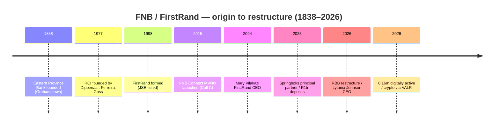

# FNB / FirstRand — Consolidated Journey (UnConsolidated)

> Self-contained synthesis of the FNB research set (`/workspace/research/banks/fnb/`). Every figure is
> traceable to a source already cited in that research set. Tags: `[OBS]` observed/filing-stated,
> `[INF]` inference, `[DER]` derived, `[EST]` estimate, `[UNK]` unknown, `[UNVERIFIED]` single/low-authority.
> **Entity note:** FNB is **a division of FirstRand Bank Limited** (not a separate legal entity); financial
> figures are therefore FirstRand-group or FNB-franchise level as flagged. FY ends **30 June**.

## 1. Origin & founding story

FNB's history fuses a **1838 frontier bank** with a **1977 entrepreneurial start-up** (RCI) that became the
modern **FirstRand** group in 1998. `[OBS]`

| Year | Milestone | Tag |
|---|---|---|
| 1838 | Origins traced to the **Eastern Province Bank**, established 12 Nov 1838 in Grahamstown, Eastern Cape, by wool merchants to finance the wool trade | [OBS] |
| 1977 | **Rand Consolidated Investments (RCI)** founded with R10,000 capital by Laurie Dippenaar, GT Ferreira and Pat Goss — the seed of modern FirstRand | [OBS] |
| 1998 | **FirstRand Limited formed** (announced Mar 1998, effective ~1 Apr 1998; renamed from Momentum Life) by merging RMB Holdings with Anglo American's financial-services interests (FNB, Southern Life, Momentum, WesBank); JSE-listed | [OBS] |
| 2010s | Digital-first retail build-out (FNB Connect MVNO, eWallet/Send Money, eBucks, nav) inside the transactional base | [OBS] |
| 2025 (Mar) | FNB becomes **principal partner of all SA Rugby national teams** (Springbok jersey front) | [OBS] |
| Apr 2024 | **Mary Vilakazi** becomes FirstRand Group CEO — first woman and first Black woman to lead the group | [OBS] |
| 2026 | FirstRand restructures into a **Retail and Business Banking (RBB)** division; **Lytania Johnson** appointed FNB CEO from April 2026 (succeeding Harry Kellan) | [UNVERIFIED] |

## 2. The journey — how it grew

- **Phase 1 — Frontier banking (1838–1976):** the Eastern Province Bank financed the Eastern Cape wool
  trade; a lineage of colonial/regional banks. `[OBS]`
- **Phase 2 — Entrepreneurial start-up (1977–1998):** RCI grew from R10,000 into the **RMB** merchant-banking
  franchise, then merged to form **FirstRand** (1998) — a genuinely founder-led, profit-driven culture. `[OBS]`
- **Phase 3 — Digital-led scale-up (2000s–2020s):** FNB built an **ecosystem model** (banking + insurance +
  device/MVNO + rewards) that converted a transactional base into non-interest-revenue growth, positioning the
  app as SA's leading digital bank. `[OBS]`
- **Phase 4 — Restructure (2026):** new **RBB** division and incoming CEO signal a simplified operating model
  around retail + business banking. `[UNVERIFIED]`

## 3. Product evolution

| Era | Product build-out | Tag |
|---|---|---|
| 1838–1976 | Trade finance, deposits, lending (Eastern Province Bank lineage) | [OBS] |
| 1977–1998 | Merchant banking (RMB) plus insurance (Momentum) and fleet finance (WesBank) pre-merger | [OBS] |
| 2000s | Transactional current accounts; **eBucks** rewards; **eWallet**; **FNB Connect** MVNO (2015, on Cell C) | [OBS] |
| 2020s | **FNB Virtual Card** (dynamic CVV, tokenised); **eWallet on WhatsApp** (Mar 2026); **crypto trading** powered by **VALR** (Oct 2026) | [OBS] |

Current headline products: **Easy Zero (R0/m)**; **Easy PAYU (R7.50/m)**; **Easy Bundle (R73.50/m)**;
**Aspire** (kids free, spouse 50% off); **Fusion Premier (R260/m)**; **Private Wealth (R625/m)**;
**FNBy / FNBy Next** youth (R0–R7.50); **eWallet** (flat R10, up to R15,000); **eBucks** (up to 15% back at
Clicks, up to R6/litre fuel for business); **FNB Connect** (SA's first bank MVNO, >1m active subscribers,
~3m customers, ~R3bn revenue +14%); **FNB crypto with VALR** (5 assets from R10). `[OBS]`

## 4. Business model & economics

FNB/FirstRand runs a **normalised, diversified-franchise model**: strong NII plus a deliberately engineered
**non-interest-revenue (NIR) engine** (fees, insurance, MVNO, rewards-driven card usage) kept within a
disciplined cost base. `[OBS]`

| Metric (FirstRand, normalised) | FY2025 (Jun) | FY2024 | Change | Tag |
|---|---|---|---|---|
| Net interest income (NII) | R91,231m | R86,105m | +6% | [OBS] |
| — NII after impairment | R77,187m | R73,550m | +5% | [OBS] |
| Impairment charge | R14,044m | R12,555m | +12% | [OBS] |
| Total non-interest revenue (NIR) | R58,463m | R55,295m | +6% | [OBS] |
| — Fee & commission income | R40,258m | R38,131m | +6% | [OBS] |
| Income from operations | R135,650m | R128,845m | +5% | [OBS] |
| Operating expenses | R75,998m | R74,405m | +2% | [OBS] |
| Profit before tax | R57,778m | R52,785m | +9% | [OBS] |
| Profit for the year | R45,095m | R40,975m | +10% | [OBS] |
| Normalised earnings (ordinary holders) | R41,824m | R37,988m | +10% | [OBS] |
| Cost-to-income ratio | **50.8%** | 52.6% | improved 1.8pp | [OBS] |
| Return on equity (ROE) | **20.2%** | 20.1% | +0.1pp | [OBS] |
| Credit loss ratio (core lending) | 0.85% | 0.81% | worsened | [OBS] |
| CET1 ratio | 14.0% | 13.5% | +0.5pp | [OBS] |
| Total capital adequacy | 16.9% | 16.1% | +0.8pp | [OBS] |
| Total assets | R2,586,538m | R2,366,815m | +9% | [OBS] |
| Net advances | R1,748,639m | — | — | [OBS] |
| Deposits & debt funding | R2,181,874m | — | — | [OBS] |

- **FNB franchise:** FNB's **deposit base exceeded R1 trillion** for the first time (FY2025); FNB is
  FirstRand's largest franchise by earnings. `[OBS]`
- **Value-added services (FY2025):** FNB Connect volumes worth **R22bn** with **3m customers**; total retail
  revenue from these services **+15% to >R2.9bn**; insurance income **+9%**, insurance PBT **+8%**. `[OBS]`
- **FY2026 direction:** FNB SA active customers **12.77m**; digitally-active **8.16m**; app processed
  **782m transactions (+10%)**; virtual-card spend **R101bn**; PayShap payments **grew >8×**. `[OBS]`
- `[DER]` FNB/FirstRand's **50.8% CIR is best-in-class among the Big Five** (vs Nedbank 57.8%, Absa 53.8%),
  and its **20.2% ROE** is second only to Capitec — evidence that the ecosystem/NIR model subsidises a lean
  cost base. `[DER]`
- `[UNVERIFIED]` **Cross-source conflict:** BusinessTech's "Battle of the banks 2026" table lists FirstRand
  **HE R26.2bn / HEPS 711c / ROE 20.3% / market cap R530.3bn / P/E 13.75**, whereas FirstRand's own FY2025
  normalised earnings are **R41,824m** with ROE 20.2%. ROE and market cap reconcile; the **HE/HEPS figures
  diverge** between the two sources and are flagged `[UNVERIFIED]` pending basis reconciliation. `[UNVERIFIED]`
- `[UNK]` FirstRand FY2026 full-group NII/CIR/ROE were only partially readable in this pass; FY2025 is the
  verified baseline. `[UNK]`

## 5. Customers & distribution

- **FNB active customers: 12.37m (FY2025)** (12.07m FY2024) → **12.77m South Africa (FY2026)**;
  split FY2025: SA **10.01m**, broader Africa **2.36m**. `[OBS]`
- **Digital adoption (FY2026):** **8.16m digitally-active customers**; app processed **782m transactions
  (+10%)**. FY2025 channel mix: **digital 889.6m** transactions vs **ATM/ADT 277.7m**; card issuing
  **1,300m**; card acquiring **1,112m** transactions. `[OBS]`
- **Employees: 50,717 (FY2025)** (SA 40,194; broader Africa 6,835; UK 1,958; FirstJob youth 975). `[OBS]`
- **Footprint (FY2025):** **5,772 ATMs** (SA 4,771 + Africa 1,001); **767 branches** (SA 630);
  **5,089 CashPlus/AgencyPlus agents** (+17%). `[OBS]`
- **Channels:** FNB Banking App (Google Play rating **4.7**; repeatedly named SA's Best Consumer Digital Bank),
  Online Banking, **eWallet** (bank-account-less remittance), **eWallet on WhatsApp**, USSD, branch/ATM,
  retailer **Cash@Till** deposits. `[OBS]`
- **Complaints:** FNB's share of formal banking complaints was **14.88% (2025)** (Standard Bank 20.23%,
  Absa 17.06%, Capitec 16.05%, Nedbank 15.47%); in a prior cycle FNB had **1,017 cases (17%)**. Sector-wide
  the Ombud returned **R60m+** to consumers in 2025, with mobile + internet banking fraud = **39%** of
  cases. `[OBS]`
- `[INF]` High app satisfaction (4.7) coexists with **fraud-driven complaints** — the same incumbent pattern
  seen across the sector. `[INF]`

## 6. Technology & partnerships

- **Digital channels:** **FNB Banking App** (Android `za.co.fnb.connect.itt`, publisher FirstRand Bank
  Limited); **FNB Virtual Card** with a **dynamic CVV (changing hourly on the Global card)**, tokenised into
  Apple Pay, Google Pay, Samsung Pay, Fitbit Pay, Garmin Pay, SwatchPAY, plus QR "Scan to Pay". `[OBS]`
- **Platform / embedded services:** **FNB Connect** MVNO (Cell C 2015; MTN added 2023); **eWallet on
  WhatsApp** (11 Mar 2026); **crypto trading powered by VALR** (FSCA licence **53308**), 5 major assets from
  R10, embedded for ~9m customers (announced 6 Oct 2026). `[OBS]`
- **Back-end:** FNB's **core banking vendor, cloud provider(s) and middleware are not publicly disclosed**. `[UNK]`
- **Acquiring/issuing:** FNB acts as both **card issuer and acquirer** on global schemes (Visa/Mastercard). `[INF]`
- **Rails:** initial-cohort **PayShap** participant (launched 13 Mar 2023); supports **PayShap Payment
  Request**; EFT, RTC/SAMOS, and "Scan to Pay" QR. `[OBS]`
- **Legal/regulatory:** FirstRand Bank Limited is a SARB-supervised registered bank (Reg No
  **1929/001225/06**; **NCRCP20**; FAIS FSP licence under Act 37 of 2002). SA exited the **FATF grey list in
  2025**. `[OBS]`

## 7. Marketing & sponsorships

FNB positions on **"Help is at the heart of human greatness"** and mass **sport + ecosystem** sponsorship. `[OBS]`

| Property | Category | Note | Tag |
|---|---|---|---|
| **FNB Stadium** | Football (naming rights) | Named "FNB Stadium" since it opened in **1989**; became "Soccer City" only for the 2010 FIFA World Cup; **renewed 5-year deal (2017–2022) at ~R14m/year** — SA's longest continuous stadium naming sponsor | [OBS] |
| **SA Rugby / Springboks** | Rugby | SA Rugby partner since 2017; **principal partner of all national teams from March 2025** (logo to front of Springbok jersey); reported value **~R150m/year** | [OBS]/[UNVERIFIED] |
| **Cricket Namibia** | Cricket | Associate sponsor of the national men's team; **FNB Wanderers** in domestic cricket | [OBS] |
| 2010 FIFA World Cup | Football | ~**US$30m** spent as a FIFA partner | [OBS] |

- **Campaigns:** **eBucks** is used as a retention/acquisition engine tied to FNB card and insurance usage;
  **FNB Connect / eWallet** are marketed as ecosystem "value-added services" driving NIR. `[OBS]`
- `[UNK]` FNB's total marketing/advertising budget is not disclosed. `[UNK]`

> **Brief correction:** the brief suggested FNB sponsors the **Proteas**. Evidence shows the Proteas' banking
> sponsor historically was **Standard Bank** (1998–2011, 2016–2020), **not** FNB; senior Proteas shirt
> sponsors as of 2026 are Jonsson Workwear (Test) and others. FNB's cricket involvement is regional
> (**Cricket Namibia**, **FNB Wanderers**). `[OBS]`

## 8. Strengths, weaknesses, threats & NeoBank lessons

**Strengths**
- **Best-in-class CIR (50.8%)** and **20.2% ROE**; a genuinely differentiated **ecosystem** (Connect MVNO,
  eBucks, insurance, crypto) that grows NIR and locks in customers. `[OBS]`
- **Largest app franchise** in the set (8.16m digitally active; 782m transactions) and the most-awarded
  digital bank; >R1tn FNB deposits; B-BBEE **Level 1 for 8 consecutive years** (Black ownership 30.1%). `[OBS]`

**Weaknesses**
- **Fraud-driven complaint load** (14.88% share) and heavy dependence on the SA retail cycle. `[OBS]`
- Back-end architecture undisclosed — limits external benchmarking of core-banking resilience. `[UNK]`

**Threats**
- Digital-first challengers (Capitec R7.50/m; TymeBank; African Bank MyWORLD free) compressing the entry-level
  fee line. `[OBS]`
- Interchange/consumer-credit regulatory pressure; ecosystem services (MVNO/crypto) attract regulatory
  scrutiny. `[INF]`

**NeoBank learn / exploit**
- **Exploit the "ecosystem tax":** FNB's value is delivered through *bundled* ecosystem tie-ins; a NeoBank
  that offers a clean, unbundled, transparent core (no cross-sell requirement) can win switchers fatigued by
  ecosystem lock-in. `[INF]`
- **Beat it on fraud trust:** FNB's high complaint share is concentrated in digital fraud — a NeoBank with a
  strong real-time fraud guarantee + instant reimbursement is a credible differentiator. `[INF]`
- **Copy the young-family play:** FNB's **zero-fee kids / spouse 50% off** family banking is a proven
  acquisition wedge; a NeoBank can offer a simpler, free family bundle from day one. `[INF]`

## 9. Journey chart (Mermaid)

## 10. Sources

- [FirstRand Group Analysis of Financial Results, FY2025 (single-page booklet)](https://www.firstrand.co.za/media/investors/reports/fsr-analysis-of-financial-results-June-2025-single-page-printable-booklet.pdf)
- [FirstRand FY2025 media release](https://www.firstrand.co.za/media/investors/reports/fsr-results-media-release-june-2025.pdf)
- [FirstRand FNB & WesBank results presentation, June 2025](https://www.firstrand.co.za/media/investors/reports/fsr-results-presentation-June-2025.pdf)
- [FirstRand Group Analysis of Financial Results, FY2026 (booklet)](https://www.firstrand.co.za/media/investors/reports/fsr-analysis-of-financial-results-booklet-june-2026.pdf)
- [FirstRand Transformation & Employment Equity Report 2025](https://www.firstrand.co.za/media/investors/policies-and-practice/pdf/FirstRand_transformation_and_employment_equity_report_2025.pdf)
- [FNB account confirmation letter (Reg. No. 1929/001225/06; NCRCP20)](https://www.sabreproducts.com/assets/banking/20250430%20Sabre%20FNB%20Bank%20Acocunt%20details.pdf)
- [FNB Zambia — About us (FirstRand Group history)](https://www.fnbzambia.co.zm/about-us/)
- [FNB Easy Pricing Guide](https://online.firstrand.co.za/downloads/pricing-guides/FNB-Easy-Account.pdf)
- [FNB Private Wealth Pricing Guide](https://www.fnb.co.za/downloads/pricing-guides/FNB-Private-Wealth-Account.pdf)
- [FNB Aspire Pricing Guide](https://www.fnb.co.za/downloads/pricing-guides/FNB-Aspire-Account.pdf)
- [FNB eWallet](https://www.online.fnb.co.za/send-money/eWallet.html)
- [FNB Virtual Card FAQs](https://www.fnb.co.za/downloads/ways-to-bank/FNBVirtualCardFAQs.pdf)
- [SA Rugby — SA Rugby broadens and deepens relationship with FNB](https://www.springboks.rugby/news-features/articles/2025/03/26/sa-rugby-broadens-and-deepens-relationship-with-fnb/)
- [Grokipedia — FNB Stadium](https://grokipedia.com/page/FNB_Stadium)
- [Touchline News — FNB Connect MVNO (Cell C/MTN)](https://touchlinenews.com/absa-joins-telecom-race-as-final-big-four-bank-to-launch-mobile-network-service/)
- [Cryptonomist — FNB crypto trading with VALR](https://ko.cryptonomist.ch/2026/10/07/fnb%EB%8A%94-%EB%82%A8%EC%95%84%ED%94%84%EB%A6%AC%EC%B9%B4%EA%B3%B5%ED%99%94%EA%B5%AD%EC%97%90%EC%84%9C-%EC%95%BD-900%EB%A7%8C-%EB%AA%85%EC%9D%98-%EA%B3%A0%EA%B0%9D%EC%97%90%EA%B2%8C-%EC%95%94/)
- [Moonstone — Bank share of formal complaints 2025](https://www.moonstone.co.za/banking-complaints-surge-as-fraudsters-follow-customers-online/)
- [Daily Investor — Three men turned R10,000 into South Africa's most valuable bank](https://dailyinvestor.com/banking/128042/three-men-turned-r10000-into-south-africas-most-valuable-bank/)
- [BusinessTech — Battle of the banks 2026](https://businesstech.co.za/news/banking/876479/battle-of-the-banks-2026-capitec-vs-fnb-vs-standard-bank-vs-absa-vs-nedbank/)
