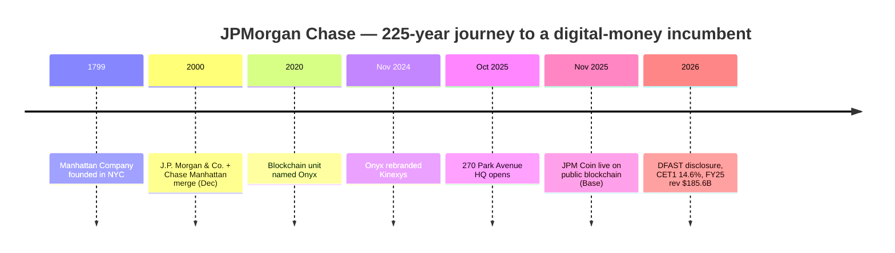

# JPMorgan Chase & Co. — Journey / Teardown

> Consolidated synthesis of the C10 research library at `research/banks/jpmorgan-chase/`.
> A reverse-engineering "journey" profile of the incumbent global-bank benchmark: origin, growth,
> product/model evolution, business model, scale, technology, marketing and transferable mechanics
> for a South African NeoBank. Public information only. Non-obvious claims are tagged and cited;
> all tags ([OBS]/[EST]/[INF]/[UNK]) are inherited from the underlying files.

---

## 1. Origin & Founding Timeline

| Year | Milestone | Tag | Source |
|---|---|---|---|
| **1799** | Roots traced to the **Manhattan Company** in New York City | [OBS] | [History of Our Firm](https://www.jpmorganchase.com/about/our-history) |
| — | Firm built on **1,200+ predecessor institutions** over ~225 years | [OBS] | [History of Our Firm](https://www.jpmorganchase.com/about/our-history) |
| **Dec 2000** | **J.P. Morgan & Co. merges with The Chase Manhattan Corporation** to form JPMorgan Chase & Co. | [OBS] | [Britannica](https://www.britannica.com/money/JPMorgan-Chase-and-Co) |
| **2000** | Jamie Dimon, then leading **Bank One**, becomes CEO of the merged firm | [OBS] | [2025 CEO letter](https://www.jpmorganchase.com/ir/annual-report/2025/ar-ceo-letters) |
| **2020** | Blockchain unit named **Onyx** | [OBS] | [DiPprofit — Onyx](https://www.dipprofit.com/what-happened-to-onyx-crypto-created-by-jpmorgan-in-2026/) |
| **Nov 2024** | Onyx **rebranded Kinexys by J.P. Morgan** (announced at Singapore Fintech Festival) | [OBS] | [Introducing Kinexys](https://www.jpm.com/insights/payments/payment-trends/introducing-kinexys) |
| **Oct 21, 2025** | New global HQ at **270 Park Avenue** opens (~423 m, 60 floors; ~10,000 employees by year-end) | [OBS] | [270 Park press release](https://www.jpmorganchase.com/newsroom/press-releases/2025/grand-opening-270-park) |
| **Nov 2025** | **JPM Coin** launches live as a USD deposit token on a public blockchain | [OBS] | [JPM Coin newsroom](https://www.jpmorgan.com/payments/newsroom/jpm-coin-usd-deposit-token-institutional-clients) |
| **2026** | Annual **DFAST** stress-test disclosure published (CET1 14.6%) | [OBS] | [2026 DFAST disclosure](https://www.jpmorganchase.com/content/dam/jpmc/jpmorgan-chase-and-co/investor-relations/documents/events/2026/2026-annual-dodd-frank-act-stress-test-results-disclosure/2026-results-methodology-disclosure-dfast-2026-20260624.pdf) |

---

## 2. Growth Journey

- [OBS] JPMorgan Chase is the **largest US bank by assets** and reported the **highest annual net
  income of any bank globally** in FY2024, formed through the union of a commercial-banking giant
  (Chase) and a premier investment bank (J.P. Morgan).
- [OBS] The firm has now posted **record net revenue for eight consecutive years**, culminating in
  **FY2025 revenue of $185.6B** (vs $180.6B in FY2024, $158.1B in FY2023)
  ([2025 CEO letter](https://www.jpmorganchase.com/ir/annual-report/2025/ar-ceo-letters)).
- [OBS] Growth is anchored in **net interest income (NII)** — FY2024 NII of **$92.6B** was the single
  largest revenue component; FY2025 NII rose to **$95.9B**.
- [OBS] Scale compounded through acquisition and organic growth: 2023–2025 headcount rose from
  **309,926 → 317,233 → 318,512** ([2025 Annual Report](https://www.jpmorganchase.com/content/dam/jpmc/jpmorgan-chase-and-co/investor-relations/documents/annualreport-2025.pdf)).

**Revenue & profit trajectory (firm-level):**

| Metric | FY2023 | FY2024 | FY2025 |
|---|---|---|---|
| Managed/reported net revenue | $158.1B (reported) | $180.6B managed | $185.6B managed / $182.4B reported |
| Net income | — | $58.5B | $57.0B |
| Diluted EPS | — | — | $20.02 |
| ROTCE | — | 20% | 20% |
| ROE | — | — | 17% |

[OBS] (all cells from the [2025 CEO letter](https://www.jpmorganchase.com/ir/annual-report/2025/ar-ceo-letters) and [2024 CEO letter](https://www.jpmorgan.com/about-us/corporate-news/2025/2024-annual-report)).

---

## 3. Product / Model Evolution

- [OBS] The firm operates through **four reportable segments** — **Consumer & Community Banking
  (CCB)**, **Commercial & Investment Bank (CIB)**, **Asset & Wealth Management (AWM)** and
  **Corporate** ([10-K](https://jpmorganchaseco.gcs-web.com/node/210081/html)).
- [OBS] **CIB** was created by merging Commercial Banking + the Corporate & Investment Bank
  (integration announced 2024) — a structural move toward a unified wholesale franchise.
- [OBS] **AWM** houses both **J.P. Morgan Asset Management** and the **J.P. Morgan Private Bank**.
- [OBS] The clearest product-model evolution is the **affluent tier ladder**: retail **Chase
  Total Checking** → **Chase Private Client ($150,000+)** → **J.P. Morgan Private Client
  ($750,000+)** → **J.P. Morgan Private Bank (>$5M investable)**
  ([Chase/Media](https://media.chase.com/news/jpmorganchase-opens-flagship-financial-centers-for-affluent-clients)).
- [OBS] Digital layer (**Chase Mobile®**) bundles Zelle, QuickDeposit, in-app card lock, credit-score
  monitoring and wealth tools ([Chase Total Checking](https://www.chase.com/personal/checking/total-checking)).
- [OBS] The newest "product" layer is the **tokenized-money stack** (Kinexys / JPM Coin) — moving
  from private-blockchain wholesale payments toward public-blockchain deposit tokens.

---

## 4. Business Model & Economics

- [OBS] **Two-engine revenue:** net interest income (FY2025 **$95.9B**) plus noninterest revenue
  (**$89.7B**) — diversified across retail deposits, cards, markets and asset management.
- [OBS] Total FY2025 noninterest expense **$95.6B**; **compensation expense $54,487M** (2025) vs
  $51,357M (2024) — driven by front-office growth and revenue-related pay, predominantly CIB/AWM
  ([2025 MD&A](https://www.jpmorganchase.com/content/dam/jpmc/jpmorgan-chase-and-co/investor-relations/documents/managements-discussion-analysis-2025.pdf)).
- [OBS] Profitability: **ROTCE 20%** (FY2024 & FY2025); **ROE 17%** (FY2025).
- [OBS] Capital: **CET1 (standardized) 14.6%** at 4Q25; projecting corporate guidance of
  **~$103B NII in 2026** ([8-K iXBRL](https://jpmorganchaseco.gcs-web.com/node/902791/ixbrl-viewer);
  [Investing.com](https://uk.investing.com/news/company-news/jpmorgan-q4-2025-presentation-reveals-earnings-beat-projects-103b-nii-for-2026-93CH-4451751)).
- [OBS] Segment net-income split is **not cleanly reconcilable** from aggregators; the audited 10-K
  segment note is the authoritative source — treat exact splits as [UNK].
- [OBS] Dividends: quarterly common dividend raised from **$1.05 → $1.15** (Q1 2024) and again in
  2025 ([2024 CEO letter](https://www.jpmorgan.com/about-us/corporate-news/2025/2024-annual-report)).

**Economics read for a NeoBank:** the incumbent's advantage is **balance-sheet scale (NII) + a
diversified fee engine**, not any single product. A NeoBank cannot match NII at launch, so its
early model must lean on **interchange + fee/noninterest revenue + low CAC**, and earn the right to
a deposit-funded NII base over time. [INF]

---

## 5. Customers & Scale

- [OBS] **Employees: 318,512** (2025); 317,233 (2024); 309,926 (2023)
  ([2025 Annual Report](https://www.jpmorganchase.com/content/dam/jpmc/jpmorgan-chase-and-co/investor-relations/documents/annualreport-2025.pdf)).
- [OBS] Distribution: **14,000+ ATMs and 5,000 branches** in the US retail network
  ([Chase Total Checking](https://www.chase.com/personal/checking/total-checking)).
- [OBS] Affluent wealth tiers span **$150k / $750k / >$5M** thresholds (see §3).
- [OBS] The **Private Bank** division is reported (secondary) to oversee **>$3.5T client assets
  (Dec 2025)**, **3,500+ advisors** and **75+ offices** — single-source, treat as **UNVERIFIED**
  ([Grokipedia](https://grokipedia.com/page/JP_Morgan_Private_Bank)).
- [UNK] Precise current US consumer customer count is not confirmed from a primary source here.

---

## 6. Technology & Blockchain

- [OBS] **FY2025 firmwide technology expense ~$18B**; technology *investments* ~$8.0B ($5.3B
  products/platforms/features, $2.7B structural/volumes), with CCB ~$3.2B
  ([2025 Investor Day](https://www.jpmorganchase.com/content/dam/jpmc/jpmorgan-chase-and-co/investor-relations/documents/events/2025/jpmc-2025-investor-day/full-presentation.pdf)).
- [OBS] **Multi-cloud** across AWS, Google Cloud and Microsoft Azure; consolidating data centres to
  ~17 AI-optimised sites; internal data/AI platform on **AWS SageMaker** with 5,000+ monthly users
  ([Business Insider Africa](https://africa.businessinsider.com/news/heres-how-aws-is-helping-financial-giants-like-jpmorgan-and-bridgewater-with-their-ai/fehdr39)).
- [OBS] Reported **450+ AI use cases in production serving 200,000 daily users** — aggregator-sourced,
  treat as **partial/single-source** ([anikethfocus](https://anikethfocus.org/how-jpmorgans-18b-ai-strategy-reveals-the-five-technologies-every-professional-should-master/)).
- [OBS] **Blockchain — Kinexys (formerly Onyx):** three product lines — **Kinexys Digital Payments**
  (formerly JPM Coin System), **Kinexys Digital Assets** (formerly Onyx Digital Assets) and
  **Kinexys Labs** ([Solana Compass](https://solanacompass.com/projects/jpmorgan-chase)).
- [OBS] Kinexys scale: **>$4T cumulative** processed, **~$7B average daily volume**, clients across
  **five continents**, settlement in **8 currencies** (mid-2026); launched 2019
  ([HBS case study](https://www.jpmorgan.com/payments/newsroom/harvard-business-school-case-study-kinexys)).
- [OBS] **JPM Coin** — first announced/piloted Feb 2019; public-blockchain pilot Jun 2025; **live
  offering Nov 2025**; the **first bank to issue a USD deposit token on a public blockchain**, with
  the deposit token live on **Base** ([JPM Coin newsroom](https://www.jpmorgan.com/payments/newsroom/jpm-coin-usd-deposit-token-institutional-clients);
  [Kinexys About](https://www.jpmorgan.com/kinexys/about)).
- [UNK] Kinexys client fee/pricing structure — not publicly disclosed.

---

## 7. Marketing & Partnerships

| Property | Relationship | Since | Source |
|---|---|---|---|
| **US Open** (tennis) | Official sponsor | [OBS] **45 years** as of 2026 | [Chase US Open](https://www.chase.com/personal/events/us-open) |
| **Chase Center** (Golden State Warriors) | Naming-rights partner | [OBS] 20-year agreement signed 2016 | [Chase Center brief](https://www.lauriegarrison.com/wp-content/uploads/2019/09/ChaseCenter_Sept23_2019.pdf) |
| **Home Nations football** (FA/IFA/SFA/FAW) | Chase UK Official Banking Partner | [OBS] Feb 28, 2024 | [Chase UK press](https://www.chase.co.uk/gb/en/media/chase-named-the-official-banking-partner-of-the-home-nations-football-teams/) |
| **Transport for London (TfL)** | Chase UK "Official Payment Partner" | [OBS] Nov 24, 2025 | [Chase UK press](https://www.chase.co.uk/gb/en/media/chase-tfl/) |

- [OBS] Chase invests in women's sport (KPMG Women's PGA; founding partner of the Golden State
  Valkyries and League One Volleyball) ([Athlete Council](https://www.chase.com/personal/jpmc-athletes-council)).
- [OBS] **Chase Freedom®** runs rotating quarterly 5% cash-back categories as an always-on
  acquisition mechanic ([Chase press announcements](https://media.chase.com/news)).
- [OBS] Marketing is described as data-driven/personalised, leveraging customer data and a
  significant share of the tech budget for marketing platforms
  ([matrixbcg](https://matrixbcg.com/blogs/marketing-strategy/jpmorganchase)).
- [OBS] Affluent marketing leads on **concierge services, preferred savings rates and complimentary
  wealth planning** ([Chase/Media](https://media.chase.com/news/jpmorganchase-opens-flagship-financial-centers-for-affluent-clients)).
- [UNK] Firmwide advertising spend / brand-equity metrics not publicly disaggregated.

---

## 8. Lessons & Transferable Mechanics for a SA NeoBank

1. **Tiered wealth ladder as a growth engine.** Chase converts retail customers upward through
   explicit **$150k → $750k → $5M** thresholds, each unlocking a richer product/relationship. A SA
   NeoBank's loyalty/segmentation stack should be built as a **transparent value ladder**, even at
   much lower thresholds. [INF]
2. **Two-engine economics.** NII (deposits) + noninterest (fees/interchange) de-risks the model; a
   NeoBank should plan the **interchange → fee → deposit-NII transition** deliberately. [INF]
3. **Technology spend is the moat.** An ~$18B tech budget funds cloud, AI and blockchain; a NeoBank
   should buy leverage via **cloud-native + vendor rails** rather than replicate at scale. [INF]
4. **Tokenized deposits / programmable money.** Kinexys/JPM Coin is the incumbent benchmark for
   **24/7 near-real-time cross-border settlement** — directly comparable to a SA NeoBank's
   payments/settlement ambitions and to stablecoin rails. [INF]
5. **Sponsorship as legitimacy + acquisition.** Long-tenure properties (US Open 45 yrs; Chase Center
   20 yrs) compound brand trust; sports/culture partnerships are transferable to a fan-engagement
   NeoBank. [INF]
6. **Regulatory posture is a product feature.** G-SIB capital discipline (CET1 14.6%, DFAST) is the
   trust foundation that lets the bank sell "safety" — a NeoBank must build a visible
   **deposit-safety narrative** from day one. [INF]

---

## 9. Journey Timeline (Mermaid)

---

## 10. Sources

- [History of Our Firm — JPMorganChase](https://www.jpmorganchase.com/about/our-history)
- [JPMorgan Chase & Co. — Britannica Money](https://www.britannica.com/money/JPMorgan-Chase-and-Co)
- [Jamie Dimon's Letter to Shareholders, Annual Report 2025](https://www.jpmorganchase.com/ir/annual-report/2025/ar-ceo-letters)
- [2024 Annual Report — Chairman and CEO Letter](https://www.jpmorgan.com/about-us/corporate-news/2025/2024-annual-report)
- [2025 Annual Report (PDF)](https://www.jpmorganchase.com/content/dam/jpmc/jpmorgan-chase-and-co/investor-relations/documents/annualreport-2025.pdf)
- [2025 MD&A (PDF)](https://www.jpmorganchase.com/content/dam/jpmc/jpmorgan-chase-and-co/investor-relations/documents/managements-discussion-analysis-2025.pdf)
- [JPMorgan Chase 10-K (segments)](https://jpmorganchaseco.gcs-web.com/node/210081/html)
- [Grand Opening of 270 Park Avenue](https://www.jpmorganchase.com/newsroom/press-releases/2025/grand-opening-270-park)
- [2025 Investor Day presentation (PDF)](https://www.jpmorganchase.com/content/dam/jpmc/jpmorgan-chase-and-co/investor-relations/documents/events/2025/jpmc-2025-investor-day/full-presentation.pdf)
- [Business Insider Africa — AWS & JPMorgan AI](https://africa.businessinsider.com/news/heres-how-aws-is-helping-financial-giants-like-jpmorgan-and-bridgewater-with-their-ai/fehdr39)
- [anikethfocus — JPMorgan $18B AI strategy](https://anikethfocus.org/how-jpmorgans-18b-ai-strategy-reveals-the-five-technologies-every-professional-should-master/)
- [Introducing Kinexys by J.P. Morgan](https://www.jpm.com/insights/payments/payment-trends/introducing-kinexys)
- [About Kinexys](https://www.jpmorgan.com/kinexys/about)
- [First bank issues USD deposit token on a public blockchain](https://www.jpmorgan.com/payments/newsroom/jpm-coin-usd-deposit-token-institutional-clients)
- [HBS case study — Kinexys](https://www.jpmorgan.com/payments/newsroom/harvard-business-school-case-study-kinexys)
- [Solana Compass — JPMorgan/Kinexys](https://solanacompass.com/projects/jpmorgan-chase)
- [JPMorgan Q4 2025 earnings release (PDF)](https://www.jpmorganchase.com/content/dam/jpmc/jpmorgan-chase-and-co/investor-relations/documents/quarterly-earnings/2025/4th-quarter/d868c7ef-1670-465d-ba75-c2b36ddbcc6b.pdf)
- [Investing.com — JPMorgan Q4 2025](https://uk.investing.com/news/company-news/jpmorgan-q4-2025-presentation-reveals-earnings-beat-projects-103b-nii-for-2026-93CH-4451751)
- [JPMorgan Chase 8-K iXBRL (capital ratios)](https://jpmorganchaseco.gcs-web.com/node/902791/ixbrl-viewer)
- [Chase × US Open](https://www.chase.com/personal/events/us-open)
- [Chase Center partnership brief (PDF)](https://www.lauriegarrison.com/wp-content/uploads/2019/09/ChaseCenter_Sept23_2019.pdf)
- [Chase named Official Banking Partner of Home Nations](https://www.chase.co.uk/gb/en/media/chase-named-the-official-banking-partner-of-the-home-nations-football-teams/)
- [Chase × TfL Official Payment Partner](https://www.chase.co.uk/gb/en/media/chase-tfl/)
- [JPMorganChase opens flagship financial centers for affluent clients](https://media.chase.com/news/jpmorganchase-opens-flagship-financial-centers-for-affluent-clients)
- [Chase Total Checking®](https://www.chase.com/personal/checking/total-checking)
- [Grokipedia — J.P. Morgan Private Bank](https://grokipedia.com/page/JP_Morgan_Private_Bank) *(secondary)*
