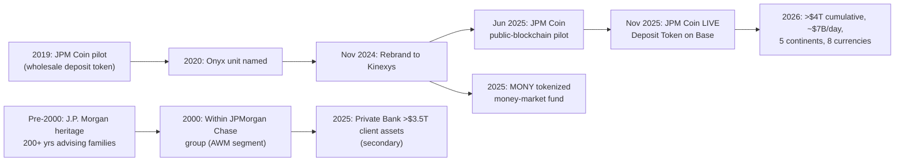

# J.P. Morgan Private Bank & Kinexys / JPM Coin — Journey / Teardown

> Consolidated synthesis of the C10 research libraries at `research/banks/jpmorgan-private-bank/`
> and `research/banks/jpmorgan-chase/blockchain/`. Two linked JPMorgan Chase capabilities:
> the **UHNW private-banking franchise** (relationship/wealth engine) and **Kinexys** (tokenized
> deposits & programmable cross-border money). Public information only. Where the sources are
> secondary/aggregator, figures are tagged **secondary/[UNVERIFIED]/[UNK]**.

---

## 1. Origin & Founding Timeline

| Year | Milestone | Tag | Source |
|---|---|---|---|
| **~1799–1800s** | **J.P. Morgan** heritage "over two centuries" of advising wealthy families | [OBS] | [Family Office Services](https://privatebank.jpmorgan.com/nam/en/services/wealth-planning-and-advice/family-office-services) |
| **2000** | Private Bank sits within the **JPMorgan Chase** group after the J.P. Morgan/Chase merger | [OBS] | [Britannica](https://www.britannica.com/money/JPMorgan-Chase-and-Co) |
| **2019** | **JPM Coin** first announced/piloted as a wholesale deposit token (Feb) | [OBS] | [Grokipedia — JPM Coin](https://grokipedia.com/page/JPM_Coin) |
| **2020** | Blockchain unit named **Onyx** | [OBS] | [DiPprofit — Onyx](https://www.dipprofit.com/what-happened-to-onyx-crypto-created-by-jpmorgan-in-2026/) |
| **Nov 2024** | Onyx **rebranded Kinexys**; first Treasury features introduced | [OBS] | [Introducing Kinexys](https://www.jpm.com/insights/payments/payment-trends/introducing-kinexys) |
| **Jun 2025** | JPM Coin **piloted on a public blockchain** | [OBS] | [Kinexys/JPM Coin recognition](https://www.jpmorgan.com/payments/newsroom/kinexys-jpm-coin-industry-recognition-2026) |
| **Nov 2025** | **JPM Coin launches live** for institutional clients; Deposit Token live on **Base** | [OBS] | [JPM Coin newsroom](https://www.jpmorgan.com/payments/newsroom/jpm-coin-usd-deposit-token-institutional-clients) |
| **2025** | **MONY** becomes the first tokenized money-market fund backed by J.P. Morgan | [OBS] | [Kinexys About](https://www.jpmorgan.com/kinexys/about) |

---

## 2. Growth Journey

**Private Bank.** [OBS] Positions itself as the **"World's Best Private Bank"** with 200+ years of
heritage, serving UHNW individuals, families and family offices across investments, advisory and
administrative needs ([Family Office Services](https://privatebank.jpmorgan.com/nam/en/services/wealth-planning-and-advice/family-office-services)).
Its entry tier is **clients with more than $5M in investable assets**
([Chase/Media](https://media.chase.com/news/jpmorganchase-opens-flagship-financial-centers-for-affluent-clients)),
sitting above group tiers at $150k (Chase Private Client) and $750k (J.P. Morgan Private Client).

**Kinexys.** [OBS] Grew from the 2019 JPM Coin pilot into a blockchain business unit processing
**>$4T cumulative**, **~$7B average daily volume**, across **five continents** and **8 settlement
currencies** (mid-2026) ([HBS case study](https://www.jpmorgan.com/payments/newsroom/harvard-business-school-case-study-kinexys)).
Earlier disclosures cited **>$1.5T cumulative**, **>$2B daily** and **10× YoY** volume growth
([Fintech News MENA](https://fintechnews.media/eight-major-mena-banks-adopt-jpmorgans-kinexys-blockchain-platform-for-cross-border-payments)).

---

## 3. Product / Model Evolution

**Private Bank offerings:**
- [OBS] **Family Office Services** — Outsourced CIO (asset allocation, investment policy, risk
  management), global markets insight, institutional trading, strategic tax management
  ([Family Office Services](https://privatebank.jpmorgan.com/nam/en/services/wealth-planning-and-advice/family-office-services)).
- [OBS] **Private markets / alternatives** platform with direct-investment access; family-office
  solutions generally viable at **"a few hundred million in assets."**
- [OBS] **Holistic wealth management** backed by research analysts in **25 countries**
  ([J.P. Morgan Private Client](https://www.jpmorgan.com/private-client)).
- [OBS] **Digital tools:** portfolio/positions tracking, index comparison, hedge-fund views, equity
  research, bill pay, real-time-FX wires, mobile check deposit and **account aggregation across
  thousands of external institutions**
  ([Private Bank online tools](https://privatebank.jpmorgan.com/nam/en/services/banking/online-tools)).

**Kinexys / JPM Coin evolution:** [OBS] three product lines — **Kinexys Digital Payments** (JPM Coin
System), **Kinexys Digital Assets** (Onyx Digital Assets) and **Kinexys Labs**
([Solana Compass](https://solanacompass.com/projects/jpmorgan-chase)). The roadmap progressed from
**private-blockchain wholesale settlement** to **public-blockchain deposit tokens** (Base) and
**tokenized money-market funds (MONY)** and tokenized commercial paper
([Kinexys About](https://www.jpmorgan.com/kinexys/about)).

---

## 4. Business Model & Economics

- [OBS] **Private Bank is not a reportable segment** — its results consolidate within JPMorgan
  Chase's **Asset & Wealth Management (AWM)** segment; standalone revenue/net income is **not
  publicly disclosed** ([Private Bank financials](../research/banks/jpmorgan-private-bank/financials/20-financials.md)).
- [OBS] Secondary figures report the Private Bank overseeing **>$3.5T client assets (Dec 31, 2025)**,
  **3,500+ advisors**, **75+ offices** — single-source, **[UNVERIFIED]**
  ([Grokipedia](https://grokipedia.com/page/JP_Morgan_Private_Bank)).
- [OBS] **Client economics (primary survey):** the 2024 Global Family Office Report (48 geographies)
  shows an **average family net worth of $1.4B**, **~11% target portfolio return** and **~45%
  allocation to alternatives** ([2024 GFOS Report](https://privatebank.jpmorgan.com/nam/en/services/wealth-planning-and-advice/family-office-services/2024-global-family-office-report)).
- [OBS] Model is **relationship- and referral-driven** with **fee/relationship-based pricing**
  (published rate cards are not itemised) and asset tiers acting as a natural qualifier.
- [INF] Revenue is essentially **AUM/advisory fees + lending spread + outsourcing fee** — a
  high-margin, low-volume, high-trust model, opposite to a retail NeoBank's high-volume/low-margin.
- [OBS] **Kinexys economics:** monetises wholesale **settlement flow** and programmable-payment
  services; fee/pricing for Kinexys clients is **not publicly disclosed [UNK]**.
- [INF] Combined read: JPMorgan monetises the **whole wealth spectrum** — from mass retail
  interchange up to UHNW advisory fees and down to interbank settlement rails.

---

## 5. Customers & Scale

- [OBS] Client-facing scale of the Private Bank: **>$3.5T** (secondary), **3,500+ advisors**,
  **75+ offices**, **25-country** research footprint ([Grokipedia](https://grokipedia.com/page/JP_Morgan_Private_Bank); [J.P. Morgan Private Client](https://www.jpmorgan.com/private-client)).
- [OBS] Family-office clients typically hold **"a few hundred million+"** in assets; survey families
  average **$1.4B** net worth ([2024 GFOS Report](https://privatebank.jpmorgan.com/nam/en/services/wealth-planning-and-advice/family-office-services/2024-global-family-office-report)).
- [OBS] **Kinexys clients across five continents**, 8 currencies, >$4T cumulative
  ([HBS case study](https://www.jpmorgan.com/payments/newsroom/harvard-business-school-case-study-kinexys)).
- [OBS] Named institutional adopters include **KB Kookmin Bank** and a consortium of **eight major
  MENA banks** ([KB Kookmin](https://www.jpmorgan.com/payments/newsroom/kb-kookmin-bank-kinexys-bda);
  [Fintech News MENA](https://fintechnews.media/eight-major-mena-banks-adopt-jpmorgans-kinexys-blockchain-platform-for-cross-border-payments)).
- [UNK] Net new money / net new assets for the Private Bank specifically.

---

## 6. Technology & Blockchain

- [OBS] The Private Bank does **not publish a standalone stack**; it uses JPMorgan Chase shared
  platforms (multi-cloud AWS/Azure/GCP, internal AI/data platform)
  ([Private Bank tech](../research/banks/jpmorgan-private-bank/technology/50-tech-stack.md)).
- [OBS] Its differentiators are **client digital tools** — real-time-FX wires, mobile check deposit
  and **open banking-style account aggregation** of external institutions
  ([Private Bank online tools](https://privatebank.jpmorgan.com/nam/en/services/banking/online-tools)).
- [OBS] **Kinexys** delivers **24/7 near-real-time cross-border settlement** and **programmable
  payments**; technology milestones include some of the **largest repo transactions on any
  blockchain**, tokenized MMFs (MONY) and tokenized commercial paper
  ([KB Kookmin](https://www.jpmorgan.com/payments/newsroom/kb-kookmin-bank-kinexys-bda)).
- [OBS] **JPM Coin** gives institutional clients **near-real-time peer-to-peer transfers between
  EVM-compatible wallets**; J.P. Morgan is the **first bank to issue a USD deposit token on a public
  blockchain** ([JPM Coin newsroom](https://www.jpmorgan.com/payments/newsroom/jpm-coin-usd-deposit-token-institutional-clients)).
- [UNK] Private Bank client-app stack, data residency and vendors.

---

## 7. Marketing & Partnerships

- [OBS] Private Bank positioning: **"World's Best Private Bank"**, 200+ years, family as the "most
  important asset" ([J.P. Morgan Private Client](https://www.jpmorgan.com/private-client)).
- [OBS] **Owned-media/thought-leadership:** the annual **Global Family Office Report** is a primary
  research asset used for positioning and lead generation
  ([2024 GFOS Report](https://privatebank.jpmorgan.com/nam/en/services/wealth-planning-and-advice/family-office-services/2024-global-family-office-report)).
- [INF] Acquisition is **relationship/referral-led**, not mass advertising; asset tiers act as
  qualifiers (see §4).
- [OBS] **Kinexys partnerships** are **institutional/infrastructure** deals — KB Kookmin Bank, eight
  MENA banks — plus academic validation via a **Harvard Business School case study**
  ([HBS case study](https://www.jpmorgan.com/payments/newsroom/harvard-business-school-case-study-kinexys)).
- [UNK] Private Bank–specific ad spend, brand-equity metrics or sponsorship portfolio.

---

## 8. Lessons & Transferable Mechanics for a SA NeoBank

1. **Two monetisation engines, one brand.** The Private Bank shows that the same group can run a
   **mass-retail interchange engine** and a **high-trust UHNW advisory engine** under one umbrella —
   a NeoBank can start retail and later bolt on a wealth/advisory (or affluent-tier) layer. [INF]
2. **Tier ladder with visible value.** Explicit thresholds ($150k → $750k → $5M) create a clear
   aspiration path; a SA NeoBank can replicate the *mechanic* at local thresholds. [INF]
3. **Owned-media as acquisition.** The Global Family Office Report is a research-led lead-gen asset —
   a low-cost, high-credibility marketing engine a NeoBank can copy with an **annual local
   "money/wealth report."** [INF]
4. **Digital aggregation + real-time FX as differentiators.** The Private Bank's account aggregation
   and real-time-FX wires are exactly the "premium" features a digital bank can productise for
   mass-affluent SA users. [INF]
5. **Tokenized deposits are the incumbent's strategic bet.** Kinexys/JPM Coin (24/7 settlement,
   programmable money, deposit tokens on public chains) is the benchmark to design against — and,
   for SA, an early signal that **regulated tokenized money** may become the cross-border norm. [INF]
6. **Institutional validation de-risks new rails.** Kinexys recruits partner banks and academic
   case studies to legitimise tokenized money; a NeoBank should similarly publish **verifiable
   solvency/partner evidence** rather than marketing claims. [INF]

---

## 9. Journey Timeline (Mermaid)

---

## 10. Sources

- [J.P. Morgan Private Bank — Family Office Services](https://privatebank.jpmorgan.com/nam/en/services/wealth-planning-and-advice/family-office-services)
- [2024 Global Family Office Report](https://privatebank.jpmorgan.com/nam/en/services/wealth-planning-and-advice/family-office-services/2024-global-family-office-report)
- [J.P. Morgan Private Bank — online tools](https://privatebank.jpmorgan.com/nam/en/services/banking/online-tools)
- [J.P. Morgan Private Client](https://www.jpmorgan.com/private-client)
- [JPMorganChase opens flagship financial centers for affluent clients](https://media.chase.com/news/jpmorganchase-opens-flagship-financial-centers-for-affluent-clients)
- [Grokipedia — J.P. Morgan Private Bank](https://grokipedia.com/page/JP_Morgan_Private_Bank) *(secondary)*
- [JPMorgan Chase SEC filing — regulation](https://jpmorganchaseco.gcs-web.com/node/210081/html)
- [Introducing Kinexys by J.P. Morgan](https://www.jpm.com/insights/payments/payment-trends/introducing-kinexys)
- [About Kinexys](https://www.jpmorgan.com/kinexys/about)
- [First bank issues USD deposit token on a public blockchain](https://www.jpmorgan.com/payments/newsroom/jpm-coin-usd-deposit-token-institutional-clients)
- [Kinexys by J.P. Morgan earns three industry recognitions](https://www.jpmorgan.com/payments/newsroom/kinexys-jpm-coin-industry-recognition-2026)
- [HBS case study — Kinexys](https://www.jpmorgan.com/payments/newsroom/harvard-business-school-case-study-kinexys)
- [KB Kookmin Bank leverages Kinexys](https://www.jpmorgan.com/payments/newsroom/kb-kookmin-bank-kinexys-bda)
- [Solana Compass — JPMorgan/Kinexys](https://solanacompass.com/projects/jpmorgan-chase)
- [Fintech News MENA — Kinexys cross-border](https://fintechnews.media/eight-major-mena-banks-adopt-jpmorgans-kinexys-blockchain-platform-for-cross-border-payments)
- [Grokipedia — JPM Coin](https://grokipedia.com/page/JPM_Coin)
- [DiPprofit — What happened to Onyx](https://www.dipprofit.com/what-happened-to-onyx-crypto-created-by-jpmorgan-in-2026/)
