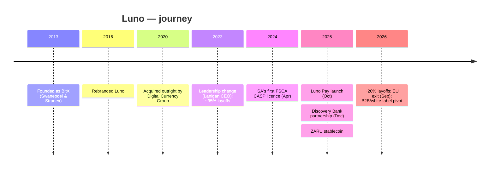
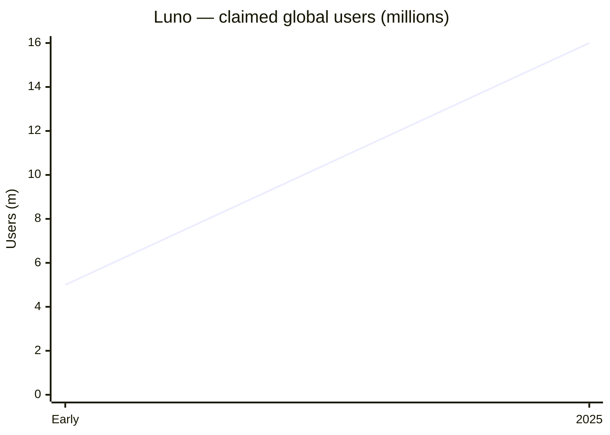

# Luno — Consolidated Journey

> Self-contained synthesis of the deep per-department research under
> `research/crypto-trading/luno/` plus the ZA crypto landscape file.
> Public information only. Tags: `[OBS]` observed, `[INF]` inference, `[EST]` estimate, `[UNK]` unknown.

## 1. Origin & founding timeline

| Date | Milestone | Tag |
|---|---|---|
| **2013** | Founded as **BitX** in South Africa by **Marcus Swanepoel** (ex-investment banker) and **Timothy Stranex** (ex-Google engineer); focused on Bitcoin education + wallet | [OBS] |
| **2015** | Naspers/Prosus invests **US$3m** | [OBS] |
| **2016** | Rebranded **BitX → Luno** | [OBS] |
| **2020** | **Digital Currency Group (DCG)** acquires Luno outright | [OBS] |
| **Mar 2023** | Leadership transition: Swanepoel → Executive Chairman; **James Lanigan** → CEO; ~35% global layoffs (reported) | [OBS]/[UNVERIFIED] |
| **Apr 2024** | Credited as **SA's first FSCA-licensed crypto asset service provider (CASP)** | [OBS] |
| **7 Oct 2025** | **Luno Pay** launched — spend crypto at ~700,000 SA merchants | [OBS] |
| **Dec 2025** | **Discovery Bank partnership** — in-app crypto trading with Vitality Money points on crypto balances | [OBS] |
| **2025–2026** | ~20% global staff cut (automation); pivot to B2B/white-label + **ZARU** ZAR-stablecoin; **EU exit** by 1 Sep 2026 | [OBS] |

## 2. Growth journey & pivots

1. **Education-first on-ramp (2013–2020).** BitX/Luno built the SA market by demystifying Bitcoin, then expanded across sub-Saharan Africa and into SE Asia/Australia. DCG's 2020 acquisition provided a global parent. [OBS]
2. **Regulated mainstreaming (2024–2025).** FSCA licensing (Apr 2024) repositioned Luno from "crypto startup" to regulated financial product; product/geographic expansions followed (Staking, Luno Pay, stablecoins). [OBS]
3. **Retrenchment & B2B pivot (2025–2026).** After ~20% global layoffs, Luno shifted toward **white-label/B2B crypto infrastructure** and **local stablecoins**, and **exited the EU/other non-core markets** (Luno France struck off the AMF PSAN whitelist 28 Jul 2025; EU accounts closed by 1 Sep 2026 for lack of MiCA authorisation). [OBS]

The defining strategic reframe: instead of competing as a consumer exchange, **become the crypto engine inside banks** — realised via the Discovery Bank deal. [OBS]

## 3. Product evolution

| Product | Description | Tag |
|---|---|---|
| ZAR Wallet | Hold ZAR; EFT/instant deposits and withdrawals | [OBS] |
| Instant Buy/Sell | Simple buy/sell from the Portfolio screen (**2%/2%**) | [OBS] |
| Luno Exchange | Advanced order-book trading with volume fee tiers | [OBS] |
| Staking | PoS rewards — **only in SA, Malaysia and Nigeria** | [OBS] |
| Luno Pay | Spend crypto at ~700,000 SA merchants (Oct 2025) | [OBS] |
| Stablecoins | USDT, USDC, PYUSD, EURC; **ZARU** (ZAR-pegged), **ZARSC** (ZAR Supercoin) | [OBS] |
| B2B/white-label | Crypto-as-a-service for banks/fintechs (e.g. Discovery Bank) | [OBS] |

**Verification tiers:** Level 1 (R15k lifetime limits) → Level 2 (R50k/month) → Fully verified (no limit). [OBS]

## 4. Business model & unit economics

**Revenue model:** transaction fees (2% instant buy/sell; exchange maker/taker), staking, B2B/white-label and payments. Fees are the primary disclosed revenue mechanism. [OBS]

**Disclosure status:** Luno is a **privately held DCG subsidiary** and does **not publish standalone audited financials** — revenue, costs and profitability are **[UNK]**. All financials below are indirect. [OBS]

| Indicator | Value | Tag |
|---|---|---|
| Ownership | 100% Digital Currency Group (since 2020) | [OBS] |
| Users | ~5m (early) → ~15–16m claimed (2025) | [OBS] |
| Funding | DCG-backed; earlier Naspers/Prosus (US$3m, 2015) | [OBS] |
| Cost actions | ~35% layoffs (2023, reported); ~20% layoffs (2025–26, automation) | [OBS]/[UNVERIFIED] |

**Inference:** the B2B/white-label and ZARU stablecoin pivots suggest an attempt to diversify away from volatile retail trading revenue after headcount cuts. The B2B channel also implies a shift from CAC-heavy retail acquisition to distribution via bank partners. Precise unit economics are unverifiable from public sources. [INF]

## 5. Customers & distribution

- **Customers:** ~15–16m users globally (2025); SA is the anchor market (SA country manager **Christo de Wit**). [OBS]
- **Distribution:** direct app (retail on-ramp) plus **bank-embedded distribution** via the Discovery Bank in-app integration (Dec 2025) — the marquee channel shift. [OBS]
- **Customer frictions:** complaint profile is dominated by **payment-rail and availability incidents** rather than security breaches — e.g. SA withdrawal delays via a third-party banking partner (29 Apr 2026), "Instant Buy not available in SA" (Aug 2026), and Absa Instant Deposit discontinuation. The 2026 market-exit wind-down created a distinct high-severity cohort (sell-by-31-Aug-2026 deadline). [OBS]
- CryptoSlate notes 2026 Luno events were availability/footprint rather than security. [OBS]

## 6. Technology

| Layer | Detail | Tag |
|---|---|---|
| Cold storage | ~**95% of customer crypto in multi-signature** wallets | [OBS] |
| Custody providers | **BitGo Custody** and **Fireblocks** | [OBS] |
| Certification | **ISO 27001** certified | [OBS] |
| Proof of reserves | Monthly independent attestation using **Merkle Tree** proofs | [OBS] |
| Payments | Instant deposits powered by **Stitch** (open banking); EFT via **Standard Bank** | [OBS] |
| API | Public, documented REST API for exchange trading | [OBS] |

**Proof-of-reserves detail:** Moore Blockchain and Digital Assets JHB produces the report as **Agreed-Upon Procedures under ISRS 4400 (Revised)**; findings state Luno holds reserves **exceeding 100% of customer liabilities** on a 1:1 basis. Caveat: ISRS 4400 is an agreed-upon-procedures engagement, **not a full audit** — weaker assurance than a statutory audit. Deeper architecture (languages/cloud) is **[UNK]**. [OBS]/[INF]

## 7. Marketing & partnerships

- **Positioning:** retail-education-led — "learn about crypto", safety, simplicity, regulated trust; SA spokesperson **Christo de Wit**. Agency: **Ogilvy South Africa**. [OBS]
- **Sponsorship:** **Vodacom Bulls** (Pretoria rugby) — 3-year deal with player performance incentives paid **in crypto**; plus the Discovery Bank co-marketing partnership. Budget figures **[UNK]**. [OBS]
- **Partnerships:** Discovery Bank (in-app trading + Vitality Money points); Stitch (instant deposits); Standard Bank (ZAR receiving bank); GTXN acquisition (Kenyan cross-border payments, year [UNK]/[UNVERIFIED]). [OBS]
- **People:** Co-founders Swanepoel & Stranex; CEO **James Lanigan** (since Mar 2023); ~400 at peak, reduced through restructurings. Current headcount **[UNK]**. [OBS]

## 8. Key lessons for a SA NeoBank

1. **Become the bank's crypto engine, not its competitor.** Luno's Discovery Bank white-label deal is the reference model: the fastest route to crypto for a NeoBank is a **CASP partnership/white-label**, not building an exchange. [OBS]
2. **Trust signalling is table stakes:** monthly proof-of-reserves, named custodians (BitGo/Fireblocks), ISO 27001. But note PoR is an agreed-upon-procedures attestation, **not a full audit**. [OBS]/[INF]
3. **Bank-rail dependency is a hidden risk.** Luno's complaint profile traces to third-party rails (Standard Bank/Stitch/Absa), not its own platform — a NeoBank embedding crypto should contract for reliability and disclosure. [OBS]
4. **Regulated status + stablecoins are the growth wedge:** FSCA licensing and the ZARU ZAR-pegged stablecoin position Luno for the SARB/Treasury "crypto-as-capital" regime. [OBS]
5. **Parent/subsidiary concentration risk:** DCG also owned Genesis (2022–23 distress) — a counterparty/ownership risk to diligence in any partnership. [INF]

## 9. Timeline / growth chart (Mermaid)

## 10. Consolidated Sources

- Luno global press kit (PDF): https://d32exi8v9av3ux.cloudfront.net/static/docs/press_kit_global_v4.pdf
- Luno leadership transition (Business Wire): https://www.businesswire.com/news/home/20230322005219/en/Luno-Announces-Leadership-Transition/
- Luno — fees and limits in South Africa: https://guide.luno.com/hc/en-gb/articles/14158595648541-Luno-fees-and-limits-in-South-Africa
- Luno Proof of Reserves Sep 2024 — Moore (PDF): https://discover.luno.com/wp-content/uploads/2024/10/Luno_PoR_SEP24.pdf
- Discovery Bank — crypto trading with Luno: https://www.mynewsdesk.com/za/discovery-holdings-ltd/pressreleases/discovery-bank-announces-crypto-trading-with-luno-new-ai-security-and-service-features-motor-insurance-and-new-rewards-partners-including-multichoice-3416065
- Luno cuts ~20% of global staff: https://mvcapital.app/?id=693&m=news&x=luno-cuts-20-of-global-staff-in-automation-driven-restructuring
- CryptoSlate — Luno exchange review 2026: https://cryptoslate.com/crypto-exchanges/luno-exchange-review/
- Luno Pay — spend crypto at 700,000 merchants: https://www.luno.com/en-id/newsroom/spend-crypto-countrywide-in-sa-using-luno-pay
- Luno — instant deposit via Stitch: https://guide-staging.luno.com/hc/en-gb/articles/10967642622109-How-do-I-make-an-instant-deposit-in-South-Africa
- Luno & Vodacom Bulls sponsorship: https://zeno.fm/podcast/africa-tech-news/episodes/crypto-platform-luno-and-rugby-team-vodacom-bulls-signs-sponsorship-deal/
- Luno status page: https://status.luno.com/
