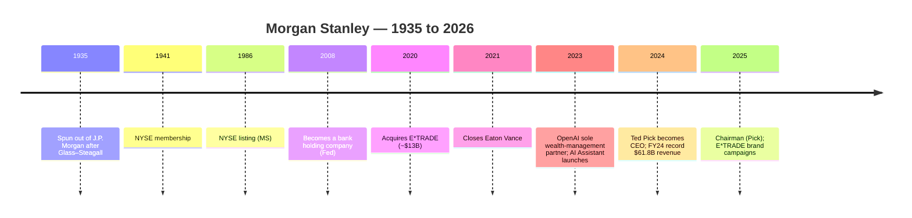

# Morgan Stanley — Journey / Teardown

> Consolidated synthesis of the C10 research library at `research/banks/morgan-stanley/`.
> A "journey" profile of the **wealth-management-led global investment bank**: origin, growth,
> product/model evolution, business model, scale, technology, marketing and transferable mechanics
> for a South African NeoBank. Public information only. Tags inherited from the underlying files;
> aggregator-sourced figures flagged.

---

## 1. Origin & Founding Timeline

| Year | Milestone | Tag | Source |
|---|---|---|---|
| **Sep 16, 1935** | Morgan Stanley opens at 2 Wall Street with **6 officers and staff of 13**, created when **J.P. Morgan spun off its securities-underwriting division** after the **Glass–Steagall Act (1933)** | [OBS] | [Our History](https://www.morganstanley.com/about-us/history); [MS MUFG history](https://www.morganstanleymufg.com/en/about-us/history) |
| **1935** | Founded by **Henry S. Morgan and Harold Stanley** | [OBS] | [dcf-analysis](https://dcf-analysis.com/blogs/history/ms) |
| **1941** | Obtains **NYSE membership** | [OBS] | [MS MUFG history](https://www.morganstanleymufg.com/en/about-us/history) |
| **1986** | **Publicly listed on the NYSE (ticker MS)** | [OBS] | [MS MUFG history](https://www.morganstanleymufg.com/en/about-us/history) |
| **Sep 21, 2008** | Federal Reserve approves **bank holding company** status (GFC pivot) | [OBS] | [Federal Reserve](https://federalreserve.gov/newsevents/pressreleases/bcreg20080921a.htm) |
| **Feb 20, 2020 / Oct 2, 2020** | Announces / closes **E*TRADE acquisition (~$13B, all-stock)** | [OBS] | [E*TRADE press release](https://cdn2.etrade.net/1/08142023/aempros/content/dam/etrade/about-us/en_US/documents/newsroom/press-releases/2020/4682042639390047.pdf) |
| **Mar 1, 2021** | **Eaton Vance** acquisition closes | [OBS] | [Strategic Update 4Q22](https://www.morganstanley.com/content/dam/msdotcom/en/about-us-ir/shareholder/4q2022-strategic-update.pdf) |
| **Mar 2023** | Becomes **OpenAI's sole wealth-management strategic partner** | [OBS] | [Observer](https://observer.com/2024/06/morgan-stanley-wall-street-generative-ai/) |
| **Jan 2024 / Jan 2025** | **Ted Pick** becomes CEO / Chairman | [OBS] | [Our History — era 5](https://ourhistory.morganstanley.com/timeline/era-5) |

---

## 2. Growth Journey

- [OBS] Founded as a pure securities house in 1935; spent decades as a leading investment bank,
  then **repositioned toward wealth management** under **James P. Gorman** (CEO 2010–2023) as the
  stabilising, fee-based engine — reshaping its revenue mix ([4Q2024 release](https://www.morganstanley.com/content/dam/msdotcom/en/about-us-ir/shareholder/4q2024.pdf)).
- [OBS] The **2008 bank-holding-company conversion** restored funding stability through the GFC.
- [OBS] Two transformative acquisitions — **E*TRADE (2020)** and **Eaton Vance (2021)** — added a
  self-directed retail brokerage and an asset-management arm, deepening the wealth + investment
  management flywheel.

**Revenue trajectory:** $59.8B (2021) → $53.7B (2022) → $54.1B (2023) → **$61.8B (2024, record)**
→ $70.6B (2025, aggregator — **[UNVERIFIED]**) ([puffling](https://puffling.co/companies/ms/)).

| Metric | FY2022 | FY2023 | FY2024 |
|---|---|---|---|
| Net revenues | $53.7B | $54.1B | **$61.8B** |
| Net income (applicable to MS) | — | $9.1B | **$13.4B** |
| Diluted EPS | — | $5.18 | **$7.95** |

[OBS] ([4Q2024 earnings release](https://www.morganstanley.com/content/dam/msdotcom/en/about-us-ir/shareholder/4q2024.pdf)).

---

## 3. Product / Model Evolution

- [OBS] Three reportable segments: **Institutional Securities**, **Wealth Management**,
  **Investment Management** ([4Q2024 release](https://www.morganstanley.com/content/dam/msdotcom/en/about-us-ir/shareholder/4q2024.pdf)).

| Segment | Core products |
|---|---|
| **Institutional Securities** | Investment banking (M&A, equity/debt underwriting), Sales & Trading, Global Capital Markets, Research |
| **Wealth Management** | Full-service brokerage/advisory, **E*TRADE** self-directed, workplace/401(k) solutions, family-office services, lending |
| **Investment Management** | Active asset management, Eaton Vance, **Parametric** (custom indexing) |

([4Q2024 release](https://www.morganstanley.com/content/dam/msdotcom/en/about-us-ir/shareholder/4q2024.pdf); [WM Pitchbook](https://advisor.morganstanley.com/the-cornerstone-group-milwaukee/documents/field/c/co/cornerstone-group-milwaukee/WM_Pitchbook_2_2026.pdf))

- [OBS] The model evolution is a **two-track consumer strategy**: **Morgan Stanley** (advised,
  HNW/UHNW) and **E*TRADE** (self-directed, mass-affluent) sharing one wealth platform.
- [OBS] **E*TRADE** added ~**5.2M retail clients** (secondary, [UNVERIFIED]) and brought
  commission-free self-directed trading alongside advisory accounts
  ([top10grid](https://top10grid.com/top-10-us-wealth-management-firms)).
- [OBS] Pricing: many E*TRADE self-directed equity trades are **commission-free**; advisory accounts
  are typically **fee-based (AUM %)** ([WM Pitchbook](https://advisor.morganstanley.com/the-cornerstone-group-milwaukee/documents/field/c/co/cornerstone-group-milwaukee/WM_Pitchbook_2_2026.pdf)).

---

## 4. Business Model & Economics

- [OBS] Wealth Management represented ~**58% of firm revenue** in 2023 (secondary, [UNVERIFIED]) —
  the fee-based ballast that smooths investment-banking cyclicality
  ([meritshot](https://www.meritshot.com/case-studies/morgan-stanley-case-study)).
- [OBS] Q2 2024 segment net revenues: Institutional Securities **$6,982M**; Wealth Management
  **$6,792M**; Investment Management **$1,433M** (approx.)
  ([2Q2024 finsup](https://www.morganstanley.com/about-us-ir/finsup2q2024/finsup2q2024.pdf)).
- [OBS] Investment banking (Q4 2024) **$1,791M**, +13% YoY ([4Q2024 release](https://www.morganstanley.com/content/dam/msdotcom/en/about-us-ir/shareholder/4q2024.pdf)).
- [OBS] Expenses: **information processing & communications $4,088M** (2024) vs $3,775M (2023);
  **distribution expenses** rise with average AUM ([4Q2024 release](https://www.morganstanley.com/content/dam/msdotcom/en/about-us-ir/shareholder/4q2024.pdf)).
- [OBS] Quarterly ROTCE: **17.5%** (Q3 2024) ([3Q2024 release](https://www.morganstanley.com/content/dam/msdotcom/en/about-us-ir/shareholder/3q2024.pdf)).
- [INF] Model = **fee-on-AUM + advisory + trading/IB**, deliberately weighted to **recurring,
  fee-based wealth revenue** to de-risk market cycles — the opposite of a spread/NII-led bank.

---

## 5. Customers & Scale

- [OBS] **Total client assets** across Wealth + Investment Management **~$7.9T** (Q4 2024)
  ([dcfmodeling](https://dcfmodeling.com/products/ms-vrio-analysis)).
- [OBS] **Wealth Management AUM ~$5.7T** (2023) (secondary, [UNVERIFIED])
  ([meritshot](https://www.meritshot.com/case-studies/morgan-stanley-case-study)).
- [OBS] **~16,000 financial advisors**; **$2.6T+** investment-advisory client assets; **$7.0T+**
  client assets under management ([WM Pitchbook](https://advisor.morganstanley.com/the-cornerstone-group-milwaukee/documents/field/c/co/cornerstone-group-milwaukee/WM_Pitchbook_2_2026.pdf); [marginofinsight](https://app.marginofinsight.com/stocks/ms/financials)).
- [OBS] **Employees: 80,478** (Q4 2024), across **42 countries**; **~15,000–16,000 developers**
  (secondary) ([4Q2024 release](https://www.morganstanley.com/content/dam/msdotcom/en/about-us-ir/shareholder/4q2024.pdf); [Business Insider Africa](https://africa.businessinsider.com/news/how-banks-like-morgan-stanley-and-citi-are-upskilling-their-engineers-for-the-ai-era/eqk3lxe)).

---

## 6. Technology

- [OBS] **AI-first strategy:** became **OpenAI's sole wealth-management strategic partner** (Mar
  2023), launched the **"AI @ Morgan Stanley Assistant"** (Sep 2023), used by **98% of the firm's
  financial-advisor teams** ([Observer](https://observer.com/2024/06/morgan-stanley-wall-street-generative-ai/)).
- [OBS] **Debrief** saves advisors ~**half an hour of grunt work per meeting**; a dedicated **AI
  team** coordinates an aligned AI strategy ([Observer](https://observer.com/2024/06/morgan-stanley-wall-street-generative-ai/); [AI deck](https://www.morganstanley.com/content/dam/im/staticContent/investment-ideas/ideas-paris-2025/pdf/jeff-mcmillan-ideas-paris-2025.pdf)).
- [OBS] **DevGen.AI** modernised **16 million lines of legacy code** by Feb 2026; the firm tested
  **550+ patented innovations** in a sandbox (aggregator, [partial])
  ([dcf-model](https://dcf-model.com/products/ms-porters-five-forces-analysis)).
- [OBS] By June 2026, **98.0% of employees** had access to ≥1 generative-AI tool (aggregator, [partial]).
- [OBS] No blockchain/token product line disclosed — Morgan Stanley's differentiator is **AI in the
  advisor workflow**, not crypto ([UNK] for cloud/core vendor names).

---

## 7. Marketing & Partnerships

- [OBS] **E*TRADE brand campaigns:** **Super Bowl ("The Big Game")** spots featuring the iconic
  **E*TRADE Baby**; a **walrus-themed March Madness ad (Mar 2025)** promoting the Morgan Stanley
  connection ([MS press release](https://www.morganstanley.com/press-releases/get-in-the-game-with-e-trade-from-morgan-stanley); [Ad Age](https://adage.com/article/marketing-news-strategy/e-trade-march-madness-ad-connection-morgan-stanley/2606526/)).

| Property | Relationship | Notes |
|---|---|---|
| **F1 Academy** | First financial-services brand partner of the all-female series | [OBS] Miami GP debut; bespoke livery ([Ministry of Sport](https://ministryofsport.com/f1-academy-lands-partnership-with-morgan-stanley-ahead-of-miami-gp/)) |
| **Mercedes F1** | Sponsor | [OBS] Entered late 2024 at ~**$20M/year** ([pops4](https://www.pops4.com/sports-edge/articles/mclaren-racing-2026-10-04t12-2)) |
| **Unrivaled** (women's pro basketball) | Official partner | [OBS] Announced Jan 17, 2025 ([Unrivaled](https://www.unrivaled.basketball/news/unrivaled-announces-morgan-stanley-as-an-official-partner-v91k3i1nf0nm)) |

- [INF] Two-track brand: **Morgan Stanley** (institutional credibility via motorsport) and
  **E*TRADE** (mass-affluent, playful consumer campaigns).
- [OBS] Sponsorship portfolio deliberately champions **women in sport** (F1 Academy, Unrivaled)
  ([Unrivaled](https://www.unrivaled.basketball/news/unrivaled-announces-morgan-stanley-as-an-official-partner-v91k3i1nf0nm)).
- [UNK] Firmwide advertising spend / brand-equity index not published.

---

## 8. Lessons & Transferable Mechanics for a SA NeoBank

1. **Fee-based wealth as ballast.** Morgan Stanley's strategic pivot toward **recurring,
   fee-based wealth revenue** (~58% of revenue) smoothed volatile trading income — a model a NeoBank
   can emulate by building **subscription/advisory or managed-investment fees** early. [INF]
2. **Two-track brand architecture.** Running an institutional brand and a **playful retail brand
   (E*TRADE)** separately lets each speak to its audience — a NeoBank could run a **trust-forward
   bank brand** plus a **lighter rewards/investing brand**. [INF]
3. **Acquire a self-directed brokerage to widen the funnel.** E*TRADE brought ~5M retail clients and
   commission-free trading; a NeoBank's analogue is an **embedded investing feature** (own-build or
   partner) to monetise mass-affluent users. [INF]
4. **AI in the workflow, not just the chatbot.** Morgan Stanley embedded AI into advisor workflows
   (Assistant, Debrief), achieving 98% team adoption — a NeoBank should deploy AI against **its own
   service/ops workflow** to cut cost-to-serve. [INF]
5. **Sponsor where values meet audience.** Deliberate women's-sport sponsorships (F1 Academy,
   Unrivaled) buy credibility with a specific, growing segment — transferable to SA fan engagement. [INF]
6. **Legacy modernisation is a moat.** 16M lines of legacy code modernised via AI shows incumbents
   convert tech debt into advantage; a greenfield NeoBank should keep its architecture clean to
   avoid the same burden. [INF]

---

## 9. Journey Timeline (Mermaid)

---

## 10. Sources

- [The History of Morgan Stanley](https://www.morganstanley.com/about-us/history)
- [Morgan Stanley MUFG — History](https://www.morganstanleymufg.com/en/about-us/history)
- [Morgan Stanley 4Q 2024 Earnings Results (PDF)](https://www.morganstanley.com/content/dam/msdotcom/en/about-us-ir/shareholder/4q2024.pdf)
- [Morgan Stanley 3Q 2024 Earnings Results (PDF)](https://www.morganstanley.com/content/dam/msdotcom/en/about-us-ir/shareholder/3q2024.pdf)
- [Morgan Stanley 2Q 2024 Financial Supplement (PDF)](https://www.morganstanley.com/about-us-ir/finsup2q2024/finsup2q2024.pdf)
- [Federal Reserve — MS becomes bank holding company (2008)](https://federalreserve.gov/newsevents/pressreleases/bcreg20080921a.htm)
- [Morgan Stanley Strategic Update 4Q2022 (PDF)](https://www.morganstanley.com/content/dam/msdotcom/en/about-us-ir/shareholder/4q2022-strategic-update.pdf)
- [Morgan Stanley to acquire E*TRADE (2020) PDF](https://cdn2.etrade.net/1/08142023/aempros/content/dam/etrade/about-us/en_US/documents/newsroom/press-releases/2020/4682042639390047.pdf)
- [Morgan Stanley WM Pitchbook (PDF)](https://advisor.morganstanley.com/the-cornerstone-group-milwaukee/documents/field/c/co/cornerstone-group-milwaukee/WM_Pitchbook_2_2026.pdf)
- [Our History — Ted Pick era](https://ourhistory.morganstanley.com/timeline/era-5)
- [James P. Gorman bio](https://www.morganstanley.com/about-us-governance/operating-committee/james-gorman)
- [Morgan Stanley 2024 Proxy Statement (PDF)](https://www.morganstanley.com/content/dam/msdotcom/en/about-us-2024ams/2024_Proxy_Statement.pdf)
- [Observer — How Morgan Stanley uses A.I.](https://observer.com/2024/06/morgan-stanley-wall-street-generative-ai/)
- [AI @ Morgan Stanley (deck)](https://www.morganstanley.com/content/dam/im/staticContent/investment-ideas/ideas-paris-2025/pdf/jeff-mcmillan-ideas-paris-2025.pdf)
- [dcf-model — MS five forces / AI](https://dcf-model.com/products/ms-porters-five-forces-analysis)
- [Business Insider Africa — banks upskilling engineers for AI](https://africa.businessinsider.com/news/how-banks-like-morgan-stanley-and-citi-are-upskilling-their-engineers-for-the-ai-era/eqk3lxe)
- [Morgan Stanley — Get in the Game with E*TRADE](https://www.morganstanley.com/press-releases/get-in-the-game-with-e-trade-from-morgan-stanley)
- [Ad Age — E*TRADE March Madness ad](https://adage.com/article/marketing-news-strategy/e-trade-march-madness-ad-connection-morgan-stanley/2606526/)
- [Ministry of Sport — F1 Academy × Morgan Stanley](https://ministryofsport.com/f1-academy-lands-partnership-with-morgan-stanley-ahead-of-miami-gp/)
- [Unrivaled — Morgan Stanley official partner](https://www.unrivaled.basketball/news/unrivaled-announces-morgan-stanley-as-an-official-partner-v91k3i1nf0nm)
- [pops4 Sports Edge — F1 sponsor deals](https://www.pops4.com/sports-edge/articles/mclaren-racing-2026-10-04t12-2)
- [puffling — Morgan Stanley revenue history](https://puffling.co/companies/ms/) *(secondary)*
- [dcfmodeling — MS VRIO analysis](https://dcfmodeling.com/products/ms-vrio-analysis) *(secondary)*
