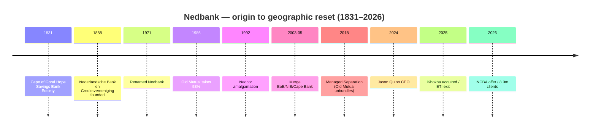

# Nedbank Group — Consolidated Journey (UnConsolidated)

> Self-contained synthesis of the Nedbank research set (`/workspace/research/banks/nedbank/`). Every figure is
> traceable to a source already cited in that research set. Tags: `[OBS]` observed/filing-stated,
> `[INF]` inference, `[DER]` derived, `[EST]` estimate, `[UNK]` unknown, `[UNVERIFIED]` single/low-authority.

## 1. Origin & founding story

Nedbank's lineage is one of the **oldest banking collectives in southern Africa**, tracing to an 1831 Cape
savings bank, with its modern corporate identity born as a **Dutch trade bank in 1888**. `[OBS]`

| Year | Milestone | Tag |
|---|---|---|
| 1831 | Heritage collective traces to the **Cape of Good Hope Savings Bank Society** — the second-oldest financial institution in southern Africa | [OBS] |
| 1888 | **Nederlandsche Bank en Credietvereeniging** founded in Amsterdam (6 April); first SA branch opens in Pretoria (1 Aug) with £50,000 capital | [OBS] |
| 1969 | Syfrets SA lists on the JSE (heritage milestone) | [OBS] |
| 1971 | Renamed **Nedbank** | [OBS] |
| 1986 | **Old Mutual Plc** becomes majority shareholder (53%) of what was then Nedcor Limited | [OBS] |
| 1988 | Nedbank merges with Perm → NedPerm Bank | [OBS] |
| 1992 | Nedbank, Perm and Nedfin amalgamate into **Nedcor** | [OBS] |
| 2003–2005 | Nedcor merges with BoE Bank, NIB and Cape of Good Hope Bank; holding company renamed **Nedbank Group Limited** (2005) | [OBS] |
| 15 Oct 2018 | **Managed Separation:** Old Mutual unbundles its 52% stake (R43.2bn distribution), retaining 19.9% | [OBS] |
| 2021 | Old Mutual reduces holding to ~7% | [OBS] |
| 1 Apr 2022 | Secondary listing on **A2X Markets** | [OBS] |
| 31 May 2024 | **Jason Quinn** becomes CEO, succeeding Mike Brown | [OBS] |
| Dec 2025 / Jan 2026 | Disposes of 21.2% ETI stake (US$100m); announces offer for ~66% of **NCBA Group** (East Africa) | [OBS] |

## 2. The journey — how it grew

- **Phase 1 — Colonial & federation (1831–1992):** from a Cape savings society and an Amsterdam trade bank
  to a merged domestic force (Perm, Nedfin → **Nedcor**). `[OBS]`
- **Phase 2 — Old Mutual ownership & consolidation (1986–2018):** Old Mutual took majority control (1986);
  Nedcor absorbed BoE Bank, NIB and Cape of Good Hope Bank (2003–2005) and rebranded as Nedbank Group. `[OBS]`
- **Phase 3 — Managed Separation & independence (2018–2024):** Old Mutual's R43.2bn unbundling turned
  Nedbank into a **widely-held independent group** (PIC ~16.95% the largest holder). `[OBS]`
- **Phase 4 — Geographic reset (2024–2026):** under Jason Quinn, exited **Ecobank (ETI)** and pivoted to a
  SADC + East Africa footprint ("businesses we own and control"), with a ~66% NCBA Group offer. `[OBS]`

## 3. Product evolution

| Era | Product build-out | Tag |
|---|---|---|
| 1888–1990s | Trade/corporate banking heritage; cheque accounts and lending | [OBS] |
| 2000s | Retail current accounts; credit cards; **Greenbacks** loyalty programme | [OBS] |
| 2020 | **Avo SuperShop** e-commerce marketplace launched (integrated into the Money app) | [OBS] |
| 2021 | **Enbi** AI chatbot launched (Money app, Online Banking, website) | [OBS] |
| 2023–2025 | Cashback-led Greenbacks (up to 30% at Checkers/Shoprite); **American Express** Gold card (min income R17k); strategic portfolio tilt to home loans, vehicle finance, overdrafts, retail deposits | [OBS] |

Current headline products: **MiGoals (~R7/m)**; **MiGoals Plus (R99/m, R49.50 for 55+)**; **MiGoals Premium
(free card maintenance)**; credit cards Gold (R60/m), Platinum (R99/m), **Amex Gold (R145/m+)**, Private
Clients (R160/m); personal loans R2,000–R400,000; **Greenbacks** (up to 30% cashback; Amex earns faster);
**Avo SuperShop** (1% back in AvoPoints). `[OBS]`

## 4. Business model & economics

Nedbank is a **client-centred universal bank** skewed to corporate & investment banking, with a strong
retail-deposit and secured-lending "portfolio tilt". NII growth was driven by balance-sheet growth offset by
NIM compression; non-interest income and associate income (ex-ETI) frame the mix. `[OBS]`

| Metric | FY2025 (Dec) | FY2024 | Change | Tag |
|---|---|---|---|---|
| Total income | **R75.1bn** | — | — | [OBS] |
| Revenue (alt. measure) | R73.9bn | — | +3% | [OBS] |
| Net interest income (NII) | — (not absolute) | — | **+3%** (AIEBA +9%, NIM −24bps) | [OBS] |
| Headline earnings (HE) | **R17.2bn** | R16.9bn | +2% | [OBS] |
| HEPS | 3,706c | 3,631c | +2% | [OBS] |
| Diluted HEPS | 3,628c | 3,538c | +3% | [OBS] |
| ROE | **15.4%** | 15.8% | −0.4pp (above COE 14.6%) | [OBS] |
| Cost-to-income ratio | **57.8%** | 55.6% | +2.2pp | [OBS] |
| Dividend per share (DPS) | 2,132c | — | +3% | [OBS] |
| Credit loss ratio | 68 bps | 87 bps | improved | [OBS] |
| CET1 ratio | 12.9% | 13.3% | −0.4pp | [OBS] |
| Gross advances | R997bn | — | +6% | [OBS] |
| Deposits | R1,306bn | — | +11% | [OBS] |
| NAV per share | R250 | — | +4% | [OBS] |

- **Segmental FY25:** **CIB R7.9bn (+2%, ROE 21.4%, ~55% of group HE)**; Business & Commercial Banking
  **R2.4bn (+7%, incl. iKhokha)**; Africa Regions **R1.6bn (−1%, hit by ETI disposal)**. `[OBS]`
- **Advances new payouts:** home loans **+20%**, vehicle & asset finance **+9%**, personal loans **+33%**;
  advances growth **+7% vs industry +4%**. `[OBS]`
- **Non-recurring item:** a **R600m Transnet settlement** (to avoid litigation, support infrastructure
  investment). `[OBS]`
- `[DER]` Nedbank has the **highest HEPS of the non-Capitec Big Four (3,706c)** but the **lowest total income
  among the Big Four (R75.1bn)** — it is sub-scale vs Standard Bank/Absa/FirstRand yet punches above its
  weight per share. `[DER]`
- `[INF]` The market prices it at a **premium P/E (15.53)** vs Absa (7.89) despite lower income — investors
  appear to reward ROE stability and a cleaner SA-centric franchise. `[INF]`
- `[UNK]` FY2025 absolute NII rand value was not captured in available sources (only % growth). `[UNK]`

## 5. Customers & distribution

- **Active clients: 8.0m (FY2025)** (2024: 7.5m; **+7%**) — the first time in the group's ~140-year
  history. `[OBS]`
- **Money app active clients: 3.0m (+14%)**; transaction values **+15%**; **70%** of Nedbank Africa Regions
  retail clients digitally active. `[OBS]`
- **Employees: 25,795 permanent** (Dec 2025; +182 YoY incl. +351 from iKhokha). `[OBS]`
- **Footprint:** **541 branches and 4,014 ATMs** (FY2025); ATM footprint deliberately shrinking as digital
  payments grow. `[OBS]`
- **Channels:** Nedbank Money app, Online Banking, USSD, **Enbi** chatbot (launched 2021; 1m+ users, 5m+
  chats), **Avo SuperShop** (2.7m registered users, 25,000 businesses), **Greenbacks** as the engagement
  layer. `[OBS]`
- **Complaints:** Nedbank had the **second-highest complaint volume** of the Big Five (Banking Ombudsman
  era) though only **+3.6%** growth; sector-wide the National Financial Ombud returned **R60m+** to clients
  in 2025 with mobile/internet fraud = **39%** of cases. App rating **3.9/5** (Apple & Google). `[OBS]`
- `[INF]` High absolute complaint count + a 3.9/5 app rating indicate customer experience is a **relative
  weakness** vs Absa/FNB, in tension with Nedbank's own "top-end peer-group satisfaction" claim. `[INF]`

## 6. Technology & partnerships

- **Core-banking modernisation — "Managed Evolution":** launched **2014** to replace the legacy stack;
  **~97% complete** by 2024, targeted for completion end-2024. A stronger public core-replacement story than
  peers. CIO **Ray Naicker**. `[OBS]`
- **Cloud:** **IBM** (IBM Garage; **IBM Cloud Pak for Integration**) for hybrid-cloud integration during
  modernisation; **SAP ERP** implemented; API marketplace built. AWS/Azure/Salesforce usage is
  `[UNVERIFIED]` third-party. `[OBS]`/`[UNVERIFIED]`
- **Customer tech:** **Nedbank Money app** (payments, virtual cards, freeze/unfreeze, credit-score,
  "My Smart Money" budgeting, Avo integration); **Enbi** AI chatbot; **NIHA** intelligent hyper-automation;
  "Martech" personalisation; payment goal of a "fully interoperable enterprise payment service hub". `[OBS]`
- **M&A:** **iKhokha** acquisition (~**R1.65bn**/US$93.3m; announced 13 Aug 2025; Competition Commission
  recommended unconditional approval 24 Oct 2025) to accelerate SME/merchant-payments growth (+351 staff). `[OBS]`
- **Geographic reset:** **ETI** disposal (21.2%, US$100m, completed 17 Dec 2025); **~66% NCBA Group** offer
  (R13.9bn: 80% Nedbank shares at R250 + 20% cash; subject to approvals). `[OBS]`
- **Card partnership:** **exclusive issuer AND acquirer of American Express in South Africa**. `[OBS]`
- **Rails:** initial-cohort **PayShap** participant (launched 13 Mar 2023). `[OBS]`

## 7. Marketing & sponsorships

Nedbank's portfolio is anchored in **mass-participation sport** (football, golf, running), positioning on
"depth over scale". `[OBS]`

| Property | Category | Note | Tag |
|---|---|---|---|
| **Nedbank Golf Challenge** (in honour of Gary Player) | Golf | DP World Tour event at Gary Player CC, Sun City; **US$6,000,000 prize fund** | [OBS] |
| **Nedbank Cup** | Football (SA) | Premier knockout; the only tournament giving amateur teams a shot at the pros; **19th edition in 2026**; R7m first prize (2025) | [OBS] |
| **Nedbank Running Club** | Running | Long-standing club; represented at Comrades Marathon 2025 | [OBS] |
| **Nedbank Namibia Newspaper Cup** | Football/netball (Namibia) | Title sponsor since 2016; U20 youth development across 14 regions | [OBS] |

- **Activation:** a client-facing "JustSave" competition runs during the Nedbank Cup (Jan–May 2025),
  promoting savings alongside the football sponsorship; **Avo SuperShop** is integrated into the Money app as
  an engagement channel. `[OBS]`
- `[OBS]` Nedbank brand value rose **20% to R20bn** (FY2025). `[OBS]`

> **Brief correction:** the brief linked "Cape Epic" to Nedbank. Evidence shows **Cape Epic is an ABSA
> property** (Absa Cape Epic). Nedbank's flagship golf event is the **Nedbank Golf Challenge** (Sun City)
> and its football property is the **Nedbank Cup**. `[OBS]`

## 8. Strengths, weaknesses, threats & NeoBank lessons

**Strengths**
- **Longest heritage** in the set (1831/1888) and a completed core-banking modernisation (Managed Evolution).
- **Highest non-Capitec HEPS (3,706c)**; CIB ROE of **21.4%**; Level 1 B-BBEE for the 8th year; brand value
  +20% to R20bn. `[OBS]`

**Weaknesses**
- **Highest cost-to-income of the Big Four (57.8%, +2.2pp)** and the **lowest income among the Big Four**. `[OBS]`
- Sub-scale vs Standard Bank/Absa/FirstRand; customer experience drag (2nd-highest complaints; 3.9/5 app). `[INF]`

**Threats**
- Digital-first challengers (Capitec R7.50/m; TymeBank; FNB Easy Zero R0) attacking the fee line. `[OBS]`
- SARB's exploration of a **domestic card scheme** could erode the Amex-exclusivity economics. `[INF]`

**NeoBank learn / exploit**
- **Exploit the fee gap:** Nedbank's R99 MiGoals Plus and R145+ Amex Gold sit far above a low-cost NeoBank
  anchor — a transparent, low-monthly-fee proposition wins price-sensitive switchers. `[INF]`
- **Beat the service bar:** the 2nd-highest complaint volume and 3.9/5 app rating signal a service-quality
  opening; a NeoBank with a hard fraud-reimbursement SLA can differentiate. `[INF]`
- **Copy the mass-participation sponsorship logic at lower cost:** the Nedbank Cup's *amateur-to-pro* story
  is the emotional hook — a NeoBank can sponsor grassroots/community sport cheaply and credibly. `[INF]`

## 9. Journey chart (Mermaid)

## 10. Sources

- [Nedbank — Our heritage and timeline](https://group.nedbank.co.za/home/heritage.html)
- [Nedbank Group — home / in a nutshell (Dec 2025)](https://group.nedbank.co.za/home.html)
- [Nedbank Group FY2025 Annual Results highlights](https://personal.nedbank.co.za/content/dam/group/pdf/20_financial-results/2025/annual-results/2025-annual-results-highlights-nedbank.pdf)
- [Nedbank Group FY2025 Annual Results booklet](https://group.nedbank.co.za/content/dam/group/pdf/20_financial-results/2025/annual-results/2025-annual-results-booklet-double-page-nedbank.pdf)
- [Nedbank Group FY2025 analyst presentation](https://group.nedbank.co.za/content/dam/group/pdf/20_financial-results/2025/annual-results/2025-annual-results-analyst-presentation-nedbank.pdf)
- [Nedbank Group FY2025 results transcript (ETI, NCBA, B-BBEE, YES)](https://group.nedbank.co.za/content/dam/group/pdf/20_financial-results/2025/annual-results/2025-annual-results-presentation-transcript-nedbank.pdf)
- [Nedbank acquires iKhokha](https://group.nedbank.co.za/news-and-insights/press/2025/nedbank-acquires-ikhokha.html)
- [Nedbank Tech & Digital Discussion (Ray Naicker, 2024)](https://group.nedbank.co.za/content/dam/group/pdf/19_presentations/2024/tech-and-digital-discussion-nedbank-2024.pdf)
- [IBM Newsroom — Banks across Africa turn to IBM hybrid cloud](https://newsroom.ibm.com/2021-09-22-Banks-Across-Africa-Turn-to-IBM-Hybrid-Cloud-and-AI-Solutions-to-Accelerate-Digital-Innovation)
- [Nedbank 2025 Everyday Banking Pricing Guide](https://personal.nedbank.co.za/content/dam/nedbank/pdfs/everyday-banking-fees-2025.pdf)
- [Nedbank Credit Card Fee schedule 2025](https://personal.nedbank.co.za/content/dam/nedbank/pdfs/nedbank-credit-cards-pricing-guide-2025.pdf)
- [Nedbank Cup — How it works 2025](https://nedbankcup.co.za/news/2025-nedbank-cup-how-it-works/)
- [SuperSport — 2026 Nedbank Cup in numbers](https://supersport.com/football/news/86a7aeb0-f155-4e08-9b53-af371d5d699a/key-stats-the-2026-nedbank-cup-in-numbers)
- [DP World Tour — 2025 schedule (Nedbank Golf Challenge)](https://www.europeantour.com/dpworld-tour/schedule/2025/)
- [Old Mutual plc — investor relations](https://www.oldmutual.com/investor-relations/old-mutual-plc/)
- [SARB — Administrative sanctions on Nedbank Limited (2022)](https://www.resbank.co.za/content/dam/sarb/publications/media-releases/2022/pa-nedbank-sanctions/South%20African%20Reserve%20Bank%20imposes%20administrative%20sanctions%20on%20Nedbank%20Limited.pdf)
- [BusinessTech — Battle of the banks 2026](https://businesstech.co.za/news/banking/876479/battle-of-the-banks-2026-capitec-vs-fnb-vs-standard-bank-vs-absa-vs-nedbank/)
