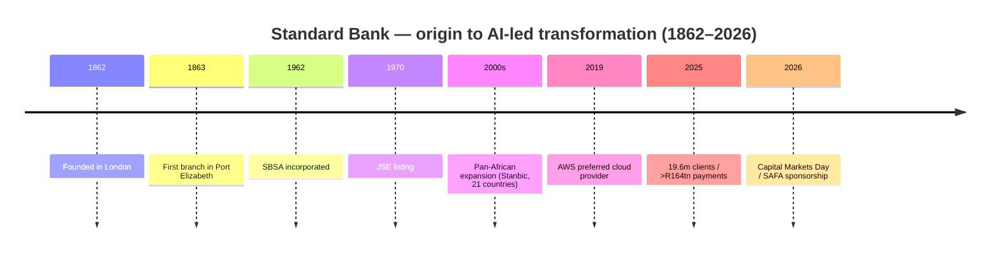

# Standard Bank Group — Consolidated Journey (UnConsolidated)

> Self-contained synthesis of the Standard Bank research set (`/workspace/research/banks/standard-bank/`).
> Every figure is traceable to a source already cited in that research set. Tags: `[OBS]` observed/
> filing-stated, `[INF]` inference, `[DER]` derived, `[EST]` estimate, `[UNK]` unknown, `[UNVERIFIED]`
> single/low-authority. **Entity note:** **Standard Bank Group Limited** (JSE: SBK) is the listed holding
> company; **The Standard Bank of South Africa Limited (SBSA)** is the SA banking entity. FY ends **31 Dec**.

## 1. Origin & founding story

Standard Bank is **Africa's largest bank by assets** and among the oldest institutions in the set,
established in **London in 1862** to serve Britain's southern-African colonies. `[OBS]`

| Year | Milestone | Tag |
|---|---|---|
| 1862 | **Standard Bank of British South Africa** established in **London** to serve British colonies in southern Africa | [OBS] |
| 1863 | First branch opens in **Port Elizabeth**, Cape Colony; the bank finances the region's mining and agricultural industries | [OBS] |
| 1962 | **The Standard Bank of South Africa Limited (SBSA)** incorporated (13 March 1962) — Reg No 1962/000738/06 | [OBS] |
| 1970 | **Listed on the JSE** (9 Feb 1970); >163 years of operation | [OBS] |
| — | Group expands to a **pan-African footprint (21 African countries)** plus offshore hubs (Beijing, Dubai, London, New York) | [OBS] |
| Mar 2026 | **Capital Markets Day** sets **2026–2028 targets**; AI/cloud-led transformation agenda | [OBS] |
| 2 Mar 2026 | Announces four-year **SAFA / Bafana Bafana** sponsorship (2026–2030) ahead of the 2026 FIFA World Cup | [OBS] |

- **Listings:** JSE (SBK) + A2X (SBK) + Namibian Stock Exchange (SNB). `[OBS]`
- **Legal entities:** Standard Bank Group Limited — Reg No **1969/017128/06**; SBSA — Reg No
  **1962/000738/06**, FAIS FSP **11287**, registered credit provider **NCRCP15**. `[OBS]`

## 2. The journey — how it grew

- **Phase 1 — Imperial trade bank (1862–1960s):** founded in London to finance colonial mining and
  agriculture; grew a branch network across southern Africa. `[OBS]`
- **Phase 2 — SA incorporation & listing (1962–1990s):** SBSA incorporated (1962) and the group JSE-listed
  (1970); the bank anchored SA's RTGS settlement as a designated **SAMOS settlement bank**. `[OBS]`
- **Phase 3 — Pan-African expansion (2000s–2020s):** the **Stanbic** brand extended the group across Africa
  (21 countries) with offshore hubs, making it Africa's largest bank by assets. `[OBS]`
- **Phase 4 — Digital & AI-led transformation (2020s–2026):** heavy cloud migration, an AI-first strategy,
  and a 2026–2028 strategic plan touting "Africa is our home, we drive her growth". `[OBS]`

## 3. Product evolution

| Era | Product build-out | Tag |
|---|---|---|
| 1862–1960s | Trade finance, deposits, agricultural/mining lending | [OBS] |
| 1970s–1990s | Retail current accounts; cards; corporate & investment banking (CIB); insurance & asset management (Liberty, Stanlib) | [OBS] |
| 2000s–2010s | Broad retail banking; **UCount Rewards** loyalty; Stanbic pan-African retail | [OBS] |
| 2020s | **MyMo** entry digital account; **Virtual/Prepaid Virtual Cards**; in-app **OneHub**-linked ecosystems; payments-as-platform (tokenised deposits, stablecoins, digital-asset custody) | [OBS] |

Current headline products: **MyMo (R7.50/m)**; **Prestige Banking (R145/m)**; **Signature**, **Consolidator**
and **Elite** tiers; **Gold Credit Card** + **Virtual Credit Card**; **Prepaid Virtual Card**;
**Personal Overdraft (R69/m)**; business lending (**Revolving Loan, BizFlex, Agricultural Production Loan**);
**UCount Rewards** (0.05%–1% base, up to **40% back** on chosen categories, up to 30% at Rewards Retailers;
redemption cap 200,000 points/R20,000 per month). `[OBS]`

## 4. Business model & economics

Standard Bank is a **diversified universal bank**: NII-dominant but with a strong and growing **non-interest
revenue** line, a large CIB franchise, and a genuinely **pan-African** earnings split that reduces single-market
concentration. `[OBS]`

| Metric (group) | FY2025 (Dec) | FY2024 | Change | Tag |
|---|---|---|---|---|
| Net interest income (NII) | R105,117m | R100,807m | +4% | [OBS] |
| Non-interest revenue (NIR) | R63,710m | R57,886m | +10% | [OBS] |
| **Total income** | **R168,827m** | R158,693m | +6% | [OBS] |
| Headline earnings | **R49,207m** | R44,503m | +11% | [OBS] |
| Profit attributable to ordinary shareholders | R49,100m | R43,727m | +12% | [OBS] |
| HEPS | 3,025.7c | — | +12% | [OBS] |
| DPS | 1,695c | — | +12% | [OBS] |
| NAV per share | 16,277c | — | — | [OBS] |
| Cost-to-income (banking) | **50.2%** | 50.5% | improved 0.3pp | [OBS] |
| Return on equity (ROE) | **19.3%** | 18.5% | +0.8pp | [OBS] |
| Credit loss ratio | 73 bps | 83 bps | improved | [OBS] |
| CET1 ratio | 13.8% | 13.5% | +0.3pp | [OBS] |
| Net interest margin | 483 bps | 490 bps | −7bps | [OBS] |
| Total assets | R3,621bn | R3,269bn | +11% | [OBS] |
| Loans & advances | R1,726bn | — | — | [OBS] |
| AUM & AUA | R1,759bn | — | — | [OBS] |

- **Business units (HE):** CIB **R24,133m**; Personal & Private Banking **R11,392m**; Business & Commercial
  Banking **R9,204m**; Insurance & Asset Management **R4,112m**. `[OBS]`
- **By region (HE):** **South Africa R24,881m (51%)**; **Africa Regions R19,695m (40%)**; Offshore R3,087m
  (6%); ICBCS R1,544m (3%). `[OBS]`
- **1H26 (to 30 Jun 2026):** revenue R86,687m; opex R42,694m; credit impairments R7,127m; **HE R26,100m**;
  **CIR 49.3%**; **ROE 19.8%**; CET1 13.6%; total assets R3,808bn; deposits R2,496bn. `[OBS]`
- `[DER]` Standard Bank leads the peer set on **absolute income (R168.8bn)** and **ROE (19.3%)** among the
  Big Five (bar Capitec), with a **best-in-class near-50% CIR** — the scale+Africa-diversification advantage. `[DER]`
- `[UNVERIFIED]` NII basis differs between the results presentation (R105,117m) and the FY25 booklet
  (R105,734m); flagged pending basis reconciliation. `[UNVERIFIED]`

## 5. Customers & distribution

- **Active clients: 19.6m (FY2025)** (19.0m FY2024) — the **largest client base of the six**. `[OBS]`
- **Digital adoption:** **67%** of transactional clients transact digitally (2025); digital clients **+9%**;
  digital volumes **+5%**. `[OBS]`
- **Employees:** **50,714** (FY25 financial results) vs **54,244** (Annual Integrated Report 2025) —
  `[UNVERIFIED]` scope difference (~3,500). `[UNVERIFIED]`
- **Footprint (SBSA, Dec 2025):** **3,470 ATMs, 509 branches, 156 kiosks/other access points**; group
  footprint **>1,200 branches** and **>5,500–5,600 ATMs** across Africa. `[OBS]`
- **Channels:** Standard Bank / Stanbic Bank app (Google Play **~4.68** from ~480k ratings), Online Banking,
  USSD, branch/ATM, **OneHub** (CIB B2B platform), Instant Money. `[OBS]`
- **Complaints:** Standard Bank accounted for the **largest share of formal banking complaints (20.23%, 2025)**
  ahead of Absa (17.06%), Capitec (16.05%), Nedbank (15.47%) and FNB (14.88%); sector-wide mobile + internet
  fraud = **39%** of cases and the Ombud returned **R60m+** to consumers. `[OBS]`
- `[INF]` The largest complaint share is consistent with the largest client base and a large digital
  footprint rather than necessarily worse service — but it is a service-quality flag. `[INF]`

## 6. Technology & partnerships

- **Cloud:** migratable servers in public cloud rose **44% (2024) → 71% (2025)**; legacy servers **−88%**
  (since 2020); physical data-centre footprint **−27%**; **cloud spend up 11× since 2020**, software spend 2×;
  **73%** of tech staff are "technical". Selected **AWS as preferred cloud provider (March 2019)**; runs a
  **multi-cloud** model (**AWS + Microsoft Azure**, **Huawei** in select African markets). `[OBS]`
- **AI:** enterprise AI platform on **Amazon Bedrock** with a multi-model strategy; ranked **leading bank in
  Africa** in the first **Evident AI Index for Banks — Middle East & Africa (June 2026)**; **Chief AI Officer
  Jörg Fischer**. `[OBS]`
- **Payments:** processed **>R164 trillion** in payments in 2025 (**>R300 million per minute**); immediate
  payments across **13 markets**; focus on tokenised deposits, stablecoins and digital-asset custody. `[OBS]`
- **Cross-border:** reported first African bank to connect clients directly to the Africa–Asia corridor via
  **CIPS** (R9.5bn processed); reported authorisation with ICBC as **Renminbi Clearing Bank of Africa**
  (June 2026). `[UNVERIFIED]`
- **Rails:** **PayShap** participant and **sponsoring bank** for third-party access; designated **SAMOS
  (RTGS) settlement bank**; card issuer + acquirer. `[OBS]`
- **Legal/regulatory:** SBSA supervised by the SARB Prudential Authority (Banks Act); FSCA FSP **11287**;
  NCRCP15. SA **exited the FATF grey list in 2025**. `[OBS]`

## 7. Marketing & sponsorships

Standard Bank positions on **"Africa is our home, we drive her growth"**, anchored in national-team football
and arts/culture. `[OBS]`

| Property | Category | Note | Tag |
|---|---|---|---|
| **SAFA / Bafana Bafana (+ Banyana Banyana, grassroots)** | Football | Four-year premier-sponsor deal announced **2 Mar 2026 (2026–2030)**, ahead of the 2026 FIFA World Cup; |value officially undisclosed (a third-party outlet reports ~R5.2bn) | [OBS]/[UNVERIFIED] |
| **Standard Bank Young Artist Awards** | Arts & culture | One of SA's most respected creative awards; winners present new work at the **National Arts Festival** (2026: 25 Jun–5 Jul) | [OBS] |
| Historical: **Proteas / CSA cricket** | Cricket | Sponsored 1998–2011, returned 2016, **ended deal 30 April 2020** | [OBS] |
| Historical: **Kaizer Chiefs & Orlando Pirates** | Football | Both club sponsorships **ended ~2011** to "improve business efficiencies" (Kaizer Chiefs' shirt sponsor is now Vodacom) | [OBS] |

- `[UNK]` SAFA deal value, total marketing budget, and campaign-level ROI are not disclosed. `[UNK]`

> **Brief correction:** the brief's "Standard Bank / Kaizer Chiefs" refers to a **historical** (pre-2011)
> relationship; the current Kaizer Chiefs shirt sponsor is Vodacom. `[INF]`

## 8. Strengths, weaknesses, threats & NeoBank lessons

**Strengths**
- **Africa's largest bank by assets (R3,621bn)**; **largest client base (19.6m)**; **highest income among the
  Big Five (R168.8bn)** and **19.3% ROE** with a near-50% CIR. `[OBS]`
- Genuine **pan-African diversification** (40% of HE from Africa Regions) and a **leading AI/cloud** narrative
  (public-cloud 71%; AI index leader). `[OBS]`

**Weaknesses**
- **Largest share of formal banking complaints (20.23%)** — a service-scale burden; two conflicting headcount
  disclosures. `[OBS]`/`[UNVERIFIED]`
- Complex, multi-market structure raises cost and coordination overhead. `[INF]`

**Threats**
- Digital-first challengers (Capitec R7.50/m; TymeBank; African Bank MyWORLD free) at the entry level. `[OBS]`
- Fraud-driven complaint and remediation cost; ongoing interchange/consumer-credit regulatory pressure. `[OBS]`

**NeoBank learn / exploit**
- **Exploit complexity:** Standard Bank's breadth (multiple tiers, pan-African markets, OneHub B2B) leaves a
  simple, transparent retail proposition room to win SA switchers. `[INF]`
- **Beat it on fraud service:** its **20.23% complaint share**, concentrated in digital fraud, is the single
  clearest service gap to attack with a hard reimbursement/SLA promise. `[INF]`
- **Copy the mass-national-team hook cheaply:** SAFA-style national pride drives reach — a NeoBank can sponsor
  grassroots/community football at a fraction of the cost. `[INF]`

## 9. Journey chart (Mermaid)

## 10. Sources

- [SBG FY2025 Analysis of Financial Results (spreads)](https://reporting.standardbank.com/static_file/Investor%20Relations/Documents/Financial-results/Annual-Results/SBG-2025-Annual-Results-Booklet-(spreads).pdf)
- [SBG 2025 Annual Results presentation](https://www.standardbank.com/static_file/Investor%20Relations/Documents/Financial-results/Annual-Results/SBG_2025_Annual_Results_Presentation.pdf)
- [Standard Bank — Financial highlights (1H26)](https://www.standardbank.com/sbg/standard-bank-group/investor-relations/financial-highlights)
- [SBG Annual Integrated Report 2025](https://www.standardbank.com/static_file/StandardBankGroup/filedownloads/RTS/2025/SBG_AnnualIntegratedReport2025.pdf)
- [SBSA Annual Report 2025](https://www.standardbank.com/static_file/StandardBankGroup/filedownloads/RTS/2025/SBSA_AnnualReport2025.pdf)
- [SBG CMD 2026 — Technology, AI & Payments](https://careers.standardbank.com/static_file/Investor%20Relations/CMD_2026/downloadable%20files/Technology_AI-&-payments.pdf)
- [Standard Bank — modern, scaled payments infrastructure](https://careers.standardbank.com/sbg/standard-bank-group/newsroom/news-and-insights/our-modern-scaled-payments-infrastructure-is-driving-growth)
- [Standard Bank — Africa's most AI-mature bank](https://reporting.standardbank.com/sbg/standard-bank-group/newsroom/news-and-insights/we-have-been-ranked-South-Africas-most-ai%E2%80%93mature-bank)
- [BizNews — Standard Bank selects AWS (2019)](https://www.biznews.com/briefs/2019/03/28/standard-bank-amazon-cloud)
- [MyMo Account 2026 pricing guide](https://www.standardbank.co.za/static_file/South%20Africa/PDF/Personal%20Pricing/2026/MyMo_Account_Pricing_Guide_2026.pdf)
- [Prestige Banking 2026 pricing guide](https://www.standardbank.com/static_file/South%20Africa/PDF/Personal%20Pricing/2026/Prestige_Banking_Account_Pricing_Guide_2026.pdf)
- [UCount Rewards — Programme Rules (eff. April 2026)](https://dlvjpsxz62zol.cloudfront.net/wp-content/uploads/2026/03/UCount-Rewards-Programme-Rules_Effective-April-2026.pdf)
- [SAFA — Standard Bank partnership announcement (2 Mar 2026)](https://www.safa.net/general-news/safa-standard-bank-announce-partnership-to-power-south-african-football/)
- [Standard Bank Sponsorships — Young Artist Awards](https://sponsorships.standardbank.com/sbgs/sponsorship/arts-and-culture/young-artist-award)
- [ESPNcricinfo — South Africa lose title sponsor (Standard Bank ended cricket)](https://www.espncricinfo.com/story/south-africa-lose-title-sponsor-as-freefall-continues-1209203)
- [Moonstone — Bank share of formal complaints 2025](https://www.moonstone.co.za/banking-complaints-surge-as-fraudsters-follow-customers-online/)
- [SARB — SAMOS settlement institutions](https://www.resbank.co.za/content/dam/sarb/what-we-do/payments-and-settlements/domestic-settlement-services-samos/related-documents/SAMOS%20institution%20as%20at%20September%202022.pdf)
- [FinanceCharts — Standard Bank Group (SGBLY) profile](https://www.financecharts.com/stocks/SGBLY/profile)
- [BusinessTech — Battle of the banks 2026](https://businesstech.co.za/news/banking/876479/battle-of-the-banks-2026-capitec-vs-fnb-vs-standard-bank-vs-absa-vs-nedbank/)
