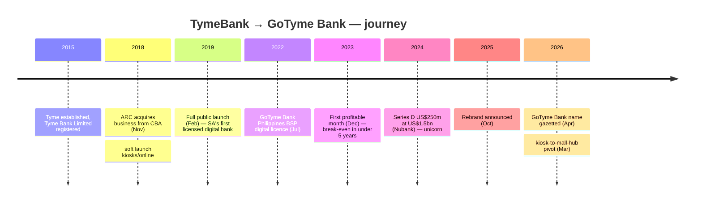
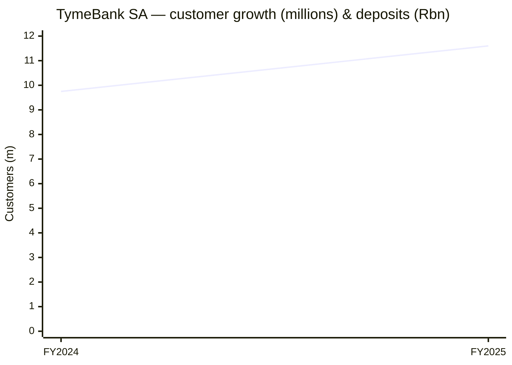

# TymeBank / GoTyme Bank — Consolidated Journey

> Self-contained synthesis of the deep per-department research under
> `research/neobanks-sa/tymebank-gotyme/` plus the SA neobank landscape file.
> Public information only. Tags: `[OBS]` observed, `[INF]` inference, `[EST]` estimate, `[UNK]` unknown.

## 1. Origin & founding timeline

| Date | Milestone | Tag |
|---|---|---|
| **2015** | Tyme (Tyme Limited) established; Tyme Bank Limited registered (Reg no. 2015/231510/06) | [OBS] |
| **5 Nov 2018** | Patrice Motsepe's **African Rainbow Capital (ARC) Financial Services Holdings** obtains Prudential Authority approval to acquire the business (~90%) from **Commonwealth Bank of Australia (CBA)** (deal concluded 29 Oct 2018) | [OBS] |
| **Nov 2018** | Soft launch — limited kiosks + online account opening | [OBS] |
| **Feb 2019** | Full public launch as **South Africa's first fully licensed, fully digital retail bank** and first majority black-owned retail bank | [OBS] |
| **Dec 2023** | **First profitable month** — first African digital bank to break even, in under 5 years | [OBS] |
| **Dec 2024** | Series D **US$250m at US$1.5bn valuation** (unicorn), led by Nubank | [OBS] |
| **21 Oct 2025 → early 2026** | Rebrand to **GoTyme Bank**; SARB confirms name change in the Government Gazette (13 Apr 2026) | [OBS] |
| **Mar 2026** | Kiosks removed from Pick n Pay stores; pivot to mall-based **Customer Hubs** (Boxer/TFG kiosks retained) | [OBS] |

## 2. Growth journey & pivots

TymeBank's arc has three phases:

1. **Distribution-led land-grab (2019–2023).** No branches; onboarding happened at retail **kiosks** in Pick n Pay and Boxer stores. It hit 50,000 customers within 2 months of launch, 1m in year 1, 3.5m by year 2, 6m+ by year 3, and 2.3m within its first 18 months (described at the time as the world's fastest-growing digital bank). [OBS]
2. **Profitability & capital (2023–2025).** Break-even in Dec 2023 after accumulated losses of ~US$347m (≈R6.6bn); the Series D in Dec 2024 minted unicorn status and brought Nubank in as an anchor investor. [OBS]
3. **Global rebrand & maturity (2025–2026).** Rebranded to **GoTyme Bank** to align with the Philippines JV; distribution pivoted from in-store kiosks to mall-based "consumer hubs". [OBS]

The international expansion is a distinct pivot: the **GoTyme Bank Philippines** venture (BSP digital banking licence, 29 Jul 2022; JV with the Gokongwei Group) exported the "supermarket banking" model using Robinsons Retail kiosks. [OBS]

## 3. Product evolution

- **Launch era:** EveryDay transactional account (no monthly fees), GoalSave savings, MoneyTransfer peer transfers, TymeCoach app; cardless cash via **TymeCode** at Pick n Pay/Boxer tills. [OBS]
- **Savings:** GoalSave base ~6% with a bonus tier up to ~**10%** APY (2026); fixed deposits reported up to **9.75%**. [OBS]
- **Lending:** expanded into consumer and **MSME/SME lending** and merchant cash advances; net advances reached R2.25bn (FY2025). [OBS]
- **Cards/access:** Mastercard debit card issued via **BPC SmartVista**. [OBS]
- **App migration (2026):** the old TymeBank app was discontinued; customers migrated to the new **GoTyme Bank app** with existing credentials carried over. [OBS]
- **Gaps:** exact 2026 fee schedule, overdraft/facility pricing and insurance bundling are **[UNK]** from public sources. [UNK]

## 4. Business model & unit economics

**Model:** No-branch, digital-first retail bank with retail **kiosk** distribution; undercuts incumbent fees; "banking on your terms". Revenue is a blend of **net interest income and diversified fee streams** (specific interchange/acquiring split **[UNK]**). [OBS]

**Unit economics (publicly visible):**
- **Customer acquisition cost:** ~**US$3–4 per kiosk customer** and ~US$0.60 for web-acquired customers (CGAP). A separate vendor estimate frames this as ~R120 per retail-channel account in FY2025 vs ~R850 for traditional branches — tagged **[EST]**. [OBS]/[EST]
- **Scale (FY2025, year to 30 Jun 2025):** customers **11.6m (+21%)**; deposits **R7.7bn (+22%)**; net advances **R2.25bn (+17%)**; revenue **R3.1bn (+29%)**; **loss before tax narrowed 32% to R226m**. [OBS]
- **FY2024 comparative:** customers 9.75m (+29%); deposits R6.29bn (+55%); customer advances R1.77bn (+25%); revenue R1.92bn. [OBS]
- **Profitability path:** first profitable *month* Dec 2023; sustained profitability targeted from June 2024; the FY2025 loss-before-tax of R226m shows the *annual* P&L was still in deficit while monthly economics had turned. GoTyme Philippines was forecast to break even in Q4 2025. [OBS]
- **Capital:** Series D US$250m at US$1.5bn (Dec 2024); total disclosed funding ~US$500m+; reported ambition of a **US$15bn listing** in 2026 is **[UNVERIFIED]**. [OBS]/[UNVERIFIED]

> **Data caveat:** the FY2024 AFS media highlights contained an internal inconsistency in the loss-before-tax line; the FY2024 loss figure is treated as **[UNVERIFIED]**, and the FY2025 R226m figure is preferred. [INF]

## 5. Customers & distribution

- **Customers:** 11.6m in SA (FY2025); Tyme Group **~21–22m** across SA + Philippines (2026); ~500k new customers/month group-wide. [OBS]
- **Distribution:** the defining asset. ~1,000 kiosks in Pick n Pay/Boxer/TFG stores (<5-minute biometric account opening); cardless cash at retailer tills; in 2025 the terminal footprint reached ~1,450 terminals as part of a **Home Affairs** smart-ID/passport service rollout with eight banks. [OBS]
- **Pivot (2026):** kiosks pulled from Pick n Pay; mall-based **Customer Hubs** introduced, kiosks retained in Boxer and TFG. [OBS]
- **Service model:** digital-first support, no branches; kiosks/hubs for assisted onboarding. [OBS]
- **Sentiment:** Google Play ratings around **4.37–4.45**; complaint themes include fraud/scam waves (Jul 2025, TymeBank denied a data breach) and failed-transfer disputes. Per-bank NFO case volumes are **[UNK]**. [OBS]/[UNVERIFIED]

## 6. Technology

- **Cloud-native on AWS**; migrated 85% of core operations to the cloud within six months (~50% cost/overhead reduction); containerised on **Amazon ECS/EKS**. [OBS]
- **Core banking:** **Mambu** SaaS cloud-native ledger. [OBS]
- **Cards/issuing:** **BPC SmartVista** (decade-long partnership). [OBS]
- **Engineering footprint:** product/engineering hub in **Ho Chi Minh City, Vietnam** (300+ staff). [OBS]
- **Interface:** mobile app + mobile-friendly internet banking (no branches). Internal architecture depth is **[UNK]**. [OBS]

## 7. Marketing & partnerships

- **Positioning:** launch tagline "It's Tyme to bank on your terms"; first-mover claims ("first digital bank", "first majority black-owned bank"); 2026 rebrand messaging "From South Africa to the world." [OBS]
- **Distribution-as-marketing:** growth driven by kiosk presence rather than heavy traditional ad spend (~150,000 new SA customers/month). No major team/jersey sponsorship was identified — **[UNK]**. [OBS]/[UNK]
- **Retail partners:** Pick n Pay, Boxer, **TFG** (600 kiosks from Jan 2023; 1m customers in year one), Zion Christian Church (ZCC) distribution, Gokongwei Group (Philippines). [OBS]
- **Technology partners:** Mambu, BPC, AWS. [OBS]
- **Investors/shareholders:** ARC (majority; historically 76.95%→50.03%), Nubank (US$150m for ~10%), Tencent + CDC Group (US$180m, Dec 2021), M&G Catalyst (US$50m). [OBS]
- **People:** Founder/Group CEO Coen Jonker; SA CEOs Sandile Shabalala → Tauriq Keraan → Karl Westvig (Jul 2024) → **Cheslyn Jacobs** (1 Jan 2026); ~2,000+ group employees; a >R100m employee share ownership scheme extended to >95% of the workforce (2026). [OBS]

## 8. Key lessons for a SA NeoBank

1. **Distribution is destiny.** A cheap retail footprint (kiosks) drove the lowest CAC in the cohort (~US$3–4); it beat branch economics by an order of magnitude. [OBS]
2. **Low-cost, fee-light mass-market banking can reach profitability fastest** of the cohort — but a monthly break-even can precede an annual profit by 18–24 months (R226m FY2025 loss after a Dec-2023 profitable month). Plan the runway accordingly. [OBS]
3. **Full banking licence = product breadth.** A Banks Act licence let Tyme run deposits, lending and direct NPS participation; it also enabled CODI deposit protection as a trust signal. [OBS]
4. **Distribution models mature.** The 2026 pivot from tills to mall hubs shows even a winning channel must be re-architected as bank economics and customer behaviour evolve. [OBS]
5. **Cloud-native + SaaS core + Vietnam engineering = capital-efficient build**, an alternative to the ~R15bn in-house build taken by Discovery. [INF]

## 9. Timeline / growth chart (Mermaid)

## 10. Consolidated Sources

- Tyme Group — TymeBank goes live: https://www.tyme.com/news-room/tymebank-south-africas-first-digital-bank-goes-live
- Tyme Bank Limited AFS 2025 (PDF): https://www.tymebank.co.za/wp-content/uploads/2025/10/TymeBank-Limited-AFS-2025-Signed.pdf
- Tyme Bank Limited AFS 2025 (alt, PDF): https://gotyme.co.za/static-assets/Disclosures/tymebank-limited-afs-2025-signed.pdf
- TymeBank Annual Report 2024 (PDF): https://www.tymebank.co.za/wp-content/uploads/2024/10/TymeBank-Limited-Annual-Report-2024-26-signed.pdf
- The Asian Banker — profitability under 5 years: https://www.theasianbanker.com/press-releases/tymebank-south-africa-hits-profitability-in-under-5-years
- Tyme — Nubank-led unicorn raise (Dec 2024): https://www.tyme.com/news-room/latin-americas-nubank-leads-newly-minted-unicorn-tymes-capital-raise
- Mambu — Tyme Bank case study: https://mambu-hotfix.8west.ie/en/customer/tyme-bank
- BPC — GoTyme Bank decade-long partnership: https://www.bpcbt.com/en/press/from-zero-to-12-million-customers.-a-decade-long-partnership-of-gotyme-bank-and-bpc-drives-south-african-digital-adoption
- MyBroadband — TymeBank changes its name: https://mybroadband.co.za/news/banking/640299-tymebank-changes-its-name.html
- CGAP — inclusive digital banking (CAC): https://www.cgap.org/sites/default/files/event_documents/2020_11_02-Webinar-Presentation-Inclusive-Digital-Banking.pdf
- GoTyme Philippines 2022 Annual Report (PDF): https://www.gotyme.com.ph/static-assets/files/pdf/gotyme-bank-2022-annual-report.pdf
- Tyme — global capital raise / Vietnam hub: https://www.tyme.com/news-room/tyme-secures-new-international-investors-in-latest-capital-raise-with-more
- Tyme Group — who we are (leadership/headcount): https://www.tyme.com/who-we-are
