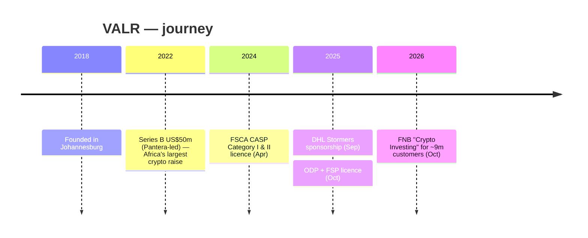

# VALR — Consolidated Journey

> Self-contained synthesis of the deep per-department research under
> `research/crypto-trading/valr/` plus the ZA crypto landscape file.
> Public information only. Tags: `[OBS]` observed, `[INF]` inference, `[EST]` estimate, `[UNK]` unknown.

## 1. Origin & founding timeline

| Date | Milestone | Tag |
|---|---|---|
| **2018** | Founded in Johannesburg (Sandton) by **Farzam Ehsani** (ex-FirstRand/Barclays Africa, ex-Deloitte) and **Badi Sudhakaran** (CPO) | [OBS] |
| **28 Feb 2022** | **Series B US$50m** — "Africa's largest-ever crypto raise"; led by **Pantera Capital** | [OBS] |
| **15 Apr 2024** | Granted **FSCA CASP Category I & II** licences — among the first approved in both categories | [OBS] |
| **20 Oct 2025** | Granted **OTC Derivatives Provider (ODP)** licence + additional FSP licence — reportedly a SA first for crypto | [OBS] |
| **1 Sep 2025** | **DHL Stormers** 3-year sponsorship begins (to 31 Aug 2028) | [OBS] |
| **6 Oct 2026** | **FNB "Crypto Investing"** launched — crypto trading for ~**9 million** FNB retail customers via VALR | [OBS] |

## 2. Growth journey & pivots

1. **Pro/API-first exchange (2018–2022).** VALR built an order-book exchange with deep liquidity and an institutional-grade API, raising the then-largest African crypto round (US$50m) in Feb 2022. [OBS]
2. **Regulated expansion (2024–2025).** Dual CASP licences (Apr 2024) and then an **ODP + FSP** licence (Oct 2025) opened derivatives — CFDs, perpetual/quarterly futures, options, forwards, swaps on crypto underlyings, plus a limited set of traditional instruments (shares, bonds). [OBS]
3. **Embedded-distribution pivot (2026).** The decisive move mirrored Luno's: embed VALR's infrastructure **inside a major bank**. On 6 Oct 2026 **FNB launched in-app "Crypto Investing"** for ~9 million retail customers using VALR rails. [OBS]

VALR's differentiation is **product depth (derivatives/margin/OTC) + institutional API**, rather than Luno's consumer education/trust posture. [INF]

## 3. Product evolution

| Product | Description | Tag |
|---|---|---|
| Spot Trading | 100+ crypto assets, order types, deep liquidity | [OBS] |
| Spot Margin | Up to **10x** leverage | [OBS] |
| Perpetual Futures | Up to **60x** leverage | [OBS] |
| Liquid Staking | Managed staking yield ("Earn Yield") | [OBS] |
| OTC desk | Bulk/block fiat & crypto trading | [OBS] |
| VALR Pay | Free "pay anyone" transfers | [OBS] |
| VALR Invest | Regulated investment products (post-ODP) | [OBS] |
| Lending & Borrowing | Crypto lending/borrowing | [OBS] |
| API / Business | Institutional API, unlimited sub-accounts, white-label | [OBS] |
| Simple Buy & Sell | Fiat↔crypto swap terminal (**1.6%**) | [OBS] |

**Fee note:** headline "0% maker / 0.05% taker" is a **best-case volume tier, not a flat rate**; published figures vary widely by source (maker often 0.08%, taker 0.10%). Treat the exact schedule as volume-tiered. [INF]

## 4. Business model & unit economics

**Revenue model:** trading fees (spot tiered), margin/futures, staking, and institutional/OTC + white-label services. [OBS]

**Disclosure status:** VALR is **privately held** and does **not publish audited financial statements** — revenue and profit are **[UNK]**. [OBS]

| Indicator | Value | Tag |
|---|---|---|
| Series B | US$50m (28 Feb 2022), Pantera-led | [OBS] |
| Total raised | ~US$54.9m | [OBS] |
| Valuation | ~US$190m pre-money (Crunchbase); ~US$240m post-money (alt source) | [OBS] |
| Daily volume | ~US$27m/day (2026 estimate, secondary) | [UNVERIFIED] |
| Flow mix | ~95% reported as USDT/ZAR "dollar buying" | [UNVERIFIED] |
| Users | >1.8m globally; >1,000 corporate/institutional clients | [OBS] |

**Investors:** Pantera Capital, Coinbase Ventures, Alameda Research, Cadenza, CMT Digital, Distributed Global, GSR, Third Prime, Avon Ventures (Fidelity/F-Prime), Bittrex, 4Di Capital. [OBS]

**Assessment:** VALR is VC-funded and pre/around profitability; economics rest on fees, derivatives and institutional services. Treat all revenue figures as **[UNK]**. [INF]

## 5. Customers & distribution

- **Customers:** >1.8m global users; >1,000 corporate/institutional clients — a proportionally **institutional/pro-trader** base vs Luno's retail on-ramp. [OBS]
- **Distribution:** direct (retail + pro/API) plus the **FNB embedded channel** (6 Oct 2026) reaching ~9 million FNB customers — the single largest distribution event in VALR's history. [OBS]
- **Support:** stated "tailored" support with private channels for corporate partners; no published SLA. [OBS]
- **Sentiment:** a **lighter public complaint footprint** than Luno/EasyEquities, likely due to the institutional base; standard crypto-exchange risks apply (60x perps, ZAR rail dependencies, travel-rule/KYC friction). Deeper complaint mining recommended. Per-bank NFO cases **[UNK]**. [INF]

## 6. Technology

| Layer | Detail | Tag |
|---|---|---|
| Institutional API | Real-time + historical market data, sub-accounts, competitive rate limits; sub-millisecond response claims | [OBS] |
| Sub-accounts | Unlimited sub-accounts with independent balances/histories | [OBS] |
| Feature parity | Everything in the web UI available programmatically | [OBS] |
| Compliance | **Sumsub** for travel-rule compliance and financial-crime prevention | [OBS] |
| Onboarding | Automated KYC/AML "in minutes" | [OBS] |
| PoR | Independent **Hacken** Proof-of-Reserves audits (Aug 2025; report dated 1 Sep 2026) | [OBS] |

**PoR detail:** Hacken covers Proof of Liabilities, Proof of Ownership, Reserves Calculation and PoR Assessment; findings show **1:1 collateralisation** with collateral ratios **exceeding 100%** for BTC, ETH, SOL, USDT, USDC and others. Caveat: independent attestation, **not a statutory audit** — addresses reserve sufficiency, not solvency/custody quality. Specific cloud/language/custody vendors are **[UNK]**. [OBS]/[INF]

## 7. Marketing & partnerships

- **Positioning:** "**Pro Trading, For Everyone**" — bridging retail simplicity and institutional sophistication; CMO **Ben Caselin** (Hong Kong-based). [OBS]
- **Flagship sponsorship:** **DHL Stormers** rugby — official crypto exchange partner, 3 years (1 Sep 2025 – 31 Aug 2028), across URC/Champions Cup/Currie Cup/U19/U21; VALR logo on kits, DHL Stadium presence, VIP suite. [OBS]
- **Campaigns:** "Crypto For Everyone" — VALR flew a helicopter with a banner around the country for mass awareness. [OBS]
- **Partnerships:** **FNB** (in-app Crypto Investing, ~9m customers, 6 Oct 2026); **Sumsub** (compliance). Strong regulatory/partnership news dominates the public narrative. [OBS]
- **People:** Co-founder/CEO **Farzam Ehsani**; Co-founder/CPO **Badi Sudhakaran**; CMO **Ben Caselin**. Headcount estimates diverge (55–200+); best-supported statement is "**100+ employees**", remote-first. [OBS]/[UNK]

## 8. Key lessons for a SA NeoBank

1. **Embed, don't build.** VALR's FNB deal (6 Oct 2026) and Luno's Discovery Bank deal prove the winning NeoBank crypto play is a **CASP white-label partnership** reaching millions instantly — the ~9m-customer FNB channel dwarfs any direct acquisition strategy. [OBS]
2. **Product depth is a moat for the institutional segment:** derivatives (ODP), margin (10x), perps (60x), OTC and API/sub-accounts. But high-leverage products raise consumer-protection and complaint risk. [OBS]
3. **Licence breadth unlocks product breadth:** the ODP + FSP licences (Oct 2025) expanded VALR into derivatives and traditional instruments — a regulatory strategy, not just a product one. [OBS]
4. **Proof-of-reserves is table stakes** (Hacken, 1:1, >100% collateral ratio) — and still only an attestation, not an audit. [OBS]/[INF]
5. **Sport sponsorship + stunts build mass awareness** cheaply relative to paid acquisition — the DHL Stormers deal and the helicopter campaign are the VALR brand playbook. [INF]

## 9. Timeline / growth chart (Mermaid)



```mermaid
xychart-beta
    title "VALR — headline users (millions, latest)"
    x-axis ["2026"]
    y-axis "Users (m)" 0 --> 2
    line [1.8]
```

## 10. Consolidated Sources

- VALR receives CASP licence (15 Apr 2024): https://blog.valr.com/blog/valr-receives-regulatory-license-as-crypto-asset-service-provider-casp
- VALR secures ODP licence (20 Oct 2025): https://blog.valr.com/blog/valr-secures-over-the-counter-derivatives-provider-license-from-south-african-regulator
- VALR raises $50m Series B: https://blog.valr.com/blog/valr-com-raises-50-million-in-africas-largest-ever-crypto-raise
- VALR — products & 1.8m users: https://www.valr.com/test
- VALR PoR audit by Hacken (2026): https://blog.valr.com/blog/valr-successfully-completes-proof-of-reserves-audit-by-hacken-lhc6l
- FNB brings crypto trading to ~9m customers via VALR: https://www.weex.com/it/news/detail/fnb-brings-crypto-trading-in-south-africa-to-nearly-9-million-customers-nddn9cmln9slnrxcw909f3ig
- VALR & DHL Stormers partnership: https://dapp.expert/news/en_valr-and-dhl-stormers-a-new-partnership-in-cryptocurrency-and-sports-1755873725-544552
- Sumsub — VALR travel rule compliance: https://sumsub.com/customers/valr/
- Moneyweb — which SA crypto exchange is cheapest: https://www.moneyweb.co.za/moneyweb-crypto/which-sa-crypto-exchange-is-the-cheapest/
- FinanceFeeds — VALR wins SA's first crypto derivatives licences: https://financefeeds.com/valr-wins-south-africas-first-crypto-derivatives-licenses/
