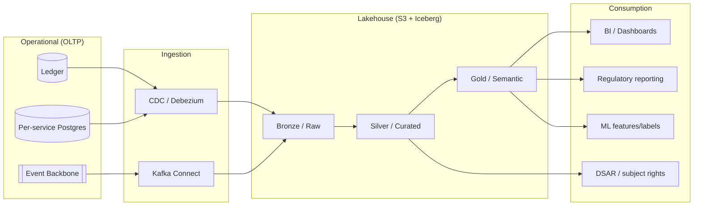

# Data Platform — Overview

**Parent index:** [architecture/README.md](../README.md) · **Status:** Proposed (v0.1) · **As-of:** 2026-10-16 · **Owner:** C06/C11 (platform) with C12 (security) & C01 (compliance).

This folder describes how Umoya handles **data**: the logical model and PII tagging, POPIA-aligned governance, regulatory/analytical reporting, and AI/ML. It sits between the operational [domain model](../domain-model/README.md) and the way we [observe](../platform/observability.md) and [run](../platform/deployment-topology.md) the platform.

> Everything here is a **DESIGN CHOICE**. Regulatory obligations are cross-linked ([POPIA](../../research/regulatory/privacy-popia.md), [FICA](../../research/regulatory/aml-fica.md), [tax/AEOI](../../research/regulatory/tax-governance.md)) and treated as authoritative; our data designs are proposals.

---

## 1. Files in this folder

| File | Scope |
|---|---|
| [`data-model.md`](./data-model.md) | Logical data model, schemas, key tables, PII tagging. |
| [`data-governance.md`](./data-governance.md) | POPIA-aligned governance: lawful basis, retention, cross-border, DSAR, classification, master data. |
| [`analytics-and-reporting.md`](./analytics-and-reporting.md) | Regulatory reporting (BA returns), BI, metrics, warehouse/lakehouse. |
| [`ai-and-ml.md`](./ai-and-ml.md) | ML use cases (credit, fraud, AML), MLOps, model governance, human-in-the-loop. |

---

## 2. Data architecture at a glance

We use a **medallion lakehouse** fed by CDC and domain events, isolated from the operational systems.

---

## 3. Data platform principles

1. **Operational ≠ analytical.** The lakehouse is **downstream**; it never writes operational truth back to the core. *(DESIGN CHOICE)*
2. **Medallion layering.** Bronze (raw/immutable) → Silver (cleaned/conformed, PII governed) → Gold (semantic, governed metrics). *(DESIGN CHOICE)*
3. **PII governed at the field level.** Every PII field carries a classification tag driving access, masking and residency ([data-model](./data-model.md), [data-governance](./data-governance.md)).
4. **Open table formats.** Apache Iceberg to avoid warehouse lock-in. *(DESIGN CHOICE)*
5. **In-region.** The lakehouse runs in-region; offshore analytics only under a §72 basis. *(DESIGN CHOICE)*
6. **Lineage & quality.** Column-level lineage and data-quality tests are first-class. *(DESIGN CHOICE)*
7. **Minimisation in analytics.** Analytics prefers de-identified/aggregated data; raw PII access is tightly controlled and audited.
8. **Reproducible.** Pipelines are code (IaC + versioned transforms), testable and re-runnable. ([devops-and-sdlc](../platform/devops-and-sdlc.md))

---

## 4. Data domains

| Data domain | Examples | Source | Governance note |
|---|---|---|---|
| **Customer & party** | Customer, Party, contacts, KYCProfile | BC2/BC3 | High PII; special categories (biometrics) |
| **Accounts & ledger** | Accounts, LedgerEntry, Transaction | BC5 | Financial; audit-critical; immutable |
| **Payments & cards** | Payments, Cards, settlements | BC6/BC7 | PII-linked; PCI-scoped (card data minimised) |
| **Credit** | Applications, decisions, loans | BC8 | PII; conduct/credit-regulation scope |
| **Risk & fraud** | Scores, signals, cases | BC9 | PII-linked; sensitive |
| **AML** | Alerts, cases, reports | BC10 | Highly restricted; legal privilege considerations |
| **Reference/master** | Products, currencies, codes, calendars | BC4 | Low sensitivity; must be governed (MDM) |
| **Telemetry** | Logs, metrics, traces | Platform | Operational; audit subset |

---

## 5. How data flows from domain to lakehouse

- **CDC** captures OLTP table changes (append-heavy: ledger entries).
- **Domain events** carry semantic change notifications ([domain-events](../domain-model/domain-events.md)).
- The lakehouse reconstructs a **history** of state changes (temporalised), enabling point-in-time analytics and audit support.
- **No PII is duplicated** unless there is a documented purpose; where needed, it is tagged and masked in lower-trust zones.

---

## 6. Definition of "done" for a data pipeline *(DESIGN CHOICE)*

- Documented **source, purpose, lawful basis** and **retention**.
- **PII classification** applied; masking in non-production.
- **Data-quality tests** (freshness, completeness, referential integrity).
- **Lineage** registered.
- **Access control** defined (least privilege).
- **Monitoring/alerting** on failure ([observability](../platform/observability.md)).
- **Residency** verified (in-region or §72 basis).

---

## 7. Related reading

- [domain-model/README](../domain-model/README.md) — the operational model this mirrors.
- [data-model.md](./data-model.md) → [data-governance.md](./data-governance.md) → [analytics-and-reporting.md](./analytics-and-reporting.md) → [ai-and-ml.md](./ai-and-ml.md).
- [platform/deployment-topology.md](../platform/deployment-topology.md) — where the lakehouse runs.
- [regulatory pack](../../research/regulatory/README.md) — POPIA/FICA/tax drivers.
