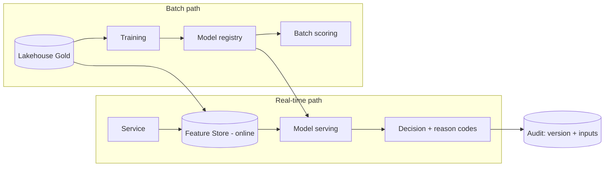

# AI & Machine Learning

**Parent:** [data/README.md](./README.md) · **Status:** Proposed (v0.1) · **As-of:** 2026-10-16.

How Umoya uses ML for **credit, fraud and AML**, and how we govern it. Model use is a **DESIGN CHOICE**; every model is subject to POPIA/FAIS/NCA fairness and explainability expectations ([privacy-popia](../../research/regulatory/privacy-popia.md), [conduct-fais-nca](../../research/regulatory/conduct-fais-nca.md), [aml-fica](../../research/regulatory/aml-fica.md)).

---

## 1. Guiding stance

**AI assists; humans decide where it matters.** We use ML to improve decisions and reduce loss, but we keep **human-in-the-loop** for consequential outcomes (credit decline, account closure, TFS confirmation) and we never let a model be the sole basis of an adverse action without explanation and appeal. *(DESIGN CHOICE)*

---

## 2. ML use cases

| Use case | Context | Model type | Human-in-loop? |
|---|---|---|---|
| **Credit scoring / affordability** | BC8 | Gradient boosting / scorecard | **Yes** — decline/limit override + explanation |
| **Fraud detection (real-time)** | BC9 | Gradient boosting / rules+ML hybrid | Auto for low-value; review for high |
| **AML transaction monitoring** | BC10 | Rules + anomaly detection / graph | **Yes** — alerts to investigators |
| **Screening match resolution** | BC3/BC10 | Fuzzy matching / classifier | **Yes** — potential matches reviewed |
| **Customer churn / next-best-action** | Product | Gradient boosting | No adverse effect |
| **Collections prioritisation** | BC8/BC12 | Ranking | Human oversight |
| **Document/OCR verification** | BC3 | Vision/OCR | Falls back to manual review |
| **Conversational support** | Servicing | LLM-assisted (guardrailed) | Human escalation |

---

## 3. Where models run

- **Online feature store** for low-latency features (e.g. card auth < 150 ms budget — [NFR §3](../system-design/non-functional-requirements.md)).
- **Offline feature store** reuses the same definitions for training/serving parity. *(DESIGN CHOICE)*
- **Model registry** stores version, training data snapshot, metrics, approval. *(DESIGN CHOICE)*

---

## 4. MLOps lifecycle

| Stage | Practice *(DESIGN CHOICE)* |
|---|---|
| **Data** | Feature definitions versioned; training data snapshotted & governed ([data-governance](./data-governance.md)). |
| **Training** | Reproducible pipelines; experiment tracking. |
| **Evaluation** | Offline metrics **plus** fairness & bias tests (see §6). |
| **Approval** | Model governance board sign-off (risk/compliance) before production. |
| **Deployment** | Shadow → canary → full; rollback ready. |
| **Monitoring** | Drift (data & concept), performance, calibration; alerts. |
| **Retraining** | Scheduled + triggered; re-approved. |
| **Retirement** | Decommissioned with audit trail. |

---

## 5. Model governance (POPIA/FAIS/NCA-aligned)

| Requirement | Our control *(DESIGN CHOICE)* |
|---|---|
| **Explainability** | Adverse decisions produce human-readable reason codes; models must be interpretable or accompanied by explanation tooling (SHAP-style). |
| **Fairness** | Bias testing across protected/sensitive attributes ([privacy-popia](../../research/regulatory/privacy-popia.md) §5); monitored over time. |
| **Lawful basis & minimisation** | Features limited to what the stated purpose needs; no special-category features without explicit ground. |
| **Avoiding prohibited discrimination** | Guard against using sensitive attributes (race, health, etc.) unless lawful and justified; test proxy variables. |
| **Consent/notice** | Privacy notice discloses automated decisioning where required. |
| **Record-keeping** | Every model decision stores `modelVersion`, inputs hash, and reason codes ([aggregates](../domain-model/aggregates.md) K5). |
| **Human review & appeal** | Credit declines and account actions are reviewable/appealable (conduct — [conduct-fais-nca](../../research/regulatory/conduct-fais-nca.md)). |
| **Model risk management** | Documented model risk framework; periodic independent validation. |

> POPIA gives data subjects rights regarding decisions based **solely** on automated processing — hence "human-in-the-loop" is both good practice and risk mitigation. *(DESIGN CHOICE; confirm exact POPIA automated-decision provisions with counsel — **UNVERIFIED**.)*

---

## 6. Fairness & bias testing

- Test outcome parity across segments (age, geography, gender, and — where lawful and appropriate — other groups).
- Watch for **proxy discrimination** (e.g. postcode standing in for race).
- Document trade-offs; prefer models that pass fairness thresholds even at small accuracy cost. *(DESIGN CHOICE)*
- Re-test on retrain; alert on drift in fairness metrics.

---

## 7. AML/fraud-specific governance

- **AML models** assist investigators; final suspicion decisions are human ([aml-fica](../../research/regulatory/aml-fica.md)).
- **Auditability:** alerts, model versions and rationales retained for supervisory review.
- **Feedback loops:** case outcomes (SAR filed / not) become training labels, but carefully to avoid gaming.
- **Adversarial robustness:** continuously update features as fraudsters adapt.

---

## 8. Generative AI / LLM usage *(DESIGN CHOICE, cautious)*

| Use | Allowed? | Guardrail |
|---|---|---|
| Customer support assist | Yes (human-in-loop) | No PII leakage; grounded responses; escalation. |
| Code assistance (engineering) | Yes | No secrets/PII in prompts; [devops-and-sdlc](../platform/devops-and-sdlc.md). |
| Automated credit/AML decisions | **No** (as sole decision-maker) | Human decides. |
| Sending customer PII to external LLM APIs | **No** by default | §72 + minimisation required; prefer in-region/private models. |

---

## 9. Data & residency for ML

- Training/serving in-region on lakehouse data; PII minimised/tokenised in features.
- No production PII to third-party model APIs without a §72 basis ([data-governance](./data-governance.md) §9).
- Feature store access is least-privilege and audited.

---

## 10. Open questions *(UNVERIFIED)*

1. Exact **POPIA provisions on automated decisioning** and required safeguards — counsel review. **UNVERIFIED.**
2. **Fairness thresholds** and protected attributes treatment — legal + ethics review. **UNVERIFIED.**
3. Model **build vs buy** for fraud/AML (vendor models vs in-house). **DESIGN CHOICE open.**
4. Whether a **model risk framework** must align to a specific standard (SR 11-7-style) — no SA mandate identified. **UNVERIFIED.**

---

## 11. Related reading

- [analytics-and-reporting.md](./analytics-and-reporting.md) — the lakehouse & features.
- [data-governance.md](./data-governance.md) — lawful basis, fairness, residency.
- [component-map](../system-design/component-map.md) §5–6 — fraud/AML components.
- [conduct-fais-nca](../../research/regulatory/conduct-fais-nca.md) — fairness/conduct.
