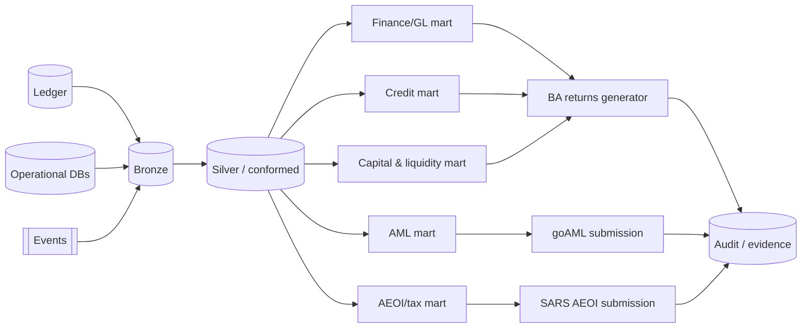

# Analytics & Regulatory Reporting

**Parent:** [data/README.md](./README.md) · **Status:** Proposed (v0.1) · **As-of:** 2026-10-16.

How Umoya produces **regulatory returns** (BA returns, FIC, AEOI), business intelligence, and metrics, on top of the lakehouse. Prudential/regulatory obligations are cross-linked ([tax-governance](../../research/regulatory/tax-governance.md) §8, [aml-fica](../../research/regulatory/aml-fica.md), [payments-nps](../../research/regulatory/payments-nps.md)). Our pipelines/marts are **DESIGN CHOICE**.

---

## 1. What we must produce

| Output | To | Cadence | Source |
|---|---|---|---|
| **BA 100** (balance sheet) | SARB PA | Periodic (confirm) | Ledger + GL |
| **BA 200 / 210** (credit returns) | SARB PA | Periodic | Credit + ledger |
| **BA 700** (capital adequacy & leverage) | SARB PA | Periodic | Capital/treasury + ledger |
| **Pillar III disclosures** | Public/regulator | Annual | Finance + risk |
| **CTR / STR / TPR** | FIC (goAML) | Event-driven (3d/15d/delay) | AML service |
| **AEOI (FATCA/CRS/CARF)** | SARS | Annual (+ CARF cycle) | Customer + tax data |
| **STT / tax reporting** | SARS | Per rules | Ledger/treasury |
| **PAIA annual report** | Information Regulator | Annual (Apr–Jun) | Privacy |

> Exact BA-return **set and frequencies for a de-novo bank are UNVERIFIED** ([tax-governance](../../research/regulatory/tax-governance.md) §10). Confirm with the PA.

---

## 2. Reporting architecture

- **Regulatory marts** are separate from exploratory analytics (controlled, tested, sign-off-gated). *(DESIGN CHOICE)*
- **Lineage** traces every reported figure back to ledger entries and events ([data-governance](./data-governance.md) §10).
- **Reproducibility:** returns are regenerable for any past period (temporal tables). *(DESIGN CHOICE)*

---

## 3. BA returns — how we produce them

| Return | Content | Data sources | Notes |
|---|---|---|---|
| **BA 100** | Assets, liabilities, equity, memo items | Ledger + GL mappings | Requires a **regulatory chart-of-accounts mapping**. *(DESIGN CHOICE)* |
| **BA 200/210** | Credit exposures, impairments, NPL | Credit + ledger | Requires exposure classification. |
| **BA 700** | Capital adequacy & leverage ratio | Capital/treasury + RWA engine | Depends on Basel III/IV (implemented from 1 Jul 2025 — [tax-governance](../../research/regulatory/tax-governance.md) §8). |

**Controls** *(DESIGN CHOICE)*: maker–checker sign-off; immutable snapshot of each submitted return; variance analysis vs prior period; alerting on abnormal movements; retention of submission evidence.

---

## 4. Business intelligence & metrics

We maintain a **governed semantic layer** so "active customer" means the same thing everywhere.

| Metric family | Example metrics | Definition owner |
|---|---|---|
| **Growth** | Active customers, funded accounts, new accounts | Product |
| **Engagement** | MAU/DAU, transactions/customer | Product |
| **Unit economics** | Cost-to-serve, ARPU, CAC, LTV | Finance |
| **Payments** | Payment volume/value, success rate, rail mix | Payments |
| **Cards** | Spend, interchange, authorisation rate | Cards |
| **Risk** | Fraud rate, fraud loss (bps), false-positive rate | Risk |
| **AML** | Alerts, STRs filed, alerts/STR ratio | Compliance |
| **Credit** | Approval rate, arrears rate, NPL ratio | Credit |
| **Reliability** | Availability, latency vs SLO | Platform |

- **Metric definitions are versioned**; changes are recorded. *(DESIGN CHOICE)*
- **Dashboards** consume the Gold layer only (never raw Bronze) for business consumption.

---

## 5. Data warehouse / lakehouse

| Layer | Content | Consumers |
|---|---|---|
| **Bronze** | Raw CDC/events (immutable) | Engineering, forensics |
| **Silver** | Conformed, deduped, PII-masked | Data science, reporting |
| **Gold** | Business marts & semantic layer | BI, regulatory returns, ML |

- **Open format (Iceberg)** to avoid lock-in; query via serverless SQL/Spark ([technology-selection](../system-design/technology-selection.md) §8). *(DESIGN CHOICE)*
- **Tiering** (hot/warm/cold) for cost ([NFR §12](../system-design/non-functional-requirements.md)).

---

## 6. Reporting to regulators — operational flow

1. **Build** the return from the governed mart.
2. **Validate** (completeness, internal consistency, cross-checks, prior-period comparison).
3. **Review & sign off** (maker–checker; finance/risk).
4. **Submit** via the regulator channel (file/portal — **UNVERIFIED** specifics).
5. **Archive** the exact submitted artefact + evidence in the audit store.
6. **Learn** — post-submission queries/remediations tracked.

---

## 7. AEOI specifics (FATCA/CRS/CARF)

- A bank is a **Depository Institution** for CRS/FATCA → must run due diligence and report reportable accounts ([tax-governance](../../research/regulatory/tax-governance.md) §4).
- **CARF** (crypto-asset reporting) effective **1 Mar 2026** if we offer crypto → we would be an **R-CASP** ([tax-governance](../../research/regulatory/tax-governance.md) §4).
- Use SARS **AEOI BRS** schema (**UNVERIFIED** current version) for submissions.
- Our mart: `AEOI/tax` in Gold, with residency/tax-residency evidence.

---

## 8. Governance of analytics

- **Privacy review** before any new analytical use ([data-governance](./data-governance.md)).
- **De-identification** preferred; raw PII access is exceptional, time-bound and audited.
- **Lineage** mandatory for regulatory marts.
- **Model** outputs feeding reporting carry model version + explainability ([ai-and-ml](./ai-and-ml.md)).
- **Residency:** lakehouse in-region; no offshore analytics of production PII absent §72 basis.

---

## 9. Open questions *(UNVERIFIED)*

1. **Exact BA-return** set/frequency/cutoffs for our licence class ([tax-governance](../../research/regulatory/tax-governance.md) §10). **UNVERIFIED.**
2. **PA/FIC/SARS submission channels & formats** (specifically goAML and PA portals). **UNVERIFIED.**
3. **RWA engine** build vs buy for BA 700/Basel. **DESIGN CHOICE open.**
4. **CARF** applicability (only if crypto is in scope). **UNVERIFIED.**

---

## 10. Related reading

- [data-governance.md](./data-governance.md) — retention, lineage, residency.
- [data-model.md](./data-model.md) — source schemas.
- [ai-and-ml.md](./ai-and-ml.md) — ML feeding/consuming analytics.
- [tax-governance](../../research/regulatory/tax-governance.md) §8 — BA returns & Basel grounding.
