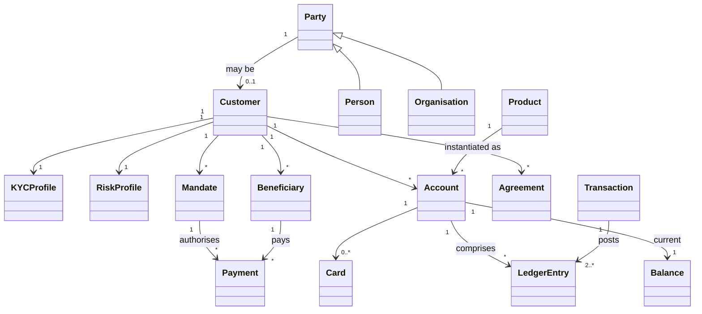

# Domain Model — How to Read It

**Parent index:** [architecture/README.md](../README.md) · **Status:** Proposed (v0.1) · **As-of:** 2026-10-16 · **Owner:** C11 Dev-Engineering with C06.

This folder describes **what the business *is*, in code terms**: the entities we track, the aggregates that enforce invariants, the events that record change, the ledger that holds the money truth, and the money/currency rules. It is the bridge between the [bounded contexts](../system-design/bounded-contexts.md) and the [data platform](../data/README.md).

Every model element here is a **DESIGN CHOICE**. Regulatory facts are cross-linked to the [regulatory pack](../../research/regulatory/README.md), not restated.

---

## 1. Files in this folder

| File | Answers |
|---|---|
| [`entities.md`](./entities.md) | What are the core business objects? (Customer, Party, Account, LedgerEntry, Transaction, Card, Mandate, Product, Agreement, Beneficiary, Payment, KYCProfile, RiskProfile.) |
| [`aggregates.md`](./aggregates.md) | Where are the consistency boundaries and what invariants must always hold? |
| [`domain-events.md`](./domain-events.md) | What facts do we publish, and what do consumers do with them? |
| [`ledger-model.md`](./ledger-model.md) | How is money written? (double-entry, posting rules, reconciliation, immutability, audit.) |
| [`money-and-currency.md`](./money-and-currency.md) | How do we represent money? (ZAR base, minor units, FX, rounding, multi-currency readiness.) |

---

## 2. Modelling principles

1. **Ubiquitous language is law.** Entity names here are the names used in code, events and APIs. Where a word is overloaded ("account") the context is stated. See the glossary in [architecture/README](../README.md) §6.
2. **Entities vs value objects.** An **entity** has identity and lifecycle (a `Customer`). A **value object** is immutable and defined by its values (`Money`, `Address`, `DateOfBirth`). We do not give a value object an identity.
3. **Aggregates are consistency boundaries.** One aggregate = one transaction boundary = one writer. Cross-aggregate consistency is **eventual**, coordinated by sagas ([aggregates](./aggregates.md)).
4. **Events are past-tense facts.** `PaymentSettled` already happened; it is not a command. Commands (`SettlePayment`) are not modelled in this folder.
5. **Money has one representation.** `Money(minorUnits, currency)` everywhere. No floats. ([money-and-currency](./money-and-currency.md))
6. **Append, never mutate, money.** Balances are derived from postings. ([ledger-model](./ledger-model.md))
7. **PII is tagged, not scattered.** Fields carrying personal information are tagged in [data-model](../data/data-model.md); the domain marks them `«PII»`.

---

## 3. The core object relationships (orienting sketch)

> The diagram is *orienting*, not exhaustive; see [entities.md](./entities.md) for the full attribute-level list and [aggregates.md](./aggregates.md) for cluster boundaries.

---

## 4. How the domain maps to contexts and containers

| Domain concept | Bounded context | Container |
|---|---|---|
| Customer, Party, KYCProfile | BC2 Customer & Party | C7 |
| Product, Agreement, Mandate | BC4 Product & Agreement | C9 |
| Account, Balance, LedgerEntry, Transaction | BC5 Ledger | C8 |
| Payment, Beneficiary | BC6 Payments | C10 |
| Card | BC7 Cards | C12 |
| RiskProfile | BC9 Fraud & Risk | C14 |

See [bounded-contexts](../system-design/bounded-contexts.md) and [container-diagram](../system-design/container-diagram.md).

---

## 5. Conventions

- `«aggregate root»`, `«entity»`, `«value object»`, `«PII»`, `«enum»` are used as stereotype markers.
- Cardinality uses `1`, `0..1`, `*` in plain text.
- Identifiers are opaque, immutable, and not sequential where they are externally visible (to prevent enumeration). *(DESIGN CHOICE)*
- Timestamps are UTC in storage; displayed in SAST for customers. *(DESIGN CHOICE)*
- Every entity that can be created or changed by a customer action has a corresponding [domain event](./domain-events.md).

---

## 6. Related reading

- [system-design/bounded-contexts.md](../system-design/bounded-contexts.md) — the contexts.
- [data/data-model.md](../data/data-model.md) — the physical/logical persistence of these entities.
- [domain-model/ledger-model.md](./ledger-model.md) — the most safety-critical model.
