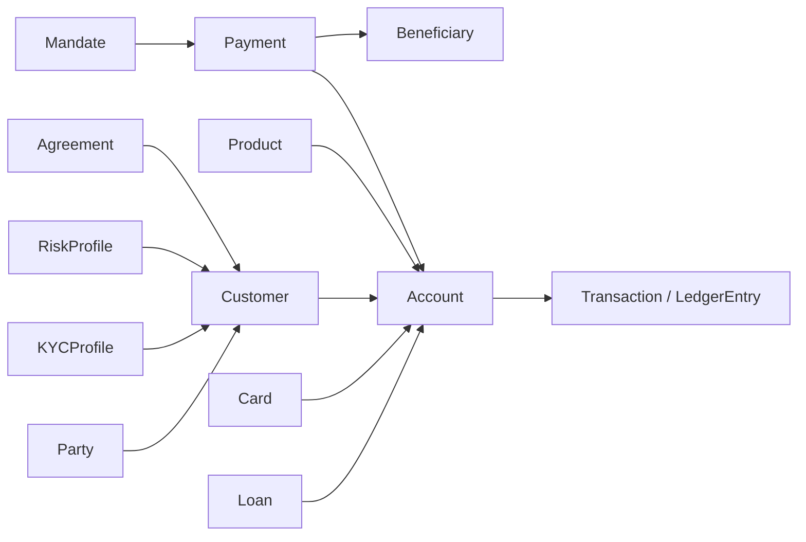

# Aggregates & Invariants

**Parent:** [domain-model/README.md](./README.md) · **Status:** Proposed (v0.1).

An **aggregate** is a cluster of entities and value objects treated as a single unit for data changes: one transaction boundary, one writer, one consistency guarantee. Aggregate **invariants** are rules that must *always* hold. This file defines the aggregate boundaries and invariants for Umoya, and explains how we keep them consistent across boundaries.

> Every boundary and invariant below is a **DESIGN CHOICE**. Invariants that reflect regulatory obligations are cross-linked.

---

## 1. Aggregate design rules we apply

1. **One aggregate = one transaction = one writer.** A single service instance commits a change to one aggregate atomically.
2. **Reference other aggregates by ID, not by object.** `Payment` holds `accountId`, not the whole `Account`.
3. **Cross-aggregate consistency is eventual**, coordinated by **sagas** (see §5) or by **events**.
4. **Small aggregates where possible.** The ledger's `Account` aggregate is kept tight; large denormalised blobs are avoided.
5. **The aggregate root is the only entry point.** External callers never touch child entities directly.
6. **Immutability wins for money.** Where an aggregate is append-only (`Account`↔`LedgerEntry`), we do not model updates.
7. **Concurrency via optimistic locking** (version field) on mutable roots. *(DESIGN CHOICE)*

---

## 2. Aggregate inventory

| Aggregate root | Contains | Transaction boundary | Owner context |
|---|---|---|---|
| **Customer** | KYCProfileRef, contacts, relationships | Customer lifecycle | BC2 |
| **Party** | identifiers, addresses, roles, beneficial owners | Party lifecycle | BC2 |
| **KYCProfile** | verification/screening outcomes | Onboarding decision | BC3 |
| **Product** | fees, interest rules, eligibility (versioned) | Product publish | BC4 |
| **Agreement** | accepted terms + evidence | Acknowledgement | BC4 |
| **Mandate** | collection authority + authentication | Mandate auth/revoke | BC4 |
| **Account** | Balance, LedgerEntries (append-only) | **Every posting** | BC5 |
| **Transaction** | balanced LedgerEntries | Posting atomically | BC5 |
| **Card** | limits, status, tokens | Card lifecycle/auth | BC7 |
| **Payment** | instruction, status, beneficiary ref | Payment state machine | BC6 |
| **Beneficiary** | identifier + verification | Add/verify/remove | BC6 |
| **CreditApplication / Loan** | decision, schedule, arrears | Origination/servicing | BC8 |
| **RiskProfile** | ratings, indicators | Risk assessment | BC9 |
| **AML Case** | alert, investigation, report | Case lifecycle | BC10 |

> **Note:** `Account` and `Transaction` are tightly related but distinct aggregates. A `Transaction` produces `LedgerEntry` lines that are *recorded against* LedgerAccounts; the `Account` aggregate exposes the `Balance` projection. See [ledger-model](./ledger-model.md) §3.

---

## 3. Invariants (the ones that must never break)

### 3.1 Ledger invariants (safety-critical)

| # | Invariant |
|---|---|
| L1 | **Every journal balances:** Σ debits = Σ credits per currency, for every `Transaction`. |
| L2 | **Entries are immutable.** No update/delete of a posted `LedgerEntry`; corrections are compensating entries. |
| L3 | **Balances are derived.** `Balance` is always consistent with the set of entries. |
| L4 | **Every posting has a business cause.** A `Transaction` references an initiating business action (payment, card, fee, interest, disbursement, reversal). |
| L5 | **Every posting has an actor.** Customer, operator (with identity), system, or rail — never anonymous. |
| L6 | **Monetary amounts are exact** in minor units; no floating point. |
| L7 | **Value dates are monotonic per account** for booking order (no post-dated booking that reorders history). |

Detail and enforcement: [ledger-model](./ledger-model.md).

### 3.2 Account invariants

| # | Invariant |
|---|---|
| A1 | An `Account` belongs to exactly one `Customer` (or joint-holders modelled explicitly). |
| A2 | An `Account` uses exactly one `Product` version at a time (changes are migrations). |
| A3 | A `FROZEN`/`CLOSED` account rejects value-decreasing postings except where regulation requires (e.g. fees/regulatory debits). |
| A4 | Available balance never goes negative without an authorised overdraft/credit facility. |

### 3.3 Payment invariants

| # | Invariant |
|---|---|
| P1 | A payment moves through the defined state machine only (no skipping states). |
| P2 | Idempotency: the same request key never produces two payments. |
| P3 | Funds are **reserved** before dispatch; reservation released on failure. |
| P4 | A settled payment always has a matching ledger posting. |
| P5 | Every payment passes eligibility + limits + fraud + (where required) AML screening before dispatch. |
| P6 | Returns/recalls reconcile back to a settlement item. |

### 3.4 Card invariants

| # | Invariant |
|---|---|
| C1 | An authorisation never exceeds available funds + authorised overdraft. |
| C2 | Cleared amounts reconcile to scheme totals. |
| C3 | Full PAN never stored outside tokenisation/PCI scope. |
| C4 | A blocked card produces no new approvals. |

### 3.5 Customer/KYC/AML invariants

| # | Invariant |
|---|---|
| K1 | A `Customer` cannot be `ACTIVE` without a `KYCProfile` meeting the required level. |
| K2 | Sanctions/TFS screening runs before relationship activation and on trigger ([aml-fica](../../research/regulatory/aml-fica.md) §4). |
| K3 | Enhanced due diligence applies for high-risk and PEP relationships. |
| K4 | A confirmed TFS match blocks transactions and triggers reporting obligations. |
| K5 | Every decision (credit/AML/fraud) stores reason codes and model version (explainability). |

### 3.6 Mandate invariants

| # | Invariant |
|---|---|
| M1 | A collection requires a valid, authenticated, non-revoked `Mandate`. |
| M2 | Mandate revocation stops future collections but does not retroactively invalidate settled ones. |

---

## 4. Aggregate interaction (who may reference whom)

- References are **by ID** across aggregates. The diagram shows logical relationships, not object graphs.
- Cycles are avoided: e.g. `Payment` references `Account` and `Beneficiary`, but neither references `Payment`.

---

## 5. Cross-aggregate consistency: sagas

Where a business operation spans aggregates (and often contexts), we use a **saga** with compensating actions. Examples *(DESIGN CHOICE)*:

| Saga | Steps | Compensation |
|---|---|---|
| **External payment** | reserve funds (Account) → screen (AML) → send (Rail) → settle → post | release reservation; if sent-but-failed, reverse |
| **Onboarding** | verify identity → screen → create Party → create Customer → open Account | mark customer declined; retain audit record |
| **Loan disbursement** | create Loan → disburse (Ledger) → notify | reverse disbursement if downstream fails |
| **Card issuance** | create Card → tokenise → ship → activate | block/cancel card |

Sagas are orchestrated by the **Workflow Engine** (C24) with idempotent steps and durable state. See [container-diagram](../system-design/container-diagram.md).

---

## 6. Concurrency & consistency model

| Concern | Approach *(DESIGN CHOICE)* |
|---|---|
| Single aggregate writes | ACID transaction in the owning service. |
| Concurrent updates to one aggregate | Optimistic locking (version/etag); retry on conflict. |
| Read-your-writes for a customer's money | Balance projection refreshed synchronously enough for own-account views ([NFR §3](../system-design/non-functional-requirements.md)). |
| Cross-aggregate reads | Eventual; consumers tolerate staleness with freshness metadata. |
| Duplicate delivery | Idempotency keys + dedupe on event consumer side. |

---

## 7. Anti-patterns we forbid

- A "God aggregate" holding Customer + Account + Payment in one transaction.
- Cross-aggregate transactional updates (two aggregates in one DB transaction across contexts).
- Referencing other aggregates by object reference (creates coupling and stale data).
- Mutating money ("adjust the balance") instead of posting compensating entries.
- Storing derived balances as the source of truth.

---

## 8. Related reading

- [entities.md](./entities.md) — the entities inside each aggregate.
- [domain-events.md](./domain-events.md) — how aggregates notify the world.
- [ledger-model.md](./ledger-model.md) — the ledger invariants in depth.
- [system-design/bounded-contexts.md](../system-design/bounded-contexts.md) — which context owns each aggregate.
