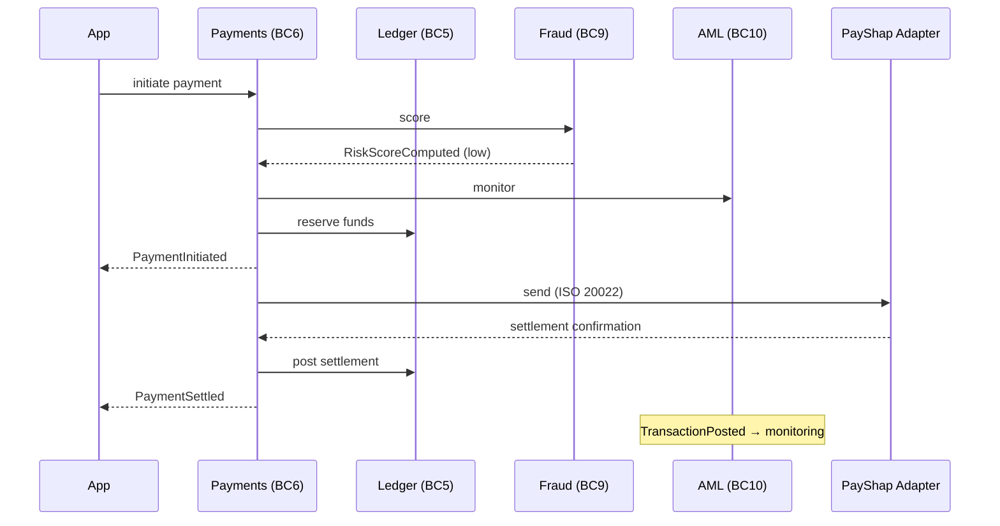
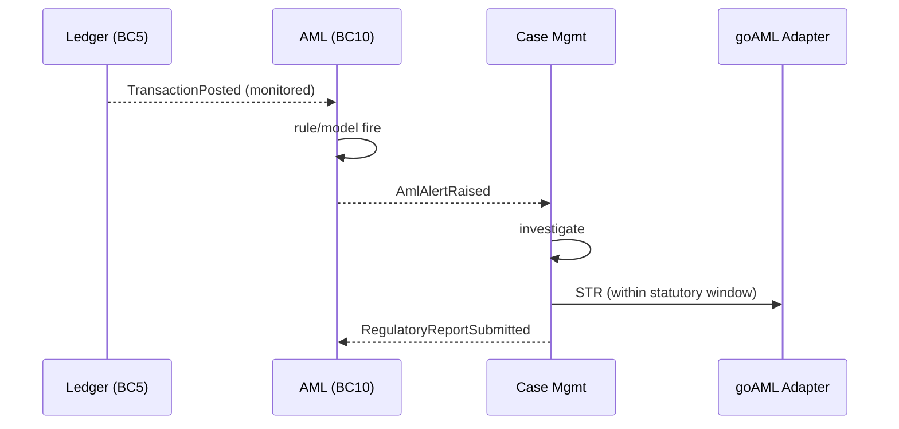

# Domain Event Catalogue

**Parent:** [domain-model/README.md](./README.md) · **Status:** Proposed (v0.1).

Domain events are **past-tense facts** published by aggregates and consumed by other bounded contexts. This is our **published language** on the event backbone (Kafka, [technology-selection](../system-design/technology-selection.md) §5). Events decouple contexts; consumers react without the publisher needing to know them.

> Every event, its payload and its consumers are a **DESIGN CHOICE**. Where an event exists to satisfy an obligation, we cross-link ([FICA](../../research/regulatory/aml-fica.md), [POPIA](../../research/regulatory/privacy-popia.md), [conduct](../../research/regulatory/conduct-fais-nca.md)).

---

## 1. Event conventions

- **Naming:** `PascalCase`, past tense, no verbs in imperative. `PaymentSettled`, not `SettlePayment`.
- **Envelope (common header):** every event carries
  - `eventId` (UUID, dedupe key), `eventType`, `eventVersion` (schema),
  - `occurredAt` (UTC), `recordedAt`,
  - `aggregateId` + `aggregateType` + `aggregateVersion`,
  - `correlationId`, `causationId`, `actor` (customer/operator/system/rail),
  - `tenant`/`environment`, `dataClassification` (drives routing & residency rules).
- **Payload:** minimum necessary fields — events are **not** full snapshots unless stated; consumers fetch detail via API if needed. *(minimisation — [POPIA](../../research/regulatory/privacy-popia.md))*
- **PII:** events avoid raw PII where possible (use IDs); where PII is unavoidable it is tagged and the topic is access-controlled.
- **Evolution:** backward-compatible changes only; schema registry enforces; breaking changes → new `eventVersion`.
- **Delivery:** at-least-once; consumers must be **idempotent** (dedupe on `eventId`).
- **Ordering:** guaranteed per aggregate (partition key = `aggregateId`); no global ordering assumed.

---

## 2. Event families (topic map)

| Topic family | Owning context | Example events |
|---|---|---|
| `identity.*` | BC1 | `UserAuthenticated`, `StepUpCompleted`, `ConsentGranted`, `ConsentRevoked` |
| `customer.*` | BC2 | `CustomerOnboarded`, `CustomerSuspended`, `CustomerClosed`, `ContactUpdated` |
| `party.*` | BC2 | `PartyLinked`, `PartySanctionsFlagged` |
| `onboarding.*` | BC3 | `IdentityVerified`, `ScreeningCompleted`, `KYCProfileCreated`, `OnboardingDeclined` |
| `product.*` | BC4 | `ProductPublished`, `ProductWithdrawn` |
| `agreement.*` | BC4 | `AgreementAccepted` |
| `mandate.*` | BC4 | `MandateRegistered`, `MandateAuthenticated`, `MandateRevoked` |
| `account.*` | BC5 | `AccountOpened`, `AccountFrozen`, `AccountClosed` |
| `ledger.*` | BC5 | `TransactionPosted`, `TransactionReversed`, `BalanceAdjusted` |
| `payment.*` | BC6 | `PaymentInitiated`, `PaymentSettled`, `PaymentFailed`, `PaymentReturned` |
| `card.*` | BC7 | `CardIssued`, `CardBlocked`, `AuthorisationApproved`, `CardSettled` |
| `credit.*` | BC8 | `CreditApplicationReceived`, `CreditDecisionMade`, `LoanDisbursed`, `RepaymentReceived`, `AccountInArrears` |
| `fraud.*` | BC9 | `FraudSignalRaised`, `PaymentHeld`, `RiskScoreComputed` |
| `aml.*` | BC10 | `AmlAlertRaised`, `CaseClosed`, `RegulatoryReportSubmitted` |
| `notification.*` | BC11 | `NotificationRequested`, `NotificationDelivered`, `NotificationFailed` |
| `servicing.*` | BC12 | `DisputeRaised`, `ChargebackRaised`, `OverrideApplied`, `ManualReviewCompleted` |
| `reporting.*` | BC13 | `BAReturnGenerated`, `AEOISubmitted` |

---

## 3. Catalogue (key events, detail)

Each entry: **trigger → payload (essential fields) → consumers → notes**.

### 3.1 Customer & identity

| Event | Trigger | Payload | Consumers |
|---|---|---|---|
| `CustomerOnboarded` | Customer reaches `ACTIVE`. | `customerId`, `partyId`, `segment`, `kycProfileId` | Notification, AML, Data, Provisioning |
| `CustomerSuspended` | Fraud/AML/ops suspension. | `customerId`, `reason`, `actor` | Payments (block), Cards (block), Notification |
| `CustomerClosed` | Relationship ended. | `customerId`, `closureReason` | Ledger (close accounts), Notification, Data |
| `ConsentGranted` / `ConsentRevoked` | Data subject grants/withdraws consent. | `partyId`, `consentType`, `scope`, `expiresAt` | Identity, Data governance, open-finance grants |
| `UserAuthenticated` | Successful login. | `principalId`, `deviceId`, `riskLevel` | Fraud, Audit |

### 3.2 Onboarding / KYC

| Event | Trigger | Payload | Consumers |
|---|---|---|---|
| `IdentityVerified` | DHA/ABIS + document + liveness pass. | `partyId`, `method`, `confidence`, `evidenceRef` | Customer, KYC |
| `ScreeningCompleted` | Sanctions/PEP screen finished. | `partyId`, `result`, `matchTypes` | AML, Risk |
| `KYCProfileCreated` | Profile finalised. | `kycProfileId`, `level`, `riskRating` | Customer (act), AML, Risk, Data |
| `OnboardingDeclined` | Decision is decline. | `applicantRef`, `reasonCodes` | Back-office, Audit |

### 3.3 Account & ledger

| Event | Trigger | Payload | Consumers |
|---|---|---|---|
| `AccountOpened` | Account becomes `OPEN`. | `accountId`, `customerId`, `productVersion`, `currency` | Ledger, Cards (if card product), Notification, Data |
| `AccountFrozen` | Freeze action. | `accountId`, `reason` | Payments, Cards |
| `TransactionPosted` | Balanced journal committed. | `transactionId`, `type`, `entryCount`, `netPerCurrency` | AML (monitoring), Data, Notification (conditional), Reporting |
| `TransactionReversed` | Compensating posting. | `originalTransactionId`, `reversalTransactionId`, `reason` | AML, Data |
| `BalanceAdjusted` | Derived balance crossed a threshold (e.g. low balance). | `accountId`, `trigger` | Notification |

> `TransactionPosted` is high-volume; consumers subscribe with care (filters, batching). It is the primary input to AML monitoring and the data lake.

### 3.4 Payments

| Event | Trigger | Payload | Consumers |
|---|---|---|---|
| `PaymentInitiated` | Payment accepted & reserved. | `paymentId`, `rail`, `amount`, `debtorAccountId`, `endToEndId` | Fraud, AML, Notification, Data |
| `PaymentSettled` | Rail confirms settlement; posting done. | `paymentId`, `settlementRef`, `settledAt` | Ledger (post), Notification, Reconciliation, Reporting |
| `PaymentFailed` | Dispatch or settlement failure. | `paymentId`, `failureReason` | Ledger (release), Notification, Back-office |
| `PaymentReturned` | Rail returns funds. | `paymentId`, `returnReason`, `returnedAmount` | Ledger, Back-office, Fraud |

### 3.5 Cards

| Event | Trigger | Payload | Consumers |
|---|---|---|---|
| `CardIssued` | Card created/activated. | `cardId`, `accountId`, `scheme`, `last4` | Notification, Data |
| `CardBlocked` | Block action. | `cardId`, `reason` | Scheme adapter, Notification |
| `AuthorisationApproved` | Real-time auth approved. | `cardId`, `amount`, `merchantCategory`, `fraudScore` | Ledger (hold), Fraud, Data |
| `CardSettled` | Clearing applied. | `cardId`, `settlementAmount`, `batchRef` | Ledger (post), Reconciliation |

### 3.6 Credit

| Event | Trigger | Payload | Consumers |
|---|---|---|---|
| `CreditApplicationReceived` | Application submitted. | `applicationId`, `customerId`, `amount` | Credit, Data |
| `CreditDecisionMade` | Decision finalised. | `applicationId`, `decision`, `reasonCodes`, `modelVersion` | Customer, Notification, Data |
| `LoanDisbursed` | Funds released. | `loanId`, `accountId`, `amount` | Ledger, Data |
| `RepaymentReceived` | Instalment collected. | `loanId`, `amount`, `viaPaymentId` | Ledger, Data, Notification |
| `AccountInArrears` | Payment missed/overdue. | `loanId`, `daysPastDue`, `amountDue` | Notification, Collections, Data |

### 3.7 Fraud & AML

| Event | Trigger | Payload | Consumers |
|---|---|---|---|
| `FraudSignalRaised` | Rule/model fires. | `signalId`, `subjectId`, `signalType`, `score` | Fraud casework, Back-office |
| `PaymentHeld` | Payment held for review. | `paymentId`, `reason`, `holdUntil` | Payments, Back-office, Notification |
| `RiskScoreComputed` | Score produced. | `subjectId`, `score`, `modelVersion` | Risk, Payments, Cards, Credit |
| `AmlAlertRaised` | Monitoring rule/model fires. | `alertId`, `subjectId`, `typology`, `severity` | AML casework, Back-office |
| `CaseClosed` | AML case resolved. | `caseId`, `outcome`, `reportRequired` | AML reporting, Data |
| `RegulatoryReportSubmitted` | STR/CTR/TPR submitted. | `reportType`, `reportId`, `submittedAt` | Audit, Data |

### 3.8 Servicing / reporting

| Event | Trigger | Payload | Consumers |
|---|---|---|---|
| `DisputeRaised` | Customer raises dispute. | `disputeId`, `paymentId/cardId`, `reason` | Back-office, Cards |
| `ChargebackRaised` | Scheme chargeback. | `chargebackId`, `cardId`, `amount` | Ledger, Back-office, Reconciliation |
| `OverrideApplied` | Operator override (dual-control). | `overrideId`, `actor`, `target`, `justification` | Audit, Risk |
| `BAReturnGenerated` | Prudential return produced. | `returnType`, `period`, `generatedAt` | Reporting, Audit |
| `AEOISubmitted` | FATCA/CRS/CARF submission. | `reportType`, `period` | Reporting, Audit |

---

## 4. Event flow examples

### 4.1 Happy-path PayShap payment

### 4.2 AML alert to regulatory report

Statutory windows (STR 15 days, CTR 3 days) referenced from [aml-fica](../../research/regulatory/aml-fica.md) §3.4.

---

## 5. Event ↔ consumer matrix (selected)

| Event ↓ / Consumer → | Ledger | Payments | Cards | Fraud | AML | Credit | Notif | Data | Reporting |
|---|---|---|---|---|---|---|---|---|---|
| CustomerOnboarded | | | | ● | ● | | ● | ● | |
| AccountOpened | ● | | ● | | | | ● | ● | |
| TransactionPosted | (source) | | | | ● | | ● | ● | ● |
| PaymentInitiated | | (source) | | ● | ● | | ● | ● | |
| PaymentSettled | ● | (source) | | | | | ● | ● | ● |
| AuthorisationApproved | ● | | (source) | ● | | | | ● | |
| CreditDecisionMade | | | | | | (source) | ● | ● | |
| AmlAlertRaised | | | | | (source) | | | ● | ● |

`●` = subscribes.

---

## 6. Aggregate → event map

| Aggregate | Events it publishes |
|---|---|
| Customer | `CustomerOnboarded`, `CustomerSuspended`, `CustomerClosed` |
| Party | `PartyLinked`, `PartySanctionsFlagged` |
| KYCProfile | `KYCProfileCreated`, `IdentityVerified`, `ScreeningCompleted` |
| Product | `ProductPublished`, `ProductWithdrawn` |
| Agreement | `AgreementAccepted` |
| Mandate | `MandateRegistered`, `MandateAuthenticated`, `MandateRevoked` |
| Account | `AccountOpened`, `AccountFrozen`, `AccountClosed` |
| Transaction | `TransactionPosted`, `TransactionReversed` |
| Card | `CardIssued`, `CardBlocked`, `CardSettled` |
| Payment | `PaymentInitiated`, `PaymentSettled`, `PaymentFailed`, `PaymentReturned` |
| Loan | `LoanDisbursed`, `RepaymentReceived`, `AccountInArrears` |
| RiskProfile | `RiskScoreComputed`, `RiskRatingChanged` |
| AML Case | `AmlAlertRaised`, `CaseClosed`, `RegulatoryReportSubmitted` |

---

## 7. Governance

- **Schema registry** is the gate: no event is published without a registered, reviewed schema.
- **PII review** is required for any event containing personal information.
- **Retention** per topic aligned to FICA/POPIA; high-volume topics use tiered retention.
- **Access control** per topic (least privilege); the audit/AML consumers are privileged.
- **Contract tests** ensure producers/consumers agree across versions (see [devops-and-sdlc](../platform/devops-and-sdlc.md)).

---

## 8. Related reading

- [aggregates.md](./aggregates.md) — the boundaries that publish these events.
- [ledger-model.md](./ledger-model.md) — `TransactionPosted` semantics.
- [system-design/container-diagram.md](../system-design/container-diagram.md) — event backbone (C19).
- [data/ai-and-ml.md](../data/ai-and-ml.md) — how events feed features and monitoring.
