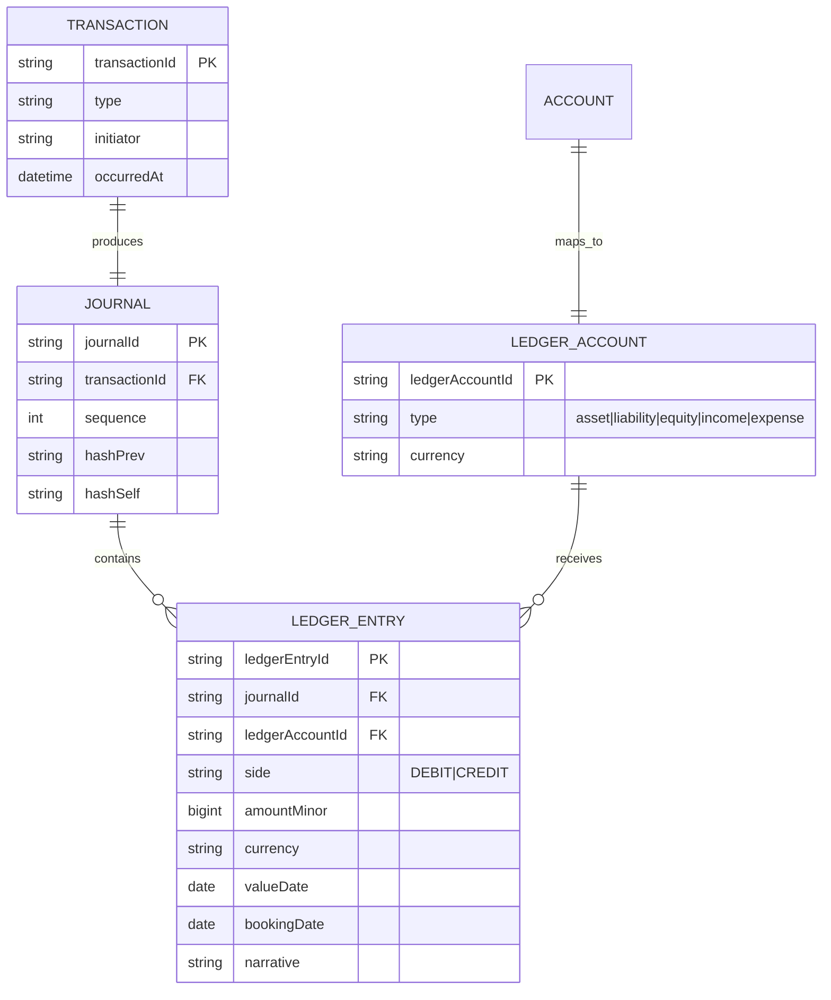

# Ledger Model (Double-Entry)

**Parent:** [domain-model/README.md](./README.md) · **Status:** Proposed (v0.1) · **Owner:** Money Core team (C11/C06).

The ledger is the **book of record** for money at Umoya. This file specifies the double-entry model, account types, posting rules, reconciliation, immutability and audit. It is the most safety-critical model in the platform; every choice here is a **DESIGN CHOICE** made to satisfy both accounting correctness and regulatory expectation.

> **Golden rule:** *Money is never mutated — it is posted.* A balance is a derived **projection**, never the source of truth.

---

## 1. Why double-entry

Every movement of value is recorded as **at least two** entries — a debit and a credit of equal amount in the same currency — such that the books always balance. This gives us:

- **Provable completeness:** if debits = credits, value is neither created nor destroyed.
- **Reconciliation:** internal books can be reconciled against external statements (rails, schemes, sponsor).
- **Auditability:** every entry traces to a business cause and an actor.
- **Error detection:** an out-of-balance journal is a hard failure, not a rounding note.

---

## 2. Chart of accounts & account types

We use the standard accounting equation **Assets = Liabilities + Equity**, with income and expense accounts flowing to equity.

| Type | Normal balance | Meaning | Umoya examples |
|---|---|---|---|
| **Asset** | Debit | What we own / are owed. | Cash at central bank / sponsor settlement account; loans receivable; card receivables; fee receivable. |
| **Liability** | Credit | What we owe. | **Customer deposit accounts** (current, savings, pockets); uncleared funds; funds held for payout. |
| **Equity** | Credit | Owners' residual. | Share capital; retained earnings. |
| **Income** | Credit | Revenue. | Fee income (account fees, payment fees); interest income. |
| **Expense** | Debit | Costs. | Interest expense; operational expense. |

### 2.1 Crucial distinction for a bank

A **customer holding money with us is a *liability*** (we owe it back on demand). This is why:

- Deposits increase **liabilities** (credit the customer's account, which is a liability account from the bank's perspective).
- A **payment to an external party** decreases our liability to the customer and decreases our **asset** (settlement/cash).

> **Language note.** "Customer account" (the customer's view) maps to one or more **ledger accounts** in the chart of accounts. See §3 for how the two relate.

---

## 3. Ledger accounts vs customer accounts

| Concept | Definition | Example |
|---|---|---|
| **LedgerAccount** | A node in the chart of accounts. The unit entries post **to**. | `liability:customer:deposit:<accountId>`, `asset:settlement:zar`. |
| **Account** (customer-facing) | A product container the customer sees; maps to one or more LedgerAccounts. | A current account → one `deposit` ledger account (+ possibly a `pending` sub-account). |
| **Transaction** | A business action that produces balanced entries across LedgerAccounts. | A transfer from A to B posts debit A-deposit / credit B-deposit. |
| **LedgerEntry** | One immutable line. | Debit A-deposit R100; Credit B-deposit R100. |

- **Every customer-facing Account has a dedicated LedgerAccount** so balances and statements map 1:1 to entries.
- **Internal accumulators** (e.g. `fees_payable`, `interest_accrual`, `pending_settlements`) are LedgerAccounts too — internal money movements are just as traceable as customer ones.

---

## 4. The posting model

### 4.1 A transaction, formally

```
Transaction {
  transactionId, type, initiator, occurredAt
  entries: [ LedgerEntry... ]
}
Invariant: Σ(debit.amount) == Σ(credit.amount)   per currency
```

### 4.2 Entry fields

```
LedgerEntry {
  ledgerEntryId, journalId, transactionId,
  ledgerAccountId, side(DEBIT|CREDIT), amount(Money),
  valueDate, bookingDate, narrative,
  hashPrev, hashSelf        // tamper-evidence chain
}
```

### 4.3 Posting sequence (single atomic commit)

1. **Validate** the transaction shape and that it balances.
2. **Resolve** each entry's `ledgerAccountId` via the chart of accounts.
3. **Assign** monotonic sequence numbers.
4. **Write** all entries in one ACID commit (all-or-nothing).
5. **Seal** (hash-chain) the journal batch.
6. **Project** the new balances.
7. **Publish** `TransactionPosted` ([domain-events](./domain-events.md)).

Because (4) is atomic and (5) is append-only, the ledger is **tamper-evident** and crash-safe.

---

## 5. Posting rules by transaction type

Each type has a deterministic rule mapping to debits/credits. Below are the canonical ones. `Dr` = debit, `Cr` = credit. Amounts in ZAR (base currency — [money-and-currency](./money-and-currency.md)).

| Transaction type | Posting | Effect |
|---|---|---|
| **Customer deposit (cash-in)** | Dr `asset:cash/settlement`; Cr `liability:customer:deposit:<acct>` | Customer balance increases; our asset increases. |
| **Internal transfer A→B** | Dr `liability:customer:deposit:<A>`; Cr `liability:customer:deposit:<B>` | Balances move between customers; no external asset change. |
| **Outbound external payment** | Dr `liability:customer:deposit:<acct>`; Cr `asset:settlement:zar` | Customer balance decreases; settlement asset decreases. |
| **Inbound external payment** | Dr `asset:settlement:zar`; Cr `liability:customer:deposit:<acct>` | Customer balance increases. |
| **Account fee** | Dr `liability:customer:deposit:<acct>`; Cr `income:fee` | Customer pays fee; we earn income. |
| **Interest accrual (deposit)** | Dr `expense:interest`; Cr `liability:interest_accrual:<acct>` | We accrue interest owed to customer. |
| **Interest capitalisation** | Dr `liability:interest_accrual:<acct>`; Cr `liability:customer:deposit:<acct>` | Accrued interest becomes part of the balance. |
| **Loan disbursement** | Dr `asset:loan_receivable:<loanId>`; Cr `liability:customer:deposit:<acct>` | We create a receivable; customer receives funds. |
| **Loan repayment** | Dr `liability:customer:deposit:<acct>`; Cr `asset:loan_receivable:<loanId>` (+ `income:interest`) | Reduces receivable; splits principal/interest. |
| **Card settlement** | Dr `liability:customer:deposit:<acct>`; Cr `asset:card_settlement` | Card spend reduces customer balance. |
| **Reversal / correction** | Mirror of the original entries (opposite sides) | Cancels an erroneous posting without deleting it. |

> These rules are the *accounting contract*. They live in the **Posting Rules Engine** ([component-map](../system-design/component-map.md) §1) and are unit-tested per type. Changing a rule is a controlled change with finance sign-off.

---

## 6. Balances

Balances are **derived**, not authoritative:

| Balance | Definition |
|---|---|
| **Current** | Sum of all posted entries on the customer's ledger account(s). |
| **Reserved** | Sum of active holds/reservations (pending payments, card holds). |
| **Available** | `current − reserved − uncleared`. |

- **Holds/reservations** are *not* entries (they do not change `current`); they reduce `available`. They are recorded in a pending ledger account or an explicit reservation record. *(DESIGN CHOICE)*
- **Clearing status:** an inbound payment may be *booked* (affects `current`) before it is *cleared* (funds genuinely ours). Uncleared items reduce `available`. *(DESIGN CHOICE)*
- The **Balance Projector** maintains fast-read projections; it can always be rebuilt from entries.

---

## 7. Reconciliation

Reconciliation is **continuous**, not a monthly panic. *(DESIGN CHOICE)*

| Reconciliation | Compares | Frequency | Output |
|---|---|---|---|
| Settlement account | Internal `asset:settlement` vs sponsor/SARB settlement statement | Intraday | `ReconBreakDetected` |
| Rail (PayShap/EFT/RTC) | Our outbound/inbound items vs rail advice files | Per cycle | Break list |
| Card scheme | Our card settlements vs scheme clearing/settlement files | Daily | Break list |
| Fee/interest | Accrued vs charged | Daily | Break list |
| Suspense | Items parked in `suspense` must trend to zero | Intraday | Aging report |

- Breaks are **first-class events** and drive back-office cases ([container-diagram](../system-design/container-diagram.md) C18).
- A **suspense account** holds unmatched items temporarily; it must not accumulate.

---

## 8. Immutability & correction

- **No UPDATE, no DELETE** on `LedgerEntry` or committed journals. *(DESIGN CHOICE)*
- **Corrections** are **compensating entries** (a reversal transaction), preserving the full history.
- **Tamper evidence:** each journal is hash-chained (`hashPrev`→`hashSelf`); periodic **seals** (merkle roots) are published and stored immutably. Any alteration breaks the chain. *(DESIGN CHOICE)*
- **Write-once storage:** ledger tables use append-only patterns (no in-place updates), with database-level guards (revoke UPDATE/DELETE grants on the ledger tables). *(DESIGN CHOICE)*

---

## 9. Audit

The ledger is an audit artefact in its own right. It must satisfy:

- **Reconstructability:** any customer balance at any past time is reconstructable.
- **Attribution:** every entry has an actor and a business cause (invariant L4/L5 — [aggregates](./aggregates.md) §3.1).
- **Retention:** aligned to FICA (≥5 years; confirm current period — [aml-fica](../../research/regulatory/aml-fica.md) §8) and prudent-accounting expectations.
- **Independence:** the ledger store is separate from the operational and analytics stores; access is least-privilege and audited ([observability](../platform/observability.md) §6).
- **Regulatory reporting:** BA returns and financial statements are derived from the ledger via the data platform ([analytics-and-reporting](../data/analytics-and-reporting.md)).

---

## 10. Data model sketch (ledger)



Physical/logical detail in [data-model](../data/data-model.md).

---

## 11. Multi-currency note

The ledger is **currency-aware from day one** but **ZAR-only at launch**. Every entry carries a `currency`; the invariant `Σ debit = Σ credit` holds **per currency**. Cross-currency movements use explicit FX transactions with an FX position account (so no journal is ever unbalanced across currencies). See [money-and-currency](./money-and-currency.md) §5.

---

## 12. Failure modes & safeguards

| Failure | Safeguard |
|---|---|
| Out-of-balance transaction | Rejected at write time (L1). |
| Partial write | Single ACID commit; no partial journals. |
| Concurrent double-spend | Reservation + optimistic locking on Account; available-balance check. |
| Duplicate posting from retry | Idempotency key per transaction; ledger rejects duplicate `transactionId`. |
| Tampering | Hash-chain + immutability grants + audit. |
| Projection drift | Periodic projection rebuild from entries; drift alarm. |

---

## 13. Related reading

- [aggregates.md](./aggregates.md) — ledger invariants L1–L7.
- [money-and-currency.md](./money-and-currency.md) — money representation & FX.
- [domain-events.md](./domain-events.md) — `TransactionPosted`.
- [data/analytics-and-reporting.md](../data/analytics-and-reporting.md) — ledger → BA returns.
- [integrations/payments-rails.md](../integrations/payments-rails.md) — settlement reconciliation with rails.
