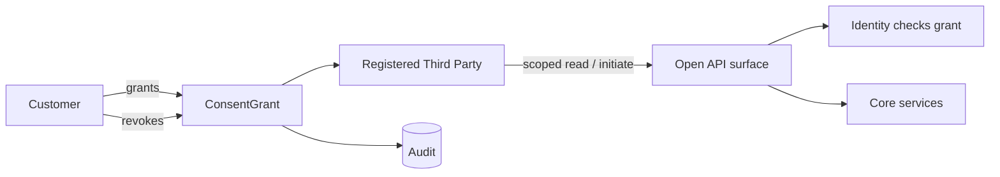

# Open Banking & Open Finance

**Parent:** [integrations/README.md](./README.md) · **Status:** Proposed (v0.1) · **As-of:** 2026-10-16.

South Africa does **not** yet have a statutory open-banking mandate. This file states our posture: design to be **regulator-ready** without over-building for a framework that does not exist yet.

> Regulatory posture facts are cross-linked from [payments-nps](../../research/regulatory/payments-nps.md) §6. Our API/consent design is a **DESIGN CHOICE**. External framework status is **UNVERIFIED** where it is still in development.

---

## 1. SA position today (grounded)

- **No statutory "right to data" / open-banking mandate** comparable to the UK/EU: data-sharing and payment initiation operate through **commercial bank–TPPP partnerships** and bank-specific APIs ([payments-nps](../../research/regulatory/payments-nps.md) §6.1).
- An **Open Finance** framework is **under development** via the **Intergovernmental Fintech Working Group (IFWG)**; it would require secure **API access** to consumer data. **Status: in development — non-binding** ([payments-nps](../../research/regulatory/payments-nps.md) §6.1). **UNVERIFIED** as to timing/content.
- **PEM** names **data-sharing infrastructure** as one of its three foundations ([payments-nps](../../research/regulatory/payments-nps.md) §2) — direction of travel: open finance is coming, slowly, via policy.
- **No formal adequacy/standard** for third-party access exists yet; TPPPs rely on bilateral partnerships.
- **IFWG Regulatory Sandbox** (est. 1 Apr 2020) is the **pre-licence de-risking path** for novel features, *not* a licence ([payments-nps](../../research/regulatory/payments-nps.md) §6.2).

---

## 2. Our posture *(DESIGN CHOICE)*

**Design for the framework that is coming; ship only what is lawful today.**

| Principle | What we do |
|---|---|
| **Consent-first** | Every data-sharing or payment-initiation grant is an explicit, scoped, revocable **ConsentGrant** owned by Identity (BC1). |
| **No open access yet** | We expose APIs to partners only under **bilateral contracts** (not a public standard) until a framework exists. |
| **Standard-shaped** | Our consent and API models align with emerging open-finance shapes (scoped consent, TPP registration, audit) so a future mandate is configuration, not redesign. |
| **Customer control** | Customers can view and revoke all consents; revocations take effect promptly. |
| **Audit everything** | Every consent grant/use/revoke is auditable (POPIA accountability + future conduct rules). |

---

## 3. Two distinct capabilities (don't conflate)

| Capability | Direction | Description |
|---|---|---|
| **Data sharing** (AIS-type) | Third party **reads** our customer's data (with consent). | Account info, balances, transactions. |
| **Payment initiation** (PIS-type) | Third party **initiates** a payment from our customer's account. | Requires strong consent + authentication + fraud controls. |

Both are currently only lawful in SA under **bilateral commercial arrangements**, not an open standard. *(DESIGN CHOICE to keep them separate in the model.)*

---

## 4. Consent architecture *(DESIGN CHOICE)*

**ConsentGrant fields (modelled in Identity, BC1):** `grantId`, `partyId`, `thirdPartyId`, `scope[]` (accounts, data types, actions), `purpose`, `expiresAt`, `status`, `evidence` (authentication), `createdAt`, `revokedAt`.

**Rules:**
- **Scoped:** least data/least action; no blanket grants.
- **Time-bound:** grants expire and require re-consent.
- **Revocable:** immediate effect; downstream tokens invalidated.
- **Evidence-backed:** the grant records how/when the customer authenticated it.
- **Audited:** every use of a grant is logged.

---

## 5. API surface (regulator-ready shapes)

| API class | Purpose | Status |
|---|---|---|
| **Consent management** | Create/read/revoke consents. | Build now (internal + partner). |
| **Account information** (AIS) | Read accounts/balances/transactions. | Build to a standard shape; expose only under contract. |
| **Payment initiation** (PIS) | Initiate payments from customer accounts. | Build; expose only under contract + framework. |
| **Webhooks/eventing** | Notify partners of status. | Build. |
| **Partner/TTPP registry** | Register and authenticate third parties. | Build minimal; expand when framework lands. |

**Security requirements** (all classes): OAuth2/FAPI-style, mTLS, strong customer authentication, fine-grained scopes, rate limits, anomaly detection. *(DESIGN CHOICE)*

---

## 6. POPIA overlay

- **Lawful basis:** consent is the natural basis for third-party data sharing; confirm and document per use case ([privacy-popia](../../research/regulatory/privacy-popia.md) §2).
- **Purpose specification & further-processing limitation:** grants must state purpose; partners must not repurpose.
- **Data subject participation:** customers can access/withdraw consent.
- **Prior authorisation:** cross-party **ID-number linking** may trigger it ([privacy-popia](../../research/regulatory/privacy-popia.md) §4) — relevant if we enable cross-source matching via partners. **UNVERIFIED** — legal assessment pending.
- **Cross-border:** if a partner processes offshore, §72 basis required ([privacy-popia](../../research/regulatory/privacy-popia.md) §6).

---

## 7. Regulatory sandbox (IFWG)

- The **IFWG Regulatory Sandbox** provides a controlled live environment for novel products under regulator supervision; eligibility includes being intended for the SA market, **not clearly fitting / challenging** the existing framework, benefitting consumers, and being significantly different ([payments-nps](../../research/regulatory/payments-nps.md) §6.2).
- **Our use** *(DESIGN CHOICE):* candidate sandbox topics — AI-driven onboarding/decisioning, novel payment-initiation consent models, and open-finance API pilots. **Caveat:** the sandbox is **not a licence** and does not override banking/FSP/FICA needs.
- Current cohort **intake windows** are **UNVERIFIED**.

---

## 8. Build vs wait

| Feature | Build now? | Rationale *(DESIGN CHOICE)* |
|---|---|---|
| Consent model & audit | **Yes** | Needed regardless; underpins POPIA compliance and future mandates. |
| Account-information API (internal shape) | **Yes** | Reuses existing APIs; low marginal cost. |
| Public/standardised open API for TPPPs | **Not yet** | No standard/mandate; expose only under contract. |
| TPPP registry & onboarding | **Minimal now** | Build skeleton; expand when framework lands. |
| Payment initiation for third parties | **Gated** | Requires framework + strong controls; prepare, don't ship. |

---

## 9. Open questions *(UNVERIFIED)*

1. Timing/content of the **Open Finance** framework and whether it lands before launch ([payments-nps](../../research/regulatory/payments-nps.md) §6.1). **UNVERIFIED.**
2. Any **PEM data-sharing infrastructure** standards (e.g. consent standards). **UNVERIFIED.**
3. Whether open finance will impose **API obligations on banks before a final framework exists** ([payments-nps](../../research/regulatory/payments-nps.md) §6.1 hints it might). **UNVERIFIED.**
4. IFWG sandbox **cohort windows** and eligibility fit. **UNVERIFIED.**

---

## 10. Related reading

- [payments-nps](../../research/regulatory/payments-nps.md) §6 — the regulatory posture in full.
- [privacy-popia](../../research/regulatory/privacy-popia.md) — consent, prior authorisation, residency.
- [domain-model/entities](../domain-model/entities.md) — Agreement/consent-adjacent entities.
- [component-map](../system-design/component-map.md) §7 — Identity's consent components.
