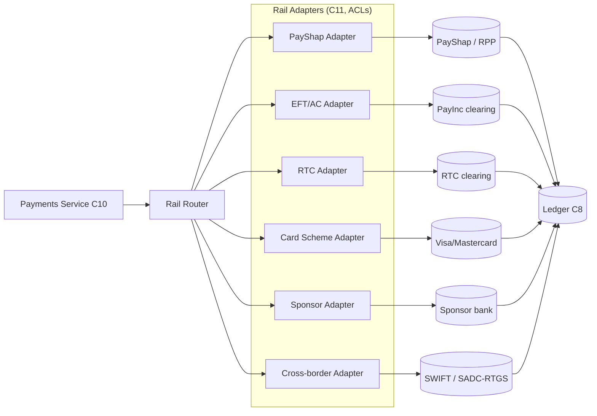
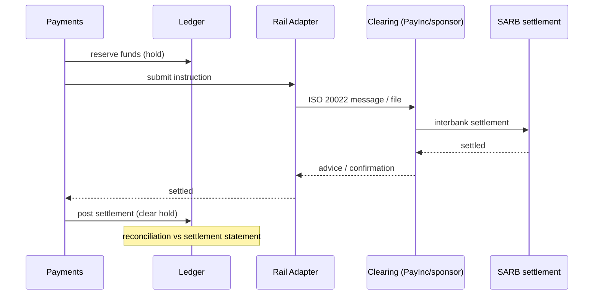

# Payments Rails (South Africa)

**Parent:** [integrations/README.md](./README.md) · **Status:** Proposed (v0.1) · **As-of:** 2026-10-16.

How Umoya connects to South African payment and settlement infrastructure. This file maps each rail, our intended integration posture, and the **sponsorship-vs-direct** question. Regulatory facts are sourced from [payments-nps](../../research/regulatory/payments-nps.md); integration *approaches* are **DESIGN CHOICE**. Rail message specs and live interfaces are **UNVERIFIED** until contracted.

---

## 1. The rail landscape

| Rail | What it is | Typical use | Our posture |
|---|---|---|---|
| **PayShap (RPP)** | SARB/PSMB low-value **real-time retail** rail, ISO 20022, mobile-number aliases (ShapID). ([payments-nps](../../research/regulatory/payments-nps.md) §4) | Instant P2P, low-value P2B | **Target primary retail rail.** *(DESIGN CHOICE)* |
| **EFT / Authenticated Collections (AC)** | Batch electronic funds transfer + authenticated debit/credit collections via clearing (PayInc, ex-BankservAfrica). | Salaries, debit orders, bulk credits. | **Connect via sponsor/participant.** |
| **RTC (Real-Time Clearing)** | Real-time interbank clearing for higher-value/time-critical items. | Time-critical high-value retail/corporate. | **Connect.** |
| **Card rails (Visa/Mastercard)** | Card authorisation (ISO 8583) + clearing/settlement. | Debit/credit cards, e-commerce, wallets. | **Scheme membership / BIN sponsorship.** |
| **DebiCheck** | Shift from signature to authenticated mandates for collections. | Debit-order collections. | **Mandatory for collections** — see §4. |
| **Cash-in / cash-out (CICO)** | Physical cash via agents/retailers/ATMs. | Inclusion, remote areas. | **Partner-mediated.** |
| **Cross-border** | SWIFT/SADC-RTGS (high value), TCIB (low value SADC), PAPSS, Nexus; SARB cross-border retail e-commerce framework. ([payments-nps](../../research/regulatory/payments-nps.md) §4) | Remittances, trade. | **Phase 2**, gated on AD/ADLA. |

---

## 2. Architecture of our rail integration

Each adapter is an **ACL** ([README](./README.md) §4): it owns the rail's message format (ISO 20022 / ISO 8583 / files), retries, reconciliation feeds, and rulebook-specific logic.

---

## 3. Rail-by-rail integration notes

### 3.1 PayShap (RPP) — real-time retail
- **Why primary:** real-time, ISO 20022, low cost, industry-backed, and the intended future non-bank rail ([payments-nps](../../research/regulatory/payments-nps.md) §4).
- **Integration:** proxy-resolution (mobile alias → account), payment initiation (credit transfer), request-to-pay, and status advices. *(DESIGN CHOICE)*
- **Limits:** per-transaction limit (raised to ~R50,000 — [payments-nps](../../research/regulatory/payments-nps.md) §4, **confirm current limit — UNVERIFIED**).
- **Adapter concerns:** idempotency via end-to-end ID; timeout/unknown-status handling (never assume failure); reconciliation to advices.

### 3.2 EFT / Authenticated Collections
- **Why:** bulk credit (salaries/refunds) and authenticated collections (debit orders).
- **Integration:** batch file generation/ingestion via clearing (PayInc), with per-line status and returns. *(DESIGN CHOICE)*
- **Adapter concerns:** file format versioning, cutoff windows, return-code mapping, suspense handling for unmatched lines.

### 3.3 RTC (Real-Time Clearing)
- **Why:** time-critical clearing beyond PayShap value bands; corporate/urgent flows.
- **Integration:** real-time message exchange with clearing. *(DESIGN CHOICE, UNVERIFIED specifics.)*

### 3.4 Card rails (Visa / Mastercard)
- **Why:** card issuance (debit first), e-commerce, wallet provisioning.
- **Integration:** issuing via **scheme membership or BIN sponsorship**; authorisation in-path (fast, < scheme SLA); clearing/settlement files; tokenisation for wallets. ([component-map](../system-design/component-map.md) §4)
- **Adapter concerns:** stand-in processing, reversal/chargeback flows, scheme fee/interchange posting to the ledger.

### 3.5 Cash-in / cash-out (CICO)
- **Why:** inclusion; agents/retail collectors; ATMs.
- **Integration:** partner-mediated (retail agent networks, ATM switch). *(DESIGN CHOICE)*
- **Adapter concerns:** agent settlement, float management, reconciliation, fraud at agents.

### 3.6 Cross-border (Phase 2)
- **Gated on** AD/ADLA appointment ([banking-licensing](../../research/regulatory/banking-licensing.md) §6) and exchange-control compliance — **a separate permission, not a launch feature.**
- **Rails:** SWIFT/SADC-RTGS (high value), TCIB (low-value SADC), PAPSS/Nexus (continental/global). ([payments-nps](../../research/regulatory/payments-nps.md) §4)
- **Adapter concerns:** FX rate audit, correspondent limits, sanctions screening on cross-border.

---

## 4. DebiCheck & authenticated collections (mandates)

- **DebiCheck** replaces signature mandates with **electronically authenticated** ones: the debtor authenticates the mandate (e.g. in-app) before the first collection. Our **Mandate** entity captures authentication evidence ([entities](../domain-model/entities.md) §8). *(DESIGN CHOICE)*
- **Flow:** register mandate → debtor authenticates → collections reference the authenticated mandate → rulebook checks.
- **Why it matters:** reduces disputes/unpaid debits and is the compliant route for collections [payments-nps](../../research/regulatory/payments-nps.md) §7.
- **Adapter:** clearing adapter must carry DebiCheck mandate identifiers and authentication states.

---

## 5. Clearing, settlement & the money movement loop

- **Settlement account:** at the SARB (if directly participating) **or** with the sponsor bank (pre-licence). ([payments-nps](../../research/regulatory/payments-nps.md) §7)
- **Reconciliation** of the settlement asset is continuous ([ledger-model](../domain-model/ledger-model.md) §7).

---

## 6. ISO 20022

South Africa adopted **ISO 20022** as an NPS modernisation milestone ([payments-nps](../../research/regulatory/payments-nps.md) §5). Implication *(DESIGN CHOICE)*: our rail adapters target ISO 20022 natively (message families: `pacs`, `pain`, `camt`), with a canonical internal payment model that maps cleanly to/from ISO 20022 fields (e.g. end-to-end ID, debtor/creditor, purpose codes).

---

## 7. Sponsor bank & PASA/PSMB membership (the pre-licence question)

**Context:** as at 2026-10 the non-bank payment framework is still **draft**; the NPS Act restricts clearing to banks/branches/designated participants ([payments-nps](../../research/regulatory/payments-nps.md) §1, §3). A new entrant that is **not yet a licensed bank** must therefore operate via the legacy model.

| Model | How it works | When *(DESIGN CHOICE)* |
|---|---|---|
| **Sponsorship** | A licensed **sponsor bank** provides clearing/settlement and (often) BIN/card access; we operate under their membership. | **Pre-licence / launch.** |
| **Direct participation** | We become a bank/branch or designated clearing participant; open our own SARB settlement account; join schemes directly. | **Post-licence.** |
| **Non-bank authorisation (future)** | Activity-based authorisation under the (draft) framework; may use sponsorship for some activities. | **Opportunistic, when finalised.** |

**Design guardrail:** we build a **Sponsor Adapter** so that the sponsor is just another ACL. Transitioning to direct participation must be a **configuration/contract change**, not a domain rewrite. *(DESIGN CHOICE)* — this is the single most important payments design constraint (see [system-design/README](../system-design/README.md) §2).

**PASA→PSMB→SARB rulebook transition:** clearing rules currently administered via PSMB are transitioning to SARB (key milestone **11 Aug 2026** — [payments-nps](../../research/regulatory/payments-nps.md) §1). We isolate rulebook logic in adapters and track the transition as an integration risk (see [third-party-catalogue](./third-party-catalogue.md)).

---

## 8. Payment flows we must support at launch *(DESIGN CHOICE)*

| Flow | Rail(s) | Priority |
|---|---|---|
| Instant P2P (alias/mobile) | PayShap | P0 |
| Instant P2B (pay merchant) | PayShap / card / QR | P0 |
| Account-to-account credits (bulk) | EFT | P0 |
| Collections (debit orders) | AC + DebiCheck | P1 |
| Card purchases (debit) | Card schemes | P0 |
| Card wallet provisioning | Scheme tokenisation | P1 |
| Cash-in/out | CICO partners | P2 |
| Cross-border remittance | SWIFT/TCIB/PAPSS | P3 |

---

## 9. Risks & open questions *(UNVERIFIED)*

1. **Sponsor bank identity & interface model** — commercial and technical. **UNVERIFIED.**
2. **Card scheme membership route pre-licence** (BIN sponsor vs principal). **UNVERIFIED.**
3. **PayShap non-bank participation rules** — draft. **UNVERIFIED** ([payments-nps](../../research/regulatory/payments-nps.md) §8).
4. **Current PayShap limits** and RTC thresholds. **UNVERIFIED.**
5. **Final non-bank framework** (categories/capital) and reapplication windows. **UNVERIFIED** ([payments-nps](../../research/regulatory/payments-nps.md) §3).
6. **PSMB→SARB rulebook cutover** impact on our adapter contracts. **UNVERIFIED.**
7. **NPS Bill** (replacing the 1998 Act) timing. **UNVERIFIED.**

---

## 10. Related reading

- [payments component map](../system-design/component-map.md) §2.
- [ledger-model](../domain-model/ledger-model.md) §5 (payment postings), §7 (settlement reconciliation).
- [domain-events](../domain-model/domain-events.md) §3.4 (payment events).
- [payments-nps](../../research/regulatory/payments-nps.md) — the regulatory grounding.
