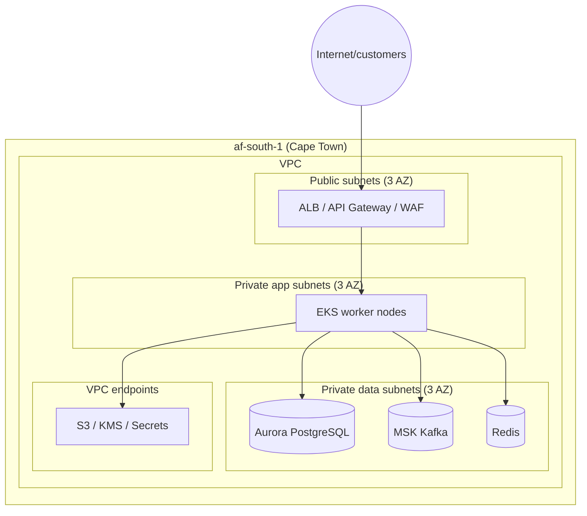

# Deployment Topology

**Parent:** [platform/README.md](./README.md) · **Status:** Proposed (v0.1) · **As-of:** 2026-10-16.

Where and how Umoya runs: environments, regions, availability zones, DR/BCP, and network segmentation. All layouts are **DESIGN CHOICE**; residency requirements are cross-linked ([privacy-popia](../../research/regulatory/privacy-popia.md) §6, [data-governance](../data/data-governance.md) §9).

---

## 1. Region strategy

- **Primary region:** AWS **`af-south-1`** (Cape Town) — in-country, satisfying the in-region default ([technology-selection](../system-design/technology-selection.md) §1). *(DESIGN CHOICE)*
- **Availability zones:** deploy across **3 AZs** within the region for T0/T1. *(DESIGN CHOICE)*
- **Secondary/DR region:** options in §6 (in-region second AZ-set preferred; alternate SA region/cloud considered). *(DESIGN CHOICE)*
- **Residency rule:** production PII + ledger stay in-region; cross-border is an exception with a §72 basis ([data-governance](../data/data-governance.md) §9).

---

## 2. Environments

| Env | Purpose | Data | Access |
|---|---|---|---|
| `dev` | Feature development | Synthetic | Engineers |
| `test` | Automated integration/e2e | Synthetic | CI |
| `staging` | Pre-prod rehearsal; perf/security | **Masked/anonymised** prod-like | Broader eng + QA |
| `production` | Live | Real (PII) | Least privilege, break-glass only |
| `sandbox` | Partner/innovation/sandbox testing | Synthetic/explicitly scoped | Partners (scoped) |
| `dr` | Disaster recovery | Production replica/standby | Ops |

**Rules** *(DESIGN CHOICE)*: identical IaC across envs (parity via Terraform modules); **no production PII in non-prod** (masking — [data-governance](../data/data-governance.md) §5); separate AWS accounts per environment (blast-radius isolation).

---

## 3. Physical/logical layout

- **Public subnets:** only load balancers / API gateway / NAT.
- **Private app subnets:** Kubernetes workers; egress via NAT (allow-listed) — [integrations](../integrations/README.md) §5.
- **Private data subnets:** databases/brokers; **no internet route**.

---

## 4. Network segmentation & zero-trust

| Layer | Control *(DESIGN CHOICE)* |
|---|---|
| Perimeter | WAF + DDoS protection + API gateway; TLS 1.3 terminations. |
| Ingress | Only via gateway; no direct pod exposure. |
| East-west | **mTLS** (service mesh) + **network policies default-deny**. |
| Egress | Allow-listed per destination; residency-tagged (`data-class`); default deny ([integrations](../integrations/README.md) §5). |
| Data tier | Reachable only from specific namespaces/SGs. |
| Admin | No standing prod access; break-glass via vaulted, session-recorded paths. |

**Security groups / policies** are applied as code (Terraform + K8s policies) and validated in CI ([devops-and-sdlc](./devops-and-sdlc.md) §5).

---

## 5. Kubernetes layout

- **Cluster strategy:** separate clusters per environment; production cluster may split by sensitivity (core vs analytics) if needed. *(DESIGN CHOICE)*
- **Namespaces per bounded-context cluster** ([bounded-contexts](../system-design/bounded-contexts.md) §8). *(DESIGN CHOICE)*
- **Workload isolation:** non-root, read-only root FS, resource quotas, pod disruption budgets.
- **Autoscaling:** Karpenter for nodes; HPA/KEDA for pods (queue-driven for consumers).
- **Ingress:** service mesh ingress / ALB controller; WAF at the edge.

---

## 6. DR / BCP

### 6.1 Targets (from [NFR §5](../system-design/non-functional-requirements.md))

| Tier | RPO | RTO |
|---|---|---|
| T0 (ledger/payments/cards) | ≈0 | ≤15 min |
| T1 | ≤5 min | ≤30 min |
| T2 | ≤15 min | ≤2 h |
| T3 | ≤24 h | ≤24 h |

### 6.2 Strategy *(DESIGN CHOICE)*

| Concern | Approach |
|---|---|
| **Multi-AZ** | Synchronous replication for Aurora (ledger); active within region. |
| **Cross-region DR** | Warm standby in a second AZ-set/region; async replication; documented failover. |
| **Backups** | Encrypted, in-region; PITR for databases; restore drills quarterly. |
| **Ledger durability** | Near-zero RPO (sync within region); DR replication for region loss. |
| **BCP (people/process)** | Alternate operations site/remote ops; runbooks; call trees; dependency fallbacks ([NFR §7](../system-design/non-functional-requirements.md)). |

### 6.3 Failure scenarios & responses

| Scenario | Response |
|---|---|
| AZ failure | Automatic failover to other AZs (multi-AZ). |
| Region failure | Failover to DR region; DNS/traffic shift; validate data currency. |
| Rail/sponsor outage | Degraded mode; queue; retry ([payments-rails](../integrations/payments-rails.md)). |
| Key/secret compromise | Rotate via Vault; revoke sessions; incident response. |
| Ransomware | Immutable backups + isolation-in-region; restore from clean. |

**Game days** test these at least twice a year. *(DESIGN CHOICE)*

---

## 7. Capacity & scaling zones

- **Steady-state:** reserved/savings-plan capacity for baseline.
- **Burst:** Karpenter-managed on-demand for peaks ([NFR §4](../system-design/non-functional-requirements.md)).
- **Batch/analytics:** elastic, scheduled windows (in-region).

---

## 8. Compliance-driven topology requirements

| Requirement | Topology implication | Source |
|---|---|---|
| In-region processing | Region-pinned stores; egress tagging | [privacy-popia](../../research/regulatory/privacy-popia.md) §6 |
| Audit retention | Separate append-only audit store; long retention | [observability](./observability.md) §6 |
| Segregation of duties | Separate accounts/namespaces; least privilege | [conduct-fais-nca](../../research/regulatory/conduct-fais-nca.md) |
| Change control | GitOps + approvals | [devops-and-sdlc](./devops-and-sdlc.md) §6 |

---

## 9. Open questions *(UNVERIFIED)*

1. **DR region choice** (in-region second AZ-set vs second SA region vs alternate cloud). **DESIGN CHOICE open.**
2. **AWS `af-south-1` service coverage** for all chosen managed services ([technology-selection](../system-design/technology-selection.md) §1). **UNVERIFIED.**
3. **Sponsor/rail connectivity** topology (VPN/direct connect vs internet). **UNVERIFIED.**
4. **PCI network segmentation** details if card data touches our estate. **UNVERIFIED.**

---

## 10. Related reading

- [observability.md](./observability.md) — how the running system is monitored.
- [devops-and-sdlc.md](./devops-and-sdlc.md) — how changes reach these environments.
- [system-design/non-functional-requirements.md](../system-design/non-functional-requirements.md) — RPO/RTO/availability targets.
- [data/data-governance.md](../data/data-governance.md) — residency rules.
