# DevOps & SDLC

**Parent:** [platform/README.md](./README.md) · **Status:** Proposed (v0.1) · **As-of:** 2026-10-16.

How Umoya is **built, tested, released and changed**: CI/CD, IaC, environment promotion, release strategy, change management and the secure SDLC. All practices are **DESIGN CHOICE**; quality gates reference [PLAN.md](../../PLAN.md) §4.

---

## 1. Principles

1. **Trunk-based development** with short-lived branches and feature flags. *(DESIGN CHOICE)*
2. **Build once, promote the same artefact** through environments ([platform README](./README.md) §2).
3. **Everything as code** — infra, config, policy, dashboards, pipelines.
4. **GitOps** — Git is the desired state; a reconciler applies it.
5. **Shift left on quality & security** — tests, scanning and policy run in CI.
6. **Small, frequent, reversible** changes; progressive delivery.
7. **No secrets in code or repos** ([PLAN.md](../../PLAN.md) §4).

---

## 2. Source control & branching

| Aspect | Practice *(DESIGN CHOICE)* |
|---|---|
| Repo strategy | Poly-repo or monorepo with clear ownership; **one repo per bounded-context cluster** preferred for blast radius. |
| Branching | Trunk-based; PRs are small; merge within days. |
| Reviews | Mandatory peer review; CODEOWNERS by context ([bounded-contexts](../system-design/bounded-contexts.md) §8). |
| Commits | Conventional commits; signed commits. |
| Feature flags | Runtime toggles for incomplete/risky work. |

---

## 3. CI pipeline (per PR and per merge)

```mermaid
flowchart LR
    PR[Pull request] --> BUILD[Build]
    BUILD --> UNIT[Unit tests]
    UNIT --> CONTRACT[Contract tests]
    CONTRACT --> SAST[SAST / lint]
    SAST --> SCA[Dependency & SCA scan]
    SCA --> SECRETS[Secret scan]
    SECRETS --> IAC[IaC scan tfsec/Checkov]
    IAC --> IMG[Build & sign image]
    IMG --> ART[Publish artefact]
    ART --> TEST[Integration/e2e in ephemeral env]
    TEST --> POLICY[Policy gates OPA]
    POLICY --> READY[Ready to promote]
```

**Gates** *(DESIGN CHOICE, aligned to [PLAN.md](../../PLAN.md) §4)*:
- **Tests:** unit + integration + contract; **80%+ coverage** on produced code.
- **Security:** SAST, dependency/SCA, secret scanning, container scanning, IaC scanning.
- **Policy:** OPA/Gatekeeper (e.g. no `latest` tags, resource limits, allowed registries, no public buckets).
- **No secrets** in code/images (blocked by scanning).
- **Architecture tests:** enforce no vendor SDK in domain modules ([integrations](../integrations/README.md) §4.2).

---

## 4. Infrastructure as Code & GitOps

| Concern | Tooling *(DESIGN CHOICE)* |
|---|---|
| Provisioning | **Terraform** (+ Terragrunt for env layering); remote state locked. |
| Kubernetes config | **Helm** charts; **Argo CD** GitOps reconciliation. |
| Policy as code | OPA/Gatekeeper + Conftest for Terraform. |
| Drift detection | Argo CD + IaC drift checks; alerts on drift. |
| Secrets | Vault; no secrets in Git. |

**Rule:** production changes go through Git + PR + automated reconcile — no manual console changes. *(DESIGN CHOICE)*

---

## 5. Environments & promotion

Promotion flow: **dev → test → staging → production** ([deployment-topology](./deployment-topology.md) §2). *(DESIGN CHOICE)*

- **Identical artefacts** promoted; only config differs (environment-specific values injected at deploy).
- **Ephemeral PR environments** for integration/e2e.
- **Staging** is prod-like (masked data) for perf/security rehearsal.
- **Production** deploys are automated (GitOps) with approvals for high-risk changes.

---

## 6. Release & change management

| Aspect | Practice *(DESIGN CHOICE)* |
|---|---|
| **Deployment strategy** | Canary or blue-green (Argo Rollouts/Flagger); automated rollback on SLO breach. |
| **Database changes** | Expand/contract migrations; backward-compatible only; never destructive in one step. |
| **Event schema changes** | Backward-compatible; new `eventVersion` for breaking changes ([domain-events](../domain-model/domain-events.md)). |
| **Feature flags** | Decouple deploy from release; kill-switch per feature. |
| **Change record** | Every production change tied to a PR + ticket + release note. |
| **Segregation of duties** | Author ≠ approver for high-risk changes; audited ([conduct-fais-nca](../../research/regulatory/conduct-fais-nca.md)). |
| **Freeze windows** | Around critical financial periods (e.g. month/period close) if needed. |
| **Emergency changes** | Break-glass path with post-hoc review and audit. |

High-risk change classes (ledger posting rules, auth, PII handling, rail adapters) require **extra review + finance/risk sign-off**. *(DESIGN CHOICE)*

---

## 7. Testing strategy *(DESIGN CHOICE)*

| Test type | Scope | Where |
|---|---|---|
| **Unit** | Functions/aggregates, invariants | CI (every PR) |
| **Contract** | Producer/consumer API & events | CI |
| **Integration** | Service + deps (Testcontainers) | CI/ephemeral env |
| **End-to-end** | Critical journeys (onboarding, payment, card) | Staging |
| **Performance/load** | To [NFR §4](../system-design/non-functional-requirements.md) peaks | Staging (quarterly) |
| **Resilience/chaos** | Dependency failures, AZ loss | Staging/game-days |
| **Security** | SAST/DAST/pen-test | CI + periodic |
| **Ledger correctness** | Balances, postings, reconciliation | CI + nightly |
| **Accessibility** | WCAG checks on UI | CI + manual |

**Ledger and money-maths tests are mandatory and exhaustive** (property-based where possible). *(DESIGN CHOICE)*

---

## 8. Secure SDLC

| Phase | Security activity *(DESIGN CHOICE)* |
|---|---|
| **Design** | Threat modelling for new services/flows; privacy review ([data-governance](../data/data-governance.md) §13). |
| **Code** | Secure coding standards; peer review; secret scanning. |
| **Build** | SAST/SCA/container scanning; signed artefacts (cosign); SBOM. |
| **Deploy** | Policy gates; least privilege; no standing prod access. |
| **Run** | Runtime monitoring; vulnerability management; patch SLAs. |
| **Respond** | Incident response; breach runbook ([data-governance](../data/data-governance.md) §12). |

Full security control catalogue is in the planned `architecture/security/` set (W9, C12).

---

## 9. Developer experience

- **Golden paths/templates** for new services (scaffolding with observability, CI, security baked in). *(DESIGN CHOICE)*
- **Local dev** reproducible via containers/compose.
- **Documentation as code** (this architecture set lives with the code; ADRs for decisions).
- **Internal developer portal** (optional) for service catalogue & ownership.

---

## 10. Metrics for the SDLC

| Metric | Target *(DESIGN CHOICE)* |
|---|---|
| Deployment frequency | Daily+ for low-risk services |
| Lead time for change | < 1 day (low-risk) |
| Change failure rate | < 15% |
| MTTR | < 1 hour (SEV1) |
| Test coverage | ≥ 80% (produced code) |
| Security findings | 0 critical open at release |

---

## 11. Open questions *(UNVERIFIED)*

1. **CI/CD platform** final choice (GitHub vs GitLab) depending on org. **DESIGN CHOICE open.**
2. Required **change-management evidence format** for auditors/regulators. **UNVERIFIED.**
3. Whether any regulator expects **notifiable change approval** for material IT changes. **UNVERIFIED.**

---

## 12. Related reading

- [deployment-topology.md](./deployment-topology.md) — target environments.
- [observability.md](./observability.md) — SLOs and release gates.
- [integrations/README.md](../integrations/README.md) §4.2 — ACL/architecture tests.
- [PLAN.md](../../PLAN.md) §4 — quality gates.
