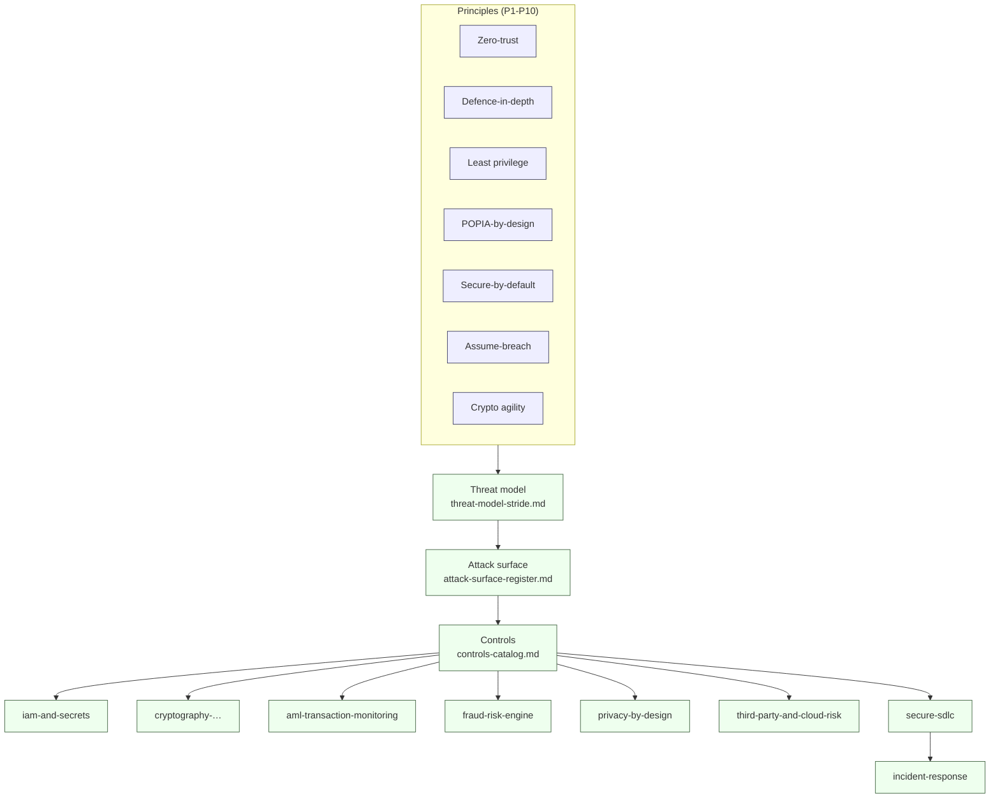
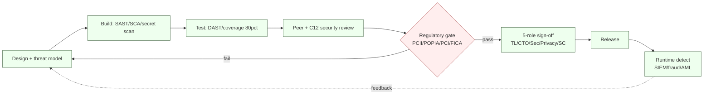

# NeoBank ZA — Security & Compliance Architecture

**Program:** Project Umoya (placeholder codename — NeoBank South Africa)
**Council owners:** C12 Cybersecurity-Intelligence + C01 Legal-Compliance
**As-of date:** 2026-10-16
**Status:** Draft for council review (input to W7 platform architecture)

> **Purpose.** This directory defines the security, fraud, privacy and compliance architecture for the neobank. It is the engineering-side counterpart to the regulatory research pack at [`../../research/regulatory/`](../../research/regulatory/). It states **what must be built, why (which obligation drives it), who owns it, and how it will be verified** — and it maps every theme to the Stremiium quality gates so that nothing ships without passing them.

---

## 1. How to read this pack (evidence classification)

Every control statement carries a weight tag. Do **not** treat guidance or our own design decisions as binding law.

| Tag | Meaning | Binding? |
|---|---|---|
| **[STATUTE]** | Act of Parliament (POPIA, FICA, Banks Act, FAIS, NCA…) | **Must** |
| **[REG]** | Regulations / subordinate legislation / Prudential Standards (Regulations relating to Banks; POPIA Regulations; Directives) | **Must** |
| **[REG-GUIDE]** | Regulator guidance, directives, circulars, manuals, RMCP obligations imposed by the supervisor | **Should** (binding on the addressee or strongly persuasive) |
| **[DESIGN]** | Our engineering design choice / recommended control | **Recommended** |
| **[CONFIRM]** | Figure or rule that comes from a secondary source or draft instrument and must be verified | **Unverified** |

**Rule applied throughout:** where a number (retention period, threshold, deadline) is not stated in the primary statute, it is marked **[CONFIRM]** or **UNVERIFIED** and cross-linked to the research file that flagged it. We never invent legal thresholds.

Regulatory facts are drawn from the research pack; **do not duplicate** them here — link instead:

| Regulatory theme | Research file |
|---|---|
| AML / CTF / CPF, FICA reports, sanctions, travel rule | [`../../research/regulatory/aml-fica.md`](../../research/regulatory/aml-fica.md) |
| POPIA (8 conditions, IO, cross-border, breach), PAIA | [`../../research/regulatory/privacy-popia.md`](../../research/regulatory/privacy-popia.md) |
| Banking licence, capital, BA returns, Basel III/IV | [`../../research/regulatory/banking-licensing.md`](../../research/regulatory/banking-licensing.md) |
| FAIS / FSCA conduct, NCA credit, CPA, ombud (NFO) | [`../../research/regulatory/conduct-fais-nca.md`](../../research/regulatory/conduct-fais-nca.md) |
| Payments rails, ISO 20022, PayShap, PASA→SARB | [`../../research/regulatory/payments-nps.md`](../../research/regulatory/payments-nps.md) |
| Evidence legend, licensing sequencing | [`../../research/regulatory/README.md`](../../research/regulatory/README.md) |

---

## 2. File index

| # | File | Scope | Primary owners |
|---|---|---|---|
| 1 | [`README.md`](./README.md) | This index; principles; Stremiium gate mapping | C12 + C01 |
| 2 | [`threat-model-stride.md`](./threat-model-stride.md) | Bank-wide STRIDE model (mobile, API GW, ledger, payments, KYC, admin, third parties, insider) | C12 |
| 3 | [`attack-surface-register.md`](./attack-surface-register.md) | Enumerated external/internal attack surfaces with owner + control | C12 |
| 4 | [`controls-catalog.md`](./controls-catalog.md) | Control catalogue mapped to ISO 27001 Annex A / NIST CSF / PCI-DSS + SA obligations | C12 + C01 |
| 5 | [`iam-and-secrets.md`](./iam-and-secrets.md) | Workforce IAM, CIAM, MFA/biometrics, step-up, PAM, secrets, HSM/KMS, cert lifecycle | C12 |
| 6 | [`fraud-risk-engine.md`](./fraud-risk-engine.md) | Real-time scoring, device fingerprint, behavioural biometrics, mule/scam, chargebacks, case mgmt | C12 + C16 |
| 7 | [`aml-transaction-monitoring.md`](./aml-transaction-monitoring.md) | CDD flows, sanctions/PEP, TM rules, triage, STR/CTR to FIC, records, model governance | C01 + C12 |
| 8 | [`cryptography-and-key-management.md`](./cryptography-and-key-management.md) | TLS 1.3, mTLS, at-rest, tokenisation, PIN blocks, key rotation, HSM, crypto agility | C12 |
| 9 | [`incident-response.md`](./incident-response.md) | IR plan, severity, on-call, containment→recovery, PIR, regulator breach notification | C12 + C02 |
| 10 | [`privacy-by-design.md`](./privacy-by-design.md) | POPIA implementation: classification, lawful basis, consent, retention, DSAR, DPIA, IO duties | C01 |
| 11 | [`secure-sdlc.md`](./secure-sdlc.md) | Threat modelling, SAST/DAST/SCA, secret scanning, review gates, pen-test, bug bounty | C11 + C12 |
| 12 | [`third-party-and-cloud-risk.md`](./third-party-and-cloud-risk.md) | Vendor/cloud due diligence, right-to-audit, residency, concentration, exit, outsourcing | C02 + C01 |

**Cross-pack links (authored in parallel under [`../`](../)):**
[`../domain-model/`](../domain-model/) (ledger, account, customer entities) ·
[`../integrations/`](../integrations/) (rails, partners, APIs) ·
[`../data/`](../data/) (data classification, lineage, warehouse) ·
[`../platform/`](../platform/) (compute, network, environments) ·
[`../system-design/`](../system-design/) (end-to-end flows).

---

## 3. Security architecture principles

These principles are **normative for this bank [DESIGN]**. Every control in the catalogue must be traceable to at least one of them.

| # | Principle | What it means here | How it is enforced |
|---|---|---|---|
| P1 | **Zero-trust** | No implicit trust from network location. Every request is authenticated, authorised and encrypted end-to-end. Internal service calls are mutually authenticated. | mTLS service mesh, per-request tokens, deny-by-default network policy → [`cryptography-and-key-management.md`](./cryptography-and-key-management.md), [`iam-and-secrets.md`](./iam-and-secrets.md) |
| P2 | **Defence-in-depth** | Independent, overlapping controls across layers (edge, network, app, data, human). Assume any single layer fails. | Layered controls C-* in [`controls-catalog.md`](./controls-catalog.md); segmentation in [`attack-surface-register.md`](./attack-surface-register.md) |
| P3 | **Least privilege** | Humans, services and CI get the minimum rights for the minimum time. Standing access is the exception. | JIT/JEA, PAM, scoped cloud roles, RBAC/ABAC → [`iam-and-secrets.md`](./iam-and-secrets.md) |
| P4 | **POPIA-by-design & by-default** | Lawfulness, minimality and purpose limitation are engineering constraints, not paperwork. Personal data is minimised, pseudonymised and short-lived at rest. | Data classification, retention engine, DPIA gate → [`privacy-by-design.md`](./privacy-by-design.md) |
| P5 | **Secure-by-default** | Insecure configurations are not reachable without an explicit, approved, logged exception. Encryption, MFA, logging and least privilege are ON at creation. | Baseline configs, policy-as-code, exception register → [`secure-sdlc.md`](./secure-sdlc.md) |
| P6 | **Assume-breach / detect-and-respond** | Design for compromise: segmentation, immutable audit, deception, fast detection and rehearsed response. | Logging, SIEM, IR → [`incident-response.md`](./incident-response.md) |
| P7 | **Crypto agility** | Any algorithm, key or protocol can be replaced without re-architecting. | Key/cert lifecycle, abstraction layer → [`cryptography-and-key-management.md`](./cryptography-and-key-management.md) |
| P8 | **Traceable accountability** | Every control has a named owner and an auditable evidence trail. Observe vs infer vs unknown is preserved. | RACI below, evidence register, governance hooks |
| P9 | **Fail-safe, not fail-open** | On control failure, the system degrades toward safety (block the payment, lock the session) not permissiveness. | Fail-closed defaults in IAM, payments, AML |
| P10 | **Resilience & reg-recovery** | Security includes availability of money movement and timely regulatory reporting under stress. | DR/BCP, RTO/RPO in [`incident-response.md`](./incident-response.md) |

---

## 4. Mapping to Stremiium quality gates

The gate language is inherited from the program's governor documents
([`../../PLAN.md`](../../PLAN.md) §4; the 16-council operating instructions and the compliance-sentinel enforcement rules under `/workspace/_stremiium/.stremiium/`).
The **critical gate** for this bank is the `security-compliance-sentinel` interception: *no service touching money, data or regulated surfaces ships without the C01/C12 binding rules passing.*

| # | Stremiium quality gate | Meaning | Where satisfied in this pack | Evidence artefact |
|---|---|---|---|---|
| G1 | **80%+ test coverage** | Automated tests on produced code | Security control tests, fraud/TM rule tests → [`secure-sdlc.md`](./secure-sdlc.md), [`fraud-risk-engine.md`](./fraud-risk-engine.md), [`aml-transaction-monitoring.md`](./aml-transaction-monitoring.md) | CI coverage report |
| G2 | **No hardcoded secrets / no PII in artefacts** | Secrets in a vault only; no live PII in repos, tickets, logs, fixtures | [`iam-and-secrets.md`](./iam-and-secrets.md), [`privacy-by-design.md`](./privacy-by-design.md) | Secret-scan report, DLP scan |
| G3 | **PCII / POPIA / PCI-DSS gates before any money/data surface ships** | Pre-release regulatory gate | [`controls-catalog.md`](./controls-catalog.md), [`cryptography-and-key-management.md`](./cryptography-and-key-management.md), [`privacy-by-design.md`](./privacy-by-design.md) | Gate sign-off record |
| G4 | **Every claim carries a source or is marked unverified** | No invented thresholds | Evidence legend; **[CONFIRM]/UNVERIFIED** tags; research cross-links | This pack + research `[S#]` map |
| G5 | **Observe / infer / unknown preserved** | Evidence discipline in threat/attack research | Likelihood/impact labelled as assessment; residual risk shown | [`threat-model-stride.md`](./threat-model-stride.md) |
| G6 | **5-role sign-off: Tech Lead → CTO → Security → Privacy → Sparkling Curious** | Release approval chain | Release approvals in [`secure-sdlc.md`](./secure-sdlc.md); Privacy in [`privacy-by-design.md`](./privacy-by-design.md) | Signed release record |
| G7 | **Security review passed (C12)** | Threat model + crypto + IR reviewed | [`threat-model-stride.md`](./threat-model-stride.md), [`cryptography-and-key-management.md`](./cryptography-and-key-management.md), [`incident-response.md`](./incident-response.md) | Review log |
| G8 | **Legal/regulatory sign-off (C01)** | Privacy impact + audit trail + contracts | [`privacy-by-design.md`](./privacy-by-design.md), [`third-party-and-cloud-risk.md`](./third-party-and-cloud-risk.md), [`aml-transaction-monitoring.md`](./aml-transaction-monitoring.md) | DPIA, DPA register |
| G9 | **Regulatory screens before regulated services ship** | FSCA/FICA/POPIA screens per workflow-routing §6 | [`aml-transaction-monitoring.md`](./aml-transaction-monitoring.md), [`privacy-by-design.md`](./privacy-by-design.md) | Screen record |
| G10 | **Escalation SLA: Critical 1h · High 4h · Medium 24h · Low 72h** | Incident/issue escalation | [`incident-response.md`](./incident-response.md) | IR ticket timeline |

---

## 5. Ownership & RACI (this pack)

| Theme | Accountable (A) | Responsible (R) | Consulted (C) | Informed (I) |
|---|---|---|---|---|
| Threat model / attack surface | C12 Captain | C12 agents | C06, C11, C16 | SC |
| Controls catalogue | C12 + C01 | C12 | C02, C06, C11 | SC |
| IAM / secrets / keys | C12 Captain | C12 + C06 | C01, C11 | SC |
| Fraud engine | C16 + C12 | C12 + C16 | C02, C14 | SC |
| AML/CTF architecture | C01 Captain (MLCO) | C01 + C12 | C06, C16 | SC |
| Cryptography | C12 Captain | C12 | C06, C11 | SC |
| Incident response | C02 + C12 | C12 + C02 | C01, C06 | SC, Executive |
| Privacy (POPIA) | C01 (Information Officer) | C01 | C01 privacy agents, C12 | SC |
| Secure SDLC | C11 + C12 | C11 + C12 | C06, C15 | SC |
| Third-party / cloud risk | C02 + C01 | C02 | C12, C06, C10 | SC |

**Governance hooks (from the operating rules):** FSCA/FICA/POPIA screens are **mandatory before any service touching money/data ships**; the security-compliance-sentinel holds interception rights (may block/halt on gate breach) and reports jointly to C01/C12 and Sparkling Curious.

---

## 6. Regulatory → architecture traceability (summary)

| Obligation (regulatory) | Weight | Primary architectural home |
|---|---|---|
| POPIA security safeguards (condition 7) | [STATUTE] | This pack (all), [`cryptography-and-key-management.md`](./cryptography-and-key-management.md) |
| POPIA breach notification (Information Regulator + data subjects) | [STATUTE] | [`incident-response.md`](./incident-response.md), [`privacy-by-design.md`](./privacy-by-design.md) |
| POPIA prior authorisation (ID linking / credit reporting) | [STATUTE] | [`privacy-by-design.md`](./privacy-by-design.md) |
| POPIA cross-border transfers s72 | [STATUTE] | [`privacy-by-design.md`](./privacy-by-design.md), [`third-party-and-cloud-risk.md`](./third-party-and-cloud-risk.md) |
| FICA CDD / RMCP / record-keeping | [STATUTE] | [`aml-transaction-monitoring.md`](./aml-transaction-monitoring.md) |
| FICA reports (CTR / STR / TPR) | [STATUTE] | [`aml-transaction-monitoring.md`](./aml-transaction-monitoring.md) |
| Sanctions / PEP / TFS screening | [STATUTE/REG-GUIDE] | [`aml-transaction-monitoring.md`](./aml-transaction-monitoring.md) |
| Banking: IT/risk-management & BA returns | [REG] | [`controls-catalog.md`](./controls-catalog.md), [`incident-response.md`](./incident-response.md) |
| Conduct: complaint handling / ombud (NFO) | [INDUSTRY] | [`fraud-risk-engine.md`](./fraud-risk-engine.md) (chargebacks/cases) |
| Outsourcing / cloud rules (PA directives) | [REG-GUIDE] | [`third-party-and-cloud-risk.md`](./third-party-and-cloud-risk.md) |

> **Not legal advice.** Every **[CONFIRM]** item must be validated by the appointed MLCO / Information Officer / admitted attorney before reliance. See the research pack's verification list.

---

## 7. Open items / verification needed

- **[CONFIRM]** Exact FICA record-retention period (commonly ≥5 years) — verify against the consolidated FIC Act (`aml-fica.md` §3.3).
- **[CONFIRM]** POPIA breach-notification form/portal and any timeline beyond "as soon as reasonably possible" (`privacy-popia.md` §7).
- **[CONFIRM]** Whether ID-number linking / credit processing triggers POPIA s57 prior authorisation for our model (`privacy-popia.md` §4).
- **[CONFIRM]** Current PA outsourcing/cloud directive text and any local-residency requirements (`third-party-and-cloud-risk.md`).
- **[CONFIRM]** PCI-DSS scope (acquiring vs issuing vs tokenisation-only) once the card product is defined.
- **UNVERIFIED** residual-risk ratings in the threat model are engineering estimates, not regulator-endorsed.
