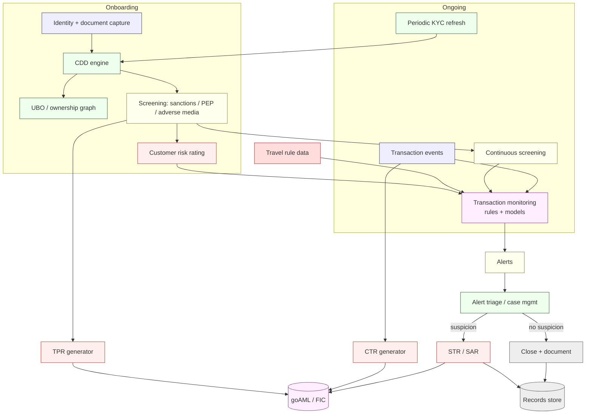
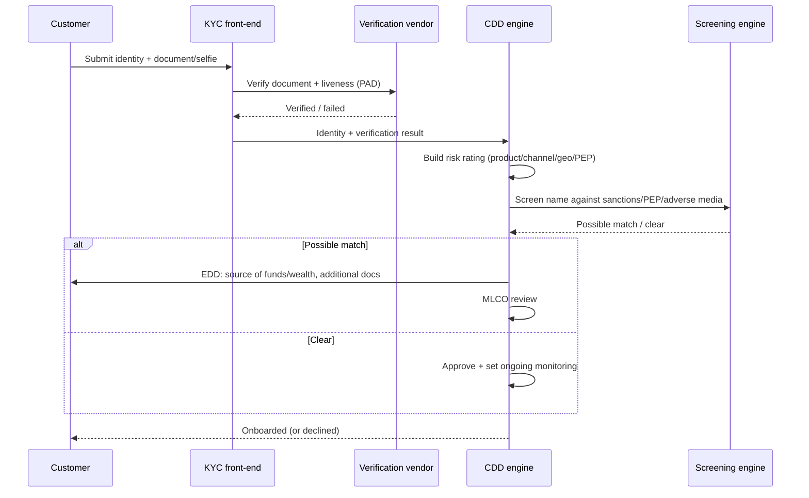
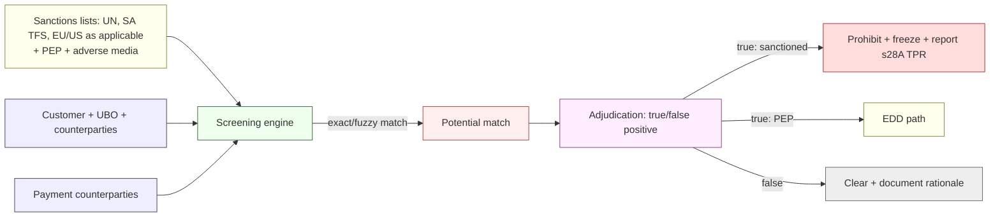
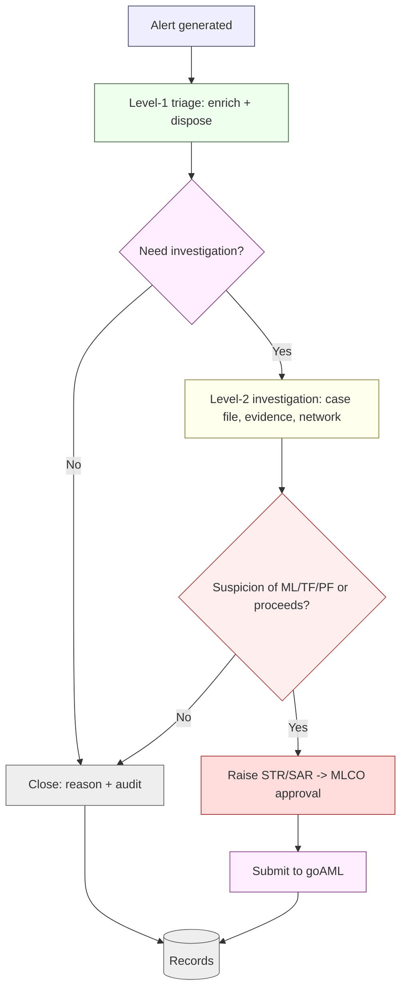

# AML / CTF / CPF Transaction Monitoring Architecture — NeoBank ZA

**Owner:** C01 Legal-Compliance (MLCO) + C12 Cybersecurity-Intelligence (platform) · **Version:** 1.0 · **Date:** 2026-10-16
**Regulatory source:** [`../../research/regulatory/aml-fica.md`](../../research/regulatory/aml-fica.md) (FIC Act 38 of 2001; POCA 121 of 1998; FIC Directives/PCCs)
**Related:** [`fraud-risk-engine.md`](./fraud-risk-engine.md) · [`privacy-by-design.md`](./privacy-by-design.md) · [`controls-catalog.md`](./controls-catalog.md) · [`incident-response.md`](./incident-response.md)

> **This file does not restate the law.** It translates the FICA obligations documented in the research pack into the *technical architecture* that satisfies them. Binding facts (`[STATUTE]`) are cited to the research file; implementation choices are `[DESIGN]`.
>
> **Headline context `[S38]`:** South Africa **exited the FATF grey list on 24 Oct 2025**, but supervision is **consolidating, not relaxing**. Banks are accountable institutions supervised for FICA by the **Prudential Authority (PA)** `[S36]`. Build to a high bar.

---

## 1. Obligation → architecture traceability

| FICA obligation (research ref) | Weight | Technical realisation |
|---|---|---|
| Register as accountable institution on **goAML** (`aml-fica.md` §2) | [STATUTE] | Registration onboarding + system-to-system goAML channel |
| **Board-approved RMCP** (risk ID, CDD, monitoring, records, reporting) (`§3.1`) | [STATUTE] | RMCP control map (this file §9); versioned artefacts |
| **CDD/KYC** — identify & verify natural + legal persons (`§3.2`) | [STATUTE] | CDD engine (§3) |
| **UBO tracing** to natural persons (`§3.2`) | [STATUTE] | Ownership graph; **no fixed % in FICA** (the 5% is CIPC/Companies Act — do not conflate) |
| **EDD** for high risk; foreign PPP / domestic PIPs (`§3.2`) | [STATUTE] | Risk-based CDD tiers (§3.4) |
| **TFS / sanctions** prohibition ss26A–26C; report s28A (`§4`) | [STATUTE] | Screening engine (§4) |
| **POCA** predicate-offence awareness (`§4`) | [STATUTE] | Case/investigation tooling |
| **CTR** > R49,999.99, ≤ 3 days (`§3.4`) | [STATUTE] | CTR generator (§6) |
| **STR/SAR** within 15 days of awareness (§3.4) | [STATUTE] | STR workflow (§6) |
| **TPR** without delay (§3.4) | [STATUTE] | TPR workflow (§6) |
| Cross-border / conveyance reports (§3.4) | [STATUTE] | Reporting module (§6) |
| **Record-keeping** s22–23 (commonly ≥5 yrs — **UNVERIFIED**, confirm) (`§3.3`) | [STATUTE] | Records store (§7) |
| **Travel rule** for crypto (Directive 9; PCC 61 zero threshold) (`§5`) | [STATUTE/REG] | Travel-rule module (§8, if crypto in scope) |
| Appoint **MLCO / Compliance Officer** (`§7`) | [REG-GUIDE] | Named role in RACI (§10) |

---

## 2. End-to-end AML architecture

---

## 3. CDD / KYC data flow

### 3.1 Data captured at onboarding [DESIGN — must satisfy FICA s21 identity+verification]

| Data class | Natural person | Legal person / trust |
|---|---|---|
| Identity | Name, ID/passport, DOB, address | Registration no., name, address, nature of business |
| Verification | Document + liveness (PAD) | CIPC/registration docs |
| Ownership/control | n/a | **UBO tracing to natural persons**; directors; authorised representatives |
| Risk factors | Country, occupation, PEP status, product, channel | Jurisdiction, structure complexity, sector |
| Consent/lawful basis | POPIA transparency | POPIA transparency |

> **UBO:** trace ownership/control to **natural persons**. FICA does **not** prescribe a fixed percentage; the **5%** figure belongs to **CIPC/Companies Act** disclosure — **do not conflate** (`aml-fica.md` §3.2, §8). `[STATUTE]`

### 3.2 Flow

### 3.3 Ongoing due diligence & refresh

| Trigger | Action | Weight |
|---|---|---|
| Periodic (risk-based cadence) | Refresh CDD/EDD | [STATUTE] |
| Trigger event (profile/txn risk change) | Re-rate + refresh | [STATUTE] |
| Sanctions/PEP list update | Re-screen book | [STATUTE] |
| Suspicion raised | Escalate to MLCO | [STATUTE] |

### 3.4 Risk-based CDD tiers [DESIGN]

| Tier | Indicators | Treatment |
|---|---|---|
| Low | Low-risk country, product, stable behaviour | Standard CDD; lighter refresh |
| Medium | Some risk factors | Standard + enhanced monitoring |
| High / EDD | PEPs (foreign PPP / domestic PIP), high-risk geo, complex structures, adverse media | EDD: SoF/SoW, senior approval, closer monitoring `[STATUTE]` |

---

## 4. Sanctions / PEP / TFS screening

| Requirement | Detail | Weight |
|---|---|---|
| Onboard screening | All customers + UBOs before relationship | [STATUTE] |
| **Continuous screening** | Re-screen on list changes, not just onboarding | [STATUTE] |
| Payment/counterparty screening | Screen rail counterparties where required | [STATUTE] |
| Prevention | On a **sanctioned** match, **do not make funds available**; report s28A TPR | [STATUTE] |
| Lists & sources | UN Security Council (ss26A–26C), SA TFS, PEP lists, adverse media | [STATUTE] |
| Governance | Documented TFS screening procedure inside the RMCP | [REG-GUIDE] |
| List freshness | Automated list ingestion; versioned | [DESIGN] |

> **Sanctions is a hard prohibition** — not a risk score. A confirmed sanctioned match means **no transaction, freeze, and report**. `[STATUTE]`

---

## 5. Transaction monitoring (rules + models)

| Layer | Examples [DESIGN] | Notes |
|---|---|---|
| **Rules** | Structuring below CTR threshold; rapid in/out; high-risk geography; cash intensity; unusual channel switch | Transparent, tuneable |
| **Scenario rules** | ML typology scenarios; TF/PF indicators (e.g. PCC 23A PF risk indicators `[S39]`) | Map to typologies |
| **Behavioural baselines** | Deviation from customer's normal profile | Needs baseline period |
| **Models** | Clustering/graph for mule & network; anomaly detection | Model governance §7 |
| **Thresholds** | Set from data; **not** from law (except CTR at R49,999.99) | Tuned regularly |

**Customer risk rating feeds monitoring sensitivity:** high-risk customers get lower alert thresholds and closer review. `[STATUTE]` risk-based approach.

---

## 6. Alert triage & reporting to the FIC

### 6.1 Triage workflow

| Stage | SLA (design) | Owner |
|---|---|---|
| Alert generation | real-time / batch | Platform |
| L1 triage | within hours | AML analyst |
| L2 investigation | same-day for priority | AML investigator |
| STR decision & MLCO approval | to meet **15-day** statutory window | MLCO |
| Submission | via **goAML** (online / batch / system-to-system) | AML ops |

### 6.2 The four reports (technical)

| Report | Trigger | Deadline | Weight | Technical control |
|---|---|---|---|---|
| **CTR** | Cash received/paid **> R49,999.99** | no later than **3 days** | [STATUTE] | Automated CTR generator on cash events; batch + system-to-system to goAML |
| **STR / SAR** | Suspicion of ML/TF/PF or proceeds | **within 15 days** of awareness (excl. weekends/public holidays) | [STATUTE] | Case→STR workflow; MLCO sign-off; clock starts at awareness (system-timestamped) |
| **TPR** | Funds/property linked to a **designated** person/entity | **without delay** | [STATUTE] | Sanctions-match → TPR (s28A); immediate freeze |
| **Cross-border / conveyance** | Physical cross-border cash/instruments | per the Act | [STATUTE] | Reporting module (as applicable) |

> Thresholds and deadlines are cited from `aml-fica.md` §3.4 (`[S33][S34][S35]`). **Do not hardcode any figure not in the statute**; the CTR threshold was raised from R24,999.99 → R49,999.99 and is config-driven so future amendments don't require a rebuild. `[STATUTE]`

### 6.3 goAML integration [DESIGN]

- Supported channels: **online form** (manual fallback), **batch file**, **system-to-system** API.
- Submission logging, acknowledgement capture, retry, and reconciliation to the FIC.
- **Never** embed FIC credentials in code — custody via secrets vault ([`iam-and-secrets.md`](./iam-and-secrets.md)).

---

## 7. Record-keeping

| Record class | Retention | Notes | Weight |
|---|---|---|---|
| CDD/EDD records | prescribed period (**commonly ≥5 yrs — UNVERIFIED, confirm**) | From relationship end | [STATUTE] FICA s22–23 |
| Transaction records | same prescribed period | From transaction | [STATUTE] |
| STR/SAR + supporting evidence | retained per Act (treat as long-lived) | Do not tip off | [STATUTE] |
| Screening results & adjudications | per policy | Audit trail of rationale | [DESIGN] |
| Travel-rule data (crypto) | per Directive 9 | See §8 | [REG] |

> **Retention `[CONFIRM]`:** the research pack flags the exact period as **UNVERIFIED** (`aml-fica.md` §3.3, §8). The archive is **configured**, not hardcoded, so the period can be set once confirmed. Retention must be reconciled with **POPIA minimisation** (see [`privacy-by-design.md`](./privacy-by-design.md) §5) — AML retention is a statutory ground that overrides deletion for the covered records.

**Protection controls:** immutable/WORM storage, access logging, legal hold, encryption at rest, no PII in logs beyond necessity. `[STATUTE]`

---

## 8. Travel rule (only if crypto is in scope) [CONFIRM]

| Requirement | Detail | Weight |
|---|---|---|
| Send originator + beneficiary info | **before or with** every crypto transfer (never afterwards) | [STATUTE/REG] FIC Directive 9 |
| Threshold | **Zero** — all crypto transfers (PCC 61 of 2026) | [REG] |
| Effective | from **30 April 2025** | [REG] |
| Registration | CASP requires **second FIC registration** (item 12) + FSCA licence | [STATUTE] |
| Data handling | Minimise, encrypt, retain per directive; reconcile with POPIA | [STATUTE/REG] |

> Crypto scope is **[CONFIRM]** (`aml-fica.md` §5). If crypto is not in the product, this module is not built but the requirement remains monitored.

---

## 9. RMCP mapping

| RMCP component (`aml-fica.md` §3.1) | Architectural home |
|---|---|
| Risk identification & assessment | §3.4 tiers, §5 monitoring sensitivity |
| Customer due diligence | §3 |
| Ongoing monitoring | §5 |
| Record-keeping | §7 |
| Reporting | §6 |
| TFS/sanctions procedure | §4 |
| Governance & MLCO | §10 |

The RMCP is a **board-approved** living document; this architecture is its technical annex. `[STATUTE]`

---

## 10. Roles & governance (RACI)

| Role | Responsibility |
|---|---|
| **MLCO / Compliance Officer** | Owns RMCP; approves STRs; liaises with FIC/PA; seniority & resources (`aml-fica.md` §7) `[REG-GUIDE]` |
| AML analysts (L1) | Alert triage |
| AML investigators (L2) | Case files, STR drafting |
| C12 platform | TM/screening platform, model ops |
| C16 | Fraud signal sharing ([`fraud-risk-engine.md`](./fraud-risk-engine.md)) |
| Internal audit | Independent testing of AML controls |
| Board | Approves RMCP; receives reporting |

---

## 11. Model governance (shared with fraud) [STATUTE — RMCP]

| Practice | Cadence |
|---|---|
| Scenario/rule review | Quarterly |
| Model validation (independent) | Annual |
| Threshold tuning with documented rationale | Quarterly |
| Data-quality & completeness checks | Continuous |
| Change control (four-eyes) | Per change |
| Coverage testing (typology → control map) | Annual |

---

## 12. Verification & open items

| Activity | Cadence | Evidence |
|---|---|---|
| Independent AML testing | Annual | Report |
| goAML submission reconciliation | Monthly | Reconciliation log |
| Sanctions-list freshness test | Monthly | Ingestion report |
| STR timeliness audit (15-day compliance) | Quarterly | SLA report |

**Open [CONFIRM]/UNVERIFIED:**
- Exact FICA **record-retention period** (`aml-fica.md` §3.3, §8) — configured, not hardcoded.
- Final **General Laws AML/CFT Amendment Bill** impact (`aml-fica.md` §8).
- **Crypto scope** (determines travel-rule module).
- Whether any **PCC** changes screening obligations for our product set.
