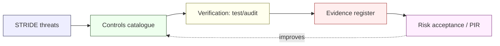

# Controls Catalogue — NeoBank ZA

**Owner:** C12 Cybersecurity-Intelligence + C01 Legal-Compliance · **Version:** 1.0 · **Date:** 2026-10-16
**Frameworks referenced:** ISO/IEC 27001:2022 Annex A · NIST CSF 2.0 (GV/ID/PR/DE/RS/RC) · PCI-DSS v4.0 (where card data is in scope)
**Related:** [`threat-model-stride.md`](./threat-model-stride.md) · [`attack-surface-register.md`](./attack-surface-register.md) · [`README.md`](./README.md) · [`../../research/regulatory/`](../../research/regulatory/)

> **How to read.** Each control names the **risk it mitigates** and, where one exists, the **South African obligation** driving it. Weight tags: **[STATUTE]/[REG]** = mandatory; **[REG-GUIDE]** = regulatory guidance (should); **[DESIGN]** = our control choice (recommended). Framework mappings are indicative alignment, not certification.
>
> **ISO 27001:2022 Annex A** uses control IDs like `A.5.15` (organisational), `A.6.3` (people), `A.7.4` (physical), `A.8.3` (technological). **PCI-DSS** column shows the nearest requirement number (`Req 3/4/7/8/10/11` …) where relevant — card scope **[CONFIRM]**.

---

## 1. Governance & risk controls (GOV)

| ID | Control | ISO A. | NIST CSF | PCI | Risk mitigated | SA obligation | Weight |
|---|---|---|---|---|---|---|---|
| GOV-01 | Board-approved information security policy & risk appetite | A.5.1, A.5.2 | GV.RM | — | Unmanaged risk, unclear accountability | Banks Act governance `[REG]`; King IV | [STATUTE/REG] |
| GOV-02 | Annual (and event-driven) information-security risk assessment | A.5.4 | ID.RA | Req 12.3 | Undetected risk drift | Banks Act risk management `[REG]` | [REG] |
| GOV-03 | Roles & segregation of duties (SoD) matrix | A.5.3, A.5.15 | GV.RR | Req 6.4 | Insider abuse, single-point control | Banks Act internal controls `[REG]` | [REG] |
| GOV-04 | Security exception register with expiry & owner | A.5.36 | GV.PO | Req 12.3 | Permanent insecure "temporary" fixes | — | [DESIGN] |
| GOV-05 | Policy-as-code baseline (secure-by-default configs) | A.5.36, A.8.9 | PR.PS | Req 2 | Misconfiguration drift | POPIA security safeguards `[STATUTE]` (cond. 7) | [STATUTE] |
| GOV-06 | Third-party / outsourcing governance framework | A.5.19-.22 | GV.SC | Req 12.8 | Vendor risk, concentration | PA outsourcing directives `[REG-GUIDE]` | [REG-GUIDE] |
| GOV-07 | Threat-intelligence consumption & model governance | A.5.7 | ID.RA/DE.AE | Req 12.3 | Stale detection against evolving crime | FICA RMCP `[STATUTE]` | [STATUTE] |

## 2. Asset & data controls (AST)

| ID | Control | ISO A. | NIST CSF | PCI | Risk mitigated | SA obligation | Weight |
|---|---|---|---|---|---|---|---|
| AST-01 | Asset inventory (cloud + apps + data) with owners | A.5.9 | ID.AM | Req 12.5.1 | Unknown/untracked assets | POPIA accountability `[STATUTE]` | [STATUTE] |
| AST-02 | Data classification & handling policy (incl. special personal info) | A.5.12, A.5.13 | ID.AM/PR.DS | Req 3/9 | Mishandling, over-exposure | POPIA conditions 2/3 `[STATUTE]` | [STATUTE] |
| AST-03 | Record of Processing Activities (ROPA) | A.5.34 | GV.RM | — | Undocumented processing | POPIA `[STATUTE]` | [STATUTE] |
| AST-04 | Data-minimisation & pseudonymisation controls | A.8.11 | PR.DS | Req 3 | Excess PII retention/leak | POPIA minimisation `[STATUTE]` | [STATUTE] |
| AST-05 | Retention & disposal schedule engine (enforced deletion) | A.5.33, A.8.10 | PR.DS | Req 3/9 | Over-retention, breach blast radius | POPIA / FICA records `[STATUTE]` (period `[CONFIRM]`) | [STATUTE] |
| AST-06 | Media/backup protection and secure destruction | A.7.10, A.8.13 | PR.DS/RC.RP | Req 9 | Data remanence, backup theft | POPIA safeguards `[STATUTE]` | [STATUTE] |
| AST-07 | Data-loss-prevention (DLP) on egress & endpoints | A.8.12 | PR.DS/DE.CM | Req 9/12 | Bulk exfiltration | POPIA safeguards `[STATUTE]` | [STATUTE] |

## 3. Identity & access controls (IAM)

| ID | Control | ISO A. | NIST CSF | PCI | Risk mitigated | SA obligation | Weight |
|---|---|---|---|---|---|---|---|
| IAM-01 | Central identity provider with SSO + conditional access | A.5.15, A.8.5 | PR.AA | Req 7/8 | Credential sprawl, weak auth | POPIA safeguards `[STATUTE]` | [STATUTE] |
| IAM-02 | MFA everywhere; phishing-resistant for privileged | A.5.17, A.8.5 | PR.AA | Req 8.3–8.5 | Account takeover (ATO) | — (PCI if card) `[REG-GUIDE]` | [DESIGN] |
| IAM-03 | Just-in-time / just-enough privileged access + PAM | A.5.15, A.8.2 | PR.AA/PR.PS | Req 7 | Insider/standing privilege abuse | Banks Act controls `[REG]` | [REG] |
| IAM-04 | Least-privilege RBAC/ABAC with periodic access review | A.5.15, A.8.2 | PR.AA | Req 7 | Over-provisioning, BOLA | POPIA accountability `[STATUTE]` | [STATUTE] |
| IAM-05 | Customer identity (CIAM): registration, KYC-bound identity, session mgmt | A.5.16 | PR.AA | Req 8 | Impersonation of customers | FICA CDD `[STATUTE]` | [STATUTE] |
| IAM-06 | Step-up authentication for high-risk actions | A.8.5 | PR.AA | Req 8 | Fraudulent high-value actions | — `[DESIGN]` | [DESIGN] |
| IAM-07 | Secrets management (vault) & rotation | A.8.24 | PR.PS | Req 3/4 | Secret leakage | POPIA (cond. 7) `[STATUTE]` | [STATUTE] |
| IAM-08 | Offboarding & joiner-mover-leaver automation | A.7.1–.4, A.6.5 | PR.AA | Req 7 | Orphaned access | POPIA accountability `[STATUTE]` | [STATUTE] |

## 4. Cryptography controls (CRY)

| ID | Control | ISO A. | NIST CSF | PCI | Risk mitigated | SA obligation | Weight |
|---|---|---|---|---|---|---|---|
| CRY-01 | TLS 1.3 (1.2 floor) everywhere; HSTS | A.8.24 | PR.DS | Req 4 | In-transit interception | POPIA safeguards `[STATUTE]` | [STATUTE] |
| CRY-02 | mTLS for service-to-service and partner/rail channels | A.8.24 | PR.DS | Req 4 | Spoofing, MITM on sensitive flows | — `[DESIGN]` | [DESIGN] |
| CRY-03 | Encryption at rest with KMS/HSM-managed keys | A.8.24 | PR.DS | Req 3 | Data theft from storage | POPIA safeguards `[STATUTE]` | [STATUTE] |
| CRY-04 | Tokenisation of PAN / sensitive identifiers | A.8.24 | PR.DS | Req 3/9 | PAN exposure, PCI scope | PCI-DSS `[REG-GUIDE]` (if card) | [REG-GUIDE] |
| CRY-05 | PIN block handling per PCI (HSM, no PIN storage) | A.8.24 | PR.DS | Req 3/4 | PIN compromise | PCI-DSS `[REG-GUIDE]` | [REG-GUIDE] |
| CRY-06 | Key management lifecycle incl. rotation & crypto agility | A.8.24 | PR.PS | Req 3.6 | Key compromise/obsolescence | POPIA safeguards `[STATUTE]` | [STATUTE] |
| CRY-07 | Certificate lifecycle (issue, renew, revoke, CT) | A.8.24, A.5.16 | PR.PS | Req 4 | Expired/rogue certs | — `[DESIGN]` | [DESIGN] |
| CRY-08 | HSM for root keys & PIN operations (dual control) | A.8.24 | PR.DS | Req 3 | Root-of-trust compromise | — `[DESIGN]` | [DESIGN] |

## 5. Network & infrastructure controls (NET)

| ID | Control | ISO A. | NIST CSF | PCI | Risk mitigated | SA obligation | Weight |
|---|---|---|---|---|---|---|---|
| NET-01 | Network segmentation & micro-segmentation | A.8.20–.22 | PR.IR | Req 1 | Lateral movement | POPIA safeguards `[STATUTE]` | [STATUTE] |
| NET-02 | Deny-by-default network policy (zero-trust) | A.8.20 | PR.IR | Req 1 | Unintended exposure | — `[DESIGN]` | [DESIGN] |
| NET-03 | WAF + DDoS + bot defence at edge | A.8.20, A.8.23 | PR.PS | Req 6 | L7 attacks, credential stuffing | — `[DESIGN]` | [DESIGN] |
| NET-04 | Secure configuration baselines & hardening | A.8.9 | PR.PS | Req 2 | Misconfiguration | — `[DESIGN]` | [DESIGN] |
| NET-05 | Vulnerability & patch management | A.8.8 | ID.RA/PR.PS | Req 6/11 | Known-exploit compromise | PA operational risk `[REG]` | [REG] |
| NET-06 | Centralised time sync & secure DNS (DNSSEC) | A.8.17 | PR.PS | Req 10 | Log integrity, DNS abuse | — `[DESIGN]` | [DESIGN] |

## 6. Application & SDLC controls (APP)

| ID | Control | ISO A. | NIST CSF | PCI | Risk mitigated | SA obligation | Weight |
|---|---|---|---|---|---|---|---|
| APP-01 | Threat modelling in design | A.8.25, A.8.28 | ID.RA | Req 6 | Design-level weakness | — `[DESIGN]` | [DESIGN] |
| APP-02 | Secure coding standards + peer review | A.8.25–.28 | PR.PS | Req 6 | Injection, logic flaws | — `[DESIGN]` | [DESIGN] |
| APP-03 | SAST / DAST / SCA / IaC scanning in CI | A.8.29, A.8.30 | PR.PS/ID.RA | Req 6/11 | Shipped vulnerabilities | — `[DESIGN]` | [DESIGN] |
| APP-04 | Secret scanning + no hardcoded secrets | A.8.24, A.8.28 | PR.PS | Req 3/6 | Secret leakage | POPIA safeguards `[STATUTE]` | [STATUTE] |
| APP-05 | Input validation / output encoding | A.8.26, A.8.28 | PR.PS | Req 6 | Injection attacks | POPIA safeguards `[STATUTE]` | [STATUTE] |
| APP-06 | SBOM + signed build artefacts | A.8.30, A.8.32 | ID.AM/PR.PS | Req 6 | Supply-chain compromise | — `[DESIGN]` | [DESIGN] |
| APP-07 | Independent penetration testing (pre-launch + annual) | A.8.29 | ID.RA/DE.AE | Req 11 | Exploitable gaps | PA/security expectations `[REG-GUIDE]` | [REG-GUIDE] |

## 7. Operations controls (OPS)

| ID | Control | ISO A. | NIST CSF | PCI | Risk mitigated | SA obligation | Weight |
|---|---|---|---|---|---|---|---|
| OPS-01 | Centralised logging & immutable audit trail | A.8.15, A.8.16 | DE.CM | Req 10 | Untraceable actions | POPIA accountability `[STATUTE]` | [STATUTE] |
| OPS-02 | SIEM with use-cases & 24/7 or on-call triage | A.8.16 | DE.AE/DE.CM | Req 10 | Slow detection | — `[DESIGN]` | [DESIGN] |
| OPS-03 | Change management & production release approvals | A.8.32 | PR.PS | Req 6 | Unauthorised change | Banks Act controls `[REG]` | [REG] |
| OPS-04 | Backup, restore & DR testing (RTO/RPO) | A.8.13, A.5.29 | RC.RP | Req 12 | Data loss, prolonged outage | Banks Act operational resilience `[REG]` | [REG] |
| OPS-05 | Monitoring of privileged actions & UEBA | A.8.16 | DE.AE | Req 10 | Insider abuse | — `[DESIGN]` | [DESIGN] |
| OPS-06 | Secure decommissioning of systems/data | A.8.9, A.7.14 | PR.DS | Req 9 | Residual exposure | POPIA disposal `[STATUTE]` | [STATUTE] |
| OPS-07 | Capacity & resilience monitoring for money-critical paths | A.8.6, A.8.16 | PR.PS/RC.RP | Req 12 | Payment outage | Banks Act `[REG]` | [REG] |

## 8. Vendor & cloud controls (VND)

| ID | Control | ISO A. | NIST CSF | PCI | Risk mitigated | SA obligation | Weight |
|---|---|---|---|---|---|---|---|
| VND-01 | Vendor due diligence & risk tiering (incl. SOC2/ISO evidence) | A.5.19-.20 | GV.SC | Req 12.8 | Untrusted vendor | PA outsourcing `[REG-GUIDE]` | [REG-GUIDE] |
| VND-02 | Right-to-audit + security schedule in contracts | A.5.20 | GV.SC | Req 12.8 | Unexamined vendor | PA outsourcing `[REG-GUIDE]` | [REG-GUIDE] |
| VND-03 | Data-residency / cross-border transfer clauses (s72) | A.5.20 | GV.SC/PR.DS | Req 12.8 | Unlawful transfer | POPIA s72 `[STATUTE]` | [STATUTE] |
| VND-04 | Concentration-risk assessment & exit strategy | A.5.21-.22 | GV.SC/RC.RP | — | Single-vendor failure | PA outsourcing/continuity `[REG-GUIDE]` | [REG-GUIDE] |
| VND-05 | Cloud shared-responsibility mapping & config controls | A.5.23 | GV.SC/PR.PS | Req 12.8 | Mis-scoped responsibility | PA cloud guidance `[REG-GUIDE]` | [REG-GUIDE] |
| VND-06 | Fourth-party (sub-processor) visibility & approval | A.5.21 | GV.SC | Req 12.8 | Buried supply-chain risk | POPIA operator duties `[STATUTE]` | [STATUTE] |

## 9. Incident-response controls (IR)

| ID | Control | ISO A. | NIST CSF | PCI | Risk mitigated | SA obligation | Weight |
|---|---|---|---|---|---|---|---|
| IR-01 | Documented IR plan with severities & RACI | A.5.24-.26 | RS.MA | Req 12.10 | Chaotic response | — `[DESIGN]` | [DESIGN] |
| IR-02 | 24/7 on-call & escalation (Critical 1h SLA) | A.5.24 | RS.MA | Req 12.10 | Slow containment | — `[DESIGN]` | [DESIGN] |
| IR-03 | Forensic evidence handling (chain of custody) | A.5.28 | RS.AN | Req 12.10 | Lost/tainted evidence | POCA/FICA evidential needs `[REG-GUIDE]` | [REG-GUIDE] |
| IR-04 | **POPIA breach notification runbook** (Regulator + subjects) | A.5.24-.26 | RS.CO | Req 12.10 | Missed statutory notice | **POPIA** `[STATUTE]` | [STATUTE] |
| IR-05 | **FIC/SARB reporting runbook** (STR/TPR, material incidents) | A.5.24 | RS.CO | — | Missed AML/PA reporting | **FICA / Banks Act** `[STATUTE]` | [STATUTE] |
| IR-06 | Post-incident review (PIR) & lessons-to-controls loop | A.5.27 | RC.IM | Req 12.10 | Repeat incidents | — `[DESIGN]` | [DESIGN] |

## 10. Resilience controls (RES)

| ID | Control | ISO A. | NIST CSF | PCI | Risk mitigated | SA obligation | Weight |
|---|---|---|---|---|---|---|---|
| RES-01 | Business-continuity & disaster-recovery plan | A.5.29-.30 | RC.RP | Req 12.10 | Prolonged outage | Banks Act continuity `[REG]` | [REG] |
| RES-02 | Operational-resilience testing (incl. severe-but-plausible scenarios) | A.5.29-.30 | RC.RP | Req 12.10 | Untested plans | PA operational resilience `[REG]` | [REG] |
| RES-03 | Immutable/offline backup against ransomware | A.8.13 | RC.RP | Req 12 | Ransomware destruction | PA operational risk `[REG]` | [REG] |

## 11. Privacy controls (PRV) — see [`privacy-by-design.md`](./privacy-by-design.md)

| ID | Control | ISO A. | NIST CSF | PCI | Risk mitigated | SA obligation | Weight |
|---|---|---|---|---|---|---|---|
| PRV-01 | Lawful-basis register & consent management | A.5.34 | GV.RM/PR.DS | — | Unlawful processing | POPIA cond. 2/3 `[STATUTE]` | [STATUTE] |
| PRV-02 | Data Subject Access Request (DSAR) workflow | A.5.34 | PR.DS | — | Rights not honoured | POPIA cond. 8 `[STATUTE]` | [STATUTE] |
| PRV-03 | DPIA process for high-risk processing | A.5.34 | ID.RA | — | Unassessed risk | POPIA `[STATUTE]` | [STATUTE] |
| PRV-04 | Cross-border transfer controls (s72) | A.5.34 | PR.DS | — | Unlawful transfer | POPIA s72 `[STATUTE]` | [STATUTE] |
| PRV-05 | Information Officer registered; PAIA manual + annual report | A.5.1 | GV.RR | — | Non-registration | **POPIA s55 / PAIA** `[STATUTE]` | [STATUTE] |
| PRV-06 | Prior-authorisation assessment (ID linking / credit reporting) | A.5.34 | ID.RA | — | Missing authorisation | **POPIA s57** `[STATUTE]` | [STATUTE] |
| PRV-07 | Special-personal-information controls (biometrics) | A.5.34, A.8.5 | PR.DS | — | Unlawful biometric use | POPIA special info `[STATUTE]` | [STATUTE] |

## 12. Financial-crime controls (AML) — see [`aml-transaction-monitoring.md`](./aml-transaction-monitoring.md)

| ID | Control | ISO A. | NIST CSF | PCI | Risk mitigated | SA obligation | Weight |
|---|---|---|---|---|---|---|---|
| AML-01 | CDD/EDD engine with UBO tracing | A.5.34 | ID.RA | — | Anonymous/false identity | **FICA s21** `[STATUTE]` | [STATUTE] |
| AML-02 | Sanctions / PEP / TFS screening (onboard + continuous) | A.5.7 | ID.RA/DE.CM | — | Sanctioned-party exposure | **FICA ss26A-26C; POCA** `[STATUTE]` | [STATUTE] |
| AML-03 | Transaction-monitoring rules + models | A.8.16 | DE.AE | — | Undetected ML/TF | **FICA RMCP** `[STATUTE]` | [STATUTE] |
| AML-04 | Alert triage, case mgmt, escalation to MLCO | A.5.24-.25 | RS.AN | — | Unactioned suspicion | **FICA** `[STATUTE]` | [STATUTE] |
| AML-05 | STR/CTR/TPR generation & goAML submission | A.5.24 | RS.CO | — | Late/missing reports | **FICA (CTR ≤3d; STR ≤15d)** `[STATUTE]` | [STATUTE] |
| AML-06 | Records retention for CDD/transactions | A.5.33 | PR.DS | — | Non-retention | **FICA s22-23** `[STATUTE]` (period `[CONFIRM]`) | [STATUTE] |
| AML-07 | Model governance & tuning (rules/models) | A.5.7 | GV.RM | — | Detection decay | FICA RMCP `[STATUTE]` | [STATUTE] |
| AML-08 | Travel-rule data handling (if crypto) | A.8.24 | PR.DS | — | Non-compliant crypto transfer | **FIC Directive 9 / PCC 61** `[REG]` | [REG] |

---

## 13. Coverage & testing

| Control family | Control count | Verification method | Cadence |
|---|---|---|---|
| GOV | 7 | Internal audit, board report | Annual |
| AST | 7 | Data-discovery scan, ROPA review | Semi-annual |
| IAM | 8 | Access review, red-team, config audit | Quarterly |
| CRY | 8 | Key inventory, pen-test, crypto review | Annual |
| NET | 6 | Vuln scan, config baseline, pen-test | Quarterly |
| APP | 7 | SAST/DAST/SCA, pen-test, code review | Per release |
| OPS | 7 | Log review, DR test, change audit | Continuous / annual |
| VND | 6 | Vendor assessment, right-to-audit | Annual + onboarding |
| IR | 6 | Tabletop + live exercise | Semi-annual |
| RES | 3 | DR/BIA test | Annual |
| PRV | 7 | DPIA review, DSAR SLA, IO audit | Quarterly |
| AML | 8 | Rule/model review, independent testing | Quarterly / annual |

**Open items [CONFIRM]:** PCI-DSS scope (card product) determines CRY-04/CRY-05 applicability; the FICA retention period (AML-06) is **[CONFIRM] ≥5 years**; PA outsourcing/cloud directive text (VND-*) is **[CONFIRM]**. These remain **UNVERIFIED** pending product scope and legal review.
