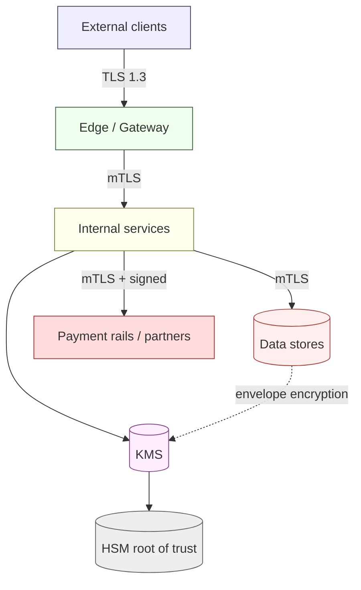
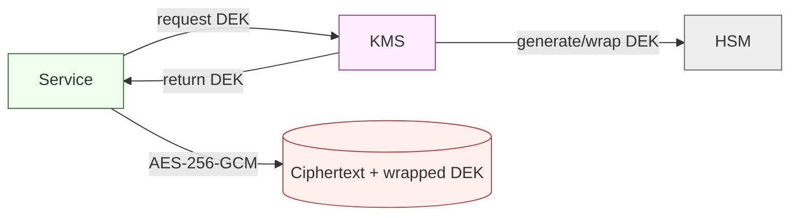
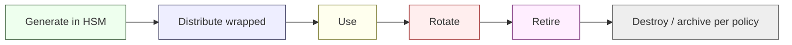

# Cryptography & Key Management — NeoBank ZA

**Owner:** C12 Cybersecurity-Intelligence · **Contributors:** C06 (infra), C11 (dev) · **Version:** 1.0 · **Date:** 2026-10-16
**Related:** [`iam-and-secrets.md`](./iam-and-secrets.md) · [`controls-catalog.md`](./controls-catalog.md) · [`threat-model-stride.md`](./threat-model-stride.md) · [`../../research/regulatory/privacy-popia.md`](../../research/regulatory/privacy-popia.md)

> **Standards baseline [DESIGN unless tagged].** NIST SP 800-52r2 (TLS), NIST SP 800-57 (key management), FIPS 140-2/3 (modules), ISO 9564 (PIN management), ISO 20022 (payment messaging), PCI-DSS v4.0 (if card data in scope `[REG-GUIDE]`). **POPIA** condition 7 (security safeguards) is the statutory driver for encryption of personal information `[STATUTE]`. All algorithm/key-size choices are **[DESIGN]** and subject to crypto review; **no national algorithm mandate is asserted here** (`[CONFIRM]` if any SARB/PA crypto guidance applies).

---

## 1. Principles

| # | Principle | Meaning |
|---|---|---|
| C1 | **Encrypt everything in transit** | TLS 1.3 for all external; mTLS for service/partner channels |
| C2 | **Encrypt everything at rest** | Envelope encryption, KMS-managed keys, no plaintext PII |
| C3 | **Minimise what is stored** | Tokenise, hash, or avoid storing secrets (PINs never stored) |
| C4 | **Strongest practical algorithms** | Modern AEAD ciphers, ≥128-bit security strength |
| C5 | **Crypto agility** | Every algorithm/key/protocol replaceable without re-architecture |
| C6 | **Separation of duties** | Key custodianship distinct from operators |
| C7 | **Keys are the crown jewels** | Root keys in HSM; no export; dual control |

---

## 2. Transport security

| Channel | Standard | Notes | Weight |
|---|---|---|---|
| Customer app/web → edge | **TLS 1.3** (1.2 floor for legacy) | HSTS, secure ciphers, cert pinning in mobile | [STATUTE] POPIA safeguards |
| Service ↔ service | **mTLS** (workload identity) | Certificate per workload; rotation tied to identity | [DESIGN] |
| Bank ↔ **payment rails** | **mTLS + message signing** | ISO 20022 / scheme requirements; PASA→SARB rulebook transition (`payments-nps.md` §1) | [REG-GUIDE] |
| Bank ↔ **partners/vendors** | **mTLS** or signed API calls | Key pinning; no plain API keys for sensitive flows | [DESIGN] |
| Admin/privileged | TLS 1.3 + mTLS client cert | Plus PAM | [DESIGN] |
| Reporting egress (goAML/PA) | TLS 1.3 + client auth | Credential custody in vault | [STATUTE] FICA |

**Cipher policy [DESIGN]:** AEAD only (e.g. AES-GCM / ChaCha20-Poly1305); forward secrecy (ECDHE); TLS 1.0/1.1 and weak ciphers disabled; certificate key ≥ RSA-3072 or ECDSA P-256. Exact suite list maintained in a versioned crypto policy and **not** copied from any unverified source.

---

## 3. Encryption at rest (envelope)

| Data | Protection | Weight |
|---|---|---|
| Databases / object stores | AES-256 envelope encryption, per-service/per-tenant keys | [STATUTE] |
| Backups | Encrypted; separate key scope from primary | [STATUTE] |
| Logs/audit | Encrypted; PII minimised at source | [STATUTE] |
| Mobile local storage | OS keystore; no secrets/keys in plaintext | [STATUTE] |
| Data in analytics/warehouse | Tokenised/masked PII | [STATUTE] POPIA minimisation |

---

## 4. Tokenisation

| Use | Design | Weight |
|---|---|---|
| **PAN (card number)** `[CONFIRM]` | Format-preserving or surrogate tokens; PAN never stored in bank systems | PCI `[REG-GUIDE]` |
| **National ID / sensitive identifiers** | Tokenise in analytics; store raw only where CDD requires, vaulted | [STATUTE] POPIA |
| **Reference data for analytics** | Pseudonymised tokens; join keys in restricted service | [STATUTE] POPIA |
| **Token vault** | HSM-backed, tightly access-controlled, audited | [DESIGN] |

> Tokenisation does **not** by itself remove POPIA obligations: pseudonymised data remains personal data if re-identifiable. Design for **minimisation + purpose limitation** ([`privacy-by-design.md`](./privacy-by-design.md)). `[STATUTE]`

---

## 5. PIN block handling (only if cards / PINs in scope) `[CONFIRM]`

| Requirement | Control | Weight |
|---|---|---|
| **PINs are never stored** | Not in databases, logs, or files | PCI `[REG-GUIDE]` |
| **PIN blocks** | ISO 9564 format; encrypted the moment captured | PCI `[REG-GUIDE]` |
| **Translation** | Performed inside HSM; clear-text PIN never in app memory | PCI `[REG-GUIDE]` |
| **HSM** | FIPS 140-2/3 validated, dual control, quorum | PCI `[REG-GUIDE]` |
| **CVV/CVC** | Never stored after authorisation | PCI `[REG-GUIDE]` |
| Scope | Depends on card product decision | **[CONFIRM]** |

> The entire PIN/CVV section is conditional on the card product. If cards are out of scope, these controls are not built — but the design must not **preclude** adding them later (crypto agility).

---

## 6. Key management lifecycle (NIST SP 800-57) [DESIGN]

| Key type | Where | Rotation (design target) | Custody |
|---|---|---|---|
| Root/CA keys | HSM | Per ceremony policy | Dual control, quorum |
| KEK (key-encryption keys) | KMS/HSM | Annual (or policy) | Security team, dual control |
| DEK (data keys) | Ephemeral / per-scope | Frequent / per-object | Service, auto |
| Signing keys (rails/payments) | HSM | Per policy, before expiry | Dual control |
| TLS/mTLS cert keys | HSM/KMS-backed | Short-lived, auto-renew | Platform |
| Secret/symmetric keys | Vault | Dynamic/short | Platform |

**Rules:** keys generated in a validated module; **no export of root keys**; key material separated from data; rotation without downtime (overlap windows); documented destruction with certificates.

---

## 7. HSM usage

| Use | Requirement |
|---|---|
| Root of trust | All root/CA/signing keys reside in HSM |
| Operations | PIN translation, card/payment crypto, key wrapping |
| Access | Quorum/dual control; separate admin from crypto officers |
| Validation | FIPS 140-2/3 (level per scope) |
| Availability | HA HSM cluster; DR HSM; documented failover |
| Monitoring | HSM audit logs to SIEM ([`incident-response.md`](./incident-response.md)) |

---

## 8. Crypto agility & future-proofing

| Practice | Why |
|---|---|
| **Algorithm abstraction** | Replace algorithms/ciphers without code rework |
| **Key/cert versioning** | Support overlap during rotation |
| **Inventory of crypto usage** | Know every place crypto is used (crypto-bill-of-materials) |
| **Post-quantum readiness** | Track NIST PQC standards; design hybrid-capable channels |
| **Deprecation calendar** | Retire weak/legacy crypto on schedule |
| **No hardcoded algorithms/keys** | Config-driven; reviewed at release |

> Crypto agility is a **design choice** but is essential to satisfy **POPIA's ongoing "appropriate" safeguards** as standards evolve `[STATUTE]` and to avoid a future forced migration under PCI/DORA-style resilience expectations.

---

## 9. Certificate lifecycle

Cross-referenced in [`iam-and-secrets.md`](./iam-and-secrets.md) §8. Summary: automated issuance (ACME), CAA records, short lifetimes, automated renewal, revocation on compromise, cert-transparency monitoring, no shadow certificates.

---

## 10. Crypto threat → control mapping

| Threat | Control |
|---|---|
| T-API-01 token replay | Sender-constrained tokens, mTLS, short-lived certs |
| T-PAY-01 forged rail instruction | mTLS + message signing + HSM keys |
| T-TP-02 MITM vendor data | TLS 1.3 + mTLS + pinning |
| T-LED-04 ledger exfil | Envelope encryption + KMS + least privilege |
| T-PAY-04 payment PII leak | Tokenisation + minimisation |
| T-ADM-06 key misuse | HSM dual control, no export, SoD |

---

## 11. Verification & open items

| Activity | Cadence | Evidence |
|---|---|---|
| Crypto review of new protocols/algos | Per change | Review record |
| Key inventory & rotation audit | Quarterly | Inventory |
| HSM configuration audit | Annual | Audit report |
| TLS config scan (external) | Monthly | Scan report |
| Crypto-agility tabletop (algorithm swap) | Annual | Exercise record |

**Open [CONFIRM]/UNVERIFIED:** card/PIN scope (PCI); any SARB/PA-specific crypto directive; exact key-rotation periods (design targets here are proposals); PQC adoption timeline.
