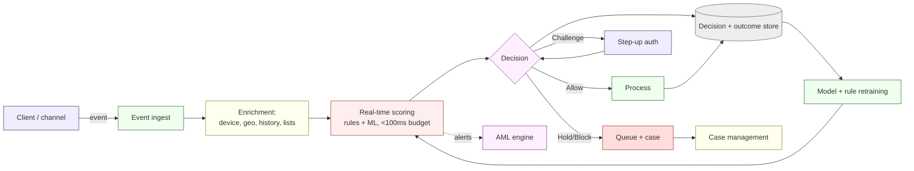
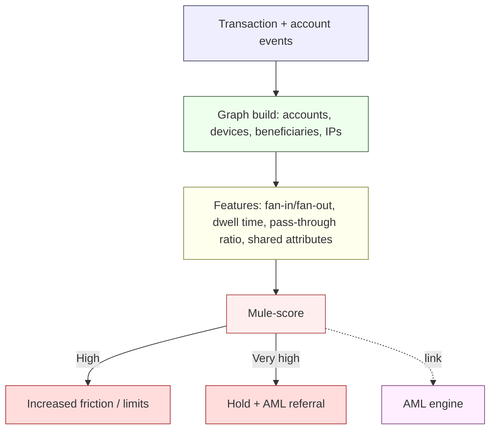
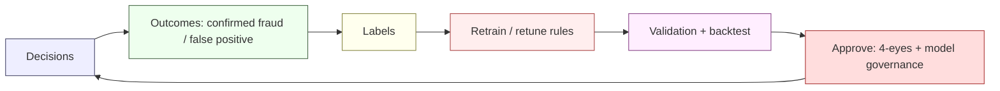

# Fraud Risk Engine — NeoBank ZA

**Owner:** C16 Banking-Fintech + C12 Cybersecurity-Intelligence · **Contributors:** C01 (AML interface), C14 (customer)
**Version:** 1.0 · **Date:** 2026-10-16
**Related:** [`threat-model-stride.md`](./threat-model-stride.md) · [`aml-transaction-monitoring.md`](./aml-transaction-monitoring.md) · [`iam-and-secrets.md`](./iam-and-secrets.md) · [`privacy-by-design.md`](./privacy-by-design.md) · [`../../research/regulatory/conduct-fais-nca.md`](../../research/regulatory/conduct-fais-nca.md)

> **Scope distinction.** *Fraud* = unauthorised/fraudulent transactions harming the customer or the bank (ATO, card, scam/APP, mule, onboarding fraud). *AML* = detecting suspicion of money laundering / terrorist financing (see [`aml-transaction-monitoring.md`](./aml-transaction-monitoring.md)). The two engines share signals but have **different decision owners, thresholds and reporting duties**. Fraud near-misses can still trigger an STR where suspicion of proceeds exists `[STATUTE] FICA`.

> **Evidence discipline.** All thresholds, model choices and rates in this file are **[DESIGN]** or **[CONFIRM]** engineering proposals — **not** regulatory numbers. Only the FICA reporting duty is `[STATUTE]`.

---

## 1. Fraud typology & target coverage

| Fraud type | Vector | Primary detection | Owner |
|---|---|---|---|
| **Account takeover (ATO)** | Credential theft, device takeover, session hijack | Device + behavioural + velocity | C12/C16 |
| **Authorised push payment (APP) / scam** | Customer tricked into paying a fraudster | Scam signals, warning friction, mule detection, confirmation-of-payee | C16 |
| **Onboarding / synthetic identity** | Fake ID, deepfake, stolen identity | Liveness/PAD, doc auth, cross-source checks | C01/C16 |
| **Money mule / ATO cash-out** | Recruited accounts receiving/forwarding proceeds | Network/link analysis, velocity, beneficiary patterns | C16/C01 |
| **Card-not-present / card fraud** **[CONFIRM]** | Card data theft, BIN attacks | Rules + ML, 3DS, tokenisation | C16 |
| **First-party / friendly fraud** | Customer denies legitimate transaction | Behavioural history, dispute analytics | C16 |
| **Internal fraud** | Staff abuse of access | UEBA, SoD, four-eyes | C12 |

---

## 2. Real-time scoring architecture

**Design targets [DESIGN]:** scoring latency budget ≤ **100 ms** (p95) inline; graceful **fail-safe** (if scorer unavailable, high-value actions default to challenge/hold, low-value proceeds within limits). Every decision is logged with reason codes for explainability and dispute handling.

---

## 3. Hybrid rules + ML

| Layer | Purpose | Strengths | Weaknesses | Governance |
|---|---|---|---|---|
| **Deterministic rules** | Immediate, explainable controls (velocity, blocklists, thresholds) | Transparent, auditable, instant deploy | Static, easy to game | Versioned, four-eyes change control |
| **Supervised ML** | Score probability of fraud from labelled history | Adapts to patterns, ranks risk | Needs labels, opaque, drift | Model governance ([`aml-transaction-monitoring.md`](./aml-transaction-monitoring.md) §7) |
| **Unsupervised / anomaly** | Surface novel patterns (mule rings, new scam) | Finds unknown-unknowns | Noisy, needs triage | Review with case outcomes |
| **Graph / network** | Link accounts/devices/beneficiaries (mule rings) | Detects networks, not just events | Compute-heavy, privacy-sensitive | POPIA minimisation; pseudonymised graph |
| **List screening** | Known-bad device/IP/account/beneficiary | Fast block | Stale lists | Refresh cadence |

**Decision policy (illustrative [DESIGN]):**

| Score band | Action |
|---|---|
| Low | Allow |
| Medium | Silent monitoring + risk token |
| High | Step-up authentication / warning friction |
| Very high | Hold + manual case + (if suspicion of proceeds) AML referral |

---

## 4. Device fingerprinting

| Signal | Use | POPIA note |
|---|---|---|
| Device ID / hardware attributes | Link accounts to devices; new-device friction | Personal data — minimise, pseudonymise |
| OS/app integrity, root/jailbreak, emulator | Malware/fraud signal | Not used alone (spoofable) |
| Network/IP/ASN/geo velocity | Impossible-travel, proxy/VPN detection | Legitimate-interest basis, documented |
| SIM/phone signals | Account recovery risk | Minimise |
| Wallet/mule markers | Link to known fraud networks | Pseudonymised |

> **Design rule:** device signals are **risk factors**, never sole authorisers (fail-safe). Raw device identifiers are stored **pseudonymised/hashed** and under retention policy ([`privacy-by-design.md`](./privacy-by-design.md)). **[DESIGN]**

---

## 5. Behavioural biometrics

| Behaviour | Signal captured | Purpose |
|---|---|---|
| Typing cadence, swipe, tap patterns | On-device, minimised | Continuous auth / bot vs human |
| Navigation & session rhythm | Session-level | ATO detection |
| Interaction with scam patterns (new beneficiary, large amount) | Event-level | APP-fraud friction |

**Guardrails [DESIGN]:** prefer **on-device** behavioural matching to avoid transmitting rich behavioural profiles; if server-side, disclose in privacy notice, apply minimisation and retention limits; treat as **special-ish** sensitive data given POPIA scrutiny ([`../../research/regulatory/privacy-popia.md`](../../research/regulatory/privacy-popia.md) §5). Continuous behavioural check must never be the **only** authorisation factor.

---

## 6. Velocity & limits

| Velocity dimension | Example control [DESIGN] | Notes |
|---|---|---|
| Per-customer | Transactions/amount per hour/day | Limits configurable, risk-based |
| Per-device | Distinct accounts/devices | ATO + mule signalling |
| Per-beneficiary | New beneficiaries/day | New-beneficiary cooling-off |
| Per-IP/ASN | Requests, signups | Bot/credential-stuffing defence |
| Per-rail | On-us/off-us split | Off-us risk higher |
| Aggregate | Bank-wide anomaly | Fraud-wave detection |

> All numeric limits are **[DESIGN]/[CONFIRM]** — set from data, not copied from law.

---

## 7. Scam / authorised push payment (APP) fraud controls

| Control | Description | Weight |
|---|---|---|
| **Confirmation of payee** | Verify beneficiary name matches account before send | [DESIGN] |
| **Scam warnings & friction** | Targeted, evidence-based warnings on risky payments | [DESIGN]/conduct |
| **Cooling-off / delay** | Delay for new beneficiary + high amount / high scam-risk | [DESIGN] |
| **Mule detection (beneficiary side)** | Score receiving accounts for mule behaviour | [DESIGN] |
| **Cohort alerts** | Warn customers matching active scam campaigns | [DESIGN] |
| **Recall/return workflow** | Fast recall with rails + beneficiary bank | [DESIGN] |
| **Complaint & ombud readiness** | Align with Code of Banking Practice / NFO jurisdiction ([`../../research/regulatory/conduct-fais-nca.md`](../../research/regulatory/conduct-fais-nca.md) §5-6) | [INDUSTRY] |

---

## 8. Money-mule detection

**Mule indicators [DESIGN]:** rapid pass-through (funds in→out < N hours), high fan-in then fan-out, shared device/IP across many accounts, disproportionate inflow vs declared income, dormancy-then-activity, matching scam-report cohorts. Network findings feed **both** fraud (block) and AML (STR where suspicion of proceeds exists — see [`aml-transaction-monitoring.md`](./aml-transaction-monitoring.md)). `[STATUTE] FICA` where suspicion arises.

---

## 9. Chargebacks, disputes & complaints

| Process | Design | Weight |
|---|---|---|
| **Dispute intake** | In-app, tracked, SLA-driven | [DESIGN] |
| **Chargeback handling** (card **[CONFIRM]**) | Scheme timelines, evidence packs | [REG-GUIDE] (PCI/scheme) |
| **Provisional credit / liability** | Policy aligned with conduct expectations | [DESIGN] |
| **Complaint escalation** | To NFO per Code of Banking Practice / ombud jurisdiction | [INDUSTRY] |
| **Records** | Full evidence retention for disputes and FIC needs | [STATUTE] FICA records |

---

## 10. Case management

| Capability | Requirement |
|---|---|
| Unified case queue | Fraud + AML cases with shared evidence, differentiated SLAs |
| Assignment & SLA | Risk-tiered; escalation per Stremiium SLA |
| Evidence & audit | Immutable case log; chain of custody for forensics ([`incident-response.md`](./incident-response.md)) |
| Cross-linking | Link cases to network graph and to AML cases |
| Outcomes capture | Every case labelled for the feedback loop |
| Regulatory hooks | STR/TPR raising from a fraud case where AML suspicion exists `[STATUTE]` |

---

## 11. Feedback loop & model lifecycle

| Practice | Cadence | Owner |
|---|---|---|
| Rule review & KPI tuning | Monthly | C16 |
| Model performance monitoring (drift, precision/recall) | Continuous | C16 + C12 |
| Challenger models / shadow mode | Quarterly | C16 |
| Bias & fairness review (avoid unlawful discrimination) | Semi-annual | C01 + C16 |
| Independent validation | Annual | C12 / internal audit |

---

## 12. Metrics (KPIs / KRIs) [DESIGN targets]

| Metric | Purpose |
|---|---|
| Fraud rate (bps of value / per 10k txns) by type | Effectiveness |
| Detection rate / recall | Coverage |
| False-positive rate & customer friction | Usability |
| Time-to-detect / time-to-contain | Response |
| Scam loss & recovery rate | APP effectiveness |
| Mule accounts actioned | Network control |
| Dispute/complaint volume & NFO referrals | Conduct |
| Model drift indicators | Model health |

---

## 13. Verification & open items

| Activity | Cadence |
|---|---|
| Red-team fraud scenarios (ATO, APP, mule) | Annual + pre-launch |
| Rules/model backtest | Per change |
| Case-file QA | Monthly |
| Conduct/ombud readiness review | Semi-annual |

**Open [CONFIRM]:** card product scope (drives chargeback/3DS/PCI); scam liability model; whether behavioural biometrics are on-device or server-side (POPIA impact). All **[DESIGN]/[CONFIRM]** and **UNVERIFIED** pending product scope and legal review.
