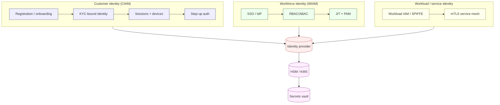
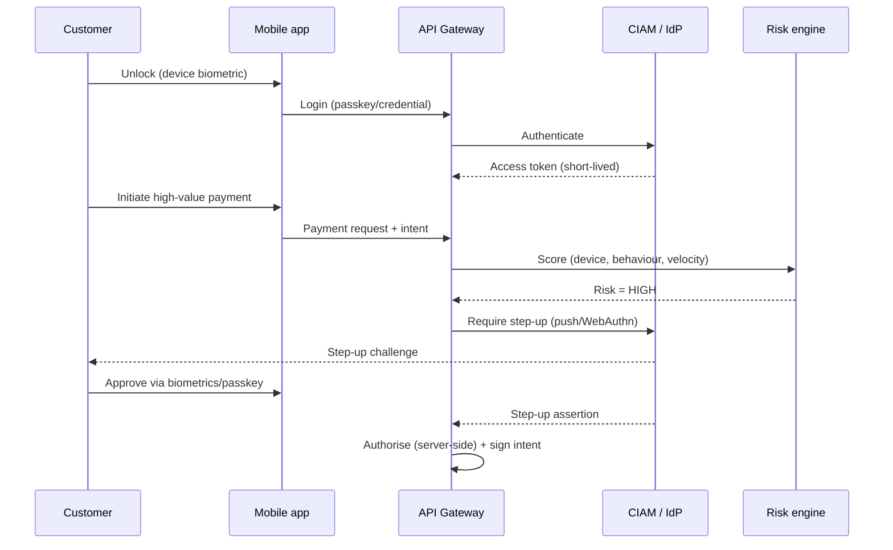
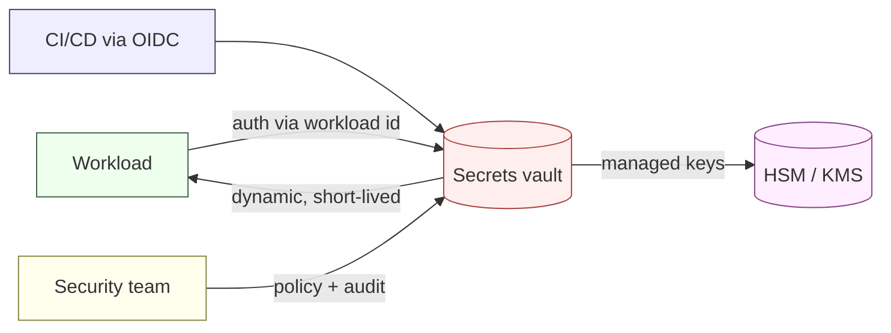

# Identity & Access Management, and Secrets Management — NeoBank ZA

**Owner:** C12 Cybersecurity-Intelligence (with C06 infrastructure, C01 privacy) · **Version:** 1.0 · **Date:** 2026-10-16
**Related:** [`cryptography-and-key-management.md`](./cryptography-and-key-management.md) · [`privacy-by-design.md`](./privacy-by-design.md) · [`threat-model-stride.md`](./threat-model-stride.md) · [`controls-catalog.md`](./controls-catalog.md)

> **Governing principles:** P1 zero-trust, P3 least privilege, P5 secure-by-default, P9 fail-safe ([`README.md`](./README.md)). **POPIA** drives biometric consent/security (special personal info) `[STATUTE]`; **PCI-DSS** drives PIN/CVV handling if cards are in scope `[REG-GUIDE]`.

---

## 1. Identity domains

---

## 2. Workforce IAM (employees, contractors)

| Area | Control | Detail | Weight |
|---|---|---|---|
| **Single source of truth** | Central IdP; every human has one identity | SSO for all consoles, no local accounts | [DESIGN] |
| **Joiner** | Provisioning from HR system of record via automated workflow | Role templates; least privilege; SoD check at grant | [REG] Banks Act controls |
| **Mover** | Access re-evaluated on role change; excess revoked automatically | SoD re-check; manager + security approval | [REG] |
| **Leaver** | **Offboarding SLA ≤ 24h**; all sessions, tokens, keys revoked | Return/prove-wipe endpoints; disable accounts same-day | [STATUTE] POPIA accountability |
| **Access review** | Quarterly recertification of role entitlements | Evidence stored; exceptions tracked | [REG] |
| **RBAC/ABAC** | Roles scoped by function; attribute checks for data-level access | Deny-by-default; no wildcard prod roles | [DESIGN] |
| **SoD** | Incompatible duties cannot co-exist (e.g. maker/checker, dev/prod) | Enforced in IdP + workflow; break-glass needs 2 approvers | [REG] |
| **Conditional access** | Device posture, geo, risk score, MFA | Non-compliant device = blocked | [DESIGN] |
| **Authentication** | Phishing-resistant MFA (FIDO2/WebAuthn) mandatory | Passwordless where possible; no SMS for privileged | [DESIGN] |

**MFA tiers (workforce):**

| Tier | Population | Minimum |
|---|---|---|
| Standard | All staff | FIDO2/passkey or app push; password + MFA fallback |
| Privileged | Admins, engineers with prod access | FIDO2 hardware key, no SMS/OTP, short session, JIT |
| External support | Vendors/contractors | Same as privileged + time-boxed + recorded |

---

## 3. Customer identity & access management (CIAM)

| Capability | Design | Weight |
|---|---|---|
| **Registration & identity binding** | Identity created only after CDD/KYC binding; identity = f(verified identity doc + liveness) | [STATUTE] FICA s21 |
| **Credentials** | Passkeys/biometrics preferred; strong password policy if used; credential-stuffing defence (breach-list check) | [DESIGN] |
| **Session management** | Short-lived access tokens, rotating refresh, binding to device + risk; server-side revocation | [DESIGN] |
| **Account recovery** | Risk-based; step-up + delays for high-value; never a single weak factor | [DESIGN] |
| **Device binding** | Registered devices; new-device = step-up + cooling-off for high-risk | [DESIGN] |
| **Federated login (social IdP)** | **[CONFIRM]** if offered — must not weaken KYC binding or POPIA consent | [DESIGN] |
| **Biometrics** | Used as a **convenience factor on the customer's own device** (local match); server never stores raw biometric templates | [STATUTE] POPIA special info |
| **Consent & preference** | Capture granular consent (biometric, marketing, data-sharing) with audit | [STATUTE] POPIA |

> **POPIA note.** Biometric data is **special personal information** and may only be processed with consent or another listed ground ([`../../research/regulatory/privacy-popia.md`](../../research/regulatory/privacy-popia.md) §5). Prefer **on-device biometric matching** so raw biometrics do not leave the device; if a template must be stored, apply explicit consent, encryption and minimisation. **[STATUTE]**

### 3.1 Customer authentication flow (with step-up)

### 3.2 Step-up triggers (risk-based)

| Trigger | Action | Weight |
|---|---|---|
| New device / new beneficiary | Step-up + optional cooling-off | [DESIGN] |
| Amount above threshold | Step-up (biometric/passkey) | [DESIGN] |
| Anomalous geo/session | Step-up or block | [DESIGN] |
| Sensitive profile change (contact, limits) | Step-up + notification to old channel | [DESIGN] |
| Scam/APP-risk signals | Warning + delay + confirmation-of-payee | [DESIGN] (see [`fraud-risk-engine.md`](./fraud-risk-engine.md)) |

---

## 4. Privileged access management (PAM)

| Control | Detail | Weight |
|---|---|---|
| **No standing production admin** | All prod access is JIT, time-boxed, approved | [REG] Banks Act controls |
| **Vaulted credentials / brokered sessions** | Secrets never shown to humans; session proxied & recorded | [DESIGN] |
| **Dual control / four-eyes** | Sensitive admin actions require a second approver | [DESIGN] |
| **Session recording & keystroke logging** | Privileged sessions recorded, tamper-evident | [DESIGN] |
| **Break-glass** | Emergency access: pre-authorised, alerting, mandatory post-review | [DESIGN] |
| **Vendor/third-party access** | Scoped, time-boxed, monitored; no persistent accounts | [REG-GUIDE] outsourcing |
| **Approval workflow** | Ticket-linked, with expiry; auto-revoke on ticket close | [DESIGN] |

---

## 5. Service / workload identity

| Control | Detail | Weight |
|---|---|---|
| **Workload identity (SPIFFE/SPIRE or cloud-native)** | Each service gets a cryptographic identity; no shared service accounts | [DESIGN] |
| **Short-lived credentials** | Services fetch credentials at runtime from a trusted broker; no long-lived keys in config | [DESIGN] |
| **mTLS everywhere** | Service-to-service and to data stores; see [`cryptography-and-key-management.md`](./cryptography-and-key-management.md) | [DESIGN] |
| **Least-privilege scopes** | Per-service roles with narrow permissions; deny-by-default | [DESIGN] |
| **No human credentials in automation** | CI/CD uses OIDC federation, not static keys | [DESIGN] |

---

## 6. Secrets management

| Requirement | Rule | Weight |
|---|---|---|
| **No hardcoded secrets** | Enforced by secret scanning in CI (gate G2) | [STATUTE] POPIA safeguards |
| **Central vault** | All secrets in a managed vault (dynamic secrets preferred) | [DESIGN] |
| **Rotation** | Automatic rotation; max age per secret class | [DESIGN] |
| **Least access to vault** | Policy-scoped read paths; audit every access | [DESIGN] |
| **Encryption of secrets at rest** | Vault-encrypted with KMS/HSM-backed keys | [STATUTE] |
| **Detection of leaks** | Continuous secret scanning (repo, logs, artefacts) | [DESIGN] |
| **Incident** | Leak → immediate rotation + IR ticket ([`incident-response.md`](./incident-response.md)) | [DESIGN] |

**Secret rotation cadence (design target):**

| Secret class | Max age | Method |
|---|---|---|
| Database credentials | ≤ 24h | Dynamic (broker-issued) |
| Service tokens | ≤ 1h | Dynamic / projected |
| Signing keys | Per policy (rotate before expiry) | Managed, dual control |
| Partner API keys | ≤ 90 days | Automated rotation |
| Root/CA keys | ≥ annual, HSM-protected | Ceremony, dual control |

---

## 7. Key custody (HSM / KMS)

| Layer | Use | Control | Weight |
|---|---|---|---|
| **Cloud KMS** | Envelope encryption for data at rest | Key policies, rotation, audit; per-tenant keys | [STATUTE] |
| **HSM (FIPS 140-2/3)** | Root keys, CA signing, PIN block translation | Dual control, no export of root keys, quorum | [DESIGN] / PCI if card |
| **Key hierarchy** | Root (HSM) → KEK (KMS) → DEK (per-data) | Separation of duties; documented custodianship | [DESIGN] |
| **Custodianship** | Named key custodians; separation from operators | Segregation of duties | [DESIGN] |

> PIN block handling, tokenisation and detailed crypto standards are in [`cryptography-and-key-management.md`](./cryptography-and-key-management.md).

---

## 8. Certificate lifecycle

| Stage | Control | Cadence | Weight |
|---|---|---|---|
| Inventory | Automated cert discovery; no shadow certs | Continuous | [DESIGN] |
| Issue | Automated CA (ACME) with policy; CAA records | On demand | [DESIGN] |
| Lifetime | Short-lived certs (internal) to reduce exposure | e.g. days–weeks `[DESIGN]` | [DESIGN] |
| Renew | Automated, monitored against expiry | Continuous | [DESIGN] |
| Revoke | Automated revocation + CRL/OCSP | On compromise | [DESIGN] |
| mTLS client certs | Issued to workloads/workforce; rotation tied to identity | Continuous | [DESIGN] |
| Transparency | Cert transparency monitoring for our domains | Continuous | [DESIGN] |

---

## 9. IAM threat → control mapping

| Threat (STRIDE) | Control |
|---|---|
| T-MOB-01 ATO via credential theft | IAM-02 MFA, device binding, passkeys, breach-list check |
| T-API-01 token replay | Short-lived tokens, sender-constrained tokens (DPoP/mTLS) |
| T-ADM-06 privilege escalation | IAM-03 JIT/PAM, least privilege, policy-as-code |
| T-INS-04 insider exfil | IAM-08 offboarding, GOV-03 SoD, DLP, UEBA |
| T-LED-06 direct DB access | IAM-03 no human prod access, workload identity |
| T-KYC-04 KYC vendor leak | VND-03 residency, minimisation, scoped access |

---

## 10. Verification & open items

| Verification | Cadence | Evidence |
|---|---|---|
| Access recertification | Quarterly | Signed review |
| Red-team of auth flows (ATO, step-up bypass) | Annual | Report |
| Secret-scanning clean build | Per release | CI report |
| Key/cert inventory reconciliation | Monthly | Inventory diff |
| Break-glass drill | Semi-annual | Drill record |

**Open [CONFIRM]:** social/federated IdP offering; whether any biometric template is stored server-side (affects POPIA special-info handling); PCI card scope (affects PIN/CVV rules). All are **UNVERIFIED** until product scope is fixed.
