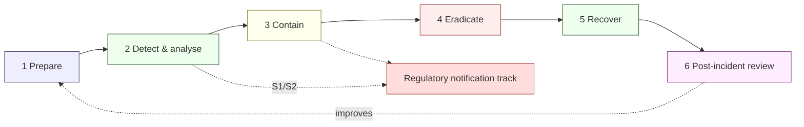
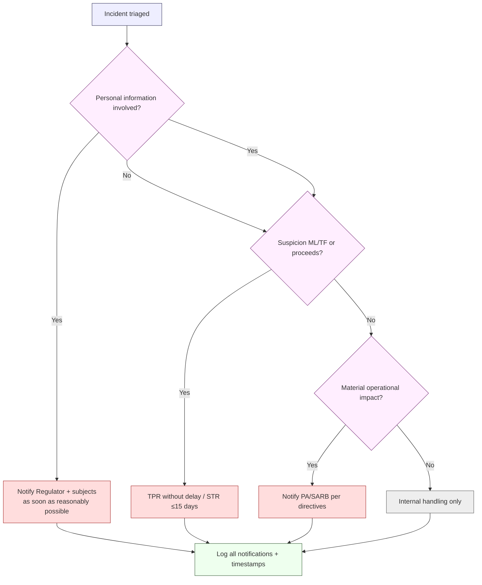

# Incident Response Plan — NeoBank ZA

**Owner:** C02 Operations + C12 Cybersecurity-Intelligence · **Contributors:** C01 (regulatory), C06 (infra)
**Version:** 1.0 · **Date:** 2026-10-16
**Related:** [`threat-model-stride.md`](./threat-model-stride.md) · [`privacy-by-design.md`](./privacy-by-design.md) · [`aml-transaction-monitoring.md`](./aml-transaction-monitoring.md) · [`controls-catalog.md`](./controls-catalog.md) · [`../../research/regulatory/privacy-popia.md`](../../research/regulatory/privacy-popia.md) · [`../../research/regulatory/aml-fica.md`](../../research/regulatory/aml-fica.md)

> **Objective.** Detect, contain, eradicate, recover from and learn from security and fraud incidents — and **meet regulatory notification obligations on time**. Escalation SLAs follow the Stremiium authority model: **Critical 1h · High 4h · Medium 24h · Low 72h**.

---

## 1. Severity levels

| Sev | Name | Definition | Examples | Escalation SLA | Regulator? |
|---|---|---|---|---|---|
| **S1** | **Critical** | Bank-threatening; money movement or customer data at scale compromised; regulator-reportable | Ledger integrity compromise; mass data breach; core payments down; confirmed sanctioned-party payout | **1 hour** | Likely POPIA/FIC/PA |
| **S2** | **High** | Significant impact; contained scope; likely reportable | Single-tenant breach; ATO wave; rail partner outage; privileged-account compromise | **4 hours** | Assess POPIA/FIC/PA |
| **S3** | **Medium** | Limited impact; no confirmed data/money loss | Isolated malware; failed control; contained phishing | **24 hours** | Usually none |
| **S4** | **Low** | Minor; no material impact | Policy violation; benign alert; near-miss | **72 hours** | None |

> **Reportability is assessed separately from severity** — a "low-severity" incident that involved personal information is still POPIA-reportable. See §6.

---

## 2. Team, roles & on-call

| Role | Responsibility | On-call? |
|---|---|---|
| **Incident Commander (IC)** | Overall coordination, decisions, comms | Yes |
| **Security Lead (C12)** | Technical forensics, containment | Yes |
| **Fraud/AML Lead** | Fraud/mule/AML angle; STR decisions | Yes |
| **Engineering Lead (C11/C06)** | Fix, restore, deploy | Yes |
| **Privacy Lead (C01 / IO)** | POPIA assessment & notification | On-call |
| **Compliance/MLCO (C01)** | FIC/PA notification | On-call |
| **Comms** | Internal/external messaging | On-call |
| **Legal** | Legal exposure, law-enforcement | On-call |
| **Executive sponsor** | Board/authority liaison | On S1/S2 |

**On-call model [DESIGN]:** primary + secondary 24/7 rota; paging with automatic escalation on no-ack (e.g. 5 min → secondary → IC). War room (bridge) stood up for S1/S2. Break-glass access pre-authorised and logged.

---

## 3. Detection sources

| Source | Feeds |
|---|---|
| SIEM detections & correlation | All classes |
| EDR / endpoint | Malware, lateral movement |
| Fraud engine alerts | Fraud, ATO, APP, mule |
| AML alerting | ML/TF suspicion |
| Cloud/security posture & config drift | Misconfig, exposure |
| Network/DDoS/WAF | Availability, L7 attacks |
| DLP / UEBA | Insider, exfil |
| Customer & partner reports | Any |
| Vulnerability/threat intel | Pre-exploitation |

---

## 4. Response lifecycle

| Phase | Key activities | Outputs |
|---|---|---|
| **1. Prepare** | Runbooks, playbooks, contact tree, tooling, tabletop exercises, logging/backups, break-glass | Tested readiness |
| **2. Detect & analyse** | Triage, severity assignment, scoping, evidence preservation | Incident record (timeline, hypothesis) |
| **3. Contain** | Isolate hosts/services, revoke tokens/keys, block accounts/IPs, fail-safe payments, freeze | Contained blast radius |
| **4. Eradicate** | Remove threat, patch, re-image, rotate all exposed credentials/keys | Root cause removed |
| **5. Recover** | Restore from clean backups, validate integrity, monitor, return to service | Restored service + validation |
| **6. Post-incident review** | Blameless PIR, timeline, lessons, control updates | PIR report → controls |

**Fail-safe design (`P9`):** if a control is uncertain, degrade toward safety (stop the payment, lock the session, hold the batch) — never "fail open".

---

## 5. RTO / RPO (recovery targets) [DESIGN — confirm with business]

| System class | RTO (target) | RPO (target) |
|---|---|---|
| Core ledger / money movement | Minutes | ~0 (no data loss) |
| Payments/rails | Minutes | ~0 |
| Fraud/AML engines | ≤ 1 hour | Minutes |
| Reporting (goAML/PA) | ≤ 1 business day | Minutes |
| Internal tooling | ≤ 1 day | ≤ 1 hour |

> RTO/RPO are **engineering targets `[DESIGN]`**; operational-resilience expectations come from the PA `[REG-GUIDE]` (`banking-licensing.md` §5). Validate against BIA.

---

## 6. Regulatory notification obligations

> ⚠️ **Do not fabricate deadlines.** The timings below are taken from the regulatory research pack. Where a specific hour-count is **our internal design target**, it is labelled as such and is **not** presented as law.

### 6.1 POPIA — security compromise (personal-information breach) `[STATUTE]`

| Requirement | Detail | Weight |
|---|---|---|
| Notify the **Information Regulator** | On discovering a security compromise, **as soon as reasonably possible**, via the prescribed portal/form | [STATUTE] |
| Notify **affected data subjects** | As soon as reasonably possible, with the required information | [STATUTE] |
| Content | Nature of breach, categories & approx. number of subjects, likely consequences, measures taken | [STATUTE] |
| Internal target | Aim to complete Regulator + subject notification within **≤ 72 hours** of confirmed compromise — **internal design target, not the statutory wording** | [DESIGN] |
| Owner | Privacy Lead / Information Officer | — |

> POPIA's statutory phrasing is "**as soon as reasonably possible**" — the research pack does **not** state a 72-hour statutory deadline (`privacy-popia.md` §7). We adopt ≤72h internally as a **design choice** to exceed expectations, while retaining the statutory standard as the binding rule. `[STATUTE]`

### 6.2 FIC — AML/CTF reporting `[STATUTE]`

| Report | Trigger in an incident | Deadline | Weight |
|---|---|---|---|
| **TPR** | Funds/property linked to a designated person/entity | **Without delay** | [STATUTE] |
| **STR/SAR** | Suspicion of ML/TF/PF or proceeds (e.g. fraud/mule/breach enabling crime) | **within 15 days** of awareness (excl. weekends/public holidays) | [STATUTE] |
| **CTR** | If ≥ threshold cash involved | ≤ 3 days | [STATUTE] |
| Also | Notify FIC/PA of significant control failures / RMCP-relevant incidents | per relationship | [REG-GUIDE] |

> FICA deadlines and thresholds are as documented in `aml-fica.md` §3.4. The MLCO owns these decisions; the IR team must preserve evidence and involve the MLCO early.

### 6.3 SARB / Prudential Authority `[REG-GUIDE]`

| Requirement | Detail | Weight |
|---|---|---|
| Material operational/security incident | Notify the PA promptly; expect operational-resilience and incident-reporting expectations | [REG-GUIDE] |
| BA-return / prudential impact | Reflect where the incident affects capital/operations reporting | [REG] |
| **CONFIRM** | Exact PA incident-notification channel and timeframes — verify via PA directives | **[CONFIRM]** |

### 6.4 Other authorities

| Authority | When | Weight |
|---|---|---|
| Law enforcement (SAPS / cybercrime) | Criminal activity, fraud, extortion | [DESIGN] |
| Regulator (if crypto/conduct) | FSCA, per licence conditions | [REG-GUIDE] |
| National Financial Ombud (NFO) | If customer harm/complaint follows | [INDUSTRY] |

### 6.5 Notification decision tree

---

## 7. Evidence handling & forensics

| Requirement | Control |
|---|---|
| **Chain of custody** | Documented, tamper-evident; forensic images with hashes |
| **Preservation** | Isolate before remediation where safe; legal hold as needed |
| **Privilege** | Engage legal early for privileged investigation |
| **POCA/FICA value** | Preserve evidence usable for criminal referral / STR |
| **POPIA balance** | Investigation processing has a lawful basis; minimise and log |
| **Tooling** | Approved forensic toolkit; untrusted evidence handled offline |

---

## 8. Communications

| Audience | Channel | Trigger |
|---|---|---|
| Internal responders | Incident bridge + status doc | S1/S2 |
| Executives/Board | Exec summary | S1/S2 |
| Regulators | Prescribed channels (POPIA portal, goAML, PA) | Per §6 |
| Customers | In-app/email (legal & comms approved) | When required |
| Partners/rails | Secure partner channel | When impacted |
| Media | Only via Comms/Legal | On S1 |

**Rule:** no speculation; comms approved by Legal + IC; **never** reveal STR existence (tipping-off prohibition under FICA).

---

## 9. Post-incident review (blameless)

| Step | Output | Timing |
|---|---|---|
| Timeline & root cause | Timeline document | ≤ 5 days (S1/S2) |
| Control failures | Which control P1–P10 / catalogue control failed | ≤ 5 days |
| Corrective actions | Owner + due date + verification | ≤ 10 days |
| Control catalogue update | Link to [`controls-catalog.md`](./controls-catalog.md) | On completion |
| Regulatory closeout | Confirm all notifications done & logged | Verified |

---

## 10. Verification & exercises

| Exercise | Cadence | Evidence |
|---|---|---|
| Tabletop (ransomware / breach / rail outage) | Semi-annual | Exercise report |
| Live failover/DR test | Annual | DR record |
| Break-glass drill | Semi-annual | Drill log |
| Notification drill (POPIA + FIC paths) | Annual | Timed drill |
| On-call readiness check | Quarterly | Rota audit |

**Open [CONFIRM]:** exact PA incident-notification channel/timeline; whether SARB mandates a cyber-specific reporting format for banks; POPIA portal mechanics at time of breach. These are **UNVERIFIED** pending confirmation.
