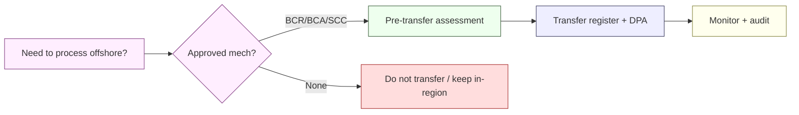
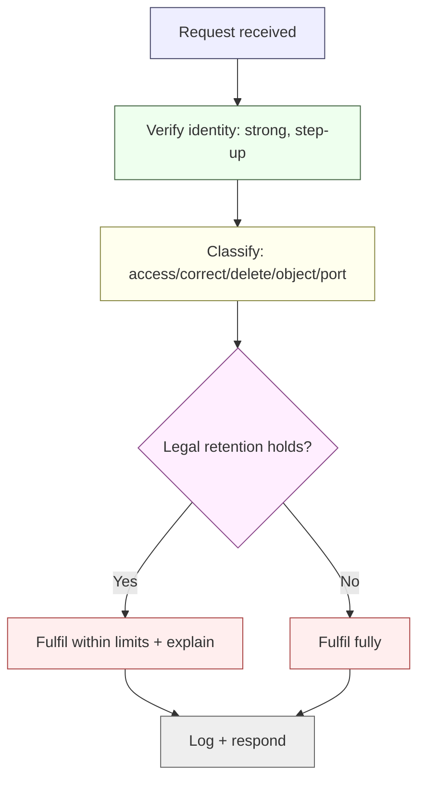

# Privacy-by-Design (POPIA Implementation) — NeoBank ZA

**Owner:** C01 Legal-Compliance — **Information Officer** (and Deputy IOs) · **Contributors:** C12, C11, C06
**Version:** 1.0 · **Date:** 2026-10-16
**Regulatory source:** [`../../research/regulatory/privacy-popia.md`](../../research/regulatory/privacy-popia.md) (POPIA 4 of 2013; PAIA 2 of 2000)
**Related:** [`incident-response.md`](./incident-response.md) §6 · [`third-party-and-cloud-risk.md`](./third-party-and-cloud-risk.md) · [`controls-catalog.md`](./controls-catalog.md) §11 · [`iam-and-secrets.md`](./iam-and-secrets.md) §3

> **This file implements POPIA; it does not restate it.** The eight conditions, IO duties, prior authorisation, cross-border rules and enforcement are documented in the research pack and linked, not duplicated. Engineering choices are `[DESIGN]`; statutory duties are `[STATUTE]`.
>
> **Why it matters:** the Information Regulator **is actively fining**; administrative fines up to **R10m** and criminal exposure up to **10 years** (`privacy-popia.md` §8). A neobank is a data-heavy responsible party handling special personal information. `[STATUTE]`

---

## 1. POPIA-by-design principles for engineers

| # | Principle | Engineering rule |
|---|---|---|
| PB1 | **Lawfulness** | Every data element has a documented lawful basis before it is collected |
| PB2 | **Purpose limitation** | Data collected for purpose X is not reused for Y without a lawful basis |
| PB3 | **Minimisation** | Collect the least data needed; prefer pseudonyms/tokens over identifiers |
| PB4 | **Accuracy** | Data quality controls; correction paths |
| PB5 | **Storage limitation** | Retention engine deletes/pseudonymises on schedule |
| PB6 | **Security & confidentiality** | Encryption, access control, DLP ([`cryptography-and-key-management.md`](./cryptography-and-key-management.md)) |
| PB7 | **Transparency** | Privacy notices, consent capture, audit trail |
| PB8 | **Data-subject participation** | DSAR workflow with SLA |
| PB9 | **Accountability** | Named IO; ROPA; DPIA; evidence |

---

## 2. Data classification

| Class | Definition | Examples | Handling |
|---|---|---|---|
| **C0 Public** | Meant to be public | Marketing site, published T&Cs | No restriction |
| **C1 Internal** | Non-public, low sensitivity | Internal policies, aggregate metrics | Internal access |
| **C2 Confidential** | Business-sensitive | Source config, non-PII operational data | Need-to-know, encrypted |
| **C3 Personal (POPIA)** | Personal information | Name, contact, account activity | POPIA controls, encryption, minimisation |
| **C4 Special / highly sensitive** | Special personal info + financial identity | Biometrics, criminal-behaviour data, ID numbers, full financial profile | Strict controls, consent/ground, prior-authorisation assessment |
| **C5 Secrets/Keys** | Cryptographic material | Keys, credentials | Vault/HSM only ([`iam-and-secrets.md`](./iam-and-secrets.md)) |

> **Special personal information** under POPIA (racial/ethnic origin, health, political persuasion, **biometrics**, trade-union membership, religious/philosophical beliefs, sex life, criminal behaviour) may only be processed with **consent or another listed ground** (`privacy-popia.md` §5). `[STATUTE]`

---

## 3. Lawful basis register (illustrative)

| Processing activity | Purpose | Lawful basis | Weight |
|---|---|---|---|
| Onboarding & KYC/CDD | Verify identity, meet FICA | **Legal obligation** (FICA) + contract | [STATUTE] |
| Account servicing | Provide the bank account | Contract | [STATUTE] |
| Fraud/AML monitoring | Detect/ prevent financial crime | Legal obligation + legitimate interest | [STATUTE] |
| Credit assessment | Affordability, lending | Contract/legal obligation (NCA) | [STATUTE] |
| Marketing | Offers, promotions | **Consent** (opt-in) | [STATUTE] |
| Biometric unlock (on-device) | Convenience/security | Consent (special info) | [STATUTE] |
| Analytics/product improvement | Improve service | Legitimate interest (documented, balanced) | [DESIGN] |
| Regulatory reporting | FIC/PA/Regulator | Legal obligation | [STATUTE] |

> Maintain this as the **ROPA** (Record of Processing Activities) with owner, retention, recipients, cross-border flags. `[STATUTE]` accountability.

---

## 4. Consent management

| Requirement | Design |
|---|---|
| **Granular** | Separate consent for marketing vs biometric vs data-sharing |
| **Informed** | Clear description of purpose and recipients |
| **Freely given** | No bundling; service not conditional on non-essential consent (where consent is the basis) |
| **Recorded** | Versioned consent with timestamp, purpose, expiry |
| **Withdrawable** | One-step withdrawal; propagate to systems/partners |
| **Special info** | Explicit consent captured for biometrics/special data |

> Consent is only one of several bases. Where we rely on **legal obligation or contract**, consent is neither required nor the right instrument (POPIA processing limitation, `privacy-popia.md` §2). `[STATUTE]`

---

## 5. Retention schedule

| Data class | Retention | Basis | Weight |
|---|---|---|---|
| CDD/KYC records | prescribed period (**commonly ≥5 yrs — UNVERIFIED, confirm**) | FICA s22–23 | [STATUTE] |
| Transaction records | same prescribed period | FICA | [STATUTE] |
| STR/SAR + evidence | per Act (long-lived) | FICA | [STATUTE] |
| Account records | contract + tax/legal period | Companies/Tax/POPIA balance | [STATUTE] |
| Marketing consent records | duration of consent + proof period | POPIA accountability | [STATUTE] |
| Fraud/behavioural telemetry | minimised, short effective window | legitimate interest | [DESIGN] |
| Logs/audit | security/forensic period | security safeguards | [STATUTE] |
| Disputes/complaints | per conduct/ombud period | conduct | [INDUSTRY] |

**Rules:** retention is **configured, not hardcoded**; AML/legal retention **overrides** POPIA deletion for covered records; on expiry, data is **deleted or irreversibly anonymised**; deletions are logged. `[STATUTE]`

> **`[CONFIRM]`:** the exact FICA retention period is flagged **UNVERIFIED** in the research pack (`aml-fica.md` §3.3). Do not assert a number.

---

## 6. Cross-border transfers (POPIA s72) `[STATUTE]`

A responsible party may transfer personal information to a third party in another country **only if** a s72(1) basis is met (`privacy-popia.md` §6). POPIA has **no formal adequacy list** — the adequacy test is **recipient-by-recipient** (`privacy-popia.md` §11).

| Mechanism | When used | Weight |
|---|---|---|
| **Binding Corporate Rules (BCRs)** | Intra-group transfers | [STATUTE] |
| **Binding agreement** with substantially similar protection **incl. onward transfer** | Vendor/cloud | [STATUTE] |
| **Standard contractual clauses** (as contract terms) | Vendor/cloud | [DESIGN] |
| **Data-subject consent** | Where appropriate (last resort for some flows) | [STATUTE] |
| **Contractual necessity / benefit** | Specific listed grounds | [STATUTE] |

**Engineering controls:** data-residency mapping, transfer register, DPAs/BCAs with transfer clauses, encryption + pseudonymisation for any cross-border processing, and a **pre-transfer assessment** ([`third-party-and-cloud-risk.md`](./third-party-and-cloud-risk.md)). `[STATUTE]`

---

## 7. DSAR & data-subject rights workflow

| Right (POPIA condition 8) | Implementation | SLA (design) |
|---|---|---|
| **Access** | Self-service export + verified request | within reasonable period; target ≤ 30 days `[DESIGN]` |
| **Correction** | In-app edit + backend update | ≤ 30 days |
| **Deletion** | Request workflow → retention-aware deletion/anonymisation | ≤ 30 days (subject to legal retention) |
| **Objection** | Preference settings / processing flags | Prompt |
| **Portability** | Standard-format export | ≤ 30 days |

> **Identity verification is mandatory** before acting on a DSAR to prevent data theft via disguised requests. Reuse step-up auth ([`iam-and-secrets.md`](./iam-and-secrets.md)).

---

## 8. Privacy Impact Assessment (DPIA) process

| Step | Activity | Output |
|---|---|---|
| 1 | Screen: does processing pose high risk (special info, large scale, new tech, profiling, ID linking)? | DPIA trigger decision |
| 2 | Describe processing & flows (data map) | Data-flow diagram |
| 3 | Assess necessity & proportionality | Justification |
| 4 | Identify risks to data subjects | Risk register |
| 5 | Define mitigations | Control list |
| 6 | Consult IO / privacy counsel | Sign-off |
| 7 | Where high residual risk & s57 applies, assess **prior authorisation** | Decision |
| 8 | Re-assess on material change | Updated DPIA |

**Triggers [DESIGN]:** new product, new AI/ML profiling, new cross-border flow, biometrics, ID-number linking, large-scale monitoring, fraud/AML model changes affecting individuals.

---

## 9. Prior authorisation (POPIA s57) `[STATUTE]`

Before certain **higher-risk** processing we must obtain **prior authorisation** from the Regulator (`privacy-popia.md` §4), notably:

- Processing **unique identifiers** (e.g. SA ID number) for a purpose other than that intended, and **linking** them with information processed by other responsible parties — **directly relevant to a bank**.
- Processing **criminal behaviour / unlawful conduct** information on behalf of third parties.
- Processing for **credit reporting**.

**Action [DESIGN]:** run a **s57 assessment** covering (a) any cross-source ID-number linking (e.g. with bureaux), and (b) credit-related processing, and register the outcome. If prior authorisation is required, obtain it **before** the processing starts. `[STATUTE]`

---

## 10. Information Officer & PAIA duties `[STATUTE]`

| Duty | Requirement | Weight |
|---|---|---|
| **Appoint IO** | By default the head of the organisation; may designate **Deputy IOs** | [STATUTE] |
| **Register IO** | With the Information Regulator under **s55** **before** taking up duties | [STATUTE] |
| **PAIA Manual** | Maintain up-to-date manual | [STATUTE] |
| **PAIA annual report** | Submit to the Regulator; portal window **1 April – 30 June** | [STATUTE] |
| **Encourage compliance** | IO ensures POPIA compliance | [STATUTE] |
| **Breach notification** | IO leads security-compromise notifications | [STATUTE] |

> Registration is a **precondition** for the Regulator's portals (e.g. PAIA annual reports) (`privacy-popia.md` §3, §9). `[STATUTE]`

---

## 11. Breach handling (privacy view)

Owned by the IR plan ([`incident-response.md`](./incident-response.md) §6.1). Privacy lead duties: assess whether **personal information** was involved, scope subjects, assess harm, prepare notifications to the **Regulator and subjects** "as soon as reasonably possible", maintain a breach register, and feed the PIR. `[STATUTE]`

---

## 12. Privacy-by-design release checklist (gate G3)

- [ ] Lawful basis recorded in ROPA for every new data element
- [ ] Minimisation applied (no "collect it in case" fields)
- [ ] Retention + deletion configured
- [ ] Consent captured where consent is the basis (esp. special info)
- [ ] Cross-border flow assessed & documented (s72)
- [ ] DPIA completed for high-risk processing; s57 prior-authorisation assessed
- [ ] DSAR path can service the new data
- [ ] Privacy notice updated
- [ ] Security controls applied ([`cryptography-and-key-management.md`](./cryptography-and-key-management.md))
- [ ] No PII in logs/artefacts (gate G2)
- [ ] C01 Privacy sign-off obtained (gate G6)

---

## 13. Verification & open items

| Activity | Cadence | Evidence |
|---|---|---|
| ROPA review | Semi-annual | ROPA |
| DSAR SLA compliance | Quarterly | DSAR report |
| Consent audit | Quarterly | Consent log review |
| Cross-border transfer register review | Semi-annual | Register |
| DPIA review | Per change + annual | DPIA record |
| PAIA annual report | Annual (1 Apr–30 Jun) | Submission proof |

**Open [CONFIRM]/UNVERIFIED:** whether our ID-linking/credit processing triggers **s57 prior authorisation**; exact FICA retention period; current **breach-notification portal** mechanics; whether any formal **adequacy determinations** exist (none identified — treat recipient-by-recipient, `privacy-popia.md` §11); exact **2025 POPIA amendments** in force.
