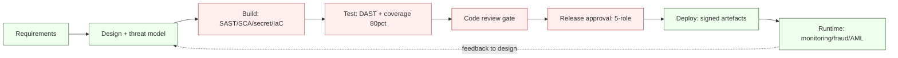
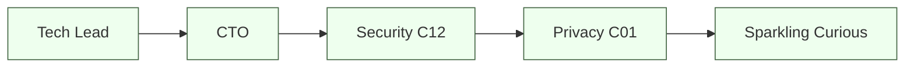

# Secure Software Development Lifecycle (Secure SDLC) — NeoBank ZA

**Owner:** C11 Dev-Engineering + C12 Cybersecurity-Intelligence · **Contributors:** C06, C15
**Version:** 1.0 · **Date:** 2026-10-16
**Related:** [`controls-catalog.md`](./controls-catalog.md) §6 · [`threat-model-stride.md`](./threat-model-stride.md) · [`README.md`](./README.md) §4 · [`incident-response.md`](./incident-response.md)

> **Objective.** Bake security into every phase so that **no money/data/regulated surface ships without passing the security and regulatory gates** (Stremiium gate G3 + `security-compliance-sentinel`). Test coverage ≥ **80%** on produced code; **no hardcoded secrets**; **no PII in artefacts**.

---

## 1. SDLC stages & security gates

| Stage | Security activity | Gate (blocks release if failed) |
|---|---|---|
| **Requirements** | Identify data classes, regulatory triggers (POPIA/PCI/FICA), abuse cases | Data-classification sheet |
| **Design** | **Threat modelling** ([`threat-model-stride.md`](./threat-model-stride.md)), secure design review, DPIA trigger | Threat model approved (C12) |
| **Build** | SAST, SCA, secret scanning, IaC scanning, linting | Zero high/critical; no secrets |
| **Test** | DAST, dependency & container scanning, **≥80% coverage**, abuse-case tests | Coverage + no criticals |
| **Review** | Peer code review + security review for sensitive changes | 2 approvals (≥1 security for sensitive) |
| **Release** | 5-role sign-off, signed artefacts, SBOM | Gate G6 |
| **Operate** | Monitoring, incident response, patch management | Verified detection |

---

## 2. Threat modelling in design

| Element | Practice |
|---|---|
| When | Every new feature/service, and material change to money/data flows |
| Method | STRIDE per element/trust boundary ([`threat-model-stride.md`](./threat-model-stride.md)) |
| Output | Threats with mitigations + residual risk + owner |
| Review | C12 security architect; update [`attack-surface-register.md`](./attack-surface-register.md) |
| Evidence | Design threat-model record linked to the change |

---

## 3. Automated security testing (CI/CD)

| Tool class | Purpose | Gate |
|---|---|---|
| **SAST** | Static analysis for injection, crypto misuse, logic flaws | Fail on high/critical |
| **DAST** | Runtime black-box scanning of running app | Fail on high/critical |
| **SCA (dependency scanning)** | Known-vulnerable libraries | Fail on high/critical; SLA for mediums |
| **Container/image scanning** | Base-image & package CVEs | Fail on high/critical |
| **IaC scanning** | Misconfigured cloud/terraform/k8s | Fail on high/critical |
| **Secret scanning** | Hardcoded secrets in code/history | Fail on any |
| **License scanning** | Open-source licence compliance | Fail on disallowed licence |
| **SBOM generation** | Software bill of materials per build | Required artefact |
| **Artifact signing** | Sign build outputs; verify at deploy | Enforced |

**Remediation SLAs [DESIGN]:** Critical → block; High → fix before release or documented exception; Medium → risk register with due date; Low → backlog.

---

## 4. Supply-chain security

| Control | Detail |
|---|---|
| **Pinned dependencies** | Lockfiles; no floating versions |
| **Verified sources** | Internal/proxy registries; no arbitrary CDNs |
| **Signed commits / provenance** | Verify authorship; SLSA-style provenance where feasible |
| **Signed artefacts + attestation** | Deploy only verified artefacts |
| **SBOM** | Consumed by C12 for CVE triage |
| **Least-privilege CI runners** | OIDC federation; no long-lived cloud keys |
| **Pipeline hardening** | Isolated runners, no prod secrets in PR builds |
| **Dependency review** | New deps reviewed for risk & licence |

---

## 5. Code review gates

| Change type | Required approvals |
|---|---|
| Normal code | ≥ 1 peer reviewer |
| **Security-sensitive** (auth, crypto, payments, ledger, keys, PII) | ≥ 1 peer + ≥ 1 security reviewer (C12) |
| **Critical money/data paths** | ≥ 2 reviewers incl. C12; four-eyes on merge |
| **Config/policy (IaC, IAM, WAF)** | Review by C12/C06 |

**Review must check:** input validation, authz (BOLA/BFLA), secrets, error handling, logging (no PII), dependencies, and threat-model alignment.

---

## 6. Release approvals (5-role sign-off) — gate G6

| Role | Checks |
|---|---|
| Tech Lead | Quality, tests (≥80%), review completeness |
| CTO | Architecture alignment, residual risk |
| Security (C12) | Threat model, controls, no high/critical findings |
| Privacy (C01) | DPIA, lawful basis, no PII leakage |
| Sparkling Curious | Cross-council synthesis, regulatory-screen evidence |

**Regulatory gate (G3/G9):** PCII / POPIA / PCI-DSS / FICA screens must pass **before** any money/data surface ships.

---

## 7. Penetration testing & assurance

| Test | Scope | Cadence |
|---|---|---|
| **External pen-test** | Public app, API, edge | Pre-launch + annual |
| **Internal pen-test** | Internal services, admin plane | Annual |
| **API / auth pen-test** | Auth flows, BOLA/BFLA, step-up | Annual + on major change |
| **Mobile app pen-test** | iOS/Android, pinning, storage, RASP | Pre-launch + annual |
| **Cloud/config review** | CSPM + manual review | Annual |
| **Red-team / adversarial** | Objective-based (e.g. move money) | Annual + pre-launch |
| **Re-test** | Verify remediation | After each test |

Findings feed [`threat-model-stride.md`](./threat-model-stride.md) and the risk register. Critical findings block release.

---

## 8. Vulnerability disclosure & bug bounty

| Element | Design |
|---|---|
| **Security.txt / disclosure policy** | Published contact & safe-harbour |
| **Bug bounty** | Private first (invite), then public tiers after launch |
| **Triage SLA** | Acknowledge ≤ 2 business days; Critical within IR SLA (`incident-response.md`) |
| **Rewards** | Risk-based; no reward for policy-violating tests |
| **Patch SLA** | Critical 24–48h; High ≤ 7 days `[DESIGN]` |

---

## 9. Developer security enablement

| Activity | Frequency |
|---|---|
| Secure-coding training (OWASP Top 10, CRYPTO, POPIA basics) | Onboarding + annual |
| Champions programme (security champions per squad) | Continuous |
| Pre-commit hooks (secret scan, lint) | Enforced |
| Secure design patterns library | Maintained |
| Post-incident lessons into training | Per incident |

---

## 10. Metrics & verification

| Metric | Target [DESIGN] |
|---|---|
| Test coverage | ≥ 80% |
| High/Critical vulns open at release | 0 |
| Secrets in repo | 0 |
| Mean time to remediate critical | ≤ 48h |
| Gate pass rate first attempt | trending up |
| Pen-test criticals carried over | 0 |

| Verification | Cadence | Evidence |
|---|---|---|
| CI security report review | Per release | Pipeline report |
| Release sign-off record | Per release | Gate G6 record |
| Pen-test & remediation | Annual + pre-launch | Reports |
| Dependency/SBOM audit | Continuous | C12 dashboard |

**Open [CONFIRM]:** toolchain selection (SAST/DAST/SCA products) is **[DESIGN]/pending**; PCI scope affects additional ASV scans if cards in scope.
