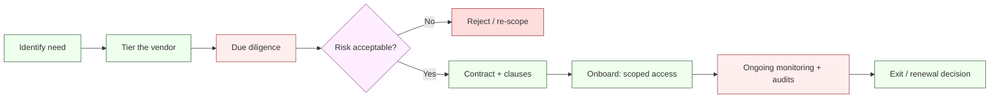

# Third-Party & Cloud Risk Management — NeoBank ZA

**Owner:** C02 Operations + C01 Legal-Compliance · **Contributors:** C12, C06, C10
**Version:** 1.0 · **Date:** 2026-10-16
**Related:** [`controls-catalog.md`](./controls-catalog.md) §8 · [`privacy-by-design.md`](./privacy-by-design.md) §6 · [`cryptography-and-key-management.md`](./cryptography-and-key-management.md) · [`incident-response.md`](./incident-response.md) · [`../../research/regulatory/banking-licensing.md`](../../research/regulatory/banking-licensing.md)

> **Objective.** Manage the risk that vendors, partners and cloud providers introduce to a regulated bank: **security, data protection, resilience, concentration and lawful exit** — while satisfying SA outsourcing and cross-border obligations.

---

## 1. Regulatory drivers

| Driver | Source | Weight |
|---|---|---|
| Banks must manage **operational risk incl. outsourcing**; the **PA** assesses risk-management, internal controls and IT systems at licensing and ongoing | [`banking-licensing.md`](../../research/regulatory/banking-licensing.md) §4-5 | [REG] / [REG-GUIDE] |
| **PA outsourcing/cloud directives** impose conditions on material outsourcing (notification, audit, continuity, exit) | SA banking supervision | **[REG-GUIDE] — text to confirm `[CONFIRM]`** |
| **POPIA:** the bank is the **responsible party**; vendors acting on our behalf are **operators** and require **written contracts** with confidentiality and security obligations; **cross-border** flows need a **s72 basis** | [`privacy-popia.md`](../../research/regulatory/privacy-popia.md) §6 | [STATUTE] |
| **FICA:** outsourced CDD/AML functions remain the bank's accountability (RMCP) | [`aml-fica.md`](../../research/regulatory/aml-fica.md) | [STATUTE] |
| **PCI-DSS:** service-provider requirements if card data in scope | PCI v4.0 | [REG-GUIDE] |
| **Payments:** rail/scheme participation and rulebook obligations (PASA→SARB transition) | [`payments-nps.md`](../../research/regulatory/payments-nps.md) §1 | [REG-GUIDE] |

---

## 2. Vendor lifecycle

---

## 3. Vendor tiering

| Tier | Definition | Examples | Due diligence depth | Review cadence |
|---|---|---|---|---|
| **T1 Critical/Material** | Failure stops money movement, breaches data at scale, or is material outsourcing | Cloud hosting, core ledger, payment rail, KYC vendor, HSM | Full: security, financial, regulatory, audit rights, exit | Annual |
| **T2 Important** | Significant impact; recoverable with effort | Fraud/AML tooling, bureau, SIEM, CDN | Substantial | Annual/triennial |
| **T3 Standard** | Limited impact | SaaS utilities, non-PII tools | Light | Biennial |
| **T4 Low** | Minimal risk, no data/money | Office tools | Self-attestation | As needed |

---

## 4. Due diligence

| Domain | Checks |
|---|---|
| **Security** | SOC 2 / ISO 27001 evidence, pen-test summaries, incident history, encryption, access controls |
| **Privacy** | DPA, sub-processor list, data flows, cross-border location, POPIA/operator terms |
| **Financial** | Stability, insurance, ownership, going-concern risk |
| **Regulatory** | Licences (FSCA/CASP/FIC where relevant), sanctions status, regulatory history |
| **Resilience** | BCP/DR, RTO/RPO, multi-region, dependency (fourth-party) exposure |
| **Concentration** | Share of our critical services; substitutability |
| **AML/CTF** | Whether the vendor is itself an accountable institution |
| **Data residency** | Where data is stored/processed/backed up/accessed from |

---

## 5. Right-to-audit & assurance

| Right | Detail | Weight |
|---|---|---|
| **Contractual audit right** | Bank (and its regulators) may audit the vendor | [REG-GUIDE] |
| **Regulator access** | PA/Regulator can access outsourcing arrangements & information | [REG-GUIDE] |
| **Evidence** | Accept SOC 2/ISO certifications + pen-test summaries; supplement with on-site/remote audit for T1 | [DESIGN] |
| **Audit reports** | Annual attestation; bridge letters where needed | [DESIGN] |
| **Test results** | Right to receive remediation evidence | [DESIGN] |
| **Sub-processors** | Right to approve/reject sub-processors | [STATUTE] POPIA onward transfer |

---

## 6. Data residency & cross-border

| Requirement | Design | Weight |
|---|---|---|
| **Prefer in-region (SA) processing** for C3/C4 personal data | Default residency = South Africa | [DESIGN] (supports s72) |
| **Any offshore flow** requires a **s72 basis** + transfer assessment | BCR/BCA/SCC/consent per case | [STATUTE] |
| **Encryption + pseudonymisation** for offshore processing | KMS/HSM keys retained in-region | [DESIGN] |
| **Onward transfer** protections | Vendor must flow down substantially-similar terms | [STATUTE] |
| **Transfer register** | Location, mechanism, approver, review date | [STATUTE] accountability |
| **Regulator access** to offshored data | Ensure audits/regulator access not obstructed | [REG-GUIDE] |

> POPIA has **no formal adequacy list**; adequacy is assessed **recipient-by-recipient** ([`privacy-by-design.md`](./privacy-by-design.md) §6). `[STATUTE]`

---

## 7. Concentration risk

| Risk | Control |
|---|---|
| Single provider for critical function | Multi-vendor / multi-region strategy; documented substitutability |
| Cloud concentration | Use abstraction layers; avoid provider-unique lock-in where critical |
| Aggregation across many services | Portfolio view of top vendors; board reporting |
| Shared dependency (common fourth party) | Map fourth parties; stress-test correlated failure |
| Cascading outage | Circuit breakers, degradation modes ([`incident-response.md`](./incident-response.md)) |

---

## 8. Exit strategy

| Element | Requirement |
|---|---|
| **Exit plan per T1 vendor** | Documented, tested, time-bound |
| **Data extraction** | Right to export data in usable format; no hostage clauses |
| **Data deletion** | Certified deletion on exit (POPIA disposal) |
| **Transition support** | Defined assistance period |
| **Continuity** | Alternative supplier pre-identified for critical functions |
| **Reversibility** | Exit test at least once for T1 |

---

## 9. Outsourcing rules (SARB PA) `[REG-GUIDE] — text `[CONFIRM]`**

| Principle | Practice |
|---|---|
| **Accountability stays with the bank** | Outsourcing a function does not outsource responsibility or regulatory obligation |
| **Material outsourcing** | Notify/seek PA comfort as required; evidence the PA's conditions are met |
| **Risk assessment before outsourcing** | Vendor risk, concentration, continuity, data protection |
| **Contract minimums** | Audit, access, confidentiality, security, continuity, exit, sub-processor control |
| **No outsourcing of core management/board duties** | Board/executive accountability cannot be outsourced |
| **Regulator access** | Regulators must retain access to data, systems and records |
| **Cloud specifics** | Address shared responsibility, data location, encryption/key custody, exit |

> The **exact PA outsourcing/cloud directive wording** must be confirmed before go-live; treat the above as supervision-aligned practice (`[CONFIRM]`).

---

## 10. Cloud shared-responsibility

| Layer | Bank | Cloud provider |
|---|---|---|
| Physical data-centre security | — | ✔ |
| Network fabric | — | ✔ |
| Hypervisor/managed service internals | — | ✔ |
| **IAM, key custody, config, data** | ✔ | — |
| **Patching of workloads, monitoring** | ✔ | — |
| **Compliance of the workload** | ✔ | — |

**Controls [DESIGN]:** policy-as-code baselines, CSPM (continuous config monitoring), key custody in HSM/KMS **owned by the bank**, per-environment isolation, egress controls, immutable logging to a bank-controlled store.

---

## 11. Contract clause checklist

- [ ] Scope & service levels (incl. security SLAs)
- [ ] Confidentiality & data-protection (operator terms per POPIA)
- [ ] Security baseline (encryption, access, patching, logging)
- [ ] Breach notification (timely, to enable **our** POPIA/FIC/PA duties)
- [ ] Right to audit + regulator access
- [ ] Data residency + cross-border (s72) clauses + onward transfer
- [ ] Sub-processor approval & flow-down
- [ ] Business continuity & DR commitments
- [ ] Exit & data return/deletion
- [ ] Liability, indemnity, insurance
- [ ] Compliance with applicable SA law
- [ ] Termination triggers (control failure, sanctions, insolvency)

---

## 12. Ongoing monitoring

| Activity | Cadence |
|---|---|
| Vendor risk review (T1) | Annual |
| Certification/attestation refresh | Annual |
| Incident & breach notification review | Per event |
| Sub-processor change review | Per change |
| Concentration dashboard | Quarterly |
| Exit-test (T1) | Annual |
| Sanctions screening of vendors | Continuous |

---

## 13. Verification & open items

| Verification | Cadence | Evidence |
|---|---|---|
| Vendor register completeness | Quarterly | Register |
| DPA/BCA coverage for all data vendors | Semi-annual | Contract register |
| Residency/transfer register review | Semi-annual | Register |
| PA outsourcing conditions check | On change + annual | Compliance note |

**Open [CONFIRM]/UNVERIFIED:** exact **PA outsourcing & cloud directive** text and any specific notification thresholds; whether a **"material outsourcing"** definition applies to each arrangement; final **non-bank payment framework** affects partners ([`payments-nps.md`](../../research/regulatory/payments-nps.md) §3); PCI **service-provider** obligations if cards in scope.
