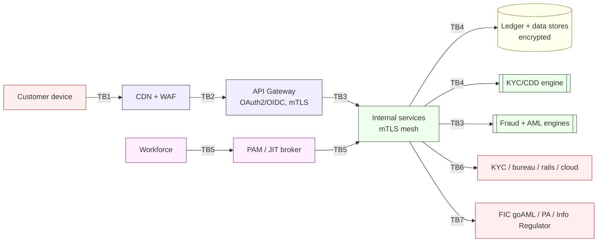
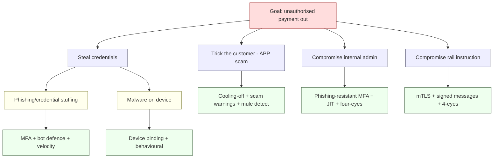

# STRIDE Threat Model — NeoBank ZA

**Owner:** C12 Cybersecurity-Intelligence · **Contributors:** C01, C06, C11, C16
**Method:** STRIDE per element across trust boundaries · **Version:** 1.0 · **Date:** 2026-10-16
**Related:** [`attack-surface-register.md`](./attack-surface-register.md) · [`controls-catalog.md`](./controls-catalog.md) · [`../../research/regulatory/aml-fica.md`](../../research/regulatory/aml-fica.md) · [`../../research/regulatory/privacy-popia.md`](../../research/regulatory/privacy-popia.md)

> **Evidence discipline.** Impact and likelihood are **engineering assessments [DESIGN]**, rated pre-mitigation. Residual risk is the *post-mitigation* estimate **with controls named**. All ratings are **UNVERIFIED** until validated by red-team exercises and the first pen-test cycle (see [`secure-sdlc.md`](./secure-sdlc.md)). Likelihood is not a legal conclusion.

**Rating scales**
- **Impact:** Critical (bank-threatening / regulatory sanction) · High · Medium · Low
- **Likelihood:** High (likely within 12 months) · Medium · Low (needs specific preconditions)
- **Residual:** Critical · High · Medium · Low (target: no *Critical* residual without board acceptance)

---

## 1. Scope, assets and assumptions

### 1.1 Assets (what we are protecting)

| Ref | Asset | Why it matters | Regulatory lens |
|---|---|---|---|
| A1 | **Ledger / core balances** | Integrity of every account balance; money truth | Banking Act prudent operations; audit |
| A2 | **Payment rails & settlement** | Movement of value; ISO 20022 / PayShap | NPS Act; PASA→SARB rulebook |
| A3 | **Customer PII & account data** | Identity, contact, transaction history | POPIA (special + financial personal info) |
| A4 | **CDD/KYC records & screening results** | Legal basis for the relationship | FICA s21–23 |
| A5 | **Credentials, tokens, keys, PINs** | Root of trust for access to money | PCI-DSS (PIN/CVV), POPIA (secrets) |
| A6 | **Admin / back-office consoles** | Privileged control of the bank | Least privilege; PAM |
| A7 | **Behavioural & device telemetry** | Fraud detection signal | POPIA (lawful basis, minimisation) |
| A8 | **Fraud/AML rule & model configs** | Detection efficacy; adversary gaming | FICA model governance |
| A9 | **Reporting pipelines to FIC / PA / Regulator** | Regulatory obligations | FICA (goAML), Banks Act (BA returns), POPIA |
| A10 | **Third-party integrations** | KYC, credit bureau, payments, cloud | Outsourcing rules; POPIA s72 |

### 1.2 Trust boundaries

| TB | Boundary | Between |
|---|---|---|
| TB1 | Device edge | Customer mobile/web ↔ Internet |
| TB2 | DMZ / WAF | Internet ↔ API gateway |
| TB3 | Service mesh | Gateway ↔ internal services (mTLS) |
| TB4 | Data boundary | Services ↔ core ledger & data stores |
| TB5 | Privileged boundary | Workforce ↔ admin/PAM plane |
| TB6 | Third-party boundary | Bank ↔ external vendors/rails |
| TB7 | Reporting boundary | Bank ↔ regulators |

### 1.3 Assumptions

- Mobile apps run on **not-fully-trusted** devices (rooted/jailbroken possible); we never trust client attestation alone.
- The cloud provider is a **shared-responsibility** partner; we own the workload, identity and data controls ([`third-party-and-cloud-risk.md`](./third-party-and-cloud-risk.md)).
- Payments partner with a **sponsoring bank** is in scope as A10 (see [`../../research/regulatory/payments-nps.md`](../../research/regulatory/payments-nps.md)).
- Insider threat is **in scope** — not just external attackers.

### 1.4 Out of scope (this iteration)

- Physical security of data-centre / offices (covered by partner/tenant controls).
- Nation-state zero-day exploitation as a primary driver (treated as residual/assume-breach).
- Crypto-asset custody specifics unless crypto is confirmed as in-product (see travel rule in [`aml-transaction-monitoring.md`](./aml-transaction-monitoring.md)).

---

## 2. STRIDE by domain

Legend for **Mitigations (C-IDs)** — see full definitions in [`controls-catalog.md`](./controls-catalog.md).
Mitigation short codes: `IAM` [`iam-and-secrets.md`](./iam-and-secrets.md) · `CRY` [`cryptography-and-key-management.md`](./cryptography-and-key-management.md) · `AMLT` [`aml-transaction-monitoring.md`](./aml-transaction-monitoring.md) · `FRD` [`fraud-risk-engine.md`](./fraud-risk-engine.md) · `PRIV` [`privacy-by-design.md`](./privacy-by-design.md) · `TP` [`third-party-and-cloud-risk.md`](./third-party-and-cloud-risk.md) · `SDLC` [`secure-sdlc.md`](./secure-sdlc.md) · `IR` [`incident-response.md`](./incident-response.md).

### 2.1 Mobile app (customer client) — TB1

| ID | STRIDE | Threat | Impact | Likelihood (pre) | Key mitigations | Residual |
|---|---|---|---|---|---|---|
| T-MOB-01 | Spoofing | Malware/keylogger captures credentials on compromised device | High | High | MFA + biometric gate (`IAM`), device binding, no secret storage on device (`CRY`), anomaly detection (`FRD`) | Medium |
| T-MOB-02 | Tampering | Repackaged/hooked app (Frida) bypasses client checks | High | Medium | Server-side enforcement (never trust client), app attestation as *signal only*, RASP, integrity checks (`SDLC`) | Medium |
| T-MOB-03 | Repudiation | Customer denies authorising a payment | Medium | Medium | Signed transaction intent + non-repudiable audit log; step-up (`IAM`); push-auth evidence (`CRY`) | Low |
| T-MOB-04 | Information disclosure | Local caches/screenshots leak PII/balances | High | Medium | POPIA minimisation + on-device encryption, block screenshots on sensitive screens, short cache TTL (`PRIV`,`CRY`) | Low |
| T-MOB-05 | Denial of service | Device DoS / client crash loops | Low | Low | Backend resilience; graceful degradation (`IR`) | Low |
| T-MOB-06 | Elevation of privilege | Client-side role flags trusted by backend | Critical | Low | Authorisation decisions server-side only; deny-by-default (`IAM`) | Low |

### 2.2 API gateway / edge — TB2/TB3

| ID | STRIDE | Threat | Impact | Likelihood (pre) | Key mitigations | Residual |
|---|---|---|---|---|---|---|
| T-API-01 | Spoofing | Stolen OAuth token replayed | High | High | Short-lived tokens + refresh rotation, sender-constrained tokens (DPoP/mTLS), token binding (`IAM`) | Low |
| T-API-02 | Tampering | Parameter tampering (amount/account substitution) | Critical | Medium | Server-side validation, idempotency keys, request signing, business-rule checks (`SDLC`,`CRY`) | Low |
| T-API-03 | Repudiation | Missing/forgeable audit trail on APIs | High | Low | Immutable append-only audit (WORM), correlation IDs (`IR`) | Low |
| T-API-04 | Info disclosure | Verbose errors expose internals; BOLA/BFLA data leaks | High | Medium | Centralized error handling, field-level authorisation, response filtering (`IAM`,`PRIV`) | Low |
| T-API-05 | DoS | Credential stuffing / L7 flood / API abuse | High | High | Rate limiting, bot defence, WAF, fraud velocity (`FRD`,`IR`) | Medium |
| T-API-06 | Elevation | Broken object-level authorisation (BOLA) → access others' accounts | Critical | Medium | Object-level authz tests, ABAC, per-request tenancy checks (`IAM`,`SDLC`) | Low |

### 2.3 Ledger / core banking — TB4

| ID | STRIDE | Threat | Impact | Likelihood (pre) | Key mitigations | Residual |
|---|---|---|---|---|---|---|
| T-LED-01 | Spoofing | Rogue service impersonates ledger service | Critical | Low | mTLS service identity, SPIFFE/workload identity (`CRY`,`IAM`) | Low |
| T-LED-02 | Tampering | Double-spend / unauthorised balance mutation | Critical | Medium | Immutable double-entry ledger, atomic posting + reconciliation, four-eyes for manual entries, hash-chaining (`AMLT` recon) | Low |
| T-LED-03 | Repudiation | Posted transaction disputed without evidence | High | Low | Tamper-evident transaction log, signed postings (`CRY`) | Low |
| T-LED-04 | Info disclosure | Ledger data exfil (PII + balances) | Critical | Medium | Encryption at rest (KMS/HSM), least-privilege DB roles, DLP, monitoring (`CRY`,`PRIV`) | Medium |
| T-LED-05 | DoS | Ledger unavailable → payments halt | Critical | Medium | HA/multi-AZ, queueing, DR with RTO/RPO (`IR`) | Medium |
| T-LED-06 | Elevation | Direct DB/schema access bypassing business rules | Critical | Low | No human prod DB access; JIT+PAM; break-glass logged; policy-as-code (`IAM`) | Low |

### 2.4 Payments / settlement — TB4/TB6

| ID | STRIDE | Threat | Impact | Likelihood (pre) | Key mitigations | Residual |
|---|---|---|---|---|---|---|
| T-PAY-01 | Spoofing | Forged payment instruction/callback from rail | Critical | Medium | mTLS + message signing on rails, callback authentication (`CRY`) | Low |
| T-PAY-02 | Tampering | Amount/beneficiary changed in transit or at rest | Critical | Medium | Signed payloads, end-to-end integrity, confirmation-of-payee (`FRD`,`CRY`) | Low |
| T-PAY-03 | Repudiation | Rail/partner denies a settlement instruction | High | Low | Non-repudiable signed messages, ISO 20022 evidence retention (`CRY`) | Low |
| T-PAY-04 | Info disclosure | Payment data leaks PII to third party | High | Medium | Tokenisation, data minimisation, DPA with rail (`PRIV`,`TP`) | Low |
| T-PAY-05 | DoS | Rail outage / mass retries | High | Medium | Circuit breakers, idempotent replay, reconciliation (`IR`) | Medium |
| T-PAY-06 | Elevation | Unauthorised initiation via cloned instruction | Critical | Low | Transaction signing, step-up, velocity + device binding (`IAM`,`FRD`) | Low |

### 2.5 KYC / onboarding — TB4/TB6

| ID | STRIDE | Threat | Impact | Likelihood (pre) | Key mitigations | Residual |
|---|---|---|---|---|---|---|
| T-KYC-01 | Spoofing | Synthetic identity / deepfake selfie / document forgery | High | High | Liveness + presentation-attack detection, doc authentication, cross-checks, sanctions/PEP (`AMLT`,`FRD`) | Medium |
| T-KYC-02 | Tampering | KYC data modified post-approval | High | Low | Immutable CDD record, four-eyes, audit (`AMLT`) | Low |
| T-KYC-03 | Repudiation | No proof of what was verified at onboarding | High | Low | Retained CDD evidence files (`AMLT`, retention `[CONFIRM]` ≥5y) | Low |
| T-KYC-04 | Info disclosure | KYC vendor leaks identity documents | High | Medium | Vendor due diligence + DPA + minimisation, in-region processing (`TP`,`PRIV`) | Medium |
| T-KYC-05 | DoS | Onboarding fraud bursts / vendor outage | Medium | Medium | Rate limits, fallback manual lane (`IR`,`FRD`) | Low |
| T-KYC-06 | Elevation | Fraudster self-approves KYC via client manipulation | High | Low | Server-side decisioning, no client authority (`IAM`,`AMLT`) | Low |

### 2.6 Admin / back-office — TB5

| ID | STRIDE | Threat | Impact | Likelihood (pre) | Key mitigations | Residual |
|---|---|---|---|---|---|---|
| T-ADM-01 | Spoofing | Stolen admin session | Critical | Medium | Phishing-resistant MFA, IP/device posture, short sessions (`IAM`) | Low |
| T-ADM-02 | Tampering | Rogue agent edits limits/balances/fraud config | Critical | Medium | Four-eyes, JIT, change audit, separation of duties (`IAM`,`FRD`) | Medium |
| T-ADM-03 | Repudiation | Admin action denied later | High | Low | Immutable privileged-action log, session recording (`IR`) | Low |
| T-ADM-04 | Info disclosure | Bulk export of customer data by staff | Critical | Medium | DLP, export quotas, watermarking, UEBA (`PRIV`,`FRD`) | Medium |
| T-ADM-05 | DoS | Admin plane overwhelmed/locked | Medium | Low | Isolated admin plane, HA (`IR`) | Low |
| T-ADM-06 | Elevation | Privilege escalation via misconfig/IAM | Critical | Medium | Least privilege, no standing admin, JIT, PAM, policy-as-code (`IAM`) | Low |

### 2.7 Third parties / integrations — TB6

| ID | STRIDE | Threat | Impact | Likelihood (pre) | Key mitigations | Residual |
|---|---|---|---|---|---|---|
| T-TP-01 | Spoofing | Vendor endpoint impersonation | High | Medium | mTLS, key pinning, vendor identity verification (`CRY`,`TP`) | Low |
| T-TP-02 | Tampering | MITM alters vendor data in transit | High | Low | TLS 1.3 + mTLS, integrity checks (`CRY`) | Low |
| T-TP-03 | Repudiation | Vendor denies an action/the bank denies vendor instructions | Medium | Low | Contractual + technical non-repudiation (`CRY`,`TP`) | Low |
| T-TP-04 | Info disclosure | Vendor breach exposes bank/customer data | Critical | Medium | Due diligence, DPA, residency, breach clauses, SOC2 evidence (`TP`,`PRIV`) | Medium |
| T-TP-05 | DoS | Concentration: single vendor outage blocks onboarding/payments | High | Medium | Multi-vendor strategy, exit plan, degradation mode (`TP`) | Medium |
| T-TP-06 | Elevation | Vendor over-scoped access into bank systems | Critical | Medium | Scoped, time-boxed vendor access; no standing prod access (`IAM`,`TP`) | Low |

### 2.8 Insider threat — all TBs

| ID | STRIDE | Threat | Impact | Likelihood (pre) | Key mitigations | Residual |
|---|---|---|---|---|---|---|
| T-INS-01 | Spoofing | Employee shares credentials / account takeover | Critical | Medium | MFA + device posture, no sharing, anomaly alerts (`IAM`) | Medium |
| T-INS-02 | Tampering | Fraudulent manual ledger adjustment or refund | Critical | Medium | Four-eyes, limits, JIT, reconciliation, forensic audit (`AMLT`,`IAM`) | Medium |
| T-INS-03 | Repudiation | Privileged action without accountability | High | Low | Session recording, immutable logs, legal hold (`IR`) | Low |
| T-INS-04 | Info disclosure | Data theft before leaving / staging | Critical | Medium | DLP + UEBA + least privilege + offboarding SLA (`IAM`,`PRIV`) | Medium |
| T-INS-05 | DoS | Sabotage of systems/data | Critical | Low | Segregation of duties, backups + immutability, break-glass (`IR`) | Low |
| T-INS-06 | Elevation | Abuse of standing privileges | Critical | Medium | Remove standing admin, JIT elevation, approval trails (`IAM`) | Low |

---

## 3. Cross-cutting threat themes

| Theme | Why it matters | Where handled |
|---|---|---|
| **Scam / authorised push payment (APP) fraud** (customer tricked into authorising) | Not a "hack" — needs friction, warnings, cooling-off, mule detection | [`fraud-risk-engine.md`](./fraud-risk-engine.md) |
| **Money-mule networks** | Layering proceeds; FICA obligation to detect/suspect | [`fraud-risk-engine.md`](./fraud-risk-engine.md), [`aml-transaction-monitoring.md`](./aml-transaction-monitoring.md) |
| **Account takeover (ATO)** | Credential + device fraud combined | [`iam-and-secrets.md`](./iam-and-secrets.md), [`fraud-risk-engine.md`](./fraud-risk-engine.md) |
| **Supply chain** (dependencies, CI, MSP) | Compromise of build or vendor | [`secure-sdlc.md`](./secure-sdlc.md), [`third-party-and-cloud-risk.md`](./third-party-and-cloud-risk.md) |
| **Regulatory data exfil** | CDD/AML data is high-value and sensitive | [`privacy-by-design.md`](./privacy-by-design.md), [`incident-response.md`](./incident-response.md) |

---

## 4. Attack trees (illustrative)

---

## 5. Verification & maintenance

| Activity | Cadence | Owner | Evidence |
|---|---|---|---|
| Threat model review (design changes) | Per major release / quarterly | C12 | Review log |
| Red-team / adversarial exercise | Annual (plus pre-launch) | C12 | Red-team report |
| Penetration test (external + internal + API) | Pre-launch, then annual ([`secure-sdlc.md`](./secure-sdlc.md)) | C12 | Pen-test report → remediation |
| Residual-risk board acceptance for any Critical | On identification | C12 → Board | Risk acceptance memo |
| Control efficacy regression (detection rules/models) | Continuous | C12 + C16/C01 | Metrics in [`fraud-risk-engine.md`](./fraud-risk-engine.md) |

**Escalation:** any newly discovered **Critical** threat follows the Stremiium SLA (Critical 1h) into [`incident-response.md`](./incident-response.md).
