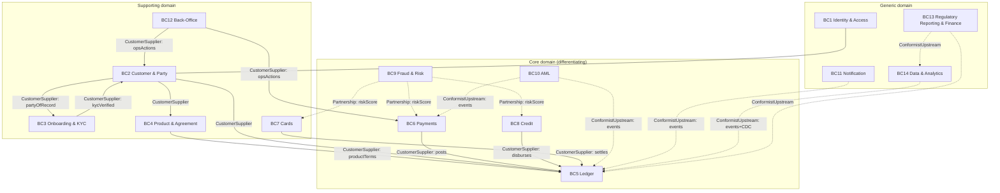

# Bounded Contexts & Context Map (DDD)

**Parent:** [system-design/README.md](./README.md) · **Status:** Proposed (v0.1) · **As-of:** 2026-10-16.

This file partitions the Umoya domain into **bounded contexts**, defines each context's responsibility and ubiquitous language, and specifies the **relationships** between contexts (upstream/downstream, shared kernel, anti-corruption layers, conformist, customer/supplier). It is the DDD justification for the service seams in the [container diagram](./container-diagram.md) and the aggregate boundaries in [domain-model/aggregates](../domain-model/aggregates.md).

Everything here is a **DESIGN CHOICE**. The domain language is fixed in [domain-model/entities](../domain-model/entities.md).

---

## 1. Why bounded contexts (and why not one big model)

A bank has one word — "account" — that means at least four different things (a bank account product, a ledger account, a card account, a login account). Forcing one model onto all of them creates a tangle. Bounded contexts let each part of the business own its own precise language and evolve independently, while the **context map** makes the couplings explicit instead of accidental.

Our rule of thumb: **align a context to a team and a data ownership boundary.** If two contexts cannot be changed independently, they are one context.

---

## 2. Context inventory

| # | Context | Core responsibility | Owning container(s) |
|---|---|---|---|
| BC1 | **Identity & Access** | Who a *user/session* is; authentication, authorisation, consent grants. | C6 |
| BC2 | **Customer & Party** | Who our *customer/party* is; relationships, contact, lifecycle. | C7 |
| BC3 | **Onboarding & KYC** | Verifying identity & eligibility; producing a KYCProfile. | C13 |
| BC4 | **Product & Agreement** | What we *sell*; products, pricing, agreements, mandates. | C9 |
| BC5 | **Ledger (Accounts & Posting)** | The book of record for money; accounts, balances, postings. | C8 |
| BC6 | **Payments** | Moving value to/from external rails and internally. | C10 + C11 |
| BC7 | **Cards** | Card lifecycle, authorisation, clearing. | C12 |
| BC8 | **Credit & Lending** | Origination, decisioning, servicing of credit. | C16 |
| BC9 | **Fraud & Risk** | Real-time fraud scoring and risk decisions. | C14 |
| BC10 | **AML / Financial Crime** | Monitoring, alerts, regulatory reporting. | C15 |
| BC11 | **Notification** | Outbound customer comms. | C17 |
| BC12 | **Back-Office / Servicing** | Operations, disputes, casework, overrides. | C18 |
| BC13 | **Regulatory Reporting & Finance** | BA returns, AEOI, finance/GL close. | Data Platform (C22) + Finance |
| BC14 | **Data & Analytics** | Analytical products, ML features/labels. | C22 |

> **Terminology guard.** "Account" in BC5 = ledger account. "Account" in BC4/BC2 = customer-facing banking account. They are linked but never the same type.

---

## 3. The context map

Legend: `-->` Customer/Supplier (upstream provides), `-.->` downstream consumer / conformist, `---` shared kernel. The ACL boundaries are drawn in §5.

---

## 4. Relationship catalogue

| Upstream | Downstream | Pattern | Why *(DESIGN CHOICE)* |
|---|---|---|---|
| BC4 Product & Agreement | BC5 Ledger | **Customer/Supplier** | Ledger needs product terms to know which accounts to open and how to post. Product is closer to business change. |
| BC2 Customer & Party | BC5 Ledger | **Customer/Supplier** | Ledger references the customer/party, never owns it. |
| BC6 Payments | BC5 Ledger | **Customer/Supplier** | Payments **instructs** postings; Ledger is the only writer. |
| BC8 Credit | BC5 Ledger | **Customer/Supplier** | Credit instructs disbursement/repayment postings. |
| BC7 Cards | BC5 Ledger | **Customer/Supplier** | Cards instruct settlement postings. |
| BC9 Fraud & Risk | BC6, BC7, BC8 | **Partnership** | Real-time scoring is co-designed with the flows that consume it; latency budget is shared. |
| BC5, BC6, BC8 | BC10 AML | **Conformist / Published Language** | AML consumes canonical domain events; AML must not force Ledger to change. |
| BC5, BC6 | BC11 Notification | Consumer (Conformist) | Notifications react to events. |
| BC5, BC6, BC7, BC8 | BC14 Data & Analytics | Consumer (Conformist) | Analytics follows events/CDC; never drives operational change. |
| BC1 Identity | BC2 Customer | **Shared Kernel (minimal)** | A tiny shared identity/party reference ID. Kept deliberately thin. |
| BC4 Product | BC5 Ledger | **Shared Kernel (money type)** | The `Money` value object + currency rules are a shared kernel across all money contexts. See [money-and-currency](../domain-model/money-and-currency.md). |

**Anti-corruption layers (ACLs).** Every *external* system is an ACL boundary (see §5). *Internal* context boundaries use the patterns above; we do **not** put heavy ACLs between internal contexts — that would be over-engineering. We rely on explicit contracts and events.

---

## 5. Anti-corruption layer map (external edges only)

Each external system below is wrapped by an adapter that translates between the vendor's model and our canonical model. The domain never imports a vendor type. Details in [integrations/README](../integrations/README.md).

| External system | ACL adapter | Protects context | Canonical model exposed |
|---|---|---|---|
| DHA/ABIS | ID-verification adapter | BC3 | `IdentityVerificationResult` |
| KYC/liveness vendor | KYC adapter | BC3 | `DocumentVerification`, `LivenessResult` |
| Sanctions/PEP provider | Screening adapter | BC3, BC10 | `ScreeningMatch[]` |
| Credit bureaus | Bureau adapters | BC3, BC8 | `CreditReport`, `AffordabilityData` |
| Bank account verification | BAV adapter | BC8, BC6 | `AccountVerification` |
| PayShap | PayShap adapter | BC6 | `PaymentInstruction`, `PaymentStatus` |
| EFT/AC, RTC | Clearing adapter(s) | BC6 | `BatchPayment`, `ReturnItem` |
| Card schemes | Scheme adapter | BC7 | `AuthRequest`, `ClearingRecord` |
| Sponsor bank | Sponsor adapter | BC6, BC7 | `SettlementInstruction` |
| FIC/goAML | Reporting adapter | BC10 | `RegulatoryReport` |
| PA/FSCA/SARS | Reporting adapters | BC13 | `BAReturn`, `AEOIRecord` |

---

## 6. Context-by-context detail

### BC1 — Identity & Access
- **Ubiquitous language:** Principal, Credential, Session, Device, Role, Entitlement, ConsentGrant, WorkloadIdentity.
- **Owns:** user identities, credentials, sessions, authorisation policy, consent records.
- **Does not own:** who the *customer* is (that is BC2). A principal maps to a party by reference.
- **Key events:** `UserAuthenticated`, `StepUpCompleted`, `ConsentGranted`, `ConsentRevoked`.

### BC2 — Customer & Party
- **Ubiquitous language:** Party, Customer, Person, Organisation, BeneficialOwner, Relationship, ContactPoint, KYCStatus.
- **Owns:** the customer/party master, relationships, contacts, lifecycle state.
- **Conformity:** consumes BC3's verification outcomes as a KYCProfile reference.
- **Key events:** `CustomerOnboarded`, `PartyLinked`, `ContactUpdated`, `CustomerClosed`.

### BC3 — Onboarding & KYC
- **Ubiquitous language:** Verification, Screening, KYCProfile, RiskRating inputs, Decision, ReasonCode.
- **Owns:** verification/screening processes and their ephemeral artefacts; emits outcomes.
- **Key events:** `IdentityVerified`, `ScreeningCompleted`, `KYCProfileCreated`, `OnboardingDeclined`.

### BC4 — Product & Agreement
- **Ubiquitous language:** Product, ProductVersion, Fee, InterestRate, Agreement, TermsVersion, Mandate.
- **Owns:** catalogue of products, pricing/versioning, accepted agreements, collection mandates.
- **Key events:** `ProductPublished`, `AgreementAccepted`, `MandateRegistered`, `MandateRevoked`.

### BC5 — Ledger (Accounts & Posting)
- **Ubiquitous language:** LedgerAccount, Account, Balance, LedgerEntry, Transaction, Journal, Posting, ReconBreak.
- **Owns:** the immutable book of record and derived balances.
- **Key events:** `AccountOpened`, `TransactionPosted`, `BalanceAdjusted`, `ReconBreakDetected`.

### BC6 — Payments
- **Ubiquitous language:** Payment, PaymentInstruction, Rail, Beneficiary, Return, Recall, Settlement.
- **Owns:** payment lifecycle and rail orchestration.
- **Key events:** `PaymentInitiated`, `PaymentSettled`, `PaymentFailed`, `PaymentReturned`.

### BC7 — Cards
- **Ubiquitous language:** Card, PAN, Token, Authorisation, Hold, ClearingRecord, Chargeback.
- **Owns:** card lifecycle and authorisation/clearing.
- **Key events:** `CardIssued`, `CardBlocked`, `AuthorisationApproved`, `CardSettled`.

### BC8 — Credit & Lending
- **Ubiquitous language:** Application, Affordability, Decision, Offer, Loan, Instalment, Arrears.
- **Owns:** origination, decisioning, servicing.
- **Key events:** `CreditApplicationReceived`, `CreditDecisionMade`, `LoanDisbursed`, `RepaymentReceived`, `AccountInArrears`.

### BC9 — Fraud & Risk
- **Ubiquitous language:** RiskScore, Signal, Rule, Model, Hold, Decision.
- **Owns:** real-time scoring and risk decisions; **does not** own case investigations (BC10) but shares alerts.
- **Key events:** `FraudSignalRaised`, `PaymentHeld`, `RiskScoreComputed`.

### BC10 — AML / Financial Crime
- **Ubiquitous language:** Alert, Case, Suspicion, STR, CTR, TPR, CustomerRiskRating.
- **Owns:** monitoring, cases, regulatory report pipeline.
- **Key events:** `AmlAlertRaised`, `CaseClosed`, `ReportSubmitted`.

### BC11 — Notification
- **Ubiquitous language:** Template, Channel, Message, DeliveryReceipt.
- **Owns:** outbound comms. Idempotent, rate-limited.
- **Key events:** `NotificationRequested`, `NotificationDelivered`, `NotificationFailed`.

### BC12 — Back-Office / Servicing
- **Ubiquitous language:** Case, Ticket, Dispute, Chargeback, ManualReview, Override, Complaint.
- **Owns:** human workflows; all overrides are dual-control and audited.
- **Key events:** `ManualReviewCompleted`, `DisputeRaised`, `OverrideApplied`.

### BC13 — Regulatory Reporting & Finance
- **Ubiquitous language:** BAReturn, GLClose, Provision, AEOIReport, PillarIIIDisclosure.
- **Owns:** statutory submissions and finance close. Consumes from BC5/BC14.
- **Key events:** `BAReturnGenerated`, `AEOISubmitted`, `PeriodClosed`.

### BC14 — Data & Analytics
- **Ubiquitous language:** Dataset, Metric, Feature, Label, Model run, Lineage.
- **Owns:** analytical products; no operational writes back to the core.
- **Key events:** `DatasetUpdated`, `ModelScored`, `MetricPublished`.

---

## 7. Shared kernels (used sparingly)

| Shared kernel | Contents | Why it is safe to share *(DESIGN CHOICE)* |
|---|---|---|
| **Money & Currency** | `Money(minorUnits, currency)`, ZAR rules, rounding. | Stable, universally agreed value semantics. See [money-and-currency](../domain-model/money-and-currency.md). |
| **Identity references** | `PartyId`, `CustomerId`, `AccountId`, `CorrelationId`. | Plain identifiers, no behaviour. |
| **Time & calendar** | SAST business-calendar helpers. | Needed for interest/limits across contexts. |

We deliberately keep the shared kernel **tiny** and free of business rules that would couple contexts.

---

## 8. Ownership & Conway's Law

We consciously align contexts to teams to avoid a "distributed monolith":

| Context cluster | Team *(DESIGN CHOICE)* |
|---|---|
| BC5 Ledger + BC4 Product | "Money Core" team |
| BC6 Payments + BC7 Cards + BC11 Notification | "Payments" team |
| BC2 Customer + BC3 KYC + BC1 Identity | "Customer & Identity" team |
| BC8 Credit + BC9 Fraud + BC10 AML | "Risk & Credit" team |
| BC12 Back-Office + BC13 Reporting + BC14 Data | "Operations & Data" team |
| Platform (C4/C19/C22 infra/C24/C26) | "Platform/Infrastructure" team (C06) |

If a change forces two teams to coordinate on every release, we reconsider the boundary.

---

## 9. Evolution rules

- Contexts can **split** when a sub-language emerges; they rarely merge.
- New external systems are added as **ACLs only** — never by importing their model into a context.
- Crossing context boundaries is always via **published API or event**, never a database join.
- The `Money` shared kernel changes require sign-off from the Money Core team **and** the Platform team.

---

## 10. Related reading

- [domain-model/entities.md](../domain-model/entities.md) — the entities living inside these contexts.
- [domain-model/aggregates.md](../domain-model/aggregates.md) — aggregate boundaries within contexts.
- [domain-model/domain-events.md](../domain-model/domain-events.md) — the published language flowing between contexts.
- [container-diagram.md](./container-diagram.md) — how contexts map to deployable containers.
