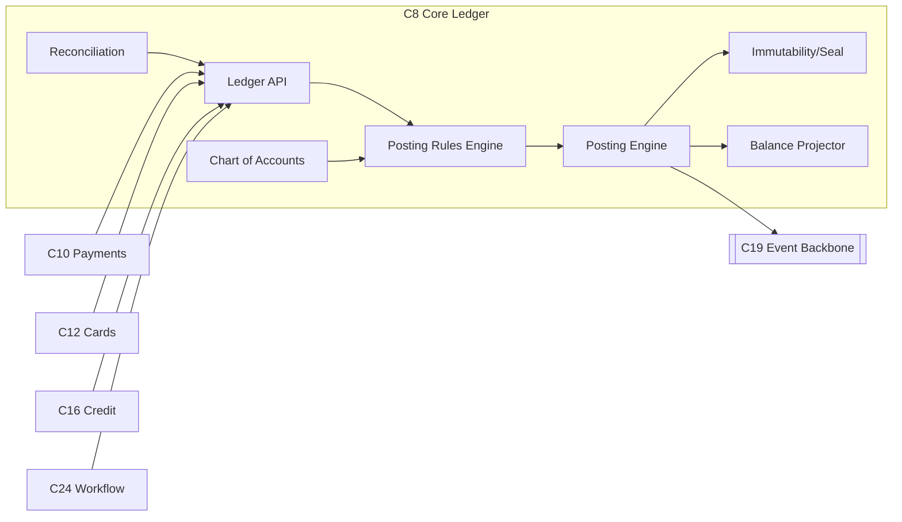
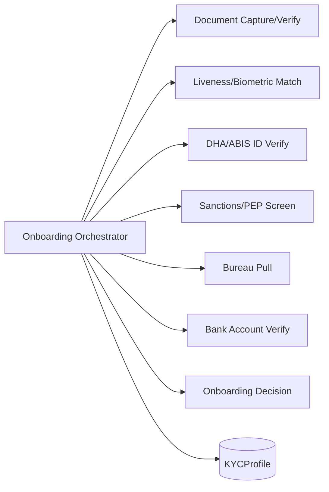

# C4 Level 3 — Component Map

**Parent:** [system-design/README.md](./README.md) · **Container view:** [container-diagram.md](./container-diagram.md) · **Status:** Proposed (v0.1).

This is the **C4 L3** view: the notable components *inside* the key containers, their responsibilities, and their collaborators. We document components only for the containers where decomposition matters for ownership and safety (ledger, payments, KYC, cards, AML, credit, identity, data). Everything here is a **DESIGN CHOICE**.

> **Notation.** Each component is `Name — responsibility → collaborators`. "Component" = a cohesive unit of code with a stable interface, *not* a separate deployable (that would be L2). Unless noted, components communicate in-process and expose behaviour via the container's API/events.

---

## 1. C8 — Core Ledger Service (most safety-critical)

| Component | Responsibility | Collaborators |
|---|---|---|
| **Ledger API** | Canonical interface to post transactions and query balances/statements. Validates shape of a `Transaction`. | Payments, Cards, Credit, Workflow, Recon. |
| **Posting Rules Engine** | Applies double-entry rules: for a transaction type, which LedgerAccounts are debited/credited; enforces debits=credits per currency. ([ledger-model](../domain-model/ledger-model.md)) | Chart of Accounts, Posting Engine. |
| **Chart of Accounts** | The account taxonomy (asset/liability/equity/income/expense) and mapping from product/account to ledger accounts. | Rules Engine, Product Service (C9). |
| **Posting Engine** | Writes balanced LedgerEntries atomically; assigns sequence numbers; guarantees single-writer semantics. | Immutability/Seal, Balance Projector, Event Bus. |
| **Immutability/Seal** | Hash-chains each journal/day; prevents mutation; produces tamper evidence for audit. | Posting Engine, Audit Store. |
| **Balance Projector** | Derives current/available balances from entries; maintains materialised balances for fast reads; supports as-of queries. | Posting Engine, Cache (C21). |
| **Reconciliation** | Continuously reconciles internal ledger ↔ external statements (rails, schemes, sponsor, bureau of settlement). Flags breaks. | Rail Adapters (C11), Back-Office (C18). |
| **Statement/Advice Generator** | Produces customer statements and regulatory extracts from entries. | Data Platform, Notification (C17). |

**Invariants enforced here:** every transaction balances; entries are immutable; balances never mutated directly; every posting is attributed to a business transaction and an actor. See [aggregates](../domain-model/aggregates.md) §Ledger.

---

## 2. C10 — Payments Service

| Component | Responsibility | Collaborators |
|---|---|---|
| **Payment API / Intake** | Accepts customer/partner payment requests; validates request shape and idempotency key. | BFF (C5), Gateway (C4). |
| **Payment Orchestrator** | Drives the payment state machine: validate → screen → reserve funds → dispatch → await settlement → post. | Workflow (C24), Ledger API, Fraud (C14), AML (C15). |
| **Limits & Eligibility** | Enforces per-product, per-customer, per-day limits and rail eligibility. | Product Service (C9), Identity (C6). |
| **Funds Reservation** | Requests a hold/reservation in the ledger so a pending payment is reflected immediately. | Ledger API. |
| **Rail Router** | Chooses the rail (PayShap / EFT / RTC / internal) per cost/latency/eligibility policy. | Rail Adapters (C11). |
| **Status Tracker** | Maintains payment lifecycle state and emits `PaymentInitiated`/`PaymentSettled`/`PaymentFailed`. | Event Bus, Notification. |
| **Batch/File Payments** | Handles bulk (salary, debit-order) files with validation and per-line status. | Workflow, Rail Adapters. |
| **Return/Reversal Handler** | Processes rail returns, reversals, and recall requests. | Reconciliation, Back-Office. |

Detail on rails is in [payments-rails](../integrations/payments-rails.md).

---

## 3. C13 — KYC / Onboarding Service

| Component | Responsibility | Collaborators |
|---|---|---|
| **Onboarding Orchestrator** | Runs the verification pipeline with retries, timeouts and degraded modes. Produces a KYCProfile. | ACL adapters, Customer/Party (C7). |
| **Document Capture/Verify** | Validates ID/passport documents (authenticity, expiry, data extraction). | KYC vendor adapter. |
| **Liveness / Biometric Match** | Confirms a live human matches the document. *(Special personal information under POPIA — explicit consent.)* | Liveness vendor adapter. |
| **DHA/ABIS ID Verify** | Verifies SA identity against Home Affairs. | DHA adapter. |
| **Sanctions / PEP Screen** | Screens against TFS/PEP lists at onboarding and on trigger. | Screening adapter; AML (C15). |
| **Bureau Pull** | Fetches credit/affordability data. | Bureau adapters. |
| **Bank Account Verify** | Confirms an external account's owner/number. | BAV adapter. |
| **Onboarding Decision** | Assembles risk signals into approve/review/decline with reason codes (human-in-loop for review). | Fraud (C14), Back-Office (C18). |

Full provider detail: [kyc-and-identity](../integrations/kyc-and-identity.md).

---

## 4. C12 — Cards Service

| Component | Responsibility | Collaborators |
|---|---|---|
| **Card Lifecycle** | Issue, activate, block/unblock, replace, close; manages status and limits. | Product Service, Ledger. |
| **Tokenisation / Wallet** | Provisions cards to wallets (Apple/Google Pay) with token management. | Scheme adapters. |
| **Authorisation Hook** | Real-time decision to approve/decline an authorisation, incorporating fraud score and available funds. | Fraud (C14), Ledger (available balance). |
| **PIN Management** | Secure PIN set/change; HSM-backed. | Vault/HSM (C26). |
| **Clearing & Settlement** | Consumes scheme clearing files; posts settlement to ledger; handles interchange/fees. | Rail Adapters, Ledger, Reconciliation. |
| **Disputes/Chargeback** | Raises/tracks chargebacks per scheme rules. | Back-Office (C18). |

---

## 5. C15 — AML / Financial-Crime Service

| Component | Responsibility | Collaborators |
|---|---|---|
| **Transaction Monitoring** | Rules + ML detect suspicious patterns; emits `AmlAlertRaised`. | Event Bus, Fraud (C14), Data Platform. |
| **Customer Risk Scoring** | Maintains a risk rating per customer driving EDD. | KYC (C13), Customer (C7). |
| **Case Management** | Investigates alerts; records decisions and rationale. | Back-Office (C18). |
| **STR/CTR/TPR Pipeline** | Generates and submits the **four reports** within statutory windows. | goAML adapter, Workflow. |
| **TFS Screening Loop** | Continuous re-screening against updated lists. | Screening adapter. |
| **Crypto Travel-Rule** *(if crypto enabled)* | Originator/beneficiary data on crypto transfers (zero-threshold). | Crypto adapter. |

Regulatory deadlines referenced from [aml-fica](../../research/regulatory/aml-fica.md) §3.4.

---

## 6. C16 — Credit Service

| Component | Responsibility | Collaborators |
|---|---|---|
| **Application Intake** | Captures application; validates completeness. | BFF, Customer (C7). |
| **Affordability Assessment** | Assesses discretionary income (NCA-aligned); consumes bureau + bank-account data. | Bureau adapter, BAV. |
| **Decisioning** | Scorecard/policy engine → approve/decline/limit; explainable reason codes. | Fraud (C14), Data/ML (C22). |
| **Offer & Agreement** | Generates offer; binds via Agreement/Mandate. | Product Service (C9). |
| **Disbursement** | Instructs ledger/payments to disburse. | Ledger, Payments (C10). |
| **Servicing** | Repayment schedules, interest/fees, arrears, restructuring. | Workflow (C24), Ledger. |
| **Reckless-Credit Guardrails** | Enforces pre-agreement assessment and flags reckless-credit risk. | Compliance rules. |

NCA context: [conduct-fais-nca](../../research/regulatory/conduct-fais-nca.md) §3.

---

## 7. C6 — Identity & Access Service

| Component | Responsibility | Collaborators |
|---|---|---|
| **Identity Provider (OIDC)** | Issues/validates tokens; manages credentials (passkeys first). | All services, Gateway. |
| **Authentication Methods** | FIDO2/passkeys, OTP, step-up for money movement. | App (C1), Notification (C17). |
| **Authorisation Engine** | RBAC/ABAC policy decisions; customer↔account entitlements; staff roles with segregation of duties. | All services. |
| **Consent/Authorisation Grants** | Records data-sharing and payment-initiation consents (open finance-ready). | [open-banking-and-open-finance](../integrations/open-banking-and-open-finance.md). |
| **Session & Device Registry** | Tracks devices, sessions, risk signals; supports forced logout. | Fraud (C14). |
| **Workload Identity** | Issues short-lived service identities for mTLS. | Service mesh, Vault. |

---

## 8. C22 — Data Platform (analytical components)

| Component | Responsibility | Collaborators |
|---|---|---|
| **Ingestion (CDC + streams)** | Streams OLTP changes and domain events into the lakehouse. | Event Bus, OLTP stores. |
| **Raw / Curated Zones** | Medallion (bronze/silver/gold) layering with PII masking per zone. | [data-model](../data/data-model.md). |
| **Semantic Layer** | Governed metric definitions (e.g. "active customer", "arrears"). | BI, reporting. |
| **Regulatory Reporting Mart** | BA returns and AEOI extracts. | [analytics-and-reporting](../data/analytics-and-reporting.md). |
| **Feature Store** | Serves ML features online/offline. | [ai-and-ml](../data/ai-and-ml.md). |
| **Data Quality & Lineage** | Tests, freshness checks, column-level lineage. | [data-governance](../data/data-governance.md). |

---

## 9. Component interaction matrix (who calls whom)

| Caller ↓ / Callee → | Ledger | Payments | KYC | Cards | Fraud | AML | Credit | Identity |
|---|---|---|---|---|---|---|---|---|
| Payments | ● post/hold | — | | | ● score | ● monitor | | ● authz |
| Cards | ● settle | | | — | ● auth | ● monitor | | ● authz |
| Credit | ● disburse | ● payout | | | ● score | | — | ● authz |
| KYC | | | — | | ● risk | ● screen | | ● consent |
| Back-Office | ● adj (compensating) | ● investigate | ● review | ● disputes | | ● cases | ● service | ● authz |
| BFF | | ● pay | ● onboard | ● card | | | ● apply | ● login |

`●` = a live dependency (via API and/or events). No callee reaches back into a caller's database.

---

## 10. Boundaries and anti-patterns (guardrails)

- **No shared database.** A component never reads another context's tables ([bounded-contexts](./bounded-contexts.md) §4).
- **No money mutation outside the ledger.** Balance changes are postings, full stop.
- **No vendor types in the domain.** Adapters translate; the domain sees only canonical types ([integrations/README](../integrations/README.md) §4).
- **No business logic in the BFF or app.**
- **No un-audited PII access.** Access goes through components that emit audit events.

---

## 11. Related reading

- [bounded-contexts.md](./bounded-contexts.md) — the contexts these components realise.
- [domain-model/aggregates.md](../domain-model/aggregates.md) — the invariants these components must protect.
- [non-functional-requirements.md](./non-functional-requirements.md) — the targets these components are measured against.
- [technology-selection.md](./technology-selection.md) — the frameworks realising each component.
