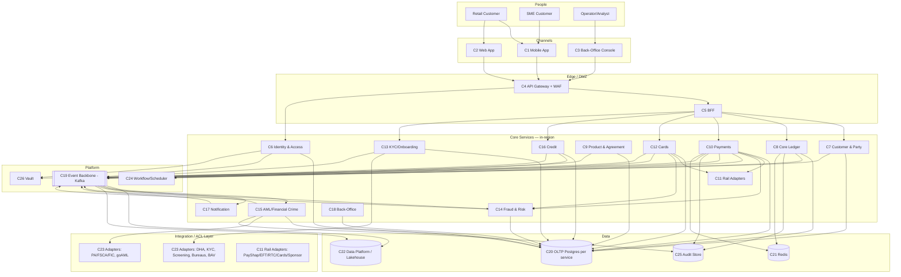

# C4 Level 2 — Container Diagram

**Parent:** [system-design/README.md](./README.md) · **Status:** Proposed (v0.1) · **As-of:** 2026-10-16.
**Perspective:** zoom into the Umoya platform to show the **deployable/executable units** (containers in the C4 sense — apps, services, datastores, queues) and how they communicate.

> Everything below is a **DESIGN CHOICE**. Container *names* are intentionally stable so that the [component map](./component-map.md) and [bounded contexts](./bounded-contexts.md) can reference them consistently. Vendor products realising these containers are in [technology-selection](./technology-selection.md).

---

## 1. Container inventory

| # | Container | Type | Owns data? | Notes |
|---|---|---|---|---|
| C1 | Mobile App (iOS/Android) | App (React Native or native) | No | Retail + SME self-service. |
| C2 | Web App | SPA | No | Same BFF as mobile. |
| C3 | Back-Office Console | SPA | No | Operator/analyst tooling. |
| C4 | API Gateway | Edge service | No | WAF, routing, authN, rate-limit. |
| C5 | BFF (Backend-for-Frontend) | Service | No | Channel-specific aggregation. |
| C6 | Identity & Access Service | Service | Yes | Customers + staff; OIDC/OAuth2. |
| C7 | Customer & Party Service | Service | Yes | Customer/party/KYC profile lifecycle. |
| C8 | Core Ledger Service | Service | Yes (append-only) | Accounts, balances, double-entry postings. |
| C9 | Product & Agreement Service | Service | Yes | Products, pricing, agreements, mandates. |
| C10 | Payments Service | Service | Yes | Internal + external payments orchestration. |
| C11 | Rail Adapters (PayShap/EFT/RTC/Cards) | Service(s) | No | ACLs to external rails. |
| C12 | Cards Service | Service | Yes | Issuing, lifecycle, authorisation hooks. |
| C13 | KYC/Onboarding Service | Service | Yes | Orchestrates verification & screening. |
| C14 | Fraud & Risk Service | Service | Yes | Real-time scoring, rules, case flags. |
| C15 | AML/Financial-Crime Service | Service | Yes | Monitoring, alerts, STR/CTR/TPR pipeline. |
| C16 | Credit Service | Service | Yes | Origination, affordability, servicing. |
| C17 | Notification Service | Service | Light | SMS/email/push/in-app. |
| C18 | Back-Office Service | Service | Light | Case mgmt, disputes, servicing workflows. |
| C19 | Event Backbone (Kafka) | Message broker | No | Domain-event fabric. |
| C20 | Ledger/OLTP Datastores | PostgreSQL (per service) | Yes | ACID stores; ledger separate. |
| C21 | Cache & Session (Redis) | Datastore | Transient | Rate-limit, sessions, idempotency. |
| C22 | Data Platform (Lakehouse) | Data platform | Yes | Analytics, warehouse, reporting. |
| C23 | Integration/ACL Layer | Services | No | One adapter per external system. |
| C24 | Scheduler/Workflow Engine | Service | Yes | Sagas, batch, retries, jobs. |
| C25 | Audit & Evidence Store | Datastore (append-only) | Yes | Tamper-evident audit stream. |
| C26 | Secrets & Config (Vault) | Infra service | Yes | Secrets, dynamic creds. |

---

## 2. Mermaid — C4 Container diagram

> The Mermaid above is a **flowchart-shaped** container view (Mermaid's `C4Container` lacks some fidelity we want for the audit/data edges). The authoritative edge semantics are in §3.

---

## 3. Interaction catalogue (key edges)

| From → To | Protocol | Intent *(DESIGN CHOICE)* |
|---|---|---|
| App/Web/Console → API Gateway | HTTPS/TLS 1.3, OAuth2/OIDC | Authenticate, route, throttle, WAF. |
| Gateway → BFF | HTTPS/gRPC (mTLS) | Channel-specific aggregation; no business rules. |
| BFF → Core services | gRPC/REST (mTLS) | Capability calls. |
| Identity → everything | OIDC/JWT, workload identity | Token issue/validate; short-lived. |
| Payments/Cards/Credit → Rail Adapters | gRPC (internal) | Canonical payment → rail-specific message (ACL). |
| Rail Adapters → external rails | ISO 20022 / ISO 8583 / files | Clearing, settlement, card auth. |
| All core services → Event Backbone | Kafka (TLS, schema-registered) | Publish domain events; consume others'. |
| Event Backbone → Data Platform | Kafka Connect / CDC | Stream to lakehouse. |
| KYC → external providers | Adapters (HTTPS) | DHA/ABIS, liveness, screening, bureaus. |
| AML → Regulator adapters | Adapters (signed file/API) | goAML CTR/STR/TPR, PA returns. |
| Workflow/Scheduler → services | gRPC/commands | Saga orchestration, retries, batch jobs. |
| Core services → Audit Store | Append-only write | Evidence-grade audit events. |
| Core services → Vault | Vault API (mTLS) | Fetch secrets/dynamic creds. |
| Core services → Redis | RESP/TLS | Idempotency keys, sessions, rate limit. |

**Rules enforced at the container level:** *(DESIGN CHOICE)*

- **Database-per-service.** No service reads another's tables. Cross-context data flows via events or APIs (see [bounded-contexts](./bounded-contexts.md) §4).
- **Only the ledger writes money.** No other container may mutate a balance.
- **Only adapters talk to externals.** Core services have *no* outbound internet; egress is via the ACL layer.
- **Everything writes audit.** Regulated actions emit to the Audit & Evidence Store.

---

## 4. Container responsibilities (one paragraph each)

### C1/C2/C3 — Channels
Thin clients. They render, capture input, and call the BFF. **No business logic.** Token storage is hardware-backed (Keychain/Keystore); sessions are short-lived. *(DESIGN CHOICE)*

### C4 API Gateway / WAF
The single public entry point. Terminates TLS, applies WAF rules, rate limiting, bot defence, request signing for partner APIs, and routes to BFF or specific services (e.g. webhooks). *(DESIGN CHOICE)*

### C5 BFF
Backend-for-Frontend: aggregates multiple core calls into a channel-optimised payload. Contains **orchestration, not policy**. Separate instances per channel class (customer vs back-office). *(DESIGN CHOICE)*

### C6 Identity & Access Service
OAuth2/OIDC provider + authorisation engine (RBAC/ABAC). Manages customer credentials (passkeys/FIDO2 first), staff SSO, step-up authentication for money movement, and consent/authorisation grants (used by open finance — see [open-banking-and-open-finance](../integrations/open-banking-and-open-finance.md)). Owns identity data; PII-tagged. *(DESIGN CHOICE)*

### C7 Customer & Party Service
The system of record for **Customer** and **Party** ([entities](../domain-model/entities.md)). Handles onboarding completion, relationship data, contact details, KYC profile *state* (the heavy verification work is in C13). Owns the **anti-duplication** logic (one human ≠ many customers). *(DESIGN CHOICE)*

### C8 Core Ledger Service
The **book of record** for money. Accounts, balances (derived), and immutable double-entry postings ([ledger-model](../domain-model/ledger-model.md)). The only writer of financial truth. Strongly consistent; append-only. *(DESIGN CHOICE)*

### C9 Product & Agreement Service
Defines **Products** (current account, savings pocket, loan, card), pricing, fees, and **Agreements** (T&Cs accepted) and **Mandates** (DebiCheck-style collection authority). Versioned. ([entities](../domain-model/entities.md)) *(DESIGN CHOICE)*

### C10 Payments Service
Orchestrates payments end-to-end: validates, applies limits/fraud checks, requests funds reservation from the ledger, dispatches to the right rail adapter, tracks status, and finalises settlement postings. Understands **PayShap, EFT/AC, RTC, internal transfers**. ([payments-rails](../integrations/payments-rails.md)) *(DESIGN CHOICE)*

### C11 Rail Adapters
One adapter per rail (PayShap, EFT/AC, RTC, card network, sponsor bank, cross-border). Each is an **ACL** translating our canonical payment to the rail's message model (ISO 20022, ISO 8583, files) and back. Rulebook-specific behaviour is isolated here so the PSMB→SARB transition is a change in the adapter, not the domain. *(DESIGN CHOICE)*

### C12 Cards Service
Card issuance, lifecycle (issue/block/replace), PIN management, tokenisation (wallet provisioning), and the authorisation hook (real-time approve/decline with fraud input). Interfaces with schemes via C11. ([entities](../domain-model/entities.md), [payments-rails](../integrations/payments-rails.md)) *(DESIGN CHOICE)*

### C13 KYC/Onboarding Service
Orchestrates identity verification (DHA/ABIS, document, liveness), sanctions/PEP screening, and bureau pulls. Produces a **KYCProfile**. Handles retries and degraded modes when a provider is down. ([kyc-and-identity](../integrations/kyc-and-identity.md)) *(DESIGN CHOICE)*

### C14 Fraud & Risk Service
Real-time scoring and rules for onboarding, payments and card authorisation. Emits risk decisions and holds. Feeds and is fed by the event backbone. ([ai-and-ml](../data/ai-and-ml.md)) *(DESIGN CHOICE)*

### C15 AML/Financial-Crime Service
Transaction monitoring, alert generation, case management, and the **CTR/STR/TPR** reporting pipeline to the FIC via goAML. Enforces the statutory deadlines ([aml-fica](../../research/regulatory/aml-fica.md) §3.4). *(DESIGN CHOICE)*

### C16 Credit Service
Origination (application → affordability assessment → decision → offer), disbursement instructions to the ledger, and servicing (repayments, arrears, restructuring). NCA-aligned. ([conduct-fais-nca](../../research/regulatory/conduct-fais-nca.md) §3) *(DESIGN CHOICE)*

### C17 Notification Service
Multi-channel notifications (push, SMS, email, in-app) driven by domain events. Templated, localised (SA languages), and rate-limited to avoid notification storms. *(DESIGN CHOICE)*

### C18 Back-Office Service
Operator-facing workflows: manual KYC review, disputes/chargebacks, payment investigations, complaint handling (NFO-aligned), and override tooling with dual control. *(DESIGN CHOICE)*

### C19 Event Backbone (Kafka)
The internal integration fabric. Topic-per-event-family, schema-registered, retention policy per topic, idempotent consumers, outbox for reliable publish. Not a data store of record. *(DESIGN CHOICE)*

### C20 OLTP Datastores
Per-service PostgreSQL (managed). The **ledger** uses its own isolated cluster. Encryption at rest, PII-tagged columns, row-level constraints for segregation of duties. *(DESIGN CHOICE)*

### C21 Cache & Session (Redis)
Ephemeral: sessions, idempotency keys, rate-limit counters, short-lived materialised views. **Never** a system of record. *(DESIGN CHOICE)*

### C22 Data Platform (Lakehouse)
Analytics, BI, regulatory reporting (BA returns), and ML feature/label stores. Fed by CDC/streams from OLTP and the event backbone. ([data/README](../data/README.md)) *(DESIGN CHOICE)*

### C23 Integration / ACL Layer
The collection of adapters for every external system. Each exposes a canonical internal interface and hides the vendor's model, auth, retries and failure semantics. See [integrations/README](../integrations/README.md). *(DESIGN CHOICE)*

### C24 Scheduler/Workflow Engine
Runs sagas (multi-step distributed transactions with compensation), scheduled jobs (interest accrual, statement generation, batch payments), and retry/DLQ handling. *(DESIGN CHOICE)*

### C25 Audit & Evidence Store
Append-only, tamper-evident (hash-chained) log of regulated actions and PII access. Separate from operational logging; long retention to FICA/POPIA requirements. ([observability](../platform/observability.md) §6) *(DESIGN CHOICE)*

### C26 Secrets & Config (Vault)
Centralised secrets, dynamic database credentials, encryption key management, and configuration. No secrets in images or repos. (Satisfies [PLAN.md](../../PLAN.md) §4 "no hardcoded secrets".) *(DESIGN CHOICE)*

---

## 5. Cross-cutting container concerns

| Concern | Where it is handled *(DESIGN CHOICE)* |
|---|---|
| Authentication | C6 + API Gateway; tokens validated at every hop. |
| Authorisation | C6 policy engine; enforced in services, not just the gateway. |
| Idempotency | Requester-supplied keys in C21 + per-service dedupe. |
| Tracing | Correlation IDs propagated via C19/headers (see [observability](../platform/observability.md)). |
| PII handling | Field-level tags from [data-model](../data/data-model.md); tokenised where possible. |
| Residency | Region-pinned stores (C20/C22) + tagged egress (C23). |
| Consistency boundaries | ACID inside C8 and each service; sagas (C24) across services. |

---

## 6. Related views

- [component-map.md](./component-map.md) — the components inside each key container (C4 L3).
- [bounded-contexts.md](./bounded-contexts.md) — justifies the service seams above.
- [deployment-topology](../platform/deployment-topology.md) — maps these containers onto regions/AZs/namespaces.
- [technology-selection](./technology-selection.md) — the concrete products for each container.
