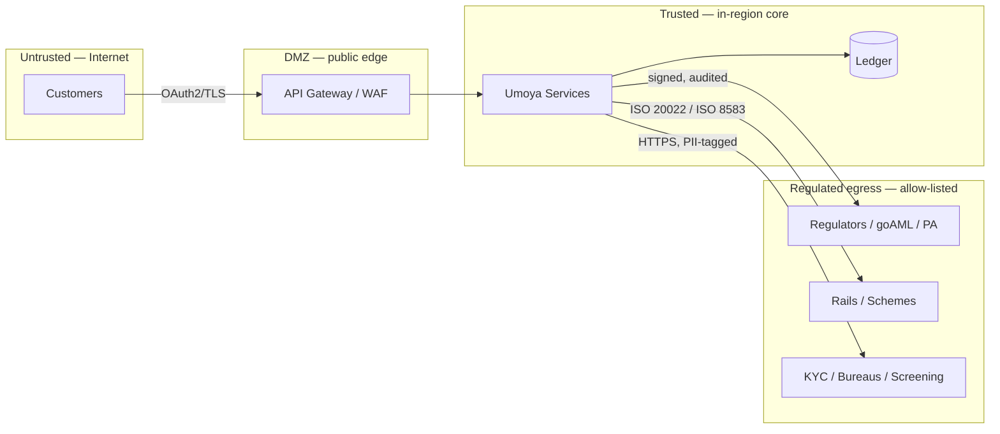

# C4 Level 1 — System Context

**Parent:** [system-design/README.md](./README.md) · **Status:** Proposed (v0.1) · **As-of:** 2026-10-16.
**Perspective:** the bank **"Umoya"** as a single black box, surrounded by the people and systems it interacts with.

> This is a **context** view: it deliberately hides internals. For the building blocks inside Umoya see the [container diagram](./container-diagram.md).
> All relationships are **DESIGN CHOICE** (how we intend to integrate). Regulators and rails are external systems — their existence and role is grounded in the [regulatory pack](../../research/regulatory/README.md); their *live interfaces* are **UNVERIFIED** until we contract with them.

---

## 1. Narrative

Umoya is a South African digital bank. Its context has four rings:

1. **Customers & staff** — who use the bank (retail/small-business customers, back-office operators, analysts).
2. **Regulators & statutory bodies** — who supervise it: SARB **Prudential Authority (PA)**, **FSCA**, **FIC**, **Information Regulator**, **NCR**, plus the **National Financial Ombud Scheme (NFO)** for complaints.
3. **Payment & market infrastructure** — **PASA/PSMB (transitioning to SARB)** governance, clearing/settlement (**PayInc, formerly BankservAfrica**), the **PayShap** rail, **card schemes (Visa/Mastercard)**, and a **sponsor bank** while we operate pre-licence.
4. **Data & service providers** — **KYC/identity** (Home Affairs/ABIS, liveness vendors), **sanctions/PEP** screening, **credit bureaus** (TransUnion/Experian/Compuscan), **bank account verification**, and partner ecosystems (open finance, wallets, merchants).

---

## 2. Mermaid — C4 Context (as a C4Context diagram)

```mermaid
C4Context
    title System Context — Umoya NeoBank (South Africa)

    Person(retail, "Retail Customer", "Opens accounts, pays, saves, borrows via app")
    Person(sme, "Small-Business Customer", "Account, collections, acquiring")
    Person(ops, "Bank Operator", "Back-office, servicing, manual review")
    Person(analyst, "Risk / Finance Analyst", "AML, credit, treasury, reporting")

    System(umoya, "Umoya NeoBank Platform", "Digital banking: accounts, payments, cards, credit, KYC, fraud, reporting")

    %% --- Regulators & statutory ---
    System_Ext(pa, "SARB Prudential Authority", "Bank licensing & prudential supervision")
    System_Ext(fsca, "FSCA", "Market-conduct regulator (FAIS)")
    System_Ext(fic, "FIC", "AML/CFT supervisor; goAML reporting")
    System_Ext(infreg, "Information Regulator", "POPIA/PAIA enforcement")
    System_Ext(ncr, "NCR", "Consumer-credit registration")
    System_Ext(nfo, "NFO", "National Financial Ombud Scheme")

    %% --- Payment / market infrastructure ---
    System_Ext(psmb, "PSMB / SARB NPS", "Payment-system rules (PASA→SARB transition)")
    System_Ext(payinc, "PayInc (ex-BankservAfrica)", "Clearing, EFT/AC, RTC")
    System_Ext(payshap, "PayShap Rail", "Low-value real-time retail payments (ISO 20022)")
    System_Ext(visa, "Visa", "Card scheme")
    System_Ext(mc, "Mastercard", "Card scheme")
    System_Ext(sponsor, "Sponsor Bank", "Clearing/settlement sponsor pre-licence")
    System_Ext(swift, "SWIFT / SADC-RTGS", "Cross-border high value")

    %% --- Data & services ---
    System_Ext(dha, "Home Affairs (DHA/ABIS)", "ID verification")
    System_Ext(kycv, "KYC / Liveness Vendor", "Document + biometric verification")
    System_Ext(screen, "Sanctions / PEP Screening", "TFS & PEP lists")
    System_Ext(bureau, "Credit Bureaus", "TransUnion / Experian / Compuscan")
    System_Ext(bav, "Bank Account Verification", "Account-holder name/number check")
    System_Ext(offshore, "Approved Cross-border Processor", "Only under POPIA s72 basis")

    Rel(retail, umoya, "Uses (mobile/web)", "HTTPS/TLS, OAuth2")
    Rel(sme, umoya, "Uses", "HTTPS/TLS")
    Rel(ops, umoya, "Operates back-office", "HTTPS/TLS, SSO+MFA")
    Rel(analyst, umoya, "Analyses/reports", "HTTPS/TLS, SSO+MFA")

    Rel(umoya, pa, "Supervisory returns & notifications", "Secure file/API (UNVERIFIED)")
    Rel(umoya, fsca, "Conduct reporting", "Secure file (UNVERIFIED)")
    Rel(umoya, fic, "goAML: CTR/STR/TPR", "System-to-system (UNVERIFIED)")
    Rel(umoya, infreg, "Breach + PAIA reporting", "Portal (UNVERIFIED)")
    Rel(umoya, ncr, "Credit reporting", "Manual/file")
    Rel(umoya, nfo, "Complaint referrals", "Secure channel")

    Rel(umoya, psmb, "Observes rulebook", "Rulebook-governed")
    Rel(umoya, payinc, "Clears EFT/AC, RTC", "ISO 20022")
    Rel(umoya, payshap, "Sends/receives RPP", "ISO 20022")
    Rel(umoya, visa, "Authorisation & settlement", "ISO 8583 / APIs")
    Rel(umoya, mc, "Authorisation & settlement", "ISO 8583 / APIs")
    Rel(umoya, sponsor, "Pre-licence clearing/settlement", "Bilateral (UNVERIFIED)")
    Rel(umoya, swift, "Cross-border", "MT/ISO 20022")

    Rel(umoya, dha, "ID verification", "ABIS-style (UNVERIFIED)")
    Rel(umoya, kycv, "Document + liveness", "HTTPS/API (UNVERIFIED)")
    Rel(umoya, screen, "Screen customers/transactions", "HTTPS/API (UNVERIFIED)")
    Rel(umoya, bureau, "Credit & affordability data", "HTTPS/API (UNVERIFIED)")
    Rel(umoya, bav, "Verify bank account", "HTTPS/API (UNVERIFIED)")
    Rel(umoya, offshore, "Exception processing", "Only with s72 basis")

    UpdateLayoutConfig($c4ShapeInRow="4", $c4BoundaryInRow="2")
```

---

## 3. Actor and system catalogue

### 3.1 People / roles *(DESIGN CHOICE — internal role model)*

| Actor | Description | Primary interaction |
|---|---|---|
| Retail Customer | Natural-person customer. | Mobile app, web, support. |
| Small-Business Customer | Legal-person customer (sole prop/company). | App, web, bulk payments, acquiring. |
| Bank Operator | Servicing & manual-review staff (KYC, disputes, payments ops). | Back-office console. |
| Risk / Finance Analyst | AML, credit, treasury, regulatory reporting. | Analytics + reporting tools. |
| Auditor / Regulator reviewer | Read-only evidence access under control. | Evidence exports, audit logs. |

> Machine partners (merchant systems, valuation agents, other banks' systems) are modelled as **external systems**, not people.

### 3.2 Regulators & statutory bodies (grounded in [regulatory pack](../../research/regulatory/README.md))

| System | Role | What we owe it | Source |
|---|---|---|---|
| **SARB Prudential Authority (PA)** | Prudential supervisor; grants bank licence. | Authorisation/registration, BA returns (BA 100/200–210/700), capital/liquidity, notifications. | [banking-licensing](../../research/regulatory/banking-licensing.md), [tax-governance](../../research/regulatory/tax-governance.md) §8 |
| **FSCA** | Market-conduct regulator (Twin Peaks). | FSP licensing where advice/intermediary applies; conduct reporting; concurrence on banking licence. | [conduct-fais-nca](../../research/regulatory/conduct-fais-nca.md) |
| **FIC** | AML/CFT/CPF supervisor. | Accountable-institution registration (goAML), RMCP, CDD/EDD, CTR/STR/TPR. | [aml-fica](../../research/regulatory/aml-fica.md) |
| **Information Regulator** | POPIA/PAIA enforcement. | Information Officer registration, breach notification, PAIA manual/annual report, prior authorisation where triggered. | [privacy-popia](../../research/regulatory/privacy-popia.md) |
| **NCR** | Consumer-credit regulator. | Credit-provider registration; affordability assessments. | [conduct-fais-nca](../../research/regulatory/conduct-fais-nca.md) §3 |
| **NFO** | Ombud (complaints). | Fair complaint handling; binding determinations. | [conduct-fais-nca](../../research/regulatory/conduct-fais-nca.md) §6 |
| **SARS** | Tax authority. | Income tax/VAT, FATCA/CRS/CARF AEOI. | [tax-governance](../../research/regulatory/tax-governance.md) |

### 3.3 Payment & market infrastructure

| System | Role | Our relationship *(DESIGN CHOICE)* |
|---|---|---|
| **PSMB / SARB NPS** | Sets clearing/settlement rules. PASA derecognition transitions functions to SARB (key milestone **11 Aug 2026** — [payments-nps](../../research/regulatory/payments-nps.md) §1). | We consume the applicable rulebook via our sponsor/clearing participant; adapters are rulebook-isolated. |
| **PayInc (ex-BankservAfrica)** | Clearing: EFT/Authenticated Collections, RTC. | Clearing counterparty via sponsor or direct membership. |
| **PayShap** | Low-value real-time retail rail (ISO 20022, ShapID aliases). | Target rail for instant P2P/retail; requires participant access. |
| **Visa / Mastercard** | Card schemes. | Issuing (and later acquiring) membership; typically via sponsor/BIN sponsor pre-licence. |
| **Sponsor Bank** | Provides clearing/settlement & scheme access before our own licence. | Bilateral contract; the pivot away from it must be a configuration change, not a rewrite. |
| **SWIFT / SADC-RTGS** | Cross-border high-value. | Via correspondent/sponsor; later direct where relevant. |

### 3.4 Data & service providers

| System | Purpose | Notes |
|---|---|---|
| **Home Affairs (DHA/ABIS)** | Verify SA ID / identity. | Interface model is **UNVERIFIED** — verify access route (direct vs via an accredited provider) before design lock. Cost changes (e.g. ID-verification fee) are a known pain point in-market ([digital-banks](../../research/neobank-competitors/digital-banks.md)). |
| **KYC / liveness vendor** | Document capture, liveness, biometric match. | Biometrics = special personal information under POPIA ([privacy-popia](../../research/regulatory/privacy-popia.md) §5). |
| **Sanctions / PEP screening** | TFS (FIC ss26A–26C) & PEP screening at onboarding and continuously. | [aml-fica](../../research/regulatory/aml-fica.md) §4. |
| **Credit bureaus** | Credit data & affordability. | TransUnion / Experian / Compuscan named in [kyc-and-identity](../integrations/kyc-and-identity.md). |
| **Bank account verification** | Confirm external account ownership. | For payouts/collections validity. |
| **Approved cross-border processor** | Exception handling. | Allowed only under a POPIA §72 basis ([privacy-popia](../../research/regulatory/privacy-popia.md) §6). |

---

## 4. Trust & data-flow boundaries

- **East-west within the core** uses mTLS + workload identity. *(DESIGN CHOICE)*
- **Egress** to regulators/rails/data providers is **allow-listed and tagged by data class**; unclassified egress is denied by default (residency control). *(DESIGN CHOICE)*
- **Cross-border** traffic is an explicit, logged exception with a §72 basis reference. *(DESIGN CHOICE)*

---

## 5. Key context-level interactions (sequences worth noting)

1. **Onboarding** → app → API GW → Identity → KYC (DHA/ABIS + liveness) → Screening (sanctions/PEP) → Core (create Customer/Account) → FIC goAML registration (institution-level, not per-customer). *(DESIGN CHOICE)*
2. **PayShap payment** → app → Payments service → rail adapter (ISO 20022) → sponsor/clearing → settlement → ledger posting → event `PaymentSettled`. *(DESIGN CHOICE)*
3. **Card transaction** → scheme → authorisation service → fraud check → hold → clearing/settlement file → ledger posting. *(DESIGN CHOICE)*
4. **AML alert** → monitoring → `AmlAlertRaised` → case management → STR to FIC within the statutory window ([aml-fica](../../research/regulatory/aml-fica.md) §3.4). *(DESIGN CHOICE)*
5. **Breach** → detection → POPIA breach notification to Information Regulator + data subjects. ([privacy-popia](../../research/regulatory/privacy-popia.md) §7)

---

## 6. Open questions at the context level *(UNVERIFIED)*

1. **Sponsor relationships** — which licensed bank(s) will provide pre-licence clearing/settlement and BIN sponsorship, and on what interface model. **UNVERIFIED.**
2. **DHA/ABIS access model** — direct agency access vs accredited third party; fee schedule. **UNVERIFIED.**
3. **FIC goAML** interface specifics (batch vs system-to-system). **UNVERIFIED** ([aml-fica](../../research/regulatory/aml-fica.md) §3.4).
4. **PA/FSCA digital submission channels** for returns and notifications. **UNVERIFIED.**
5. **Card scheme membership route** pre-licence (BIN sponsor vs principal). **UNVERIFIED.**
6. **PayShap non-bank participation** rules — still draft ([payments-nps](../../research/regulatory/payments-nps.md) §3). **UNVERIFIED.**

These are tracked as items to resolve before design lock; see the [third-party catalogue](../integrations/third-party-catalogue.md) for owner/status.

---

## 7. Related diagrams

- [container-diagram.md](./container-diagram.md) — zoom into the Umoya box.
- [bounded-contexts.md](./bounded-contexts.md) — the domain decomposition behind the containers.
- [integrations/README.md](../integrations/README.md) — for the ACL strategy across every external edge above.
