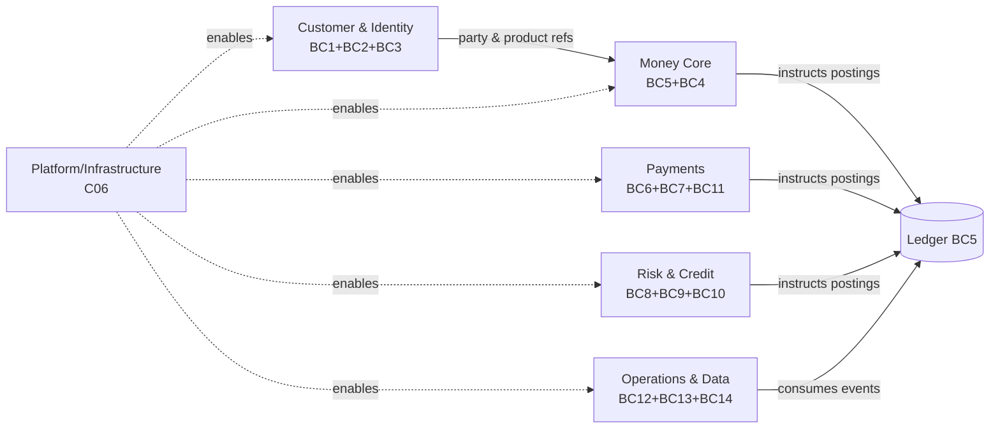

# Team Topology (C11)

**Owner:** C11 Dev-Engineering Captain · **Status:** Proposed (v0.1) · **As-of:** 2026-10-16.

This file maps C11's delivery organisation onto the **bounded contexts** in [`../../architecture/system-design/bounded-contexts.md`](../../architecture/system-design/bounded-contexts.md). It is the deliberate application of **Conway's Law**: we shape teams to match the seams we want in the system, because *the architecture will mirror the communication structure whether we plan it or not*.

Everything here is a **DESIGN CHOICE** (team topology, team size), not a regulatory requirement.

---

## 1. Why topology matters for a bank

The classic failure mode in fast-moving fintechs is the **distributed monolith**: many small teams, one coupled codebase, every release requiring cross-team coordination. A bank adds a hard constraint — a **ledger** that no two teams may write to inconsistently. So:

- **One writer per context.** Money is written by the ledger; every other context *instructs* it ([`ledger-model.md`](../../architecture/domain-model/ledger-model.md) §4.3).
- **Team boundary = context boundary.** If a change forces two teams to release together every sprint, the boundary is wrong ([`bounded-contexts.md`](../../architecture/system-design/bounded-contexts.md) §8).
- **Contracts over coordination.** Cross-team work happens through a published API or event, never a shared database.

---

## 2. Stream-aligned teams mapped to bounded contexts

The mapping follows `bounded-contexts.md` §8 exactly. Each team owns the contexts it builds and the internal code that sits inside them.

| Team (stream-aligned) | Bounded contexts owned | Primary C11 agent(s) | Core deliverable |
|---|---|---|---|
| **Money Core** | BC5 Ledger, BC4 Product & Agreement | AGT-backend-engineer, AGT-tech-lead | Posting rules engine, balances, product/agreement service |
| **Payments** | BC6 Payments, BC7 Cards, BC11 Notification | AGT-payments-engineer, AGT-integration-engineer | Rail adapters, payment lifecycle, card auth/clearing |
| **Customer & Identity** | BC2 Customer & Party, BC3 Onboarding & KYC, BC1 Identity & Access | AGT-integration-engineer, AGT-backend-engineer, AGT-mobile-engineer | Onboarding, KYC orchestration, auth/consent |
| **Risk & Credit** | BC8 Credit & Lending, BC9 Fraud & Risk, BC10 AML / Financial Crime | AGT-backend-engineer, AGT-data-engineer | Credit origination/servicing, fraud scoring, AML cases |
| **Operations & Data** | BC12 Back-Office, BC13 Regulatory Reporting & Finance, BC14 Data & Analytics | AGT-data-engineer, AGT-backend-engineer | Casework, reporting pipelines, analytics datasets |
| **Platform/Infrastructure** *(not a C11 team)* | infra, environments, CI/CD | — owned by **C06** | Golden paths, IDP, runtime ([`../c06-engineering-infrastructure/README.md`](../c06-engineering-infrastructure/README.md)) |

> **Important.** The "Platform/Infrastructure" cluster is **owned by C06**, not C11. C11 *consumes* the platform; C11 does not run it. This is the primary C06↔C11 boundary.

---

## 3. Team types & interaction modes

We use the four **Team Topologies** team types and three interaction modes, adapted to C11.

| Team | Type | Why |
|---|---|---|
| Money Core | **Stream-aligned** | Owns a value stream end-to-end; the highest-risk context. |
| Payments | **Stream-aligned** | Owns rail integration and payment lifecycle. |
| Customer & Identity | **Stream-aligned** | Owns the customer journey from onboarding to session. |
| Risk & Credit | **Stream-aligned** | Owns decisions on money-in/out (credit, fraud, AML). |
| Operations & Data | **Stream-aligned** | Owns servicing workflows and reporting outputs. |
| C06 Platform | **Platform** | Provides the IDP and golden paths as a product. |
| C12 Security | **Enabling / assurance** | Reviews, threat-models and gate-breaks across all teams. |
| Ledger specialists | **Complicated-subsystem** | The posting-rules engine is deep enough to warrant a focused group within Money Core. |

| Interaction mode | Used between | Example |
|---|---|---|
| **Collaboration** | New seams (design-led) | Money Core ↔ Payments defining the posting contract. |
| **X-as-a-service** | Stable seams | All teams consume C06's platform as a service. |
| **Facilitating** | Assurance | C12 facilitates threat-model workshops into a stream team. |

---

## 4. Conway's Law in practice

- **Split rule.** A context splits when a distinct sub-language emerges (e.g. cards' `Authorisation` becomes different enough from `Payment`). A team follows the split.
- **Merge rule.** Contexts rarely merge; if two teams always release together, we first reconsider the *contract*, not merge the teams.
- **Shared kernel ownership.** The `Money` value object ([`bounded-contexts.md`](../../architecture/system-design/bounded-contexts.md) §7) changes require sign-off from **Money Core** *and* **Platform** — a deliberate friction to prevent accidental coupling.
- **ACL ownership.** Each external adapter (PayShap, sponsor, KYC, bureau) is owned by the stream team that consumes it, not by a central "integrations" team.

---

## 5. Sizing & staffing notes

> ⚠️ **Proposed roster — not staffed.** Figures below are `[ASSUMPTION]`.

| Parameter | `[ASSUMPTION]` |
|---|---|
| Team size (two-pizza) | 5–8 people per stream-aligned team |
| Ownership | Each context has exactly one owning team |
| On-call | Each team owns on-call for its services ([`../c06-engineering-infrastructure/devops-and-sre.md`](../c06-engineering-infrastructure/devops-and-sre.md) §5) |
| C11 agent roster | Per [`CHARTER.md`](./CHARTER.md) §4 (AGT-tech-lead, backend, payments, integration, mobile, test, data) |

---

## 6. Open items / unknowns

- `[ASSUMPTION]` The six-cluster mapping stands unless `bounded-contexts.md` evolves.
- `[UNKNOWN]` Final headcount and the agent-to-human ratio are unset (see PLAN.md).
- `[UNKNOWN]` Whether a dedicated "Card" team is needed at launch, or cards stay inside Payments.

_Codename `Project Umoya` is a working label only._
