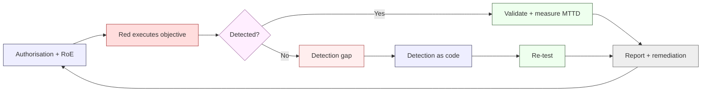

# Red Team & Assurance (C12)

**Owner:** C12 Cybersecurity-Intelligence Captain · **Status:** Proposed (v0.1) · **As-of:** 2026-10-16.

Authorised, adversarial testing of the bank's controls and the independent assurance that those controls actually work. This is where C12 tries to **break its own bank** — with money movement as the objective — under strict rules of engagement and legal authorisation.

Everything here is a **DESIGN CHOICE** unless marked `[STATUTE]`/`[REG]`.

---

## 1. Purpose

Preventive controls and blue-team detections are only as good as their **tested** performance. Red teaming answers a different question than a pen-test:

| Discipline | Question | Nature |
|---|---|---|
| Vulnerability scan | "Are there known weaknesses?" | Automated |
| Penetration test | "Can a tester exploit this scope?" | Scoped, time-boxed |
| **Red team** | "Can an adversary achieve a real objective end-to-end, evading detection?" | Objective-based, covert |
| **Purple team** | "Does our detection actually catch that technique?" | Collaborative, validating |
| **Assurance review** | "Is the control designed, implemented and operating as claimed?" | Independent, evidence-based |

---

## 2. Authorisation & legal basis

> **Non-negotiable.** No adversarial activity occurs without **written authorisation**. Unauthorised testing is itself a security incident.

| Requirement | Detail |
|---|---|
| **Written authorisation** | Signed by C12 Captain + CTO + (for anything touching money/data) Sparkling Curious |
| **Rules of engagement (RoE)** | Scope, timing, excluded systems, escalation, stop conditions — agreed before start |
| **Legal review** | C01 confirms the testing is lawful and contractually permitted (including on vendor/cloud assets) |
| **Data handling** | Any real customer/PII encountered is handled under POPIA; **no PII exfiltration**, minimal copies, secure destruction |
| **Third-party systems** | Cloud providers, rails and partners have their own testing policies — respect them; obtain permission where required |
| **Insurance/notification** | Pre-notify where needed; coordinate so testing is not mistaken for a real attack |

Reference: [`../../architecture/security/README.md`](../../architecture/security/README.md) §3 (P8 traceable accountability), and the breach-notification duties in [`../../architecture/security/incident-response.md`](../../architecture/security/incident-response.md) §6.

---

## 3. Rules of engagement (template)

| Field | Example |
|---|---|
| **Objective** | e.g. "Move funds out of a customer account without alerting the SOC" |
| **In scope** | Named apps/APIs/systems/environments |
| **Out of scope** | Production money movement beyond an agreed ceiling; live customer accounts; specific vendors |
| **Environments** | Staging first; production only with explicit approval and controls |
| **Timing** | Windows agreed with SOC to allow controlled observation |
| **Deconfliction** | A named "white cell" on both sides; a codeword to stop instantly |
| **Stop conditions** | Data corruption risk, real customer impact, regulatory risk → halt |
| **Detection** | Purple-team mode: SOC may or may not be told (stated in RoE) |
| **Reporting** | Findings, ATT&CK mapping, detection gaps, remediation owners |
| **Evidence** | Logs/screenshots retained securely; no PII retained |

**Guardrails:** bound to a value ceiling; reversible actions preferred; dual-control on anything irreversible; bank environments isolated where feasible.

---

## 4. Red-team objectives (bank-weighted)

Scenarios are chosen for **real-world impact**, mirroring SA fraud typologies ([`../../c12-cybersecurity-intel/README.md`](./README.md) §7):

| Scenario | Objective | Threat class |
|---|---|---|
| Account takeover → payment | Move money via ATO/APP | External fraud |
| Insider privilege abuse | Post/adjust ledger entries | Insider |
| Mule network | Process suspect funds | Financial crime |
| API abuse (BOLA/BFLA) | Access another customer's data/funds | App security |
| Supply-chain compromise | Inject into build → prod | Supply chain |
| Ransomware / availability | Disrupt payments/ledger | Ransomware |
| Cloud control-plane abuse | Escalate to data/settlement | Infrastructure |
| Sanctions evasion | Push a payout past screening | AML/CTF |

Objectives map to MITRE ATT&CK so results feed detection coverage ([`soc-and-monitoring.md`](./soc-and-monitoring.md) §4).

---

## 5. Purple-team & detection validation

Red-team findings are only useful if they **improve detections**.

| Practice | Detail |
|---|---|
| **Purple-team exercises** | Red executes a technique; blue confirms whether/how it was detected; gaps → new detections |
| **Detection validation** | Each priority detection is tested against a simulated technique |
| **Coverage heat-map** | ATT&CK technique coverage tracked over time |
| **Feedback loop** | Gap → detection rule (as-code) → re-test |
| **Cadence** | At least annual red-team + periodic purple-team `[TARGET]` |

---

## 6. Independent assurance

Beyond adversarial testing, C12 provides **assurance** that controls are designed, implemented and operating:

| Assurance activity | What it verifies | Cadence |
|---|---|---|
| **Control effectiveness review** | Controls in [`controls-catalog.md`](../../architecture/security/controls-catalog.md) are operating, not just documented | Periodic |
| **Gate integrity review** | G-SEC/G-DEP were genuinely enforced (not bypassed) | Per release sampling |
| **Access review** | Least privilege (P3); no stale/standing privileges | Quarterly `[TARGET]` |
| **Key/secret review** | Rotation, custody, HSM use ([`../../architecture/security/cryptography-and-key-management.md`](../../architecture/security/cryptography-and-key-management.md)) | Periodic |
| **DR/BCP test** | Resilience (P10) supports recovery targets | Annual |
| **Vendor assurance** | Third-party security posture ([`../../architecture/integrations/third-party-catalogue.md`](../../architecture/integrations/third-party-catalogue.md) §9) | Per onboarding + annual |
| **Regulatory readiness** | POPIA/FICA/PA evidence is complete | Per obligation |

Assurance findings feed the [risk register](../../program/risk/risk-register.md) and, where material, the board through the C12 Captain.

---

## 7. Reporting & remediation

| Output | Audience | Timing |
|---|---|---|
| Exercise report (objective, findings, ATT&CK, detection gaps) | C12, CTO | ≤ 10 days post-exercise |
| Critical findings | SC + Board (if material) | Immediately |
| Remediation plan (owner + due date) | Owning council | With report |
| Detection updates | SOC | As gaps close |
| Risk-register updates | C12 (owner) | On discovery |
| Regulatory disclosure | Only if warranted (C01) | Per §2 / incident rules |

**Rule:** critical findings **block** release or require a documented, time-boxed exception ([`vulnerability-management.md`](./vulnerability-management.md) §4).

---

## 8. Metrics & verification

| Metric | Target | Weight |
|---|---|---|
| Pen-tests passed before money/data release | 100% | `[TARGET]` |
| Red-team criticals carried over | 0 | `[TARGET]` |
| Detection coverage (ATT&CK) | improving | `[TARGET]` |
| Mean time to detect (during exercises) | tracked, falling | `[TARGET]` |
| Assurance findings closed on time | 100% | `[TARGET]` |

---

## 9. Open items / unknowns

- `[UNKNOWN]` Whether red-team is in-house, external, or hybrid.
- `[ASSUMPTION]` Value ceilings for production money-movement exercises to be set with C10/C16.
- `[CONFIRM]` Cloud/rail partner testing policies and any notification requirements.
- `[UNKNOWN]` Regulatory expectation (if any) for sharing red-team results with the PA.
- `[CONFIRM]` PCI-DSS penetration-test requirements if cards are in scope (segmentation testing).

_Codename `Project Umoya` is a working label only._
