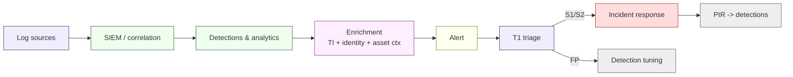

# SOC & Monitoring (C12)

**Owner:** C12 Cybersecurity-Intelligence Captain · **Status:** Proposed (v0.1) · **As-of:** 2026-10-16.

How C12 **detects** what it cannot prevent. This file defines the Security Operations Centre (SOC) model, detection engineering, SIEM/logging strategy and threat-intelligence consumption. It is the operational counterpart to the preventive controls in [`../../architecture/security/controls-catalog.md`](../../architecture/security/controls-catalog.md).

Everything here is a **DESIGN CHOICE** unless marked `[STATUTE]`/`[REG]`.

---

## 1. Why monitoring is not optional for a bank

A bank is a **high-value target**: money is the objective and customer data is the payload. You cannot rely on prevention alone (P2 defence-in-depth, P6 assume-breach — [`../../architecture/security/README.md`](../../architecture/security/README.md) §3). Detection and response must be **rehearsed and measured**, because POPIA and FICA impose notification duties that start ticking at *discovery* ([`../../architecture/security/incident-response.md`](../../architecture/security/incident-response.md) §6).

---

## 2. SOC model

> ⚠️ **Proposed — not staffed.** Model choice and tooling are `[UNKNOWN]`.

We design toward a **follow-the-sun-capable, tiered SOC**, delivered either in-house or via a managed security service (MSSP) with in-house escalation ownership.

| Tier | Function | Ownership |
|---|---|---|
| **T1 — Triage** | Alert monitoring, first-pass classification, ticket creation | SOC analysts (or MSSP) |
| **T2 — Investigation** | Deep analysis, correlation, containment recommendation | C12 analysts |
| **T3 — Threat hunting / IR** | Hypothesis-driven hunting, forensics, incident command support | C12 senior + incident responders |

**Automation posture:** SOAR-style enrichment and playbook automation for high-volume, low-ambiguity alerts; **human decision** retained for money-movement and regulatory-notification calls (fail-safe, P9).

**Coverage:** 24/7 monitoring for **S1/S2-capable** detections; business-hours for lower tiers (model `[TARGET]`).

---

## 3. Logging & SIEM

| Element | Design |
|---|---|
| **Central SIEM** | Aggregates security + fraud + AML signals; correlation across domains |
| **Sources** | Auth/IAM events, API gateway, WAF, EDR, cloud control-plane (CloudTrail-equivalent), network flow, ledger/payment events, admin actions, DLP |
| **Log integrity** | Append-only / immutable store; hash-chained where money/data-relevant |
| **Retention** | Security logs retained per policy; **FICA-relevant records ≥ 5 years** `[CONFIRM]` ([`../../research/regulatory/aml-fica.md`](../../research/regulatory/aml-fica.md) §8) |
| **Data residency** | Logs stay in the SA region where they contain SA personal data (D-002) |
| **Clock** | All sources time-synced to SAST for forensics |
| **PII discipline** | No live PII in tickets/artefacts (G2); log fields minimised |

**Detection pipeline:**

---

## 4. Detection engineering

Detection is a **product with an owner**, not a pile of rules.

| Practice | Detail |
|---|---|
| **Detection-as-code** | Rules version-controlled, peer-reviewed, tested like software |
| **Coverage mapping** | Detections mapped to **MITRE ATT&CK** techniques and to the threat model ([`../../architecture/security/threat-model-stride.md`](../../architecture/security/threat-model-stride.md)) |
| **Priority detections (bank-specific)** | Ledger/integrity tampering, privileged-account abuse, mass/abnormal payments, ATO/APP fraud, SIM-swap, mule/velocity abuse, sanctioned-party payout, API credential abuse (BOLA/BFLA), data exfiltration |
| **Quality metrics** | True-positive rate, detection latency, alert-to-triage time, false-positive rate |
| **Tuning loop** | Post-incident reviews and false positives feed rule changes |
| **Deception** | Honeytokens/canaries on money and admin surfaces (P6) |

**Detection latency target:** latency-sensitive detections (money movement, privileged actions) aim for **near-real-time** `[TARGET]`; batch/low-risk detections may run on minutes-to-hours cycles.

---

## 5. Threat intelligence

| Element | Design |
|---|---|
| **Sources** | Commercial TI feeds, ISACs, CERT-SA advisories, vendor advisories, internal incident learnings |
| **Tiers** | Strategic (trend/board), operational (campaign/actor), tactical (IOC/TTP) |
| **Consumption** | IOCs → detections; TTPs → threat model updates; advisories → vulnerability prioritisation (§ [`vulnerability-management.md`](./vulnerability-management.md)) |
| **SA-specific** | Local fraud typologies (BEC, APP, SIM-swap), SA banking-sector targeting, load-shedding-related outage/crime patterns |
| **Sharing** | Responsible sharing with partners/regulators; protect customer data |

Threat intel is a **two-way loop**: it informs detections *and* is itself corrected by what incidents reveal.

---

## 6. Integration with fraud & AML monitoring

C12's SOC is the **technical home** for signals that C01/C16 own in policy terms:

| Signal domain | Policy owner | SOC/SIEM role |
|---|---|---|
| Transaction monitoring (AML) | C01 (MLCO) | Ingest alerts; ensure pipeline integrity |
| Fraud scoring | C16 + C12 | Ingest fraud-engine alerts; correlate with security events |
| Sanctions/TFS hits | C01 | Ensure alerting and audit trail |
| Chargebacks/disputes | C16/C02 | Correlate abuse patterns |

See [`../../architecture/security/aml-transaction-monitoring.md`](../../architecture/security/aml-transaction-monitoring.md) and [`../../architecture/security/fraud-risk-engine.md`](../../architecture/security/fraud-risk-engine.md).

---

## 7. Metrics & verification

| Metric | Target | Weight |
|---|---|---|
| Mean time to detect (MTTD) — critical classes | `[TARGET]` low | `[TARGET]` |
| Mean time to triage | `[TARGET]` per SLA | `[TARGET]` |
| Alert-to-incident escalation accuracy | rising | `[TARGET]` |
| Detection coverage (ATT&CK technique-based) | tracked, improving | `[TARGET]` |
| Critical alert missed rate | 0 | `[TARGET]` |

| Verification | Cadence | Evidence |
|---|---|---|
| Detection rule tests | Continuous (CI) | Test results |
| Purple-team validation | Per [`red-team-and-assurance.md`](./red-team-and-assurance.md) | Exercise report |
| Log-source coverage review | Quarterly | SIEM source inventory |
| Break-glass drill | Semi-annual | Drill log |

---

## 8. Open items / unknowns

- `[UNKNOWN]` SIEM/SOAR product selection and whether the SOC is in-house or MSSP.
- `[UNKNOWN]` Full log-source inventory and retention configuration.
- `[CONFIRM]` FICA record-retention period (commonly ≥ 5 years) ([`../../research/regulatory/aml-fica.md`](../../research/regulatory/aml-fica.md) §8).
- `[UNKNOWN]` Whether SARB mandates a cyber-specific incident-report format for banks ([`../../architecture/security/incident-response.md`](../../architecture/security/incident-response.md) §10).

_Codename `Project Umoya` is a working label only._
