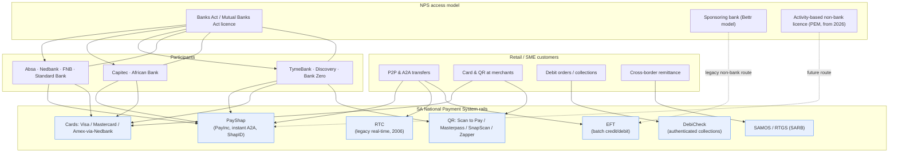

# A2 — Payments Rails Map (SA)

> Add-on artifact to the NeoBank programme. **Public information only.** Tags: `[OBS]` observed,
> `[DER]` derived, `[INF]` inference, `[EST]` estimate, `[UNK]` unknown.
> Per-bank rail evidence is drawn from the bank `banking/90-banking-rails.md` files under
> `research/banks/` and `research/neobanks-sa/`; national rail facts from `cross-cutting/regulation/30-PAYMENTS-RAILS.md`.

## 1. The national rail set

`[OBS]` The SARB's **Digital Payments Roadmap** recognises the retail methods in use: **cards** (debit/credit/fleet),
**EFT** (credit and debit), **authenticated collections (DebiCheck)**, **real-time clearing (RTC)**,
**PayShap** (faster payments) and **ATMs**
([SARB — Digital Payments Roadmap, PDF](https://www.resbank.co.za/content/dam/sarb/what-we-do/payments-and-settlements/regulation-oversight-and-supervision/Digital%20Payments%20Roadmap.pdf)).

| Rail | What it is | Operator / PSO | Live since |
|---|---|---|---|
| **PayShap** | Instant low-value A2A, proxy "ShapID", 24/7/365, sub-10-second | PayInc (ex-BankservAfrica) | **13 Mar 2023** `[OBS]` |
| **RTC** | First SA real-time interbank rail (now displaced by PayShap) | BankservAfrica | **2006** `[OBS]` |
| **EFT** | Batch credit/debit clearing | BankservAfrica / PayInc | legacy `[OBS]` |
| **DebiCheck** | Authenticated debit-order mandate management | BankservAfrica | **2018** `[OBS]` |
| **Cards** | Visa / Mastercard four-party; Amex via Nedbank licence | Visa, Mastercard (PSOs) | legacy `[OBS]` |
| **QR** | Scan to Pay / Masterpass / SnapScan / Zapper | BankservAfrica, Mastercard | — `[OBS]` |
| **SAMOS / RTGS** | High-value real-time gross settlement | SARB | **1998** `[OBS]` |

`[OBS]` There are **four authorised PSOs: BankservAfrica, Strate, Visa and Mastercard**
([PASA — Glossary](https://pasa.org.za/about-payments/pasa-glossary/)).

## 2. Bank × rail participation matrix

Legend: **✓** = evidenced participation/live; **p** = participant (inferred from licensed-bank status); **—** = not evidenced; **?** = `[UNK]`.

| Bank | PayShap | RTC / immediate | EFT | DebiCheck | Card (issuer) | Card scheme | QR | Proprietary rail | Source |
|---|---|---|---|---|---|---|---|---|---|
| **Absa** | ✓ (first cohort) | p `[INF]` | ✓ | p `[INF]` | ✓ | Visa/MC (largest Africa acquirer) | ✓ | CashSend | [Absa rails](https://cib.absa.africa/wp-content/uploads/2019/10/ABSA-CIB-Instant-Payments-an-African-Market-Snapshot.pdf) |
| **Nedbank** | ✓ (first cohort) | p `[INF]` | ✓ | p `[INF]` | ✓ | Visa/MC **+ Amex exclusive** | ✓ | — | [Nedbank rails](https://paymentbrief.com/markets/south-africa/) |
| **FNB** | ✓ (first cohort) | p `[INF]` | ✓ | p `[INF]` | ✓ | Visa/MC | ✓ (Scan to Pay) | eWallet, PayShap Request | [FNB rails](https://paymentbrief.com/markets/south-africa/) |
| **Standard Bank** | ✓ (first cohort + sponsoring bank) | p `[INF]` | ✓ | p `[INF]` | ✓ | Visa/MC | ✓ | Instant Money, OneHub | [Standard Bank rails](https://developer.eftcorp.com/docs/payshap-use-cases) |
| **Capitec** | ✓ | ✓ (R6) | ✓ (R2) | ✓ (R3) | ✓ (Visa) | Visa | ✓ (Scan to Pay) | **Capitec Pay** (open-banking A2A) | [Capitec rails](https://www.capitecbank.co.za/personal/transact/payshap) |
| **African Bank** | ✓ + PayShap Request | ✓ | p `[INF]` | p `[INF]` | ✓ (Visa) | Visa | `[UNK]` | Alliance Banking BaaS | [African Bank rails](https://www.africanbank.co.za/en/home/payshap/) |
| **TymeBank / GoTyme** | ✓ | ✓ | ✓ | p `[INF]` | ✓ | **Mastercard** (BPC SmartVista) | `[UNK]` | Kiosk + TymeCode | [TymeBank rails](https://prifinance.com/en/payments/south-africa-payment-license/) |
| **Discovery Bank** | ✓ | ✓ | ✓ | p `[INF]` | ✓ | Visa/MC | `[UNK]` | Discovery Pay, Smart Vault | [Discovery rails](https://www.discovery.co.za/bank/digital-banking) |
| **Bank Zero** | ✓ | ✓ | ✓ | ✓ (R0) | ✓ | **Mastercard** (Paymentology) | `[UNK]` | Alliance banking (Mukuru) | [Bank Zero rails](https://www.bankzero.co.za/rates-and-pricing/) |

`[OBS]` PayShap's **initial cohort (13 Mar 2023)** was **Absa, FNB, Standard Bank and Nedbank**; **Capitec,
TymeBank, Discovery Bank, Investec and Sasfin** are listed as SARB-roadmap participants
([SARB Digital Payments Roadmap (PDF)](https://www.resbank.co.za/content/dam/sarb/publications/media-releases/2024/npsd---payments-report/Digital%20Payments%20Roadmap%20Report.pdf)).

`[INF]` **DebiCheck/RTC/SAMOS** participation is inferred for all licensed banks because direct NPS access
requires a Banks Act / Mutual Banks Act licence; only Capitec, African Bank, Bank Zero and TymeBank
publish explicit per-item RTC/DebiCheck pricing (see A1).

## 3. Rail adoption — national scale

- `[OBS]` PayShap **>R100bn value across >136m transactions and >5m ShapIDs** (mid-2025 series); practical
  limit raised **August 2024**; **12+ participating banks**
  ([Stitch — state of PayShap 2026](https://stitch.money/blog/real-time-payments-in-south-africa-the-state-of-payshap-in-2026);
  [PaymentBrief](https://paymentbrief.com/markets/south-africa/)).
- `[OBS]` PayShap monthly volume reported at **~45m/month (late 2025), 80% under R500**; cumulative
  **>1bn transactions by June 2026** per one source (figures diverge — treat totals as `[EST]`).
- `[INF]` **PayShap is displacing RTC** for consumer P2P; RTC never achieved mass adoption
  ([PaymentBrief](https://paymentbrief.com/markets/south-africa/)).

## 4. Open banking & the SARB Vision 2025 / PEM regime

- `[OBS]` **Vision 2025** (2018) called for **non-bank NPS access**, **activity-based regulation** and a
  **level playing field** ([Polity — Payments Revolution 2026](https://www.polity.org.za/article/payments-revolution-what-every-psp-operating-in-south-africa-needs-to-know-right-now-2026-03-25)).
- `[OBS]` SARB is moving to a **PSD2-style activity-based authorisation framework** under **PEM**, with
  draft instruments in 2025 and **first non-bank payment-institution licences expected from 2026**.
- `[OBS]` In **Nov 2025 the SARB acquired 50% of PayInc**, establishing the **National Payments Utility**;
  the SARB is also withdrawing PASA's recognition as payments management body
  ([SARB Annual Report 2025/26 — Payments, PDF](https://www.resbank.co.za/content/dam/sarb/publications/reports/annual-reports/2026/chapters/policy-implementation/payments-25-26.pdf)).

## 5. Mermaid — SA payment rails & neobank entry paths

## 6. Strategic observations `[DER]` / `[INF]`

1. `[DER]` **PayShap is universal.** Every studied bank is a PayShap participant; it is now table-stakes,
   not a differentiator. The differentiator is **pricing** (Capitec free ≤R100; Bank Zero R0).
2. `[DER]` **Card scheme choice is a lever.** Nedbank's **Amex exclusivity** and TymeBank/Bank Zero's
   **Mastercard** issuance create structurally different interchange economics vs the Visa-heavy majors.
3. `[INF]` **Capitec Pay is the template** for a neobank: an open-banking A2A rail built on AWS
   (Electrum) that **bypasses card-scheme interchange** for e-commerce — lower merchant cost than card.
4. `[INF]` **Regulatory timing is favourable:** SARB's **activity-based authorisation (from 2026)** would
   let a neobank access PayShap/clearing **without a full banking licence**, materially lowering the
   entry cost that sank Bettr (see A6, A10).

## Sources

- [SARB — Digital Payments Roadmap (PDF)](https://www.resbank.co.za/content/dam/sarb/what-we-do/payments-and-settlements/regulation-oversight-and-supervision/Digital%20Payments%20Roadmap.pdf)
- [SARB — Digital Payments Roadmap Report (PDF)](https://www.resbank.co.za/content/dam/sarb/publications/media-releases/2024/npsd---payments-report/Digital%20Payments%20Roadmap%20Report.pdf)
- [SARB — PayShap launch press release (PDF)](https://www.resbank.co.za/content/dam/sarb/publications/media-releases/2023/payshap-/Press%20release%20on%20the%20launch%20of%20Payshap%20-%20a%20digital%20payment%20service.pdf)
- [SARB Annual Report 2025/26 — Payments (PDF)](https://www.resbank.co.za/content/dam/sarb/publications/reports/annual-reports/2026/chapters/policy-implementation/payments-25-26.pdf)
- [PASA — Glossary (PSOs)](https://pasa.org.za/about-payments/pasa-glossary/)
- [PaymentBrief — South Africa Payments](https://paymentbrief.com/markets/south-africa/)
- [Stitch — the state of PayShap in 2026](https://stitch.money/blog/real-time-payments-in-south-africa-the-state-of-payshap-in-2026)
- [Polity — Payments Revolution: what every PSP in SA needs to know](https://www.polity.org.za/article/payments-revolution-what-every-psp-operating-in-south-africa-needs-to-know-right-now-2026-03-25)
- [EFT Corp — PayShap use cases (Standard Bank sponsoring bank)](https://developer.eftcorp.com/docs/payshap-use-cases)
- [Capitec — PayShap](https://www.capitecbank.co.za/personal/transact/payshap)
- [African Bank — PayShap](https://www.africanbank.co.za/en/home/payshap/)
- [Bank Zero — rates & pricing](https://www.bankzero.co.za/rates-and-pricing/)
- [Discovery Bank — digital banking](https://www.discovery.co.za/bank/digital-banking)
- [Absa CIB — Instant Payments: an African market snapshot (PDF)](https://cib.absa.africa/wp-content/uploads/2019/10/ABSA-CIB-Instant-Payments-an-African-Market-Snapshot.pdf)
- [TymeBank — payment licensing (PRIFinance)](https://prifinance.com/en/payments/south-africa-payment-license/)
